# Architecture & Design: UDP-Based Zero Touch Provisioning (ZTP)

| Field | Value |
|---|---|
| Document | DESIGN.md (Architect persona) |
| Version | 1.0, as built (M7) |
| Date | 2026-11-12 (first draft 2026-11-10) |
| Status | Final for submission; describes the implementation as built. Sections written before the build that the build changed carry an *as built* note |
| Owner | Sunil Vallamkonda (Architect) |
| Implementation language | C11, POSIX sockets, no third-party libraries |
| Companion documents | [PRD_ZTP.md](PRD_ZTP.md) (requirements: *what* and *why*) · [QA_TEST_PLAN.md](QA_TEST_PLAN.md) (verification: *how it is proven*) |
| Source | `UDP‑Based Zero Touch Provisioning (ZTP) Assignment.pdf` (referred to below as "the PDF") |

> **Reading guide.** §1–§4 give the big picture. §5 is the normative wire specification. §6–§13 follow the device lifecycle in the same order as the PDF. §14 covers the server. §16–§18 cover simulation, observability and security. §21 drafts the README answers the PDF requires. Callouts mark places where reviewers are invited to push back:
>
> - **Design rationale**: why a choice was made over the alternatives.
> - **Reviewer note**: a known weak point, a deliberate deviation from an RFC, or an open choice.
>
> Requirement IDs (`ZTP-FR-*`, `ZTP-NFR-*`, `ZTP-BON-*`, `ZTP-DEL-*`) come from the PRD. Test IDs (`TC-*`) come from the QA plan. All constants are defined once, in [Appendix B](#appendix-b-constants-and-configuration-defaults).

---

## Table of contents
0. [Front matter: audience, conventions, glossary](#0-front-matter)
1. [Scope, goals, non-goals](#1-scope-goals-non-goals)
2. [Requirements traceability matrix](#2-requirements-traceability-matrix)
3. [Assumptions and ambiguity resolutions](#3-assumptions-and-ambiguity-resolutions)
4. [System architecture](#4-system-architecture)
5. [Wire protocol specification](#5-wire-protocol-specification)
6. [Boot and discovery](#6-boot-and-discovery)
7. [UDP session establishment](#7-udp-session-establishment-ztp-fr-04)
8. [Reliability layer](#8-reliability-layer)
9. [NAT awareness and keepalives](#9-nat-awareness-and-keepalives-ztp-fr-10-fr-11)
10. [Identity, authentication and registration](#10-identity-authentication-and-registration-ztp-fr-1214)
11. [Configuration and firmware provisioning](#11-configuration-and-firmware-provisioning-ztp-fr-1519)
12. [Version upgrade and restart](#12-version-upgrade-and-restart-ztp-fr-2123)
13. [Validation and operational state](#13-validation-and-operational-state-ztp-fr-2427)
14. [Server design](#14-server-design-ztp-fr-2832)
15. [Device state machine and persistence](#15-device-state-machine-and-persistence)
16. [Loss, reorder and duplicate simulation](#16-loss-reorder-and-duplicate-simulation-ztp-bon-06)
17. [Logging and observability](#17-logging-and-observability-ztp-fr-33-nfr-08)
18. [Security analysis](#18-security-analysis)
19. [Build, run and demo plan](#19-build-run-and-demo-plan-expected-submission-1-3)
20. [Test and verification strategy](#20-test-and-verification-strategy)
21. [README mapping and draft answers](#21-readme-mapping-and-draft-answers)
22. [Tradeoffs, limitations and future work](#22-tradeoffs-limitations-and-future-work)
23. [Resolved design decisions](#23-resolved-design-decisions)
24. [Project timeline, dependencies and assumptions (summary)](#24-project-timeline-dependencies-and-assumptions-summary)
25. [Configuration model](#25-configuration-model-ztp-fr-34-fr-35)
- [Appendix A: Annotated end-to-end log transcript](#appendix-a-annotated-end-to-end-log-transcript)
- [Appendix B: Constants and configuration defaults](#appendix-b-constants-and-configuration-defaults)
- [Appendix C: Reason/error codes](#appendix-c-reasonerror-codes)
- [Appendix D: Key C data structures](#appendix-d-key-c-data-structures)
- [Appendix E: References](#appendix-e-references)

---

## 0. Front matter

### 0.1 Audience
Senior architects, who judge the protocol and trust model; senior developers, who will implement against §5 and Appendix D; QA, who derive test cases from the behaviour described here.

### 0.2 Conventions
- **MUST, SHOULD and MAY** are used in the RFC 2119 sense, in §5 only (the normative wire spec).
- Multi-byte integers on the wire are **big-endian** (network byte order).
- "Frame" means one protocol message carried in exactly one UDP datagram. A frame is never split across datagrams and never fragmented at the IP layer.
- `‖` means byte concatenation. `HMAC(K, m)` means HMAC-SHA256 (RFC 2104). `trunc16(x)` means the first 16 bytes of x.
- Times are given as *production / demo* values where they differ (for example 20 s / 2 s).

### 0.3 Glossary
| Term | Meaning |
|---|---|
| ZTP | Zero Touch Provisioning: a device configures itself without human help |
| Soft serial | A software-generated device identifier, `ZTP-XXXXXX` |
| Session | The logical association between one device and the server, named by a 32-bit `session_id` |
| Epoch | A 16-bit counter that increases each time a session is re-keyed (on resume). Each epoch has its own sequence spaces |
| Frame classes | **Reliable** (consumes a seq number, is ACKed, retransmitted and ordered), **ack-class** (ACK and KEEPALIVE_ACK: carry seq but don't consume it, and are never ACKed), **datagram-class** (DISCOVER and OFFER: before a session exists, retried by the application) |
| RTO / SRTT / RTTVAR | Retransmission timeout, smoothed RTT and RTT variance (RFC 6298) |
| SACK | Selective ACK: a bitmap of frames received beyond the cumulative ACK |
| K_fleet, K_boot | Fleet-wide bootstrap secret, and the bootstrap key derived from it (discovery, handshake and authenticated rejections only; no identity) (§10.1) |
| K_mfg, K_dev, K_s | Per-model manufacturing secret, the per-device key derived from it and the serial, and the per-session key derived from K_dev and the nonces (§10.1) |
| Nd, Ns | Device nonce and server nonce (64-bit, from a CSPRNG) |
| Grace period | How long after idle or restart the server keeps a session that can still be resumed |
| Half-open session | A session after HELLO_ACK and before the first frame authenticated with K_s |
| PMTU | Path MTU: the largest IP packet that crosses the path without fragmentation |
| NAT binding / mapping | The NAT's temporary translation from (internal IP:port) to (external IP:port) |
| A/B slots | Two firmware images: the active one and a staging one. The switch between them is atomic |

---

## 1. Scope, goals, non-goals

### 1.1 Goals
1. A complete ZTP lifecycle (boot → discovery → session → registration → config → firmware → upgrade/restart → validation → OPERATIONAL) **using only UDP** (ZTP-FR-03).
2. An application-layer reliability protocol that is **correct under 10–20% loss, reordering and duplication** (ZTP-FR-09, BON-*).
3. A trust model that gives **authenticity, mutual authentication and replay protection** without certificates or a clock (ZTP-FR-13/14).
4. **Crash-consistent** provisioning: every step can be interrupted and resumed without duplicating state (ZTP-FR-19/23, NFR-10).
5. A **concurrent server** with a policy engine and an auditable DB (ZTP-FR-28..32).
6. A design simple enough to build in about 3.5 weeks (18 working days; PRD §11) and to review in one sitting.

### 1.2 Non-goals, and what production would do instead
| Non-goal | Rationale | Production equivalent |
|---|---|---|
| Encryption / confidentiality | The PDF's "secure UDP-based control channel" is specified in §5 as HMAC authenticity plus replay protection; encryption would double the crypto surface. The interpretation is stated explicitly in §18.1 | DTLS 1.3 (RFC 9147) or an AEAD layer; see §22.3 |
| PKI and certificates | The scenario says "no certificates" | IDevID (IEEE 802.1AR) and BRSKI (RFC 8995); SZTP (RFC 8572) |
| Real flash or bootloader | Mock firmware is acceptable | A/B partitions, verified boot |
| IPv6 | Keeps the scope down; the 1200 B budget is already IPv6-safe | Dual-stack sockets |
| Congestion control | Small, fixed window; control-plane traffic | AIMD or QUIC-style congestion control |
| Multi-instance or HA server | Single host is enough for the exercise | Sharding by `session_id`, shared DB |

### 1.3 How the design meets the PDF's "Overview" and "Scope & Expectations"
| PDF statement | How this design responds |
|---|---|
| "Build a simplified ZTP system using UDP as the transport protocol" | Every message is a UDP datagram on ports 5555 and 5556. No TCP, HTTP or other transport anywhere (ZTP-FR-03, TC-SESS-08, TC-PDF-05) |
| "This is not a REST or API exercise" | A binary, fixed-header protocol over raw `SOCK_DGRAM` sockets (§5). There are no HTTP, REST, JSON-RPC or web frameworks. JSON appears **only** as the configuration *payload* the PDF asks for (§11.1) |
| "Reason about networking fundamentals, reliability, security, and system behavior … real-world operational constraints" | Reliability (§8), NAT (§9), fragmentation (§5.5), security (§10, §18), crash consistency (§12.4, §15.3), operations (§14, §17). Each choice carries a "Design rationale" or "Reviewer note" |
| "Language: C or Python" | **C11**. Rationale: (1) C is what real device control planes are written in, so the exercise is realistic; (2) it gives explicit control of byte order, struct layout, socket options (DF bit, `SO_BROADCAST`, multicast loop) and memory bounds, all of which this assignment is about; (3) a static binary with no runtime dependencies suits a constrained device. Tradeoff: more code and memory-safety risk than Python, mitigated by fixed-offset parsing, ASan/UBSan, fuzzing and `-Werror` (§5.6, §19.1) |
| "Deliverables: working code and a README explaining your design choices" | Code: §4.2, §19. README: built from §21 (ZTP-DEL-05..08, DEL-12) |
| "Focus on correctness and networking fundamentals rather than UI or packaging" | There is no UI: a CLI, tagged logs and a text DB dump only. Packaging is a Makefile only. Effort goes into the protocol, testing and documentation |
| "There is no single correct solution … reasoning and tradeoffs more than feature completeness" | §3 (explicit ambiguity decisions), §22 (tradeoffs and limitations), §23 (resolved design decisions, each with its assumption and configurability) |

---

## 2. Requirements traceability matrix
This is the completeness checklist for reviewers. Each PRD requirement maps to the section that designs it, the module that will implement it, and the QA test cases that verify it (the full matrix is in [QA §10](QA_TEST_PLAN.md#10-requirements-traceability-matrix)).

### 2.1 Functional requirements (PDF §1–§9)
| PRD ID | Requirement (short) | Design § | Module(s) | Key tests |
|---|---|---|---|---|
| ZTP-FR-01 | Soft serial generate/load | §6.1 | device/persist.c | TC-APX-01, TC-DISC-01/02, TC-E2E-01, TC-PDF-01 |
| ZTP-FR-02 | Static IP discovery | §6.3 | device/discovery.c | TC-APX-02, TC-DISC-03, TC-E2E-01, TC-PDF-01/04 |
| ZTP-FR-03 | UDP only | §4.3, §5 | common/protocol.c | TC-APX-03, TC-E2E-01, TC-PDF-05, TC-SESS-08 |
| ZTP-FR-04 | Session handshake with session ID | §7 | device/session.c, server/session.c | TC-APX-03, TC-E2E-01, TC-SESS-01/04 |
| ZTP-FR-05 | Seq number on every message | §5.2, §8.1 | common/protocol.c | TC-APX-03, TC-E2E-01, TC-REL-01, TC-UNIT-03/06 |
| ZTP-FR-06 | Timeouts and retransmission | §8.3 | common/reliable.c | TC-E2E-01, TC-REL-02/06/07, TC-SESS-02/03/05, TC-UNIT-07 |
| ZTP-FR-07 | Acknowledgements | §8.4 | common/reliable.c | TC-E2E-01, TC-REL-02/11, TC-UNIT-10 |
| ZTP-FR-08 | Duplicate detection | §8.5 | common/reliable.c | TC-E2E-01, TC-REL-05, TC-UNIT-09 |
| ZTP-FR-09 | 10–20% loss | §8, §16, §21.1 Q5 | all | TC-APX-10, TC-E2E-01, TC-PERF-03, TC-REL-09 |
| ZTP-FR-10 | Keepalives (incl. path probe before registration, as in Appendix A Step 4) | §9.2 | device/session.c | TC-APX-04, TC-E2E-01, TC-NAT-01/02 |
| ZTP-FR-11 | Session timeout detection | §9.3 | device/session.c, server/session.c | TC-E2E-01, TC-NAT-03/04/05/07/08/12/13, TC-SESS-05 |
| ZTP-FR-12 | REGISTER: serial, metadata, nonce | §10.2 | device/fsm.c | TC-APX-05, TC-AUTH-01, TC-E2E-01 |
| ZTP-FR-13 | HMAC authenticity | §10.1–10.3 | common/crypto, server/auth.c | TC-APX-05, TC-AUTH-02/03/09/12, TC-E2E-01, TC-UNIT-02/16 |
| ZTP-FR-14 | Replay protection | §10.4 | server/auth.c, common/reliable.c | TC-AUTH-04/05/06/07/14/15, TC-E2E-01, TC-NAT-12, TC-SESS-09 |
| ZTP-FR-15 | JSON configuration (superset of the PDF's example config) | §11.1 | server/artifacts.c | TC-APX-06, TC-E2E-01, TC-PDF-03, TC-PROV-01/02 |
| ZTP-FR-16 | Firmware blob | §11.1 | tools/mkartifacts.c | TC-APX-07, TC-E2E-01, TC-PROV-03 |
| ZTP-FR-17 | Chunked transfer | §11.2 | device/transfer.c | TC-APX-06, TC-E2E-01, TC-PROV-01/03/06 |
| ZTP-FR-18 | Hash integrity | §11.3 | device/transfer.c | TC-APX-06, TC-E2E-01, TC-PROV-01/03/07/10, TC-UNIT-01 |
| ZTP-FR-19 | Resume after failure | §11.4 | device/transfer.c | TC-E2E-01, TC-PROV-08/09/10/13, TC-UNIT-14/19, TC-UPG-10 |
| ZTP-FR-20 | No IP fragmentation | §5.5 | common/protocol.c | TC-E2E-01, TC-PROV-04/05/12/13, TC-UNIT-19 |
| ZTP-FR-21 | Detect outdated firmware, simulate upgrade | §12.1 | device/upgrade.c | TC-APX-07, TC-E2E-01, TC-UNIT-12, TC-UPG-01/05/06 |
| ZTP-FR-22 | Restart process | §12.2 | device/main.c | TC-APX-07/08, TC-E2E-01, TC-UPG-02 |
| ZTP-FR-23 | Resume without duplicate registration | §12.3 | device/session.c, server/auth.c | TC-APX-08, TC-AUTH-07, TC-E2E-01, TC-NAT-05/09/13, TC-PROV-09, TC-SESS-07, TC-SRV-10, TC-UPG-03/04/08/10/11 |
| ZTP-FR-24 | Validate config | §13 | device/validate.c | TC-APX-09, TC-E2E-01, TC-UNIT-17, TC-VAL-01/02 |
| ZTP-FR-25 | Validate firmware version | §13 | device/validate.c | TC-APX-09, TC-E2E-01, TC-UPG-09, TC-VAL-01/03 |
| ZTP-FR-26 | Validate session health | §13 | device/validate.c | TC-APX-09, TC-E2E-01, TC-VAL-01/04 |
| ZTP-FR-27 | OPERATIONAL state | §13, §15 | device/fsm.c | TC-APX-09, TC-E2E-01, TC-VAL-01/05 |
| ZTP-FR-28 | Concurrent devices | §14.1 | server/main.c | TC-E2E-02, TC-PERF-01, TC-SRV-01/09 |
| ZTP-FR-29 | Per-device assignment | §14.3 | server/policy.c | TC-APX-05, TC-AUTH-09/12, TC-CFG-06, TC-E2E-02, TC-SRV-02, TC-UNIT-11, TC-UPG-06 |
| ZTP-FR-30 | Registration record fields | §14.4 | server/db.c | TC-AUTH-03, TC-E2E-02, TC-PDF-02, TC-SRV-03, TC-UPG-04, TC-VAL-05 |
| ZTP-FR-31 | DB dump in the PDF's example format | §14.5 | server/db.c | TC-E2E-02, TC-PDF-02, TC-SRV-04 |
| ZTP-FR-32 | Summary | §14.5 | server/db.c | TC-E2E-02, TC-PDF-02, TC-SRV-05 |
| ZTP-FR-33 | Tagged logs following Appendix A and the §1 example output | §17, §4.5, App. A | common/log.c | TC-APX-01/02/03/04/05/06/07/08/09/10, TC-E2E-01, TC-LOG-01, TC-PDF-01 |
| ZTP-FR-34 | Runtime configuration through JSON files (defaults, profiles, files, CLI), validated, with effective config printable | §25 | common/json.c, common/config.c | TC-CFG-01/02/03/04/05/07/09/10, TC-UNIT-18/20 |
| ZTP-FR-35 | NAT and session parameters configurable per deployment and per tenant, model or serial, and advertised to the device | §9.7, §25.3, §25.6 | server/policy.c, device/session.c | TC-CFG-06/08/10, TC-NAT-08, TC-UNIT-20 |
| ZTP-FR-36 | Handling of, and diagnostics for, NAT changes outside our control (timeout, reboot, IP change, blocked UDP) | §9.7, §9.8 | device/session.c, server/session.c, common/netsim.c | TC-AUTH-13, TC-NAT-08/09/10/11 |

### 2.2 Bonus requirements
| PRD ID | Requirement | Design § | Module(s) | Key tests |
|---|---|---|---|---|
| ZTP-BON-01 | Broadcast/multicast discovery | §6.2 | device/discovery.c, server/main.c | TC-DISC-04/05/06/07/08 |
| ZTP-BON-02 | Seq on every message | §5.2, §8.1 | common/protocol.c | TC-REL-01, TC-UNIT-03 |
| ZTP-BON-03 | ACK + retransmit on timeout | §8.3 | common/reliable.c | TC-REL-02 |
| ZTP-BON-04 | Out-of-order buffering | §8.4 | common/reliable.c | TC-REL-03/10, TC-UNIT-08 |
| ZTP-BON-05 | Idempotent processing | §8.6 | handlers on both sides | TC-PROV-11, TC-REL-04/05, TC-SESS-02/03, TC-UNIT-09 |
| ZTP-BON-06 | In-code loss simulation | §16 | common/netsim.c | TC-SIM-01/02/03/04, TC-UNIT-15 |
| ZTP-BON-07 | Lost-ACK handling | §8.7 | common/reliable.c | TC-REL-04 |
| ZTP-BON-08 | Bonus log lines | §17.2 | common/log.c | TC-LOG-02, TC-REL-03 |

### 2.3 Non-functional requirements
| PRD ID | Design § | How the design satisfies it |
|---|---|---|
| ZTP-NFR-01 | §4.2, §19 | C11, POSIX, in-house crypto, single Makefile |
| ZTP-NFR-02 | §5.5, §5.8 | `ZTP_MAX_DGRAM_CAP = 1200`; static asserts plus a runtime check against the current limit (1200, or 508 after a fallback) in the encoder |
| ZTP-NFR-03 | §8, §21.1 Q5 | Selective repeat, backoff, resume on session failure |
| ZTP-NFR-04 | §8.3, §16.3 | 200 ms RTO floor, fast retransmit, window of 8 |
| ZTP-NFR-05 | §14.1, §14.6 | `poll()` loop, O(1) session lookup, rate limits, 1024-session cap |
| ZTP-NFR-06 | §10, §18 | CSPRNG, `ct_memeq`, MAC checked before any state change, mutual authentication |
| ZTP-NFR-07 | §5.6, §14.6 | Length checks before reads, bounded buffers, fuzz target |
| ZTP-NFR-08 | §17 | Tagged millisecond logs, per-device files, counters |
| ZTP-NFR-09 | §16.1 | Seeded PRNG in netsim, separate from the CSPRNG |
| ZTP-NFR-10 | §15.3, §14.4 | tmp + fsync + rename; append-only journal |
| ZTP-NFR-11 | §19.1 | `-Wall -Wextra -Werror`; `make asan` target |

### 2.4 Deliverables (Expected Submission)
| PRD ID | Deliverable | Design § |
|---|---|---|
| ZTP-DEL-01 | Working code | §4, §19 |
| ZTP-DEL-02 | Buildable/runnable | §19.1 |
| ZTP-DEL-03 | Device/server separation | §4.2 (separate directories and binaries, shared `common/` library only) |
| ZTP-DEL-04 | UDP only | §4.3 |
| ZTP-DEL-05 | Build/run instructions | §19, §21.3 |
| ZTP-DEL-06 | README: 5 required questions | §21.1 |
| ZTP-DEL-07 | README: design sections | §21.3 |
| ZTP-DEL-08 | README: bonus sections + 4 questions | §21.2, §21.3 |
| ZTP-DEL-09/10 | Server and client logs | §17.3, §19.3 |
| ZTP-DEL-11 | DB dump and summary | §14.5, §19.3 |
| ZTP-DEL-12 | README: why keepalives and session-timeout detection matter in real deployments (PDF §4) | §9.2, §9.6, §21.3 |

### 2.5 Conformance with the PDF's examples
The PDF gives five concrete examples. The design reproduces each one, and QA checks each one verbatim:
| PDF example | Where it is reproduced | QA |
|---|---|---|
| §1 "Example output" (`[BOOT] Soft serial generated`, `[DISCOVERY] Provisioning server found`) | §6.1, §6.3, §17.4 | TC-PDF-01 |
| §9 "Example of a Dump from Server DB" (5 devices, columns, "Invalid HMAC", "Legacy device") | §14.5 | TC-PDF-02 |
| Appendix A, Steps 1–9 (device info, static IP 10.10.10.5:5555, HELLO/HELLO_ACK seq=1 with session_id=7421, keepalive, REGISTER fields, config chunks 1/3–3/3, upgrade v1.0 → v1.1, resume, validation) | §4.5 (event flow), Appendix A (transcript) | TC-APX-01..10 |
| Appendix A "Example Configuration" (`interfaces`, `mtu`, `keepalive_interval`) | §11.1 | TC-PDF-03 |
| Bonus "Sample Packet Flow Diagram", "Example Out-of-Order Handling", "Sample Log Output" | §8.8.1, §17.2 | TC-REL-03, TC-LOG-02 |

---

## 3. Assumptions and ambiguity resolutions
Each decision is stated explicitly so that reviewers can challenge the decision itself, not an unstated assumption.

### 3.1 "No stored credentials" versus "verify authenticity using an HMAC"
The PDF's Appendix says the device has *"no configuration, no certificates, and no stored credentials"*, but §5 requires HMAC verification. An HMAC needs a shared secret, so some secret must exist before provisioning.

**Decision.** The device has no *provisioned* (site-specific or operator-specific) credentials. Every firmware image carries two **factory secrets**:
- a fleet-wide **bootstrap key `K_fleet`**, used only to take part in discovery and the handshake, and to authenticate rejections;
- a **per-model manufacturing secret `K_mfg[model]`**, from which the per-device and per-session keys are derived and which proves identity (§10.1).

The server keeps both in its keystore. The second root was added in review so that a device with a wrong model key reaches REGISTER and produces a *verified, recorded* "Invalid HMAC" (PDF §9 dump example), instead of failing silently at HELLO.

> **Design rationale.** This is how many low-cost devices actually ship: a "model key" or a factory-installed key. The alternatives are worse for the exercise. Trust-on-first-use has no authenticity at first contact. A per-device random key would need a provisioning database of serials and keys that the server must already know, and that contradicts a *soft* serial generated at first boot.
>
> **Reviewer note.** The blast radius is one model: extracting `K_mfg` from any single device lets an attacker impersonate any device of that model. This is the most significant security limitation (§18.3). The production path is a per-device key in a secure element or TPM, or an IDevID certificate (§22.3).

### 3.2 The seq/ACK diagram in the PDF's bonus section
The diagram shows `HELLO seq=1,2,3` being sent and ACKed separately. It is read as **illustrative of selective repeat** (that seq=3 can be ACKed before seq=2 is repaired), not as literally sending three HELLOs.

**Decision.** Each direction has its own sequence space, starting at 1 per epoch. Every frame carries a cumulative `ack` and a 32-bit `sack` bitmap (§8). §8.8.1 shows how the engine handles the PDF scenario. In an end-to-end run, frames 2 and 3 of one direction aren't always in flight together, so the PDF's literal case (expected 2, received 3) is reproduced deterministically by the component test TC-REL-03.

### 3.3 Resuming with the same `session_id` after a reboot
The PDF's Appendix shows `[UDP] Session resumed (session_id=7421)` after the restart. **Decision:** the device persists `session_id` and a monotonic `resume_ctr`. The server keeps the session in `AWAIT_RESUME` for a **grace period** (120 s / 30 s). Resuming is an authenticated handshake (§12.3) that re-keys the session (a new epoch) **without sending REGISTER**.

### 3.4 Firmware and config assignment policy
**Decision.** Assignment is by model, with optional per-serial overrides (precedence: serial > model > default-reject). Demo policy:

| Model | Firmware | Config | Tenant | Notes |
|---|---|---|---|---|
| EDGE-GW-100 | v1.1 | v3 | cruise_ops | — |
| EDGE-GW-050 | v1.0 | v2 | cruise_ops | Legacy device |
| *(other)* | — | — | — | Rejected: `UNKNOWN_MODEL` |

### 3.5 No real-time clock on the device
A freshly powered device has no trustworthy time, so timestamp-based replay windows are ruled out. **Decision:** freshness comes from a **server challenge nonce (Ns)** that is bound into the session key, plus device nonces and sequence-based anti-replay (§10.4). All timestamps in the DB come from the server.

### 3.6 What "registration outcome" means
**Decision:** *Registration status* is Success or Failed for authentication and registration (as in the PDF's table). Provisioning progress is tracked in a separate **stage** column (REGISTERED … OPERATIONAL). A device can therefore show "Success / FAILED stage", for example when firmware validation fails, and the dump stays faithful to the PDF's columns.

### 3.7 Technical assumptions (the product-level ones are in PRD §10.3)
- T-01: Loopback or a LAN with an IPv4 path MTU ≥ 1280. The 1200 B budget leaves margin even for IPv6 or tunnel overhead.
- T-02: `/dev/urandom` (or `arc4random_buf` on macOS) is a sufficient CSPRNG.
- T-03: `rename(2)` is atomic within one filesystem, and `fsync` is honoured (POSIX).
- T-04: A monotonic clock (`clock_gettime(CLOCK_MONOTONIC)`) is used for all timers. Wall time is used only for logs and the DB.
- T-05: One device process is one device. Each process has its own state directory.
- T-06: All operational parameters, NAT and keepalive timers included, are **runtime configuration** (JSON files, profiles, policy overrides; §25), not compile-time constants. Only the wire-protocol invariants are fixed (Appendix B.1).
- T-07: The customer or ISP owns and may change the NAT and firewall (§9.7). The only thing the design requires from them is that outbound UDP to the server ports is allowed (PRD A-09, A-10).
- T-08: **NAT timing.** The default `nat.keepalive_interval_s = 20` assumes idle UDP mappings last ≥ 30 s (common practice is 30–60 s; RFC 4787 REQ-5 requires ≥ 2 min and recommends 5 min, but real devices often use less). This is a *configurable default*, not a hard dependency: shorter timers are handled by policy overrides, profiles and rebinding recovery (§9.7, §25) (PRD A-11).
- T-09: **NAT behaviour.** Replies from the same server IP:port the device sent to are delivered back through the mapping, under any RFC 4787 filtering behaviour. Not assumed: endpoint-independent mapping, port preservation, hairpinning, a UDP ALG, UPnP/NAT-PMP, inbound reachability, or a single NAT layer (double NAT and CGNAT work). Payload integrity is not assumed either: a rewriting ALG is caught by the MAC (PRD A-12).
- T-10: **Discovery does not cross NAT.** Multicast (TTL 1) and broadcast stay inside the local segment, so devices behind NAT use the static address (§4.6, §6.3) (PRD A-13).
- T-11: **Server addressing.** The server has a stable, publicly reachable IP:port, and it replies from the address the device targeted (`--bind` or `IP_PKTINFO`, §9.1). The server itself is not behind a NAT that changes its address.
- T-12: **NAT mapping lifecycle** (RFC 4787 terms). This is what the design assumes, and what it relies on:

  | Aspect | Assumption | What the design does about it | Where |
  |---|---|---|---|
  | Creation | The **first outbound** datagram from the device's socket (DISCOVER, or HELLO in static mode) creates the mapping. No mapping exists before that, so the server can't reach the device first | The device always initiates; the server only replies | §9.1 |
  | Identity | A mapping is keyed by the device's internal IP:port (and, on address- or port-dependent NATs, by the server's IP:port too). The device uses **one UDP socket, and so one source port, per session**, so exactly one mapping carries the whole session | One socket per device process; discovery replies (OFFER) arrive on that same socket | §6.2, §9.1 |
  | Mapping type | **Any** mapping behaviour works: endpoint-independent, address-dependent or address-and-port-dependent ("symmetric"), because the device talks to a single server IP:port | No hole punching; no learning of the external address | T-09 |
  | Refresh | The mapping is **refreshed by outbound traffic** (RFC 4787 REQ-6). Inbound refresh is **not** relied on, because many NATs don't refresh on inbound packets | Idle-triggered keepalives come **from the device**; server traffic is never counted as keeping the mapping alive | §9.2 |
  | Lifetime | The idle timeout is ≥ 30 s by default (T-08), but is **unknown and may change** | Configurable keepalive; overrides per tenant, model or serial; a server-side hint when the lifetime looks short | §9.7, §25.6 |
  | External address | The external IP:port is **not stable**: it may change after expiry, a NAT reboot, failover or ISP renumbering, and it is **never** used as the device's identity | The session is keyed by `session_id`; `peer` is updated only after the MAC check | §9.4, §9.7 |
  | Across restarts | A device restart (an upgrade `execv`, a crash) opens a **new socket**, which creates a **new mapping** with a different external port | The resume handshake is authenticated by `K_dev` and `session_id`, not by address, so the new mapping is accepted without re-registration | §12.3 |
  | Deletion | A mapping can disappear at any time (timeout, reboot, flush) without notice to either side | Liveness detection (§9.5); the next outbound datagram recreates the mapping, and rebinding handling restores the return path | §9.3, §9.4 |
  | Port forwarding / static mappings | **Not required and not used** | — | PRD A-09 |
  | Multiple layers (double NAT, CGNAT) | Each layer behaves as above; the outermost mapping is the one the server sees | Nothing extra needed | T-09 |

  (PRD A-14; tested via the NAT emulator in §9.8 and QA TC-NAT-05, TC-NAT-08..10, TC-UPG-03.)


### 3.8 Assumptions from resolved decisions (§23; PRD §12.3)
The proposed answers to the review questions were adopted on 2026-11-10. These assumptions follow from them. "Config" names the key that lets a customer or operator change the behaviour later (§25); "fixed" means it is part of the protocol or a security invariant.
- T-13 (OQ-1): The retransmission timer uses 500 ms initial, 200 ms minimum and 4 s maximum RTO. This suits a control plane on LAN and WAN paths, and is a documented deviation from RFC 6298. *Config:* `rel.rto_initial_ms`, `rel.rto_min_ms`, `rel.rto_max_ms`.
- T-14 (OQ-2, PRD Q-01): Payloads are integrity-protected but **not encrypted**. Configs must not carry secrets that need confidentiality in this release. *Fixed* (roadmap N-01, a new protocol version).
- T-15 (OQ-3, PRD Q-02): The resume grace period is a deployment choice. *Config:* `nat.grace_s`, per tenant, model or serial.
- T-16 (OQ-4, PRD Q-03): HELLO floods are contained by per-IP rate limits and table caps, with no stateless cookie. *Config:* `limits.hello_rate_per_ip`, `limits.hello_burst`, `limits.max_half_open`, `limits.max_sessions`, `limits.max_failed_records`, `nat.half_open_ttl_s`.
- T-17 (OQ-5): A failure never overwrites an existing Success row. *Fixed* (a security invariant).
- T-18 (OQ-6): Discovery defaults to multicast, falling back to static. *Config:* `discovery.mode` and the related `discovery.*` and `net.mcast_*` keys.
- T-19 (OQ-7): The default dump always has the PDF's six columns; stage and provisioning notes appear only in the verbose dump. *Config:* `log.dump_verbose`; the default format is *fixed*.
- T-20 (OQ-8): A production device keeps running after OPERATIONAL and keeps sending keepalives; the demo exits. *Config:* `run.exit_when_operational`, `run.operational_hold_s`.
- T-21 (OQ-9, PRD Q-06): All configuration is JSON. *Fixed*.
- T-22 (OQ-10): A change of the device's source IP is accepted by default. *Config:* `nat.allow_ip_change`, per tenant, model or serial.
- T-23 (OQ-11): Every firmware image carries the fleet bootstrap key as well as its model key. *Config:* the key material in `keys.json`; the scheme is *fixed*.
- T-24 (OQ-12): One MTU fallback level (508 B) is enough for the paths in scope. *Config:* `net.mtu_fallback`, `net.pmtu_blackhole_s`, `net.max_datagram`; the levels are *fixed*.
- T-25 (PRD Q-04): A device whose registration is rejected for BAD_MAC stops after a bounded number of attempts instead of retrying forever. *Config:* `auth.register_attempts` (default 3).

---

## 4. System architecture

### 4.1 Component view
```mermaid
flowchart LR
    subgraph DEV["Device process (ztp-device)"]
        DFSM["Device FSM<br/>fsm.c"]
        DDISC["Discovery<br/>discovery.c"]
        DSESS["Session and keepalive<br/>session.c"]
        DXFER["Transfer and resume<br/>transfer.c"]
        DUPG["Upgrade A/B<br/>upgrade.c"]
        DVAL["Validation<br/>validate.c"]
        DPER[("State dir<br/>device.state, config.json,<br/>fw_slot_A/B, xfer_*.part/.map")]
        DCONF[("conf/device.json<br/>+ profiles")]
    end
    subgraph COMMON["libztpcommon.a (shared)"]
        PROTO["Frame codec, TLV, MAC<br/>protocol.c"]
        REL["Reliability engine<br/>reliable.c"]
        CRY["SHA-256, HMAC, KDF<br/>sha256.c, hmac.c"]
        CFG["Config loader, JSON parser<br/>config.c, json.c"]
        SIM["Impairment shim and NAT emulator<br/>netsim.c"]
        TMR["Timers<br/>timer.c"]
        LOG["Tagged logging<br/>log.c"]
    end
    NATBOX{{"Customer or ISP NAT / firewall<br/>not owned or configured by ZTP"}}
    subgraph SRV["Provisioning server (ztp-server)"]
        LOOP["poll() event loop<br/>main.c"]
        STAB["Session table<br/>session.c"]
        AUTH["Auth, replay, rate limit<br/>auth.c"]
        POL["Policy engine<br/>policy.c"]
        ART["Artifact store<br/>artifacts.c"]
        DB[("DB: in-memory +<br/>db.jsonl journal")]
        SCONF[("conf/server.json, policy.json,<br/>keys.json + profiles")]
    end
    DFSM --- DDISC & DSESS & DXFER & DUPG & DVAL
    DFSM --- DPER
    DFSM --- DCONF
    DEV ==>|"outbound UDP only"| NATBOX
    NATBOX ==>|"UDP :5555 control<br/>UDP :5556 discovery (local segment only)"| SRV
    DEV -.uses.- COMMON
    SRV -.uses.- COMMON
    LOOP --- STAB --- AUTH
    LOOP --- POL & ART & DB
    POL --- SCONF
```

### 4.2 Source tree and module responsibilities (ZTP-DEL-03)
```
ztp/
├── Makefile                 all, server, device, test, release, demo, appendix-a, matrix, scale, soak, longrun, asan, debug, clean, clean-logs
├── README.md                submission README (built from §21)
├── PRD_ZTP.md  DESIGN.md  QA_TEST_PLAN.md
├── common/                  → libztpcommon.a  (no device- or server-specific logic)
│   ├── protocol.[ch]        constants, header encode/decode, TLV codec, MAC apply/verify
│   ├── reliable.[ch]        per-peer reliability engine (TX window, RTO, RX reorder, SACK, dedup)
│   ├── sha256.c hmac.c crypto.h   SHA-256, HMAC-SHA256, KDF helpers, ct_memeq()
│   ├── rand.[ch]            CSPRNG wrapper (arc4random_buf on macOS and the BSDs, /dev/urandom on Linux)
│   ├── net.[ch]             UDP sockets, multicast/broadcast options, address helpers
│   ├── hooks.[ch]           test-hook plumbing (--test-hooks gate, one-shot markers, seq lists)
│   ├── netsim.[ch]          loss/reorder/duplicate/delay shim around sendto()/recvfrom()
│   ├── timer.[ch]           monotonic clock and min-heap timer queue
│   ├── log.[ch]             tagged, millisecond-timestamped logs to stdout and a file
│   ├── logmsg.h             every log message string as a constant, including the PDF lines (§17.4, §17.5)
│   ├── json.[ch]            strict RFC 8259-subset JSON parser (bounded, fuzzed; §25.2)
│   ├── config.[ch]          config loader: defaults, profiles, files, policy, CLI; validation; --print-config (§25)
│   └── util.[ch]            atomic file write, hex, version compare
├── device/                  → ztp-device
│   ├── main.c               CLI, lifecycle, execv() restart
│   ├── dev.h                the device's state, FSM states and internal API (§15)
│   ├── fsm.c                device state machine and main loop (§15)
│   ├── keys.c               factory keys (demo: derived in code) and K_boot
│   ├── discovery.c          static, multicast and broadcast discovery (§6)
│   ├── session.c            HELLO, resume, keepalive, liveness (§7, §9, §12.3)
│   ├── transfer.[ch]        chunk bitmap: persistence, next missing run, chunk-size conversion (§11.4, §5.8)
│   ├── provision.c          per-file transfer FSM: manifest, CHUNK_REQ, writes, hash verify, black hole (§11.5)
│   ├── natsim.c             NAT emulator and --rebind-after (§9.8)
│   ├── upgrade.c            A/B slots, install, rollback (§12)
│   ├── validate.[ch]        validation checks (§13)
│   └── persist.c            device.state load/store (§15.3)
├── server/                  → ztp-server
│   ├── main.c               CLI, sockets, poll() loop, signal self-pipe (§14.1)
│   ├── srv.h                the server's state, session struct and internal API
│   ├── session.c            session table, lifecycle, grace timers (§14.2)
│   ├── auth.[ch]            keys, verification helpers, nonce cache, rate limit (§10)
│   ├── policy.[ch]          policy file and assignment (§14.3)
│   ├── artifacts.[ch]       manifests and chunk reads (§11)
│   ├── handlers.c           per-message-type dispatch
│   ├── fuzz.[ch]            --self-fuzz datagram fuzzer (TC-SRV-07)
│   └── db.[ch]              in-memory DB, JSONL journal, dump and summary (§14.4–14.5)
├── tools/mkartifacts.c      deterministic mock firmware and configs; --test-set boundary files; --fw one image with a valid header; --keys demo keys
├── tools/netspike.c         M1 multicast/broadcast platform spike
├── tests/peer_sim/, tests/pcapcheck/   QA protocol peer and pcap checker (QA §3)
├── conf/server.json device.json policy.json keys.json   runtime configuration (§25)
├── conf/profiles/{server,device}/  default, demo, strict-nat, cgnat, lan, metered overlays, one file per side (§25.7)
├── scripts/run_demo.sh  run_matrix.sh  run_scale.sh  run_soak.sh  run_release.sh  run_scenario_logs.sh  ci_evidence.sh   (netem runs inline in CI; no dummynet script)
├── tests/                   unit tests (C) and integration scripts (sh)
├── .github/workflows/ci.yml GitHub Actions matrix: ubuntu-latest + macos-latest (§19.4)
├── logs/                    produced by `make demo`, `make appendix-a` and `make scenario-logs`, committed for the submission (logs/README.md)
├── evidence/                the release regression's results and the CI reports, committed
└── results/                 one folder per test run (not committed)
```
*As built (M7).* README §3 lists every file with its purpose. The planned `fsm.h`, `session.h`, `scripts/netem.sh`, `dummynet.sh`, `pcapcheck.sh` and `tests/fuzz_decode.c` were not created: the device FSM shares `dev.h`, netem runs inline in the CI workflow, the pcap checker is the C tool `tests/pcapcheck/`, and the datagram fuzzer is the server hook `--self-fuzz` (`server/fuzz.c`).

**Separation rule.** `device/` and `server/` never include each other's headers. Both depend only on `common/`. The CI check is that `nm ztp-device` contains no `srv_*` symbols, and vice versa (TC-DEL-03). Everything except each `main.c` is built into `libztpserver.a` / `libztpdevice.a`, so the unit tests can link both sides. The rule applies to the binaries, not to the test runner.

### 4.3 Layering (on both sides)
```
┌──────────────────────────────────────────────────────────────┐
│ Application FSM (device fsm.c / server handlers.c)           │  idempotent handlers (§8.6)
├──────────────────────────────────────────────────────────────┤
│ Session layer: session_id, epoch, keys, liveness, resume     │  §7, §9, §12.3
├──────────────────────────────────────────────────────────────┤
│ Reliability: seq, ACK/SACK, RTO, window, reorder, dedup      │  §8
├──────────────────────────────────────────────────────────────┤
│ Frame codec: header and TLV parse, MAC verify, size cap      │  §5
├──────────────────────────────────────────────────────────────┤
│ netsim shim (loss/reorder/dup), active only when flags set   │  §16
├──────────────────────────────────────────────────────────────┤
│ UDP socket (SOCK_DGRAM), non-blocking, DF set                │  ZTP-FR-03
└──────────────────────────────────────────────────────────────┘
```
> **Design rationale.** The MAC is verified **below** the reliability layer. A forged or corrupted frame is dropped before it can touch seq/ACK state, so an attacker can't advance ACKs, poison the reorder buffer or reset timers. The cost is one HMAC per datagram received, about 2 µs for 1 KB, which is negligible.

### 4.4 Threading and I/O model
Both binaries are **single-threaded and event-driven**: a non-blocking UDP socket, `poll()` with a timeout equal to the next timer deadline, and a min-heap of timers. Signals go through the self-pipe trick, which is portable to macOS where `signalfd` isn't available. The reasoning is in §14.1.

### 4.5 End-to-end control and event flow (following PDF Appendix A, Steps 1–9)
This is the full happy-path lifecycle of the Appendix A device. Each "Step n" note matches the step with the same number in the PDF. Reliability (ACK/SACK, retransmissions) is left out here and shown in §8. The same flow is in [Appendix A](#appendix-a-annotated-end-to-end-log-transcript) as log lines and in QA as TC-APX-01..10.
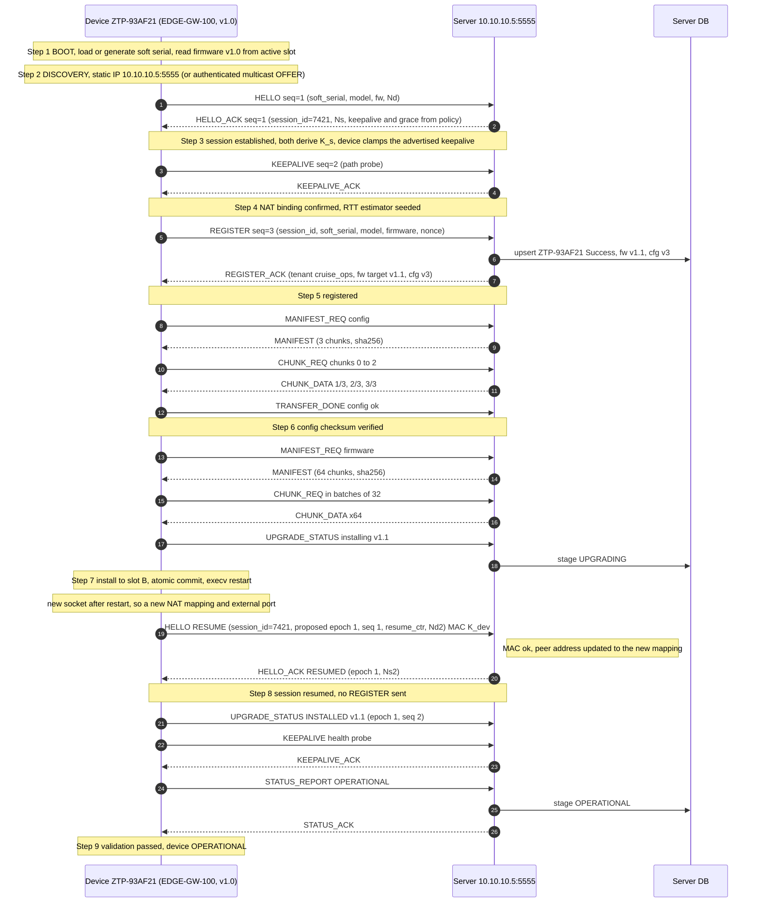

**Event flow by Appendix A step.** Each step lists its trigger, the messages exchanged, the state change and the log lines (the PDF text is emitted verbatim; §17.4).
| Step | Trigger event | Messages | Device state change | Server state / DB change | PDF log lines emitted |
|---|---|---|---|---|---|
| 1 Boot | Process start | — | → BOOT | — | `[BOOT] Device starting`, `[BOOT] Soft serial: ZTP-93AF21`, `[BOOT] Firmware version: v1.0` |
| 2 Discovery | Boot done | (DISCOVER/OFFER in multicast mode) | BOOT → DISCOVERY → SESSION | (rate-limit bucket) | `[DISCOVERY] Using static server IP 10.10.10.5:5555`, `[DISCOVERY] Provisioning server found` |
| 3 Session | Server address known | HELLO, HELLO_ACK | SESSION, keys derived | HALF_OPEN, sid 7421 | `[UDP] HELLO sent (seq=1)`, `[UDP] Session established (session_id=7421)` |
| 4 Keepalive | Session established (path probe), then every idle interval | KEEPALIVE, KEEPALIVE_ACK | Liveness ALIVE (§9.5) | last_rx updated | `[NAT] Keepalive sent`, `[NAT] Keepalive acknowledged` |
| 5 Registration | Path probe acknowledged | REGISTER, REGISTER_ACK / NAK | → REGISTER → CONFIG | HALF_OPEN → REGISTERED; DB row Success | `[AUTH] Registration successful`, `[AUTH] Assigned tenant: cruise_ops` |
| 6 Config | REGISTER_ACK | MANIFEST_REQ/MANIFEST, CHUNK_REQ/DATA, TRANSFER_DONE | CONFIG → FIRMWARE (stage CONFIG_OK persisted) | PROVISIONING; DB stage CONFIG_SENT | `[PROVISION] Receiving config (chunk 1/3)` … `(3/3)`, `[PROVISION] Config checksum verified` |
| 7 Upgrade | fw target > running | MANIFEST, CHUNK_DATA ×64, TRANSFER_DONE, UPGRADE_STATUS(INSTALLING) | FIRMWARE → UPGRADE → RESTART (FW_STAGED, then FW_INSTALLED, persisted) | AWAIT_RESUME; DB stage FW_SENT, then UPGRADING | `[UPGRADE] Current: v1.0 -> Target: v1.1`, `[UPGRADE] Upgrade complete, restarting device` |
| 8 Resume | Process restart with `pending_reboot` (new socket, so a new NAT mapping) | HELLO(RESUME) under K_dev, epoch 1 seq 1; HELLO_ACK(RESUMED); UPGRADE_STATUS(INSTALLED), seq 2 | BOOT → RESUME → VALIDATE | AWAIT_RESUME → PROVISIONING, epoch 1, peer updated; DB stage UPGRADED; **no new DB row** | `[BOOT] Restart detected`, `[UDP] Session resumed (session_id=7421)` |
| 9 Validation | Resume accepted | KEEPALIVE (health probe), STATUS_REPORT, STATUS_ACK | VALIDATE → OPERATIONAL | OPERATIONAL; stage OPERATIONAL | `[VALIDATION] Configuration present`, `[VALIDATION] Firmware v1.1 verified`, `[STATE] Device is OPERATIONAL` |

### 4.6 Deployment and NAT topology
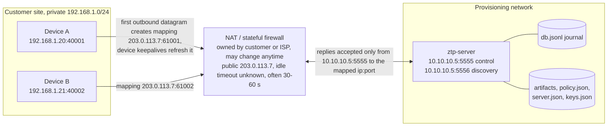
- **Discovery scope:** multicast and broadcast stay inside the site's L2 or multicast scope (TTL 1), so devices behind NAT in a remote site use the static IP, exactly as in Appendix A. Discovery over a WAN is a roadmap item (DHCP option 43 or DNS-SD, §22.3).
- **What the NAT implies for the protocol:** §9.1 and README Q4 (§21.1).

### 4.7 Diagram index
| # | Diagram | Type | Section |
|---|---|---|---|
| 1 | Component view | flowchart | §4.1 |
| 2 | End-to-end control and event flow (Appendix A) | sequence | §4.5 |
| 3 | Deployment and NAT topology | flowchart | §4.6 |
| 4 | Header bit layout | ASCII | §5.2 |
| 5 | Receive pipeline | flowchart | §5.7 |
| 6 | Discovery exchange | sequence | §6.2 |
| 7 | Session handshake | sequence | §7.1 |
| 8 | Server session state machine | state | §7.4 |
| 9 | Lost ACK | sequence | §8.7 |
| 10 | PDF bonus scenario (seq 2 lost) | sequence | §8.8.1 |
| 11 | Retransmission timer logic | flowchart | §8.10 |
| 12 | Keepalive and liveness state machine | state | §9.5 |
| 13 | Key derivation | flowchart | §10.1 |
| 14 | Registration failure (Invalid HMAC) | sequence | §10.3 |
| 15 | Transfer exchange | sequence | §11.2 |
| 16 | Per-file transfer state machine | state | §11.5 |
| 17 | Resume after restart | sequence | §12.3 |
| 17a | Validation flow (VALIDATE → OPERATIONAL) | flowchart | §13.1 |
| 18 | Upgrade (A/B) state machine | state | §12.6 |
| 19 | Server data model | ER | §14.7 |
| 20 | Concurrent devices on one event loop | sequence | §14.8 |
| 21 | Device state machine | state | §15.1 |
| 22 | Device event loop | flowchart | §15.5 |
| 23 | Project timeline | Gantt | PRD §11.1 |
| 24 | Configuration precedence | flowchart | §25.3 |

---

## 5. Wire protocol specification
*This section is normative.*

### 5.1 Transport
- UDP over IPv4. Server control port **5555** (from the PDF's Appendix A) and discovery port **5556**. Both are configurable (`net.server_port`, `net.discovery_port`; §25).
- One frame per datagram. Every datagram **MUST** be ≤ the session's current **datagram limit**: `net.max_datagram`, default and hard cap **1200 bytes** of UDP payload. The limit can step down to **508 bytes** when the path can't carry 1200 (§5.8).
- Senders **MUST** set DF where the platform allows it: `IP_MTU_DISCOVER=IP_PMTUDISC_DO` on Linux, `IP_DONTFRAG` on macOS. With DF set, an oversize datagram fails visibly (EMSGSIZE, or an ICMP "fragmentation needed" message) instead of being fragmented silently. §5.8 then reacts.

### 5.2 Common header (44 bytes)
```
 0                   1                   2                   3
 0 1 2 3 4 5 6 7 8 9 0 1 2 3 4 5 6 7 8 9 0 1 2 3 4 5 6 7 8 9 0 1
+-+-+-+-+-+-+-+-+-+-+-+-+-+-+-+-+-+-+-+-+-+-+-+-+-+-+-+-+-+-+-+-+
|       magic = 0x5A54 ("ZT")   |  version = 1  |     type      |  0
+---------------+---------------+---------------+---------------+
|     flags     | hdr_len = 44  |             epoch             |  4
+---------------+---------------+-------------------------------+
|                          session_id                           |  8
+---------------------------------------------------------------+
|                              seq                              | 12
+---------------------------------------------------------------+
|                       ack (cumulative)                        | 16
+---------------------------------------------------------------+
|              sack bitmap (bit i => seq ack+2+i rcvd)          | 20
+-------------------------------+---------------+---------------+
|          payload_len          |    key_id     |   reserved=0  | 24
+-------------------------------+---------------+---------------+
|                                                               | 28
|            mac[16] = trunc16(HMAC(K, hdr[0..27] ‖ payload))   |
|                                                               |
|                                                               |
+---------------------------------------------------------------+ 44
|                   payload (0..1156 bytes)                     |
+---------------------------------------------------------------+
```

| Field | Size | Semantics |
|---|---|---|
| magic | 2 | `0x5A54`. Anything else is dropped silently (counter `rx_malformed`) |
| version | 1 | `1`. A frame with an unknown version is dropped (`rx_malformed`). A future version would negotiate in HELLO |
| type | 1 | Message type (§5.3) |
| flags | 1 | bit0 `ACK_VALID` (the ack/sack fields are meaningful); bit1 `RETX` (this is a retransmission, used for logs and Karn's rule); bit2 `RESUME` (on HELLO and HELLO_ACK); bit3 `FIN`; bits 4–7 reserved, must be 0 |
| hdr_len | 1 | `44` in version 1. A v1 receiver rejects any other value. A future version may change it (together with `version`), but v1 offsets, the `payload_len` check and the MAC coverage all assume exactly 44 |
| epoch | 2 | Session epoch. 0 for a fresh session. A resume HELLO **proposes** an epoch greater than any the device has used or proposed (§12.3), and that becomes the session's epoch once the server accepts it. RESUME HELLOs bypass the epoch filter and go to the resume path (§5.7). Every other frame from a non-current epoch is dropped **before** the MAC is computed (a cheap filter; counter `rx_stale`) |
| session_id | 4 | 0 before a session exists (DISCOVER, OFFER, fresh HELLO). Otherwise the server-assigned random value |
| seq | 4 | Sender's sequence number. Reliable frames: the consumed seq (1, 2, 3, … per direction and per epoch). Ack-class frames: the sender's *next* seq, not consumed. Datagram-class frames: the attempt number |
| ack | 4 | Highest seq **N** such that every seq ≤ N from the peer has been received (valid if `ACK_VALID` is set) |
| sack | 4 | Bit *i* set ⇒ seq `ack+2+i` received (covers ack+2 … ack+33). `ack+1` is missing by definition |
| payload_len | 2 | Bytes after the header. Must equal `datagram_len − 44` |
| key_id | 1 | 1 = K_boot, 2 = K_dev, 3 = K_s. This is **a hint only**: the receiver enforces the expected key for each message type and session state (table §5.3), which defeats key-downgrade attempts |
| reserved | 1 | 0 |
| mac | 16 | HMAC-SHA256 truncated to 128 bits, over header bytes 0–27 followed by the payload |

> **Design rationale (header size).** 44 bytes per frame is about 4% overhead on a 1076 B CHUNK_DATA frame. A variable-length header was rejected because fixed offsets make the parser trivially bounds-safe. Truncating the MAC to 128 bits is allowed by RFC 2104 §5 (at least half the hash output) and is the same choice IPsec makes with HMAC-SHA-256-128 (RFC 4868).
>
> **Reviewer note.** The header is authenticated, not encrypted, so `session_id` and `seq` are visible to anyone on the path. That's acceptable because they aren't secrets: the security rests on `K_s` (§18).

### 5.3 Message catalogue
| Code | Name | Dir | Class | Key | Payload (TLV unless noted) |
|---|---|---|---|---|---|
| 0x01 | DISCOVER | D→S (mcast/bcast) | datagram | K_boot | MODEL, SERIAL, DISC_NONCE |
| 0x02 | OFFER | S→D (unicast) | datagram | K_boot | DISC_NONCE (echo), SERVER_ADDR, SERVER_PORT |
| 0x10 | HELLO | D→S | reliable: seq 1 of the epoch, handled on the handshake path (§5.7) | K_boot (fresh, epoch 0) / K_dev (`RESUME`, proposed epoch) | Fresh: SERIAL, MODEL, FW_VER, NONCE_DEV (Nd), CAPS. Resume: SERIAL, MODEL, RESUME_CTR, NONCE_DEV (Nd′), FW_VER, STAGE (device stage, Table 5.4.3) |
| 0x11 | HELLO_ACK | S→D | reliable: server seq 1 of the epoch | Same key as the HELLO | NONCE_DEV (echo), NONCE_SRV (Ns), KEEPALIVE_S, DEAD_INTERVALS, GRACE_S. Resume also: RESUMED=1, SRV_STAGE, FW_TARGET, CFG_VER |
| 0x20 | REGISTER | D→S | reliable | K_s | SERIAL, MODEL, FW_VER, HW_REV, NONCE_REG (64-bit), NONCE_SRV (echo of Ns) |
| 0x21 | REGISTER_ACK | S→D | reliable | K_s | TENANT, FW_TARGET, CFG_VER, optional INFO (for example ALREADY_REGISTERED) |
| 0x22 | REGISTER_NAK | S→D | terminal\* | K_boot | REASON (BAD_MAC, REPLAY or NO_POLICY), DETAIL, NONCE_REG (echo, binds the NAK to the request) |
| 0x30 | KEEPALIVE | D→S | reliable | K_boot while HALF_OPEN (the path probe before REGISTER, Appendix A Step 4); K_s afterwards | PATH_PROBE=1 (path probe), HEALTH_PROBE=1 (validation, §13) or empty (periodic) |
| 0x31 | KEEPALIVE_ACK | S→D | ack-class | Same key as the KEEPALIVE | SRV_STAGE |
| 0x40 | MANIFEST_REQ | D→S | reliable | K_s | FILE_KIND (1 = config, 2 = firmware), MAX_DGRAM (the device's current datagram limit, §5.8) |
| 0x41 | MANIFEST | S→D | reliable | K_s | FILE_ID, FILE_KIND, VERSION, FILE_SIZE, CHUNK_SIZE (chosen to fit MAX_DGRAM), CHUNK_COUNT, SHA256 |
| 0x42 | CHUNK_REQ | D→S | reliable | K_s | FILE_ID, CHUNK_START, CHUNK_NUM (≤ `xfer.chunk_req_max`; the server enforces its own limit) |
| 0x43 | CHUNK_DATA | S→D | reliable | K_s | **Fixed layout** (§5.4.2) |
| 0x44 | TRANSFER_DONE | D→S | reliable | K_s | FILE_ID, RESULT (0 = ok, otherwise a reason code) |
| 0x50 | UPGRADE_STATUS | D→S | reliable | K_s | UPG_STATE (Table 5.4.3), FW_VER, FW_TARGET |
| 0x60 | STATUS_REPORT | D→S | reliable | K_s | REPORT_STATE (Table 5.4.3), REASON, FW_VER, CFG_VER |
| 0x61 | STATUS_ACK | S→D | reliable | K_s | (empty) |
| 0x70 | CLOSE | either | reliable | K_s | REASON (flag `FIN`) |
| 0x7E | ERROR | S→D | **unsequenced** (ack-class semantics: carries the sender's next seq without consuming it; never ACKed). The one exception is BAD_REQUEST, which is reliable | K_boot for terminal errors (UNKNOWN_MODEL, SERVER_BUSY, SESSION_UNKNOWN, SESSION_EXPIRED, RESUME_REJECTED); K_s for RESUME_REQUIRED and BAD_REQUEST | REASON (Appendix C), DETAIL, and an **echo binding it to the request that triggered it**: NONCE_DEV (Nd) for HELLO-time errors, NONCE_DEV (Nd′) for resume errors, and ECHO_SEQ (the triggering frame's seq, in the current epoch) for RESUME_REQUIRED and BAD_REQUEST. The device accepts an ERROR only if the echo matches an outstanding request: the nonce of its pending HELLO or resume, or, for ECHO_SEQ, a seq it has sent in the current epoch that is not older than `snd_una − 32`. The device also **accepts at most one RESUME_REQUIRED per echoed seq**, and ignores any further ones while its resume is in progress. A replayed RESUME_REQUIRED from an older epoch therefore fails the epoch filter, a replay of the same one is ignored, and the residual risk is one forced resume per *new* frame that an on-path attacker can observe (§18.2) |
| 0x7F | ACK | either | ack-class | Device: K_boot until it sends REGISTER, then **K_s for every frame**. Server: K_boot while HALF_OPEN; it **accepts an ACK under either K_boot or K_s** until it has verified the session's first K_s frame (it can't know which one the device used during that transition) | (empty): carries only ack and sack |

\* **Terminal and unsequenced replies** (REGISTER_NAK, and every ERROR except BAD_REQUEST) are never ACKed, and they are always sent to the **source address of the datagram that triggered them**.
- The server sends one immediately and keeps it in a **reply tombstone** for `nat.half_open_ttl_s`: keyed by session id for REGISTER_NAK, by `(serial, Nd)` for HELLO-time errors, and by `(session_id, Nd′)` for resume errors.
- Each time the device retransmits the request, the server resends the identical bytes. A lost NAK therefore costs one RTO, not a whole retry budget.
- After the NAK the half-open session itself is discarded; only the tombstone remains.
- Every such reply echoes the nonce of the request it answers (NONCE_REG, Nd or Nd′), so a captured reply can't be replayed against another request (§10.4, mechanism 7).
- RESUME_REQUIRED is repeated, to the source, for every new frame that arrives from the new IP until the resume succeeds.

**Class semantics**
- **Reliable:** consumes the next seq; retransmitted until ACKed; delivered **in order, exactly once** to the application. HELLO and HELLO_ACK are seq 1 of their epoch. They are processed on the *handshake path*, because the session's reliability state doesn't exist yet (fresh) or is being replaced (resume). The receiving side then initialises its receive state as if seq 1 had been delivered (`rcv_ack = 1`).
- **Ack-class:** `seq` = the sender's next seq (it satisfies "every message carries a seq" without consuming one); never ACKed; never retransmitted (a lost one is repaired by the next ACK).
- **Datagram-class:** exists only before a session; the application retries it (§6.2).

### 5.4 Payload encoding
#### 5.4.1 TLV (all types except CHUNK_DATA)
```
+--------+----------------+------------------------+
| tag u8 |  length u16    |  value (length bytes)  |   repeated until payload_len
+--------+----------------+------------------------+
```
| Tag | Name | Type | Tag | Name | Type |
|---|---|---|---|---|---|
| 0x01 | SERIAL | str ≤ 16 | 0x13 | CHUNK_SIZE | u16 |
| 0x02 | MODEL | str ≤ 16 | 0x14 | CHUNK_COUNT | u32 |
| 0x03 | FW_VER | str ≤ 8 | 0x15 | SHA256 | 32 B |
| 0x04 | HW_REV | str ≤ 8 | 0x16 | CHUNK_START | u32 |
| 0x05 | NONCE_DEV | u64 | 0x17 | CHUNK_NUM | u16 |
| 0x06 | NONCE_SRV | u64 | 0x18 | VERSION | str ≤ 8 |
| 0x07 | NONCE_REG | u64 | 0x19 | RESULT / REASON | u16 (Appendix C) |
| 0x08 | TENANT | str ≤ 32 | 0x1A | DETAIL | str ≤ 64 |
| 0x09 | FW_TARGET | str ≤ 8 | 0x1B | STAGE (device stage) | u8 (Table 5.4.3) |
| 0x0A | CFG_VER | u16 | 0x1C | SERVER_ADDR | 4 B IPv4 |
| 0x0B | KEEPALIVE_S | u16 | 0x1D | SERVER_PORT | u16 |
| 0x0C | GRACE_S | u16 | 0x1E | HEALTH_PROBE | u8 (1) |
| 0x0D | RESUME_CTR | u32 | 0x1F | PATH_PROBE | u8 (1) |
| 0x0E | CAPS | u32 bitmask | 0x20 | RESUMED | u8 (1) |
| 0x0F | DISC_NONCE | u64 | 0x21 | SRV_STAGE | u8 (Table 5.4.3) |
| 0x10 | FILE_ID | u8 | 0x22 | DEAD_INTERVALS | u8 |
| 0x11 | FILE_KIND | u8 | 0x23 | MAX_DGRAM | u16 |
| 0x12 | FILE_SIZE | u32 | 0x24 | INFO | u16 (Appendix C) |
| — | — | — | 0x25 | UPG_STATE | u8 (Table 5.4.3) |
| — | — | — | 0x26 | REPORT_STATE | u8 (Table 5.4.3) |
| — | — | — | 0x27 | ECHO_SEQ | u32 (seq of the frame that triggered an ERROR) |

Rules: unknown tags are **skipped**, which allows forward compatibility. A duplicate tag rejects the frame. A missing required tag gives `BAD_REQUEST`. Strings are not NUL-terminated on the wire and are copied into fixed buffers that are always terminated.

#### 5.4.2 CHUNK_DATA (fixed layout, for efficiency)
```
+---------+---------+------------------+--------------+------------------------+
| file_id | flags u8| chunk_index u32  | data_len u16 |  data (≤ CHUNK_SIZE)   |
+---------+---------+------------------+--------------+------------------------+
   1 B       1 B          4 B               2 B             data_len
```
`flags`: bit 0 `MTU_REDUCED` marks a 52 B **fill frame** (`data_len = 0`, §5.8); bits 1–7 are 0. At the default chunk size the frame is 44 + 8 + 1024 = **1076 bytes**, under the 1200 B cap with 124 B of margin. At the fallback level it is 44 + 8 + 256 = 308 bytes, under the 508 B limit (§5.8).

#### 5.4.3 Enumerations
| Field (tag) | Values |
|---|---|
| STAGE (0x1B), the device's persisted stage (§15.3) | 0 NEW, 1 REGISTERED, 2 CONFIG_OK, 3 FW_STAGED, 4 FW_INSTALLED, 5 OPERATIONAL, 6 FAILED |
| SRV_STAGE (0x21), the server's DB stage (§14.4). Value 0 HELLO is a **session-only** value (half-open); it is never written to the DB, because rows exist only from a verdict onward | 0 HELLO, 1 REGISTERED, 2 CONFIG_SENT, 3 FW_SENT, 4 UPGRADING, 5 UPGRADED, 6 OPERATIONAL, 7 FAILED |
| UPG_STATE (0x25), in UPGRADE_STATUS | 1 INSTALLING, 2 INSTALLED, 3 ROLLED_BACK |
| REPORT_STATE (0x26), in STATUS_REPORT | 1 OPERATIONAL, 2 FAILED |
| FILE_KIND (0x11) | 1 CONFIG, 2 FIRMWARE |
| CAPS (0x0E), bits | bit0 MCAST_DISCOVERY, bit1 RESUME, bit2 MTU_FALLBACK |

### 5.5 Size budget and avoiding fragmentation (ZTP-FR-20, NFR-02)
| Item | Normal level | Fallback level (§5.8) |
|---|---|---|
| Path assumption | IPv6 minimum MTU 1280 − 40 − 8 = 1232 B of UDP payload never fragments; any IPv4 path with MTU ≥ 1228 | IPv4 minimum datagram 576 − 60 (max IPv4 header) − 8 (UDP) = 508 B, the classic "never fragments" size |
| Datagram limit (`net.max_datagram`, cap `ZTP_MAX_DGRAM_CAP`) | **1200** (QUIC's initial limit, RFC 9000 §14) | **508** (`ZTP_MIN_DGRAM`) |
| Header + MAC | 44 | 44 |
| Maximum payload | 1156 | 464 |
| CHUNK_DATA overhead | 8 | 8 |
| Chunk size (a power of two that fits; leaves margin for tunnels: PPPoE −8, GRE −24, IPsec about −60) | **1024** | **256** |

Enforcement: `_Static_assert(ZTP_HDR_LEN + 8 + ZTP_CHUNK_SIZE_CAP <= ZTP_MAX_DGRAM_CAP)`. The encoder checks every frame against the session's *current* limit and returns `-E2BIG` instead of sending an oversize frame. QA verifies the largest datagram in a pcap (TC-PROV-04) and the fallback on reduced-MTU links (TC-PROV-12/13). Why fragmentation is avoided is covered in §21.1 Q3.

### 5.6 Parsing and validation rules (robustness)
These checks run in order, and processing stops at the first failure. Each one matches a box in §5.7:
1. `44 ≤ len ≤ current datagram limit` (never above 1200);
2. magic, version and `hdr_len`;
3. `payload_len == len − 44`;
4. type known, and the class and direction valid for this endpoint;
5. **session lookup and epoch filter**:
   - `session_id = 0` goes to the pre-session path.
   - **Every HELLO with the `RESUME` flag goes to the resume path** (§12.3), whatever its epoch.
   - For any other frame, an unknown `session_id` is dropped (`rx_unknown`) and a wrong epoch is dropped (`rx_stale`).
   - On the resume path, a RESUME HELLO for an **unknown** session id is answered with a terminal ERROR `SESSION_UNKNOWN` (or `SESSION_EXPIRED` if a tombstone exists) **only after** the per-IP rate limit and a K_dev MAC check. K_dev is derived from the payload's MODEL and SERIAL, read with a bounded, read-only TLV peek. Otherwise the HELLO is dropped, so the reply can't be used for reflection;
6. **key selection by message type and session state** (never by `key_id`), then MAC verification with `ct_memeq`;
7. reliability classification (new, buffered, duplicate, out of window);
8. address-change handling, **only for new frames** (§9.4);
9. TLV parse with bounds checks;
10. the application handler.

**No state changes before step 6 passes.** All failures increase a counter. Only MAC failures on REGISTER (§10.3) are logged one per event; others are rate-limited in the log so that an attacker can't flood it. With the fleet bootstrap key (§10.1) no step before the MAC needs any payload field: the K_boot MAC is checked without knowing the model.

### 5.7 Receive pipeline (both binaries)
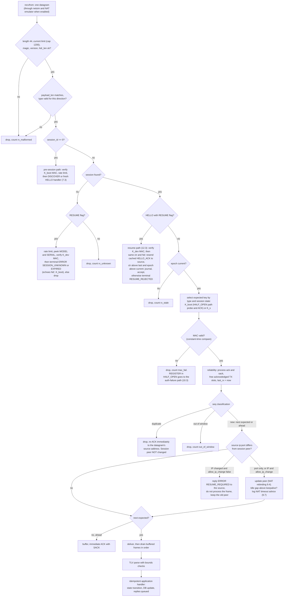
> **Design rationale: only new frames move the peer address.** There is no encryption, so an on-path attacker can capture any frame and re-send it from its own address. The MAC still verifies on such a frame. If a *duplicate* could change the peer, the attacker would capture the server's replies and starve the real device. Only a frame with a never-seen, in-window sequence number moves the peer, and only the key holder can produce one. This is the same rule QUIC uses (RFC 9000 §9.3, "highest-numbered non-probing packet"). Re-ACKs for duplicates go to the datagram's own source address. A real device whose NAT rebound while it was retransmitting therefore still gets its ACK, sends its next new frame, and the peer then moves. An attacker replaying a frame gets only an ACK copy: the same size, so no amplification, and nothing it hadn't already seen.

### 5.8 Path MTU safety: small-MTU fallback
The 1200 B limit is safe on any compliant IPv6 path and on IPv4 paths with MTU ≥ 1228. A path with a smaller MTU (some tunnels, misconfigured VPNs, satellite modems) would make large frames fail. **Only the server's CHUNK_DATA frames exceed 508 B.** Every control frame, and every frame the device sends, is under 508 B. The fallback is therefore driven by what happens to CHUNK_DATA, and it is designed so that no sequence number is ever left as a hole.

**Detection.** There are two independent triggers:
| Trigger | Where | Detection | Why it is robust |
|---|---|---|---|
| **EMSGSIZE**: a local interface MTU, or a PMTU cached from an ICMP "fragmentation needed" | Server, on `sendto` of a CHUNK_DATA | Immediate | The kernel reports it; no guessing |
| **Black hole**: ICMP filtered, large frames vanish silently | **Device** | The device's CHUNK_REQ has been ACKed, then: (1) after **`net.pmtu_blackhole_s / 2`** (4 s; demo 1.5 s) without any CHUNK_DATA, the device sends a **liveness KEEPALIVE** (small, so it gets through); (2) if that KEEPALIVE is **acknowledged** (KEEPALIVE_ACK received) and still **no CHUNK_DATA has arrived by `net.pmtu_blackhole_s`** (8 s; demo 3 s), the device **re-requests** the missing chunks (a new, small CHUNK_REQ; log `[UDP] No chunk data for N s: chunks re-requested before a black hole is declared`), and the server sends them again at once as new frames; (3) the black hole is declared only if a **second** interval, timed from the ACK of that CHUNK_REQ, passes the same way (probe ACKed, no CHUNK_DATA). Detection therefore takes about 2 × `net.pmtu_blackhole_s` (16 s; demo 6 s) | The acknowledged keepalive proves the path works in both directions for small frames. **Any** authenticated CHUNK_DATA larger than 508 B restarts the interval: one delivered to the transfer, one **buffered out of order** behind a lost chunk, or a duplicate. Its arrival is the proof that large frames pass. (Before M7 only delivered chunks counted, so a lost head chunk with the later chunks waiting in the receive buffer looked like silence. On 821d134 the release run's matrix re-requested in 11 of 360 device runs and stepped down falsely twice; with the rule above, the release runs after it re-requested in 8 to 9 of 360 (8 in the final run, 0b2e460) and stepped down in none. The remaining re-requests are the lone-frame tail case below, most of them on the S4 device whose retransmissions went to its old port just after the rebinding; each recovered at once.) The second interval covers a lone frame at the **tail of a transfer**: the server's RTO backoff fits only a few tries into a 3 s interval, and the re-request adds fresh copies outside it, which also produce the SACKs that trigger a fast retransmission. In a real black hole the re-sent frames are as large as the first ones and vanish too, so the step-down still happens. The probe is needed because, once a CHUNK_REQ is ACKed, the server otherwise sends only (black-holed) CHUNK_DATA |

**Reaction (identical for both triggers):**
1. **The session's datagram limit becomes 508 B.** The server stores this in the session (and journals it, §14.4) and the device in `device.state` (`max_dgram`), so it survives a resume and a restart. Log: server `[UDP] [sid=… …] Path MTU too small for 1200 B (EMSGSIZE): datagram limit now 508`, or device `[UDP] Suspected PMTU black hole: datagram limit now 508`.
2. **Holes are filled in order, without renumbering.** Every unacknowledged CHUNK_DATA above the limit is retransmitted, at the same seq, as a **fill frame**: CHUNK_DATA with `data_len = 0` and flag bit `MTU_REDUCED` (bit 0 of the CHUNK_DATA `flags` byte, §5.4.2), which makes it 52 B. The receiver delivers fill frames in order like any other, so the sequence space stays gap-free. A fill frame doesn't mark its chunk as received. Chunk requests the server has **queued but not yet sequenced** at the old size are **dropped** at the step-down; the device re-requests those chunks after the re-manifest.
3. **Signalling.**
   - On EMSGSIZE the server initiates. The `MTU_REDUCED` flag on the first fill frame delivered tells the device (event E27).
   - On a black hole the device initiates. It sends MANIFEST_REQ with `MAX_DGRAM = 508`. The server lowers its session limit at once and fills its stuck frames, as in step 2. Only 508 is this signal: a device whose own `net.max_datagram` is lower than the server's (say 1000) sends that value, and the server just picks a chunk size that fits it (512 B), with no step-down (tested in TC-PROV-13).
4. **Re-manifest.**
   - The device sends MANIFEST_REQ (`MAX_DGRAM = 508`) for the current file.
   - The server **always** answers with `CHUNK_SIZE` = the largest power of two ≤ min(MAX_DGRAM, session limit) − 52, which is 256.
   - The device **keeps its partial file**. Chunk *i* of size 1024 is exactly chunks 4i … 4i+3 of size 256, so the bitmap is converted without losing data (TC-UNIT-19). It then requests only the missing 256 B chunks.

The limit **never steps back up** within a session, because probing upwards (PLPMTUD, RFC 8899) is a roadmap item (§22.3). `net.mtu_fallback = false` disables the behaviour. The device's own EMSGSIZE handling exists in the shared engine, but in practice it never fires, because device frames are small.

---

## 6. Boot and discovery

### 6.1 Soft serial (ZTP-FR-01)
- Every boot starts with `[BOOT] Device starting` (Appendix A Step 1), then the serial line, then `[BOOT] Firmware version: v1.0`, read from the active slot's header.
- The serial is set by one of three paths, and each logs exactly one *origin* line followed by the Appendix A Step 1 line `[BOOT] Soft serial: ZTP-93AF21`:

  | Situation | Origin line | Then |
  |---|---|---|
  | First boot, no serial configured | `[BOOT] Soft serial generated` (the PDF §1 example text). 3 bytes from the CSPRNG → `ZTP-%06X`, persisted atomically in `device.state` (§15.3) | `[BOOT] Soft serial: ZTP-93AF21` |
  | Later boot (serial in `device.state`) | `[BOOT] Soft serial loaded` | `[BOOT] Soft serial: ZTP-93AF21` |
  | Serial given by `--serial` or `identity.serial` (demo and tests, to reproduce the PDF's table) | `[BOOT] Soft serial assigned (configuration)`; persisted like a generated one | `[BOOT] Soft serial: ZTP-93AF21` |

- A configured serial that differs from a persisted one is a fatal configuration error (exit 78), because a device can't change identity silently.

> **Reviewer note.** 24 bits gives a 50% chance of a collision at about 4,800 devices (birthday bound). That's fine for the exercise, but a real product would derive the serial from a hardware ID (MAC address, eFuse) or use 64 bits. The server can't tell apart two devices with the same serial and model, because they share the same derived `K_dev`. Listed in §22.2.

### 6.2 Multicast and broadcast discovery (ZTP-BON-01)
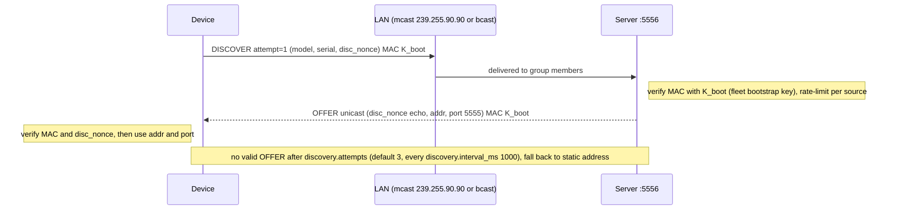
- **Mode** `--discover=mcast|bcast|static` (default `mcast`, falling back to static when `--server` is also given).
- **Multicast:** group 239.255.90.90 (administratively scoped, RFC 2365), `IP_MULTICAST_TTL=1`, `IP_MULTICAST_LOOP=1`. **Interface selection must be explicit on both sides**, because the defaults depend on the routing table:
  - **Server:** `IP_ADD_MEMBERSHIP` with `imr_interface` = `net.mcast_iface_addr` (default: the address of `net.bind`; for loopback tests `127.0.0.1`).
  - **Device:** `IP_MULTICAST_IF` = `discovery.mcast_iface_addr` (the same address).
  - **macOS:** `lo0` supports multicast. Without an explicit `IP_MULTICAST_IF`, a host with no default route fails with `EHOSTUNREACH`.
  - **Linux:** `lo` lacks the `MULTICAST` flag by default. Tests run `ip link set lo multicast on` (CI needs sudo, which is available) or use the runner's `eth0` address. If none of this works, the device falls back to static.
  - The OFFER is unicast to the DISCOVER's source address and arrives on the device's single socket (§3.7 T-12).
- **Broadcast:** `SO_BROADCAST`, to `255.255.255.255` or the interface's directed broadcast address (`--bcast-addr`).
- **The OFFER is authenticated** with K_boot and echoes `disc_nonce`, so a rogue host on the LAN can't redirect the device (a rogue-DHCP-style attack), and an old OFFER can't be replayed.
- If several valid OFFERs arrive, the device takes the first. A future *priority* TLV would allow choosing between servers.

> **Reviewer note (platform).** macOS `lo0` doesn't support broadcast, so the demo default is multicast, which works on loopback on both macOS and Linux. Broadcast is tested (TC-DISC-05) **locally on the Mac's Wi-Fi/Ethernet interface**: both processes run on the Mac, and the device sends to the interface's directed broadcast address (for example `192.168.1.255`; get it with `ifconfig en0 | grep broadcast`). It is tested again on the CI Linux runner. No local Linux host is needed. This is spiked in M1 (PRD R-03).
>
> **Design rationale.** Discovery is *datagram-class* (application retries, no seq/ACK state), because no session exists yet and the server must stay stateless toward unauthenticated multicast traffic.

### 6.3 Static IP (ZTP-FR-02)
`--server 10.10.10.5:5555` → `[DISCOVERY] Using static server IP 10.10.10.5:5555` (the Appendix A Step 2 text), followed by `[DISCOVERY] Provisioning server found 10.10.10.5:5555 (static)`. The second line is the PDF §1 example text, so both discovery modes emit it (TC-PDF-01). This path is used directly when the mode is `static`, and as the fallback otherwise.

> **Reviewer note.** In static mode, "found" means *located through configuration*. Reachability has not been proven at that point; `[UDP] Session established` (Appendix A Step 3) proves it. Emitting "found" only after HELLO_ACK would put a `[DISCOVERY]` line after `[UDP]` lines and break the PDF's Step 2 → Step 3 order. If the server never answers, the device logs the blocked-UDP hint (§9.7) instead of a false success.

> **Reproducing Appendix A's address exactly.** The PDF uses server 10.10.10.5. On macOS this needs no extra software: `sudo ifconfig lo0 alias 10.10.10.5/32`, then run `ztp-server --bind 10.10.10.5` and `ztp-device --server 10.10.10.5:5555`. Remove it with `sudo ifconfig lo0 -alias 10.10.10.5`. The default demo uses 127.0.0.1, which needs no sudo (TC-PDF-04).

---

## 7. UDP session establishment (ZTP-FR-04)

### 7.1 Handshake
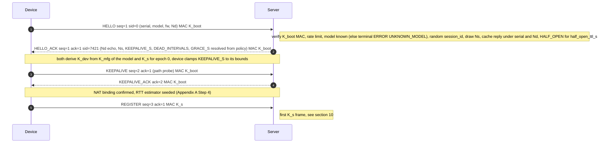
Logs: `[UDP] HELLO sent (seq=1)`, `[UDP] Session established (session_id=7421)`, `[NAT] Keepalive sent`, `[NAT] Keepalive acknowledged`.

### 7.2 Session identifier
- 32-bit, from the CSPRNG; never 0; unique among live sessions (redrawn on a collision).
- > **Design rationale.** A random ID instead of a sequential one is (a) hard to guess, which raises the bar for off-path spoofing even before the MAC check, and (b) the **lookup key instead of the 5-tuple**, so a NAT rebinding doesn't break the session (§9.4).

### 7.3 Retransmitting HELLO is idempotent
HELLO is reliable frame seq=1. Until HELLO_ACK arrives, the device retransmits **exactly the same bytes** (the same Nd), following the RTO schedule. The server keys half-open sessions by `(serial, Nd)`. A duplicate HELLO gets the **cached HELLO_ACK** back and allocates no new session (TC-SESS-02). A new Nd from the same serial (after the device gave up and started again) replaces an earlier **half-open** session for that serial. It **never** affects a registered session: an established session is superseded only when a new REGISTER (under K_s) or a resume (under K_dev) for that serial is verified (§14.2). Anyone holding the fleet key can send a HELLO, so a HELLO alone must not be able to tear down a live session (TC-SESS-09).

### 7.4 Session state on the server
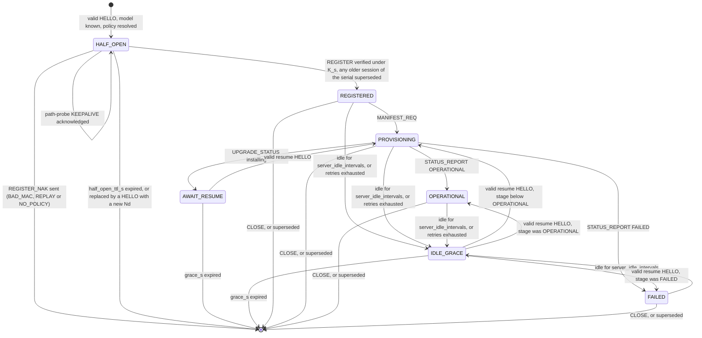
**Rules not drawn as separate arrows:**
- **A valid resume HELLO is accepted in every live state** (REGISTERED, PROVISIONING, OPERATIONAL, FAILED, AWAIT_RESUME, IDLE_GRACE) when `resume_ctr` is greater than the last one seen and the proposed epoch is greater than the current one. It starts the proposed epoch and keeps the state (stage). This covers a device that crashes and restarts before the server has noticed (scenario S3).
- An unknown model gets a terminal ERROR `UNKNOWN_MODEL` at HELLO time, and **no session is created** (§10.3).
- On a server restart, live sessions are restored from the journal into IDLE_GRACE with a new grace timer (§14.4), so resume keeps working.
- Deleting a session **never** deletes its DB record. The DB is the long-lived truth, and the session is a transient transport association.

---

## 8. Reliability layer
*ZTP-FR-05..09, ZTP-BON-02..05, ZTP-BON-07. This is the core of the networking review.*

### 8.1 Model
- **Selective repeat ARQ** with a cumulative ACK and a SACK bitmap, **per direction, per epoch**. Both peers run the same engine (`common/reliable.c`). The device runs one instance; the server runs one per session.
- Every frame carries a seq (ZTP-BON-02); semantics by class are in §5.3.
- ACK information is **piggybacked** on every outgoing frame (`ACK_VALID`). A standalone ACK frame is sent only when there is nothing to piggyback on, after the delayed-ACK timer (`rel.delayed_ack_ms`, 20 ms) or **immediately** for a duplicate or a gap. A KEEPALIVE is answered at once by its own ack-class KEEPALIVE_ACK, which carries the ACK fields.

> **Design rationale: why selective repeat.**
> | Scheme | Under 20% loss | Complexity | Verdict |
> |---|---|---|---|
> | Stop-and-wait | 1 frame per RTT; every loss costs a full RTO | Lowest | Too slow for 64+ chunks |
> | Go-back-N | One loss resends the whole window (W frames) | Low | Wastes bandwidth precisely when the link is worst |
> | **Selective repeat + SACK** | Only lost frames are resent; gaps are detected early through SACK | Moderate (a reorder buffer) | **Chosen**: the bonus requires a reorder buffer anyway |

### 8.2 Sender state
```
next_seq            next seq to assign (starts at 1 per epoch)
snd_una             oldest unacknowledged seq
tx_slots[16]        { seq, frame bytes, len, first_sent, last_sent, retries, sacked, retx_flag }  (array sized at ZTP_TX_WINDOW_MAX = 16; W = rel.tx_window of them are used)
srtt, rttvar, rto   RFC 6298 estimator
```
- **Window W = 8** frames in flight by default (`rel.tx_window`, 1..16). When the window is full, the application's sends are queued (bounded, 64 entries) and back-pressure the producer. The server stops reading chunks from disk, for example.

> **Design rationale (W = 8).** With frames of about 1.1 KB and a 50 ms WAN RTT, 8 in flight gives about 176 KB/s, which provisions 64 KiB of firmware in well under a second of transmit time. The window is a fixed, small cap on how many frames can arrive at once on a lossy link. That cap is our minimal substitute for congestion control, and it follows the RFC 8085 guidance that UDP applications without congestion control should send at a low, bounded rate. Listed as a limitation in §22.2.

### 8.3 Timeouts and retransmission (ZTP-FR-06, BON-03)
- **RTO** follows the RFC 6298 estimator: `RTO = SRTT + max(G, 4·RTTVAR)`, initial RTO **500 ms** (`rel.rto_initial_ms`), clamped to **[200 ms, 4 s]** (`rel.rto_min_ms`, `rel.rto_max_ms`). The first RTT sample comes from HELLO → HELLO_ACK, unless HELLO was retransmitted (Karn's rule), in which case the path probe (§9.2) gives it. Either way the initial value is replaced after the first exchange.
- **Karn's algorithm:** RTT samples come only from frames that were never retransmitted.
- **Exponential backoff:** RTO ×2 on each timeout of the same frame, up to the 4 s cap. The backoff is kept **per frame**: each TX slot starts from the estimator's RTO when it is first sent and doubles on its own timeouts, so a burst of timeouts doesn't compound into a single shared RTO. A fresh RTT sample updates the estimator, and later frames start from that value.
- **Retransmitted frames** keep their seq, payload and key, but the header is rebuilt: the `RETX` flag is set and the current ack and SACK are piggybacked. The MAC covers the flags, so it is recomputed; the bytes are therefore not identical to the original. Each TX slot stores the key it was first sent under, so a path-probe KEEPALIVE sent under K_boot is retransmitted under K_boot even after REGISTER switches the session to K_s (§10.1).
- **Timers on SACKed frames.** A SACKed frame is already held by the receiver, so it normally needs no timer. The exception is the **oldest unacknowledged frame**: a frame SACKed under an older ACK becomes the oldest when the gaps before it are filled. If the cumulative ACK covering it is then lost, nothing else would prompt the peer to ACK again, and the sender would wait forever. Its timer therefore stays armed; the retransmission arrives as a duplicate, and the immediate re-ACK (§8.7) repairs the state. This was found by the 10k-permutation test (TC-UNIT-08) and is pinned by a regression test.
- **Retry limit:** after **8** retransmissions of one frame (`rel.max_retries`), the engine raises `SESSION_FAILED`. Timing from the initial 500 ms RTO: the original is followed by retransmissions at +0.5, +1.5, +3.5, +7.5, +11.5, +15.5, +19.5 and +23.5 s (waits of 0.5+1+2+4+4+4+4+4 = 23.5 s), and the 8th retransmission's own 4 s timer expires at **about 27.5 s**. **KEEPALIVE frames are exempt from this limit.** They are retransmitted until the liveness detector's dead interval expires (§9.3), so session death is decided by `nat.dead_intervals` and not by two competing timers. **The one exception is the path probe** (§9.2), the K_boot keepalive that REGISTER waits for: it is a setup step, so it has the HELLO's retry budget. Under the dead interval it could wait 3 × 20 s = 60 s with production timers, long after the server dropped the half-open session (`nat.half_open_ttl_s`, 10 s). (Found by the M5 long run, TC-NAT-07: at 20% loss a lost probe ACK followed by lost retransmissions stalled registration for a minute.) The device then moves to *resume* (if it's registered) or a fresh HELLO, with jittered reconnect backoff (§9.3). The server moves the session to `IDLE_GRACE`.
- **Fast retransmit:** if frame X is unacknowledged and **3** frames sent after it have been SACKed, X is retransmitted at once, without waiting for its RTO, at most once per RTO period. This recovers losses in the middle of a window in about one RTT instead of one RTO.
- Log: `[UDP] Retransmitting seq=N (timeout)` or `(fast, sack)`.

> **Reviewer note (three RFC 6298 deviations).** RFC 6298 specifies an initial RTO of 1 s (§2.1) and a minimum RTO of 1 s (§2.4), and allows a maximum only if it is at least 60 s (§2.5). We use **500 ms initial, 200 ms minimum and a 4 s maximum**. The 4 s cap keeps a provisioning session responsive (the 8-retry budget then spans about 27.5 s, instead of minutes); persistent loss beyond that is handled by session failure and resume, not by ever-longer waits. The other two values are chosen because: (a) the traffic is a short-lived control plane, not bulk transfer; (b) the window is small and fixed, so a spurious retransmission costs at most 8 frames; (c) the 200 ms floor matches widespread practice (the Linux TCP `RTO_MIN`); (d) the initial value is used only for the first two frames (HELLO and the path probe), whose measured RTT then drives the estimator. Both are configuration values (`rel.rto_initial_ms`, `rel.rto_min_ms`), so the RFC values can be restored without rebuilding (OQ-1).

### 8.4 Receiver: ACK, SACK and out-of-order buffering (ZTP-FR-07, BON-04)
```
rcv_ack           highest in-order seq delivered (cumulative ACK value)
rx_buf[32]        slots for seq rcv_ack+2 .. rcv_ack+33 (ring buffer indexed by seq mod 32)
rx_bitmap u32     occupancy (this becomes the outgoing SACK field)
```
Processing a reliable frame with sequence `s`, after its MAC has been verified:

| Condition | Action | Log |
|---|---|---|
| `s == rcv_ack+1` | Deliver; `rcv_ack++`; **drain** consecutive buffered frames; schedule a delayed ACK | — |
| `rcv_ack+1 < s ≤ rcv_ack+33` and not buffered | Store in `rx_buf`, set the SACK bit, **send an ACK immediately** (it tells the sender about the gap) | `[UDP] Received packet seq=3 (out of order, expected=2)`, `[UDP] Buffered packet seq=3` |
| `s ≤ rcv_ack`, or already buffered | **Duplicate**: drop and **ACK immediately** (§8.7) | `[UDP] Duplicate packet seq=2 ignored` |
| `s > rcv_ack+33` | Outside the window: drop (it can't legitimately happen with W=8, so it suggests a bug or an attack) | rate-limited warning |

The application therefore sees each reliable frame **exactly once, in strictly increasing seq order**.

> **Design rationale (an RX buffer of 32 with a TX window of 8).** The receive window matches the SACK width, so every buffered frame can be reported. The extra space over W covers retransmissions that arrive late from an earlier window. Memory per session: RX buffer 32 × 1200 B = 38.4 KB, TX slots 16 × 1200 B = 19.2 KB, cached HELLO_ACK 1.2 KB, plus keys and state of about 0.5 KB, so **about 59 KB per session**, or **about 60 MB at the 1024-session cap** (≈ 3 MB for the 50-device test, well within ZTP-NFR-05). The RX buffer could be sized to W slots if memory mattered (§22.2).

### 8.5 Duplicate detection (ZTP-FR-08)
Duplicates come from (a) retransmissions after a lost ACK, (b) network duplication, and (c) retransmissions that were spurious but harmless. Detection is purely by seq: `s ≤ rcv_ack` or `rx_bitmap` bit set. Because every frame passes the MAC check first, an attacker can't forge a "future" seq to fill the window.

### 8.6 Idempotent processing (ZTP-BON-05)
The transport guarantees exactly-once delivery **within an epoch**. Across epochs (after a resume, a crash or a re-registration) the same *logical* request can arrive again, so the application handlers are idempotent as well:

| Message | Idempotency rule |
|---|---|
| HELLO (fresh) | Keyed by `(serial, Nd)` → cached HELLO_ACK; no second session |
| HELLO (resume) | Keyed by `(session_id, resume_ctr, Nd′)`. The same triple as the accepted one returns the cached HELLO_ACK, sent to the datagram's source; a newer ctr with a higher proposed epoch starts a new epoch; an older or equal ctr with a different Nd′ is rejected (§10.4, §12.3) |
| REGISTER | DB upsert keyed by serial. If the serial is already `Success`, the same assignment is returned, `attempts++`, and the provisioning note (verbose dump, §14.4) says "re-registered"; **never a second row**. The registration timestamp keeps the *first* success time; `last_seen` is updated |
| CHUNK_DATA | Written to a fixed offset `index × CHUNK_SIZE`; the bitmap bit is set. A chunk that's already present is ignored, not rewritten |
| TRANSFER_DONE / UPGRADE_STATUS / STATUS_REPORT | Stage transitions are **monotonic**: a report of a stage ≤ the current stage changes nothing, and the server ACKs it with the current view |
| KEEPALIVE | No state beyond `last_rx` |

### 8.7 Lost ACKs (ZTP-BON-07, bonus README Q3)
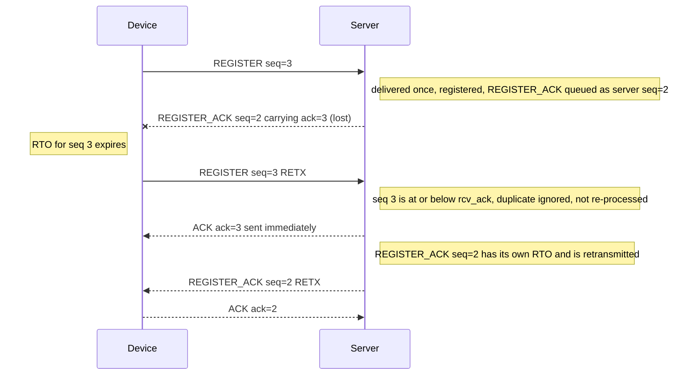
Server log for this case: `[UDP] Duplicate packet seq=3 ignored` (TC-REL-04).
The data was received, so the receiver's state is already correct. The sender's retransmission is recognised as a duplicate and **not applied again**. The immediate re-ACK stops further retransmissions. The response (REGISTER_ACK) is a reliable frame in the other direction, so its own loss is repaired separately. Since ACKs are cumulative, **any** later frame or ACK from the peer also repairs an earlier lost ACK.

### 8.8 Worked timelines
#### 8.8.1 The PDF's bonus scenario: seq 2 lost, seq 3 buffered
The diagram shows the reliability engine's behaviour for any three consecutive reliable frames from one sender. In an end-to-end run, frames 2 and 3 of one direction are often not in flight together: in epoch 0, device seq 2 (the path probe) must be ACKed before seq 3 (REGISTER) is sent. So the bonus lines appear in demo logs with whatever sequence numbers the loss pattern produces, for example config chunks 4–6. The **literal** PDF case (expected 2, received 3) is reproduced deterministically by the component test TC-REL-03, which drives the receiver directly.
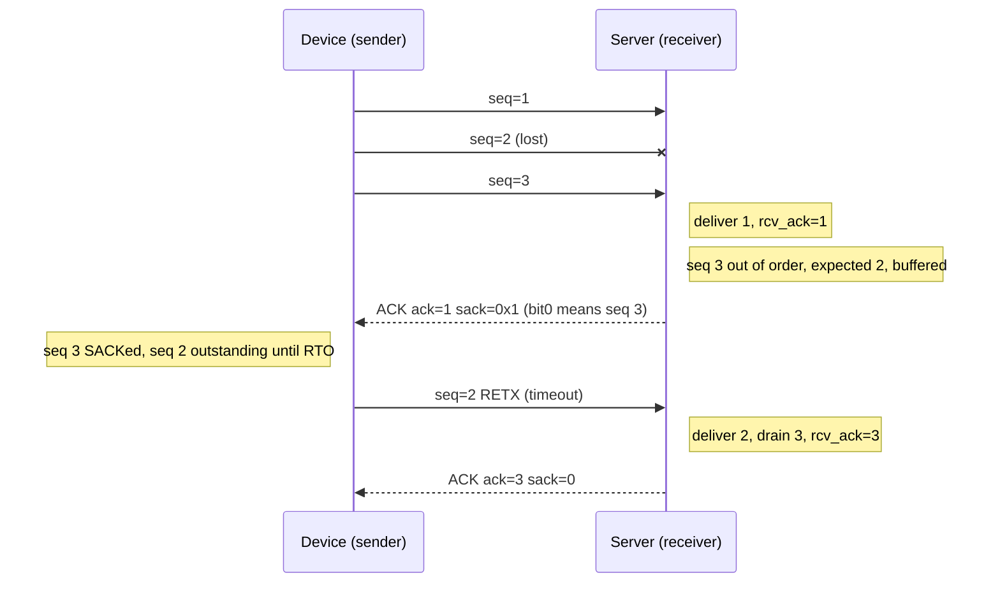
Matching logs on the receiving side (the same format as the PDF):
```
[UDP] Received packet seq=3 (out of order, expected=2)
[UDP] Buffered packet seq=3
[UDP] Retransmitting seq=2 (timeout)          <- sender side
[UDP] Delivered seq=2..3 (drained 1 buffered)
```
And with a duplicate of seq 2 arriving later: `[UDP] Duplicate packet seq=2 ignored`.

#### 8.8.2 The retransmission is lost too
seq 2 is lost again → RTO doubles (for example 400 → 800 ms) → third attempt. Each retry adds `RETX`; `retries` counts up to 8 → `SESSION_FAILED` → resume (§9.3). Probabilities at various loss rates are in §21.1 Q5.

#### 8.8.3 Network duplicates a frame
The second copy hits `s ≤ rcv_ack` → dropped and re-ACKed. The counter `rx_dup` is increased. The application never sees it.

### 8.9 Sequence wraparound
Comparisons use serial-number arithmetic (RFC 1982): `seq_lt(a,b) = (int32_t)(a-b) < 0`. A sequence space resets to 1 on every epoch. At 1000 frames/s, wrapping 2³¹ takes about 24 days. For safety, the device forces a re-key (resume) when its `next_seq` or the server's sequence it has received passes 2³⁰, with nothing in flight and not mid-upgrade: the resume starts a new epoch, which restarts both sequence spaces at 1, so wraparound is defined but never reached in practice. Log: `[UDP] Sequence numbers passed 1073741824: re-keying with a resume (new epoch)`. The test hook `--rekey-at SEQ` lowers the threshold so `tests/m5_upgrade.sh` exercises it (TC-UNIT-06).

### 8.10 Retransmission timer logic (sender side)
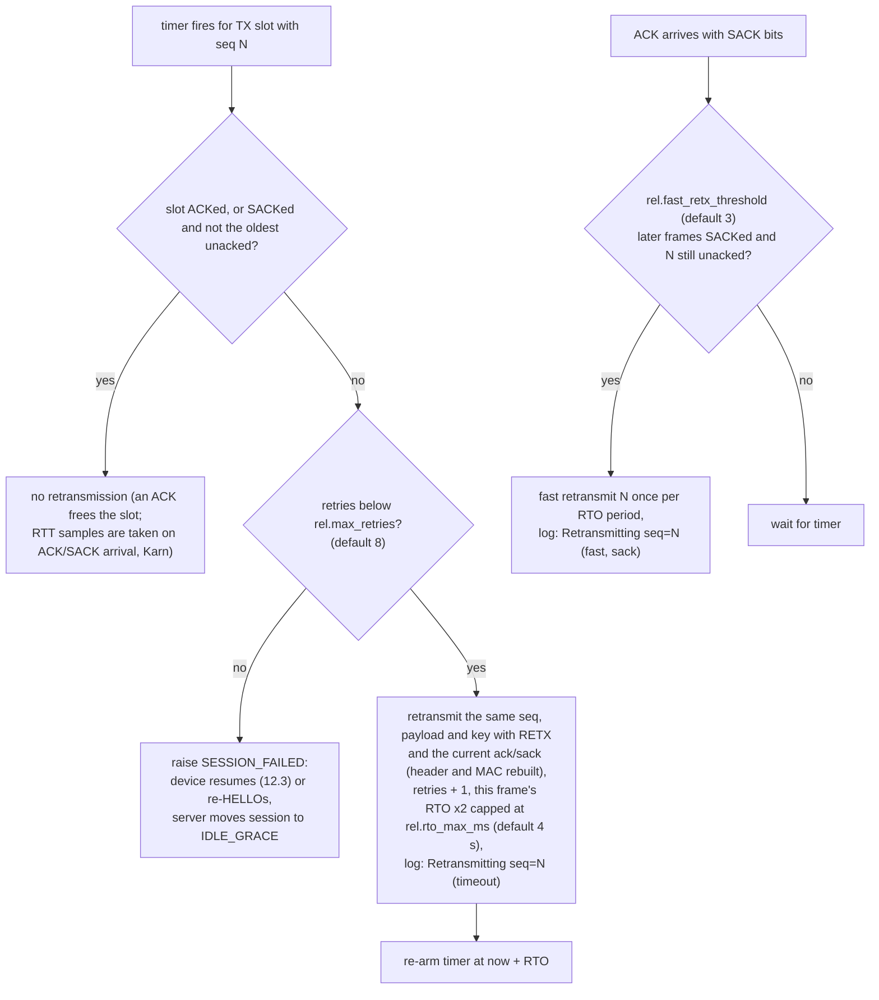

---

## 9. NAT awareness and keepalives (ZTP-FR-10, FR-11)

### 9.1 Principles
1. **The device always initiates.** The server never sends to a device that hasn't contacted it recently: a NAT drops unsolicited inbound UDP.
2. **The server replies to the source address and port of the most recent authenticated *new* frame** (never-seen seq; §5.7), not to an address carried in the payload. Re-ACKs of duplicates go to the duplicate's own source.
3. **Sessions are identified by `session_id`, not by the 5-tuple,** so a change of external port (rebinding) is survivable.
4. **The server replies from the address the device targeted.** On multi-homed servers, bind to a specific IP (`--bind`) or use `IP_PKTINFO` (Linux) or `IP_RECVDSTADDR` (BSD/macOS) to source replies correctly. Otherwise a stateful NAT or firewall drops replies that come from an unexpected address.

### 9.2 Keepalives
- **Path probe (Appendix A Step 4).** Right after HELLO_ACK, and before REGISTER, the device sends one KEEPALIVE(PATH_PROBE) under K_boot. It (a) confirms that the NAT mapping works in both directions before any state-changing request is sent, (b) gives an RTT sample (the first one if the HELLO was retransmitted, otherwise a second one), so the estimator is seeded before any state-changing request, and (c) matches the order of the PDF's Appendix A (keepalive before registration). The probe changes no authentication state on the server. K_boot comes from the **fleet** bootstrap key (§10.1), so a device whose *model* key (K_mfg) is wrong or corrupted still passes the probe. It then fails at REGISTER, which is where "Invalid HMAC" is recorded (§10.3).
- **Periodic keepalives.** The device sends KEEPALIVE when **no frame has been sent for the effective keepalive interval**. That interval is the server-advertised `KEEPALIVE_S` (resolved from policy), clamped to the device's `nat.keepalive_min_s..keepalive_max_s`; the full precedence is in §25.3. The default is 20 s in production and 2 s with the `demo` profile. The trigger is idle time, so it costs nothing while a transfer is running.
- KEEPALIVE is reliable, so a lost one is retransmitted. It is **exempt from `rel.max_retries`** (except the path probe, §8.3): it keeps being retransmitted on the RTO schedule until the dead interval (§9.3) decides. The server answers with **KEEPALIVE_ACK** (ack-class, carrying the ACK fields) as soon as the KEEPALIVE is **delivered** in order. A KEEPALIVE that arrives ahead of a gap is buffered, and triggers only the immediate ACK with SACK (§8.4); its KEEPALIVE_ACK follows when the gap is filled. In HALF_OPEN the server accepts **any number** of K_boot keepalives. Each one is answered, changes no state, and does **not** extend `nat.half_open_ttl_s`. The device normally sends one path probe, but retransmissions and test tools (TC-REL-03) may send more.
- Logs: `[NAT] Keepalive sent`, `[NAT] Keepalive acknowledged (rtt=3 ms)`.

> **Design rationale (20 s).** RFC 4787 REQ-5 requires a NAT's UDP mapping timer to be at least 2 minutes (a MUST, with narrow exceptions) and recommends 5 minutes. Measured home and CGNAT devices nevertheless often use 30–60 s, and some as little as 20 s. 20 s refreshes reliably below the common 30 s floor. The cost per device is one 44 B KEEPALIVE and one 48 B KEEPALIVE_ACK (header plus the SRV_STAGE TLV) every 20 s: 92 B of UDP payload, about 148 B on the wire with IP and UDP headers, about **60 bit/s**. On battery-powered or cellular devices the real cost is radio wake-ups, which is why the interval is set by policy and profile (§25).

### 9.3 Detecting session timeouts
| Side | Detection | Action |
|---|---|---|
| Device | No authenticated frame from the server for **`nat.dead_intervals` × keepalive** (3 × 20 = 60 s; demo 3 × 2 = 6 s), **or** the reliability engine signals `SESSION_FAILED` for a non-keepalive frame | `[NAT] Session timeout detected (no response for 6.0 s)` → if registered: **resume** (§12.3); otherwise a fresh HELLO. Reconnects use **exponential backoff with full jitter** (`net.reconnect_min_s` → `reconnect_max_s`: 1 → 60 s; demo 0.5 → 5 s), so a fleet doesn't reconnect all at once after a server outage |
| Server | No authenticated frame for **`nat.server_idle_intervals` × keepalive** (3 × 20 = 60 s; demo 6 s), or retry exhaustion of a server frame | `[NAT] [sid=7421 ZTP-93AF21] Session idle, entering grace` → `IDLE_GRACE`. Reliable TX state is discarded. After **`nat.grace_s`** (120 s; demo 30 s) the session is deleted; the DB record is kept |

> **Reviewer note: the probability of a false timeout at 20% loss per direction.** A keepalive round trip succeeds with probability 0.8 × 0.8 = 0.64, so each attempt fails with p = 0.36. The keepalive is sent one interval after the last activity, and it is retransmitted on the RTO schedule, which is not limited by `max_retries`, until the dead deadline.
> - **Production (20 s / 60 s, RTO about 200 ms doubling to the 4 s cap):** about 14 transmissions fit in the remaining 40 s, so P(false timeout) ≈ 0.36¹⁴ ≈ **6×10⁻⁷ per keepalive cycle**, about 1×10⁻⁴ per device-hour.
> - **Demo profile (2 s / 6 s):** only about 5 transmissions fit in 4 s, so P ≈ 0.36⁵ ≈ **6×10⁻³ per cycle**. A long demo run *will* see occasional false timeouts. They are harmless: the device resumes, with no re-registration and no lost progress.
>
> QA therefore checks the production-timer case for zero timeouts (TC-NAT-07), and checks recovery for the demo case (TC-NAT-13). A non-keepalive frame that exhausts its 9 transmissions (P = 0.36⁹ ≈ 1×10⁻⁴; §21.1 Q5) also ends in a resume.

### 9.4 NAT rebinding
When a frame for session S passes the MAC check, **is new** (a never-seen, in-window seq) and arrives from a different `ip:port` than `S.peer`:
`[NAT] [sid=7421 ZTP-93AF21] Peer address changed 203.0.113.7:40001 -> 203.0.113.7:40999 (rebinding)` → `S.peer` is updated, and all later replies go to the new address.

**Both conditions are required.**
- A frame with a bad MAC can't move the peer (TC-NAT-06).
- A **replayed** valid frame is a duplicate, so it can't move the peer either (TC-NAT-12). Only the key holder can produce a new seq.
- Duplicates are re-ACKed to their own source address without touching `S.peer`. A real device that rebinds while it is retransmitting still receives its ACK, and its next new frame moves the peer (§5.7, design rationale).
- With `nat.allow_ip_change = false`, a new frame from a different *IP* gets ERROR `RESUME_REQUIRED` instead (§9.7).

Simulated with the device flag `--rebind-after N`, which closes the socket and opens a new one with a new ephemeral port.

### 9.5 Keepalive and liveness state machine (device side)
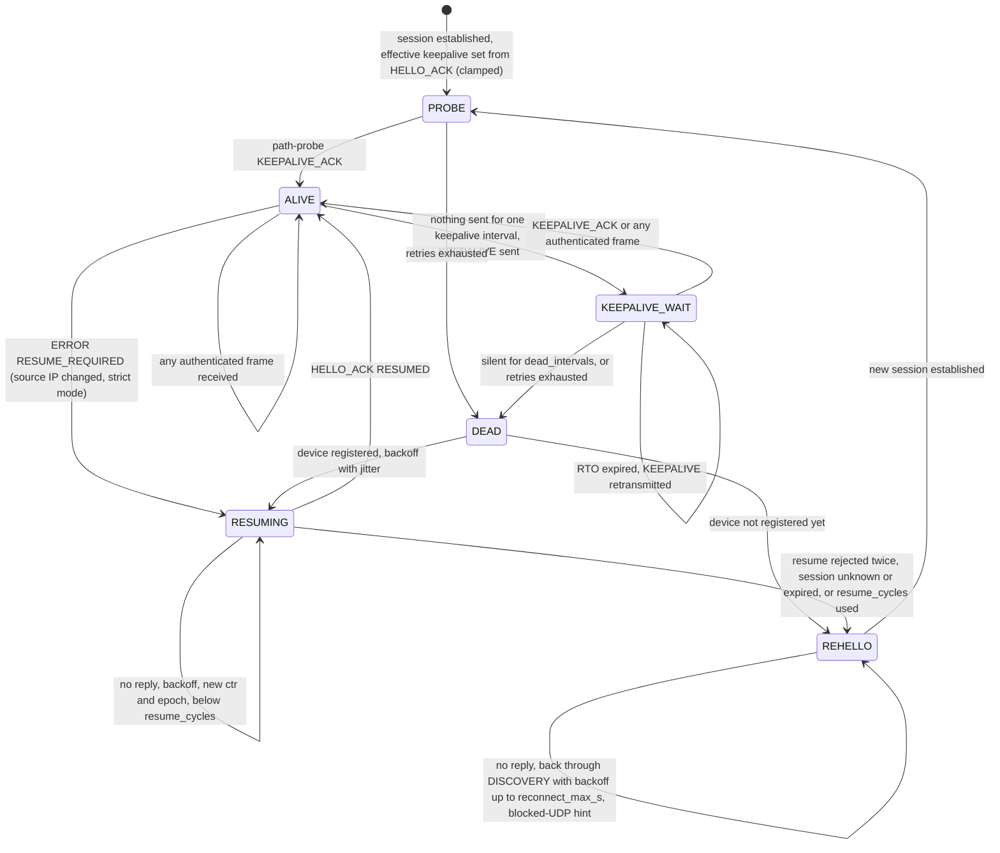
The server's view is simpler: `last_rx` is refreshed by every authenticated frame. A session idle for 3 intervals moves to `IDLE_GRACE` and is deleted after the grace period (§7.4).

### 9.6 Why keepalives and timeout detection matter in real deployments (ZTP-DEL-12; README text)
1. **NAT and firewall state expires silently.** If nothing is sent for longer than the middlebox's UDP idle timer (often 30–60 s, sometimes 20 s), the mapping disappears. The server's next reply is dropped, and *neither side notices* without a liveness mechanism. Keepalives refresh the mapping.
2. **The server can't reach the device on its own.** Behind NAT, only traffic the device initiates opens the path. The device therefore has to keep it open while it expects replies or pushes, for example during long verifications or when it's OPERATIONAL and awaiting future config changes.
3. **Fast failure detection.** Without timeouts, a device whose server has crashed, or whose link has changed (Wi-Fi to cellular, DHCP renumbering), would wait forever. Three missed intervals bound detection to about 60 s, and then resume restores the session.
4. **Server resource hygiene.** Devices that disappear (power loss, decommissioning) must not hold session memory forever. Idle detection plus the grace period reclaims it while still allowing a quick resume.
5. **Detecting rebinding.** A keepalive arriving from a new source port shows the NAT has rebound, so the server updates the return path (§9.4) before real traffic is lost.
6. **Cost-aware.** Keepalives are triggered by idle time and are small (92 bytes of UDP payload per round trip), and the interval is set by policy for battery-powered or metered links.

### 9.7 Who owns the NAT, and changes outside our control
**Ownership.** The NAT and firewall in front of a device belong to the **customer**, the site owner or the **ISP** (for CGNAT). The ZTP system can't see or configure them, and nothing in the design depends on their settings: no port forwarding, no static mappings, no UPnP or NAT-PMP, no knowledge of the NAT type. The design therefore assumes that **any NAT property can change at any time without notice** and handles each change, or reports it clearly, using only traffic the device initiates. NAT-related timers are **not** fixed: the operator configures them per deployment, profile or tenant (§25.4–§25.6), so they can be matched to what a customer's network does.

| Change made by the customer or ISP | Effect on the session | How the design responds | Config keys (§25) | Test |
|---|---|---|---|---|
| Idle timeout lowered (for example to 15 s) and still ≥ `keepalive_interval` | None | Idle-triggered keepalives refresh the mapping | `nat.keepalive_interval_s` | TC-NAT-01 |
| Idle timeout set **below** `keepalive_interval` | The mapping expires between keepalives; server replies in the gap are dropped | The next keepalive from the device creates a new mapping (a new external port). The server sees a rebinding after an idle gap and logs `[NAT] Rebinding after 21 s idle: NAT idle timeout is probably below keepalive_interval (20 s); consider lowering it`. Retransmission covers any lost replies | `nat.keepalive_interval_s`, `nat.rebind_advice` | TC-NAT-08 |
| NAT or router reboot / failover (all mappings flushed, new external port) | The next server reply is dropped | The device's retransmission or keepalive opens a new mapping. The server updates `peer` after the MAC check (§9.4). The session is kept, with no re-registration | `nat.dead_intervals` | TC-NAT-09 |
| Public IP changes (ISP renumbering, WAN failover to LTE) | Same as above, but with a new source IP | Same; the session is keyed by `session_id`, not by IP. Optionally, `nat.allow_ip_change=false` makes the server answer ERROR `RESUME_REQUIRED` (code 14), so the device must re-prove itself with the K_dev resume handshake before the new IP is accepted. This is an operator policy for deployments that want fresh nonces and a new K_s whenever a device changes network. Hijacking is already prevented without it, because only new authenticated frames move the peer (§9.4) | `nat.allow_ip_change` | TC-NAT-10 |
| NAT type changes (endpoint-independent → symmetric), or a UDP ALG is enabled | None, because the protocol never relies on hole punching or on the server learning the device's external address in advance | Device-initiated traffic only. The ALG can't change frames without breaking the MAC; a tampered frame is dropped and retransmitted | — | TC-AUTH-08 |
| **Outbound UDP to 5555/5556 blocked** by a firewall rule | No session can be set up. *This is the only case the design can't fix on its own* (the PDF requires UDP, so there is no TCP fallback) | A clear diagnostic after the discovery and HELLO budget: `[NAT] No response from 10.10.10.5:5555 after 9 HELLO transmissions: check that outbound UDP to port 5555 is allowed (firewall or NAT policy)` (1 original + `rel.max_retries` = 8 retransmissions; it is repeated after each failed reconnect cycle). The device keeps retrying with capped backoff (`net.reconnect_max_s`). This becomes a **deployment prerequisite** (PRD A-09) | `net.server_port`, `net.reconnect_max_s`, `nat.blocked_hint` | TC-NAT-11 |
| Port forwarding or a static mapping added | None (not needed, not used) | — | — | — |
| UDP rate-limited by the firewall | Shows up as loss | Normal reliability (§8). Sustained loss beyond the retry budget leads to resume with backoff | `rel.*` | TC-REL-09 |

> **Reviewer note.** The device can't measure the NAT's idle timeout directly. The *server* infers it: a rebinding after an idle gap of *g* seconds means the timeout is < *g*. That's why the hint is logged on the server, which is the operator's view, and appears in the verbose dump's Provisioning Notes. Automatic keepalive tuning (probing the timeout as RFC 5780 does) is a roadmap item (§22.3).

### 9.8 NAT emulation for testing
There's no NAT hardware, so the device gains a **NAT emulator** (`device/natsim.c`) that acts on its own socket, set with `--nat-sim` or the `sim.nat` block in the config. It logs each event under `[SIM]` (`NAT: reboot, all mappings flushed`, `NAT: mapping expired after idle: new source address <ip:port>`, …) and its totals at exit (`NAT: blocked=<n> inbound_dropped=<n>`):
- `idle_timeout_s`: if the device hasn't sent anything for this long, the emulated mapping is gone. Inbound datagrams are dropped until the device sends again, and the next send uses a **new source port**: the socket is re-bound, just as a real NAT allocates a new external port.
- `reboot_at_s`: at time T, flush the mapping immediately, regardless of idle time.
- `change_ip_at_s`: at time T, re-bind to a different source IP (for example 127.0.0.2; on Linux all of 127/8 is local, on macOS this needs a lo0 alias).
- `block_server_port`: drop every datagram to the server's port, which emulates a firewall rule.

*Planned, not built:* a real-NAT CI job (network namespaces plus `iptables -t nat MASQUERADE`, with `nf_conntrack_udp_timeout` set low) was a P2 option (QA §14). NAT behaviour is tested with the device's emulator above.

---

## 10. Identity, authentication and registration (ZTP-FR-12..14)

### 10.1 Key hierarchy
```
K_fleet        32 B   fleet bootstrap key: in every firmware image (device) / keys.json "fleet" (server)
   │
   └── K_boot = HMAC(K_fleet, "ZTP-BOOT-v1")                     DISCOVER, OFFER, fresh HELLO/HELLO_ACK,
                                                                 path-probe KEEPALIVE/ACK and HALF_OPEN ACKs,
                                                                 REGISTER_NAK, terminal ERRORs

K_mfg[model]   32 B   per-model manufacturing secret: in that model's firmware image / keys.json "models"
   │
   └── K_dev  = HMAC(K_mfg, "ZTP-DEV-v1" ‖ serial)               resume HELLO/HELLO_ACK, root of K_s
          │
          └── K_s = HMAC(K_dev, "ZTP-SK-v1" ‖ be64(Nd) ‖ be64(Ns) ‖ be32(session_id) ‖ be16(epoch))
                                                                every in-session frame (REGISTER onward)
```
- **Byte encoding of the HMAC inputs (normative).** These are the exact bytes that are MACed:
  - Labels are their ASCII bytes, with no NUL terminator and no length prefix.
  - The serial is its ASCII bytes as carried in the SERIAL TLV (for example the 10 bytes `ZTP-93AF21`), again with no terminator or length prefix.
  - `Nd` and `Ns` are the 64-bit nonces as carried in NONCE_DEV and NONCE_SRV, written as **8-byte big-endian** values (`be64`). The session id is `be32` and the epoch `be16`, matching the header. The K_s message after the label is therefore always 22 bytes.
  - The reference vectors for TC-UNIT-16 are in `tests/test_crypto.c`. They were computed independently with Python's `hmac` module, and K_boot was cross-checked with `openssl dgst -sha256 -mac HMAC`.
- **Two roots with separate jobs.**
  - `K_fleet` (through K_boot) only lets a peer *take part in the bootstrap*: discover the server, open a half-open session, probe the path, and receive an authenticated rejection. It proves **nothing about identity**.
  - `K_mfg` (through K_dev and K_s) proves that a device is a genuine unit of its model, and that the server can provision it.
- **Why two roots** (the decision made in review): with a single per-model key, a device with a wrong key failed silently at HELLO, so the server never learned of the attempt and the PDF's "Failed / Invalid HMAC" outcome couldn't be produced realistically. With a fleet bootstrap key, every such device reaches REGISTER. The server then *verifies* that REGISTER fails, records "Invalid HMAC", and sends a NAK the device can authenticate.
- **Domain separation** by label strings means one key is never used for two purposes.
- The server derives `K_dev` on demand from `(model, serial)`. **No per-device secrets are stored on the server.**
- **Mutual authentication.**
  - The device authenticates the server *as a fleet member* through the HELLO_ACK MAC under K_boot, which binds Nd.
  - It authenticates the server *as authorised for its model* through REGISTER_ACK under K_s, which only a holder of K_mfg can produce.
  - A rogue server holding only K_fleet is therefore detected at REGISTER_ACK at the latest, and can cause only denial of service (§18.3).
- **Demo key material.** For the demo and CI, the factory keys are derived deterministically, so the device binary and `conf/keys.json` agree without a provisioning step: `K_fleet = SHA-256("ZTP-DEMO-K_fleet")` and `K_mfg[model] = SHA-256("ZTP-DEMO-K_mfg:" ‖ model)` (`device/keys.c`). A unit test checks that `conf/keys.json` matches. A real product embeds random per-fleet and per-model secrets and keeps `keys.json` out of version control.
- Comparisons use constant time (`ct_memeq`). Nonces and IDs come from the CSPRNG. Keys are wiped (`explicit_bzero` or a volatile loop) when a session is freed.

**Key derivation, as a diagram:**
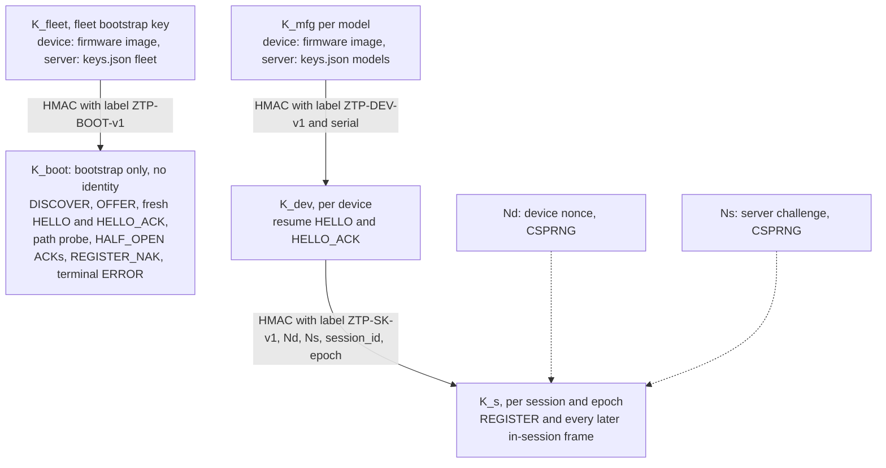

### 10.2 REGISTER contents (ZTP-FR-12)
| Field | Example | Purpose |
|---|---|---|
| SERIAL | ZTP-93AF21 | Identity (must match the HELLO) |
| MODEL | EDGE-GW-100 | Metadata, selects the policy and K_mfg |
| FW_VER | v1.0 | Metadata, drives the upgrade decision |
| HW_REV | A1 | Metadata (informational) |
| NONCE_REG | 0x00000000000F04F8 (984312) | The nonce the PDF requires; input to the replay cache; echoed in a NAK |
| NONCE_SRV | Ns from HELLO_ACK | Explicit proof of freshness (it is also bound in K_s) |
| *(frame MAC)* | trunc16(HMAC(K_s, …)) | Authenticity and integrity of all of the above |
| *(header)* session_id | 7421 | The session it belongs to. Appendix A lists it as a REGISTER field; here it is carried in the authenticated header |

The device logs these fields at the default level, in the same layout as Appendix A Step 5, so the log shows what was sent:
```
[AUTH] REGISTER: session_id=7421 soft_serial=ZTP-93AF21 model=EDGE-GW-100 firmware=v1.0 nonce=984312
```

### 10.3 Verification and failure paths (ZTP-FR-13)
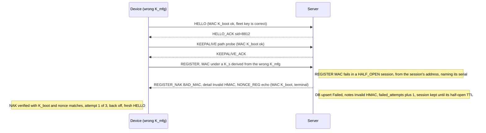

**Why the session is kept after an Invalid HMAC (as built, M7 review).** A REGISTER that fails K_s proves only that the MAC is wrong, not who sent it: a device with the wrong model key and a forged frame look the same. So the failure is recorded only for a well-formed REGISTER that names the session's serial, arrives from the session's own address, and is the session's first failure. The session is **not** discarded: a forged frame from an on-path observer (the session id is cleartext in the HELLO_ACK) cannot end a genuine device's registration, whose valid REGISTER still succeeds. The wrong-key device itself backs off and opens a fresh session (the NAK it verifies tells it to); the abandoned half-open session expires after `nat.half_open_ttl_s`. Retransmissions of the failed REGISTER get the same NAK. The residual risk is that such an observer can add a failed attempt to a serial's row; it cannot change a Success or block one.

**Every registration outcome is defined:**
| Case | Detected at | Server reply (key) | DB effect | Device action | Log (device) |
|---|---|---|---|---|---|
| Success | REGISTER MAC ok, policy found | REGISTER_ACK (K_s) | Success row (or upsert) | → CONFIG | `[AUTH] Registration successful`, `[AUTH] Assigned tenant: …` |
| **Wrong model key** (counterfeit, corrupted or mis-provisioned K_mfg; the demo's `--bad-key` corrupts K_mfg only) | REGISTER MAC fails | REGISTER_NAK `BAD_MAC` (K_boot) | Failed, notes **"Invalid HMAC"** | Retry with a fresh session; FAILED after `auth.register_attempts` (3) | `[AUTH] Registration failed: Invalid HMAC (1/3)` … `(3/3), giving up` |
| Nonce reused | REGISTER MAC ok, NONCE_REG in cache | REGISTER_NAK `REPLAY` (K_boot) | failed_attempts + 1 | Retry once with a new nonce | `[AUTH] Registration rejected: REPLAY, retrying with a new nonce` |
| Model known, no policy (`default.action = reject`) | REGISTER MAC ok | REGISTER_NAK `NO_POLICY` (K_boot) | Failed, notes "No policy" | FAILED at once (retrying can't help) | `[AUTH] Registration failed: NO_POLICY` |
| **Unknown model** (no K_mfg for it in keys.json) | HELLO (MODEL TLV, after the K_boot MAC passes) | terminal ERROR `UNKNOWN_MODEL` (K_boot); no session created | Failed, notes "Unknown model" (identity unverified; see the protection rule below) | FAILED at once | `[AUTH] Registration failed: UNKNOWN_MODEL` |
| Wrong **fleet** key (not a fleet device at all) | HELLO MAC fails | none (silent drop; only K_boot could authenticate a reply) | none (counter `mac_fail`) | Retries, then the blocked-path hint (§9.7) | `[NAT] No response from …` |

**Rules**
- The device **verifies every NAK and terminal ERROR** with K_boot, and checks the echoed nonce (NONCE_REG for a NAK, Nd for a HELLO-time ERROR, Nd′ for a resume ERROR) against its outstanding request. An off-path attacker can't forge a rejection. An on-path attacker holding K_fleet could, but such an attacker can deny service anyway (§18.3).
- **DB protection:**
  - A failure for a serial that already has a `Success` row **never** overwrites its status. It only increases `failed_attempts` and sets `last_failure`. Otherwise an attacker holding only the fleet key could make legitimate devices look failed.
  - Failed rows for serials with no prior Success are capped at `limits.max_failed_records` (default 10 000, evicting the oldest first), so K_fleet holders can't grow the DB without bound.
- Only a **REGISTER** in a HALF_OPEN session counts as a registration attempt. Any other MAC failure is a silent drop (counter `mac_fail`), because that is noise or an attack, not a credential problem.

### 10.4 Replay protection (ZTP-FR-14): defence in depth
| # | Mechanism | Defeats | Notes |
|---|---|---|---|
| 1 | **Server challenge Ns bound into K_s** (and echoed in REGISTER) | Replaying a captured REGISTER into any *other* session, because that session has a different Ns, hence a different K_s, so the MAC fails | The **primary** defence; needs no clock and no server memory beyond the live session |
| 2 | **Anti-replay on seq within an epoch** (the reliability window: `s ≤ rcv_ack` or already buffered → dropped, and **never moves the peer address**, §9.4) | Replaying any frame inside the same session, including from another address | The same mechanism as IPsec ESP's anti-replay window (RFC 4303 §3.4.3) |
| 3 | **REGISTER nonce cache**: per serial, the last `limits.nonce_cache_per_serial` (64) NONCE_REG values, TTL `limits.nonce_ttl_s` (600 s), `limits.nonce_cache_total` (4096) entries overall, LRU | A device or test hook re-using a nonce; also defence in depth if Ns generation is ever weak | Rejects with `REPLAY` (TC-AUTH-06) |
| 4 | **Resume counter and proposed epoch** (`resume_ctr` and `proposed_epoch`, both monotonic and persisted on the device *before* it sends; journaled and fsynced on the server before the HELLO_ACK, §14.4) | Replaying an old resume HELLO to disrupt a live session, even across a server restart | The same ctr and Nd′ → cached reply (a genuine retransmission); an older ctr, or a different Nd′ with the same ctr → `RESUME_REJECTED` |
| 5 | **Epoch in the header and in K_s** | Frames from an earlier epoch, after a resume | Dropped cheaply before the MAC |
| 6 | **disc_nonce** in DISCOVER/OFFER | Replaying an old OFFER to redirect discovery | §6.2 |
| 7 | **Nonce echo in every rejection**: NONCE_REG in REGISTER_NAK; Nd or Nd′ in every terminal ERROR | Replaying a captured NAK or ERROR (UNKNOWN_MODEL, SERVER_BUSY, SESSION_UNKNOWN/EXPIRED, RESUME_REJECTED) to push a device to FAILED or to force a re-registration | The device accepts a rejection only for its outstanding nonce (TC-AUTH-14, TC-AUTH-15) |

> **Reviewer note.** Mechanism 3 is largely redundant with mechanism 1. It's kept because the PDF explicitly asks for a nonce, and because it remains useful if the server nonce ever repeats, for example through a CSPRNG failure. Its state is lost when the server restarts, which is acceptable because mechanism 1 still holds.

Attack walkthroughs (all of them tested in QA §7):
1. **Replay REGISTER in the same session** → seq ≤ rcv_ack → dropped as a duplicate (mechanism 2), even if it is sent from the attacker's own address (TC-NAT-12).
2. **Replay REGISTER after a new HELLO** (the attacker holds K_fleet and opens a session with a stolen serial, but has no K_mfg) → the K_s differs, so the MAC fails → counted as a failed attempt, and an existing Success status isn't overwritten (§10.3).
3. **Replay a fresh HELLO** → returns the cached HELLO_ACK, or creates a half-open session that the attacker can't use and that expires after `nat.half_open_ttl_s`. A **live session is never superseded by a HELLO** (§7.3; TC-SESS-09).
4. **Replay a resume HELLO** → `resume_ctr` is not newer → rejected.
5. **Forged OFFER** → bad MAC or wrong disc_nonce → ignored.
6. **Replayed NAK or terminal ERROR** → the echoed nonce doesn't match the outstanding request → ignored. This applies even to a passive observer that captured a valid K_boot reply.

The demo exercises 1 and 2 with `ztp-device --replay-test`. The hook keeps the raw bytes of its accepted REGISTER datagram, then:
- **(a)** re-sends them unchanged into the live session. Result: a duplicate, re-ACKed, with no state change.
- **(b)** opens a *second* half-open session with a fresh HELLO, which **never registers**. It splices the captured REGISTER into that session, the way an attacker would, by rewriting the header `session_id` to the new one. Because the MAC covers the header and the K_s is different, the MAC fails: the server records one failed attempt (`failed_attempts` = 1) and sends a BAD_MAC NAK to that half-open session, which the hook ignores. The device's real session and its Success row are untouched (`attempts` stays 1).

### 10.5 Rate limiting and resource bounds
- A token bucket per source IP for HELLO and DISCOVER: `limits.hello_rate_per_ip` (10/s), burst `limits.hello_burst` (20). Excess datagrams are **dropped silently**, with a rate-limited log line. No reply is sent, so floods aren't amplified.
- Half-open sessions are capped at `limits.max_half_open` (256), total sessions at `limits.max_sessions` (1024), and Failed rows without a prior Success at `limits.max_failed_records` (10 000). When the session tables are full, a valid HELLO gets the terminal ERROR `SERVER_BUSY` (K_boot), and the device backs off.
- > **Reviewer note (CGNAT).** Many devices may share one public IP behind CGNAT, so the per-IP limit is deliberately generous and is **not** used for identification. A stateless cookie (as in DTLS HelloVerifyRequest) is the proper fix for HELLO floods and is a roadmap item (§22.3).

---

## 11. Configuration and firmware provisioning (ZTP-FR-15..19)

### 11.1 Artifacts
| Artifact | Example | Size | Chunks |
|---|---|---|---|
| Config v3 (EDGE-GW-100) | `artifacts/cfg_v3.json` | ≈ 2.3 KB | 3 (matching the PDF's "chunk 1/3") |
| Config v2 (legacy) | `artifacts/cfg_v2.json` | ≈ 1.8 KB | 2 |
| Firmware v1.1 | `artifacts/fw_EDGE-GW-100_v1.1.bin` | 65 536 B **including** the 64-byte header | 64 |
| Firmware v1.0 | `artifacts/fw_EDGE-GW-050_v1.0.bin` | 49 152 B including the header | 48 |

Config (JSON, ZTP-FR-15). It is a **strict superset** of the PDF's Appendix A "Example Configuration": the keys `interfaces.wan = "eth0"`, `interfaces.lan = "eth1"`, `mtu = 1500` and `keepalive_interval = 20` appear unchanged, and QA checks them verbatim (TC-PDF-03). JSON was chosen over YAML (§25.2): the same strict in-house parser (`common/json.c`) reads the provisioned config and every configuration file.
```json
{
  "config_version": 3,
  "tenant": "cruise_ops",
  "interfaces": { "wan": "eth0", "lan": "eth1" },
  "mtu": 1500,
  "keepalive_interval": 20,
  "ntp": ["10.10.10.1"], "syslog": "10.10.10.2:514",
  "vlans": [ { "id": 10, "name": "mgmt" }, { "id": 20, "name": "data" } ],
  "acl": [ "...padding entries to make a realistic 3-chunk payload..." ]
}
```
Mock firmware (ZTP-FR-16): a 64-byte header followed by deterministic pseudo-random bytes (seeded by model and version), made by `tools/mkartifacts`:
```
magic "ZTPFW\0" | fmt u8 | model[16] | version[8] | payload_len u32 | reserved | payload…
```
The device's "running firmware version" is read from the header of the **active slot**, so the validation check (§13) tests something real.

### 11.2 Transfer protocol: device pulls
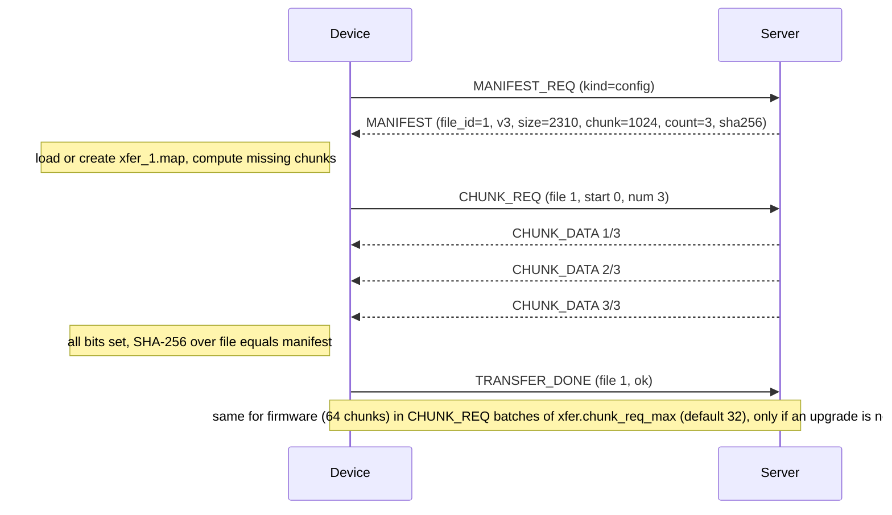
- The device requests **contiguous runs of missing chunks**, at most 32 per CHUNK_REQ. The server queues them into the session's reliable sender, which drains at the window W = 8 and reads each chunk from the artifact file on demand (`pread`), so server memory is O(W), not O(file).
- Logs: `[PROVISION] Receiving config (chunk 2/3)`, `[PROVISION] Config checksum verified`, `[PROVISION] Firmware 40/64 (62%)` (progress every 8 chunks). The chunk counts assume the default 1024 B chunks. After an MTU fallback (§5.8) the same files are 256 B chunks (the 3-chunk config becomes 10 chunks).

> **Design rationale: pull, not push.** (1) **Resume is trivial**: the device knows exactly what it has and asks for the rest. (2) **The server keeps no transfer state** beyond the current request queue, so a server restart or a device crash needs no coordination. (3) The device paces the flow (flow control at the receiver), which suits constrained devices. The cost is one extra request per 32 chunks, which is negligible.

### 11.3 Integrity (ZTP-FR-18)
- **Per frame:** the HMAC under K_s covers each chunk, so corruption or tampering in transit is dropped and retransmitted.
- **Per file:** SHA-256 over the assembled artifact must equal `MANIFEST.sha256` before the file is used. This catches bugs in assembly or on disk, and a mismatch between the artifact and the manifest on the server.
- On mismatch: `[PROVISION] Checksum mismatch, discarding (attempt 1/2)` → the partial file and bitmap are deleted → full re-download. `xfer.hash_attempts` (2) counts the **total** number of downloads, so the second mismatch logs `(attempt 2/2)` and ends in STATUS_REPORT(FAILED, HASH_MISMATCH).

### 11.4 Resume after failure (ZTP-FR-19)
- **Persistence:** `xfer_<id>.part` (preallocated to `size`; chunks written at offset `i × CHUNK_SIZE`) and `xfer_<id>.map` (`sha256`, `size`, `chunk_size`, `count`, bitmap). The map is a small text file: a `ztp-xfermap 1` line, then `key=value` lines, with the bitmap as hex (bit *i*, least significant bit first in each byte, is chunk *i*; bits past `count` must be 0). A map whose `sha256` or `size` differs from the current manifest is discarded, and so is a malformed one; the download then starts from scratch. The map is written atomically (§15.3) **every `xfer.persist_every_chunks` (16) chunks** and on clean shutdown.
- **Durability order (required for crash consistency):** the map may claim only chunks that are already durable. So every map update runs in this order:
  1. `fsync(part_fd)` (on macOS `fcntl(F_FULLFSYNC)`, because plain `fsync` there doesn't flush the drive cache);
  2. write `map.tmp`;
  3. `fsync(map.tmp)`;
  4. `rename` it over the map;
  5. `fsync(dirfd)`.

  After power loss the map can therefore *under*-claim chunks (they are fetched again, which is harmless), but it never *over*-claims them. The whole-file SHA-256 check (§11.3) is the final guard either way.
- On restart, or after the session is lost, the device sends MANIFEST_REQ again. **If the manifest's sha256 equals the map's** → it continues and requests only the missing chunks: `[PROVISION] Resuming firmware: 32/64 chunks present, requesting 32`. If they differ (the artifact changed on the server) → the partial is discarded (TC-PROV-10). If only the chunk size differs (an MTU fallback, §5.8), the bitmap is converted (one 1024 B chunk = four 256 B chunks) and the partial is kept.
- **File names.** The transfer files are `xfer_<kind>.part` and `xfer_<kind>.map`, keyed by file kind (1 config, 2 firmware) rather than the server's FILE_ID, because a FILE_ID can change when the server restarts with a different policy; the manifest's sha256 decides whether a partial still applies.
- > **Reviewer note.** Because the map is written every 16 chunks (`xfer.persist_every_chunks`), up to 16 chunks may be fetched again after a crash (a kill between a chunk write and the next map save). They are already on disk, but their bits weren't persisted. That's a deliberate tradeoff of fsync cost against refetch cost, and it is harmless because writing a chunk is idempotent.

### 11.5 Per-file transfer state machine (device side)
One instance runs per artifact: config first, then firmware.
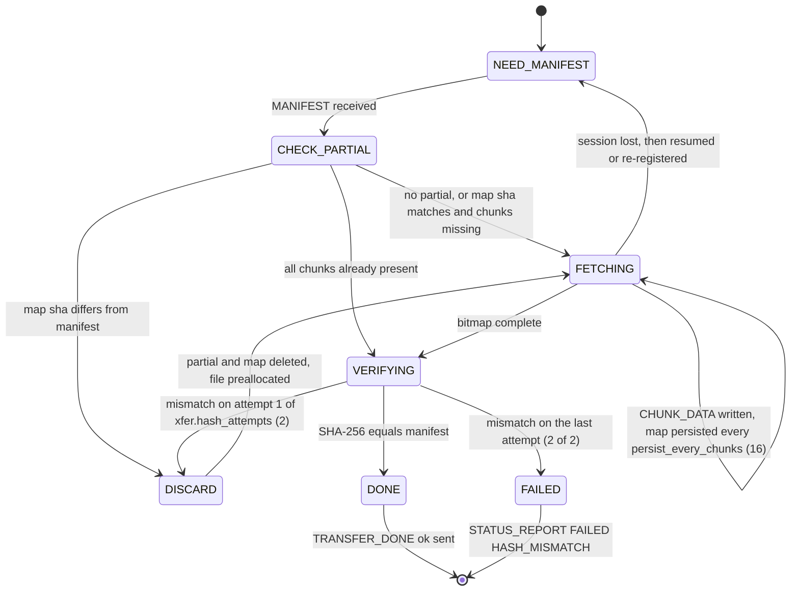

---

## 12. Version upgrade and restart (ZTP-FR-21..23)

### 12.1 Deciding and installing
1. REGISTER_ACK (or a resume HELLO_ACK) carries `FW_TARGET`. The device compares it with its running version, numerically per dotted component (`v1.10 > v1.9`; TC-UNIT-12).
2. If `running ≥ target`: log `[UPGRADE] Firmware v1.1 is current, no upgrade required`, then go to VALIDATE.
3. Otherwise:
   - log `[UPGRADE] Current: v1.0 -> Target: v1.1`;
   - download into the **inactive slot** (§11);
   - verify its SHA-256 and its header (model and version match);
   - persist `stage=FW_STAGED` (event E13, §15.4). From this point, a crash never causes a re-download.
4. Send UPGRADE_STATUS(INSTALLING) reliably and **wait for its ACK**. The server moves the session to `AWAIT_RESUME` and the DB stage to `UPGRADING`.
5. **Commit point.** Atomically write `device.state` with `active_slot=B`, `pending_reboot=1`, `stage=FW_INSTALLED`, `fw_target=v1.1`, `session_id`, `epoch` and `resume_ctr`. The slot switch *is* this state write, so there is exactly one atomic commit.
6. Log `[UPGRADE] Upgrade complete, restarting device`, flush the logs, then `execv(self_path, saved_argv)`.

### 12.2 Restarting the process (ZTP-FR-22)
- `self_path` is resolved once at startup:
  - Linux: `readlink("/proc/self/exe")`;
  - macOS: `_NSGetExecutablePath` followed by `realpath`, because `realpath(argv[0])` fails when the binary was found through `PATH`.

  The original argv is saved.
- All fds have `FD_CLOEXEC`, so the socket and log file don't leak across the exec. Logs are reopened in append mode. The new process opens a **new UDP socket**, which means a new NAT mapping (§3.7 T-12).
- The test hook `--restart-mode=exec|exit` exists because a real reboot is better simulated by a supervisor restarting the process (`exit(75)`, and `run_demo.sh` relaunches it). Both paths go through the same boot logic.
- After the exec the device logs, in order:
  - `[BOOT] Device starting (boot #2)`
  - `[BOOT] Restart detected (pending upgrade to v1.1)`
  - `[BOOT] Soft serial loaded`
  - `[BOOT] Soft serial: ZTP-93AF21`
  - `[BOOT] Firmware version: v1.1 (slot B)`

### 12.3 Resuming without duplicate registration (ZTP-FR-23)
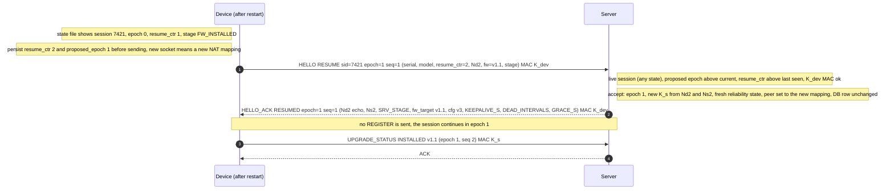
- **Wire rules.**
  - **Device:** before sending, it persists `resume_ctr + 1` **and** `proposed_epoch = max(epoch, proposed_epoch) + 1` (one atomic write; both are kept in `device.state`). Every attempt, whether after a crash, a restart, a budget exhaustion or `RESUME_REJECTED`, applies the same rule, so the device never proposes an epoch it has proposed before, even if it crashed after the server accepted the previous proposal.
  - The resume HELLO is **seq 1 of the proposed epoch** and is MACed under K_dev. Every RESUME HELLO goes to the resume path *before* the epoch filter (§5.7).
  - **Server rules on the resume path**, applied in order after the K_dev MAC check:
    1. `resume_ctr` and `Nd′` equal to the accepted ones: a **retransmission**. Resend the cached HELLO_ACK to the datagram's source; nothing else changes.
    2. `resume_ctr > last_resume_ctr` **and** `proposed epoch > current epoch`: **accept**. Journal the new epoch, ctr and peer, and fsync (§14.4) **before** sending HELLO_ACK, so a server crash can never forget an epoch the device was told about. Then set epoch = proposed and start a fresh reliability state.
    3. Anything else: terminal ERROR `RESUME_REJECTED`, echoing Nd′.
  - **Why it can't deadlock.** Epochs need not be consecutive (only "greater than"). If the device crashes after sending, or the server crashes after accepting, the next attempt carries a higher ctr *and* a higher epoch than anything either side has stored, so it is accepted (TC-UPG-11).
  - Once accepted, both sides use the new epoch with the receive state `rcv_ack = 1`. On receiving HELLO_ACK (RESUMED), the device persists `epoch = proposed_epoch` (E16), and its next frame is seq 2.
- **Accepted in every live server state** (§7.4), not only AWAIT_RESUME. This covers a device that crashed mid-download and restarted before the server noticed (scenario S3): the server simply starts the new epoch and discards the old epoch's TX state. The pull-based transfer (§11) re-requests whatever is missing.
- **Survives a server restart.** Resumable session records (no keys) are journaled (§14.4), so a restarted server restores the session and accepts the resume.
- Logs: `[UDP] Session resumed (session_id=7421) epoch=1` on the device (the Appendix A Step 8 text, verbatim as a prefix), and `[AUTH] [sid=7421 ZTP-93AF21] Resume accepted (ctr=2, epoch=1), no re-registration` on the server.

**Fallbacks**
| Situation | Server reply | Device behaviour | DB effect |
|---|---|---|---|
| Session deleted after `nat.grace_s` (the server keeps a tombstone for 24 h) | terminal ERROR `SESSION_EXPIRED` (K_boot) | Fresh HELLO + REGISTER | Same row (upsert by serial). Provisioning note (verbose dump) "Re-registered after session expiry". **No duplicate row** |
| Session id never seen, or the tombstone has expired | terminal ERROR `SESSION_UNKNOWN` (K_boot) | Fresh HELLO + REGISTER | As above |
| `resume_ctr` not newer than the last seen | terminal ERROR `RESUME_REJECTED` (K_boot) | Increase the counter, persist it, retry once; if rejected again, fresh HELLO + REGISTER | none (provisioning note "Re-registered" if it re-registers) |
| No reply to the resume HELLO (server down, path blocked, or a bad K_dev MAC silently dropped) | — | The resume HELLO budget is exhausted (E17b): back off with jitter and **resume again** (a new ctr and epoch), for up to `net.resume_cycles` (10; demo 3) cycles. Only then fresh HELLO + REGISTER | none (provisioning note "Re-registered" if it re-registers) |

> **Design rationale.** Persisting `resume_ctr` instead of `K_s` means **no session key is ever written to disk**, on either side. The resume proves possession of K_dev again, and the new Nd2 and Ns2 give fresh keys for the new epoch. The persisted state is therefore not a secret, apart from what the firmware image already contains.

### 12.4 Crash consistency of the upgrade
Each crash point has a hook value, `--crash-at <point>`, which TC-UPG-07 tests one by one.

| Crash point (`--crash-at`) | Disk state on the next boot | Recovery |
|---|---|---|
| `download`: during the download | `.part` + `.map` | Resume the missing chunks (§11.4) |
| `downloaded`: after the download, before the hash check | Complete `.part`, stage still CONFIG_OK | Re-hash on boot, then verify (continue) or discard (re-download) |
| `verified`: after verify, before the commit (step 5) | Slot B written, `stage=FW_STAGED`, state says slot A | Boot still uses A (v1.0); re-verify B's hash, send UPGRADE_STATUS, commit. **No re-download** |
| `committed`: after the commit, before the exec | State says slot B and `pending_reboot` | The normal "restart detected" path |
| `post-exec`: after the exec, before the resume | The same | Resume |
| `resume-sent`: right after the resume HELLO leaves (TC-UPG-11 (a)) | The same, with `resume_ctr` and `proposed_epoch` already persisted | The next boot proposes a higher ctr and epoch, accepted whether or not the server accepted the first (§12.3) |

*As built (M5).* `--crash-at download` aborts after the 20th firmware chunk written by the current process, and `--crash-after-chunks N` after the N-th (chunks already on disk from an earlier run don't count). A crash hook calls `abort()` after closing the log, so the log shows `[TEST] TEST HOOK FIRED: crash-at <point>` as its last line. If `execv` itself fails, the device logs the error and exits 75, so a supervisor can restart it.

### 12.5 Rollback
If validation on the new firmware fails (§13), for example a version mismatch or the test hook `--fail-validate`:
1. Switch `active_slot` back (an atomic state write).
2. Log `[UPGRADE] Validation failed on v1.1, rolled back to v1.0`.
3. Send UPGRADE_STATUS(ROLLED_BACK) and STATUS_REPORT(FAILED, VALIDATION_FAILED).

The DB keeps registration `Success` with stage `FAILED`, and the provisioning note (verbose dump) "Rolled back after failed validation". If **no upgrade happened** (the firmware was already current), there is nothing to roll back: the device reports FAILED directly (§13.1).

### 12.6 Upgrade state machine (A/B slots)
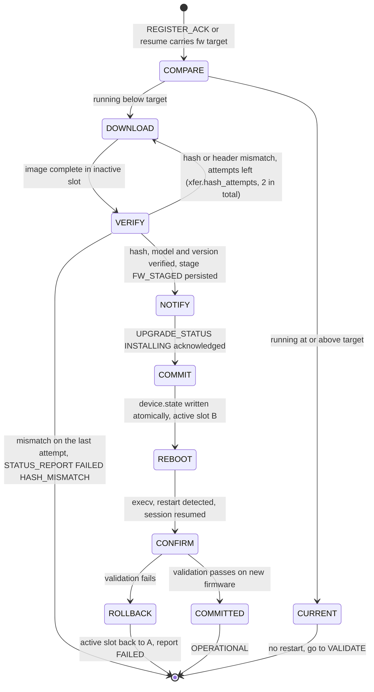

---

## 13. Validation and operational state (ZTP-FR-24..27)
| Check | Pass condition | Log |
|---|---|---|
| Configuration available | `config.json` exists, SHA-256 equals the stored `cfg_sha256`, required keys `interfaces`, `mtu`, `keepalive_interval` and `config_version` present (parsed with the strict JSON parser, §25.2), and `config_version` equals the assigned value | `[VALIDATION] Configuration present (v3, sha ok)` |
| Firmware version | After an upgrade: the active slot's header version equals `fw_target`, and its hash equals the stored hash. With no upgrade (running ≥ target, §12.1 step 2): the running version is still the one that decision accepted | `[VALIDATION] Firmware v1.1 verified` |
| Session health | (a) a **fresh** KEEPALIVE(HEALTH_PROBE) round trip within 2 × RTO; (b) last authenticated RX < 1 keepalive interval ago; (c) SRTT < `val.srtt_max_ms` (1000 ms). The probe is retransmitted on the RTO schedule until `val.deadline_s` (§13.1) | `[VALIDATION] Session healthy (rtt=2 ms)` |

If all three pass → STATUS_REPORT(OPERATIONAL), and wait for STATUS_ACK → `[STATE] Device is OPERATIONAL`. Persist `stage=OPERATIONAL`. The device stays in operational mode, sending keepalives. With `run.exit_when_operational = true` (the `demo` profile, or `--exit-when-operational`) it exits 0 after `run.operational_hold_s` (2 s by default; 5 s in the `demo` profile, so at least one periodic keepalive is logged) (§23 OQ-8).

*As built (M5).* If the session is lost during VALIDATE (backoff, resume, or a fresh session), `val.deadline_s` still runs: past it the device goes FAILED (`Session not healthy within val.deadline_s`) without waiting to reconnect, because there is no session to report on (TC-VAL-04 (b)). Check (b) is implied by (a): the probe's ACK is itself an authenticated frame received within the round trip. A health probe that comes back slower than 2 × RTO, or with SRTT at or above `val.srtt_max_ms`, is simply sent again, until `val.deadline_s`. `val_deadline` is set when VALIDATE is first entered and is kept across a resume, so a session lost during validation doesn't restart the clock.

If a check fails: a firmware mismatch after an upgrade triggers the rollback (§12.5), while a mismatch with no upgrade in this run reports FAILED directly. A missing or corrupt config triggers one re-fetch of the config, then FAILED. An unhealthy session waits for recovery (resume) until `val.deadline_s` (180 s; demo 30 s), then FAILED.

### 13.1 Validation flow, the transition to OPERATIONAL
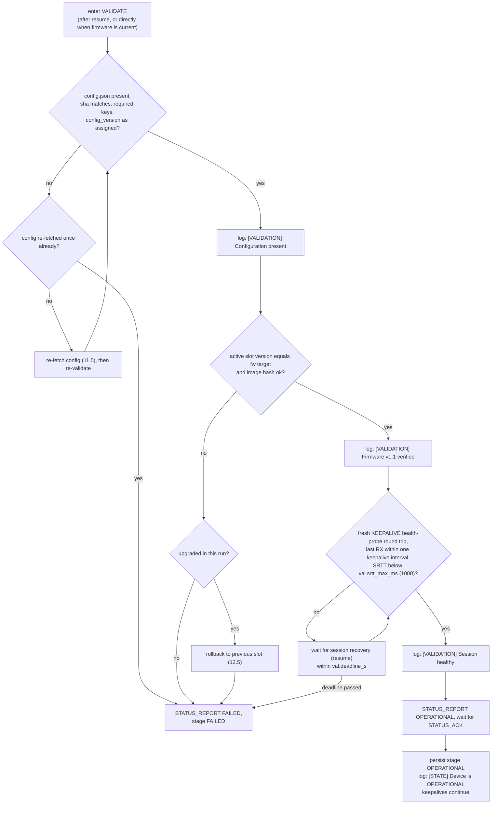

---

## 14. Server design (ZTP-FR-28..32)

### 14.1 Concurrency model
```
loop:
    timeout = timer_heap_next_deadline() - now
    poll([ctl_sock:5555, disc_sock:5556, self_pipe], timeout)
    drain self_pipe          -> SIGUSR1: dump DB; SIGINT/SIGTERM: dump + summary + exit
    drain each socket until EAGAIN (at most 64 datagrams per wakeup, for fairness)
        -> netsim_rx -> decode -> verify -> session lookup -> reliable_rx -> handler
    run expired timers       -> retransmissions, delayed ACKs, idle and grace expiry, half-open TTL
    flush per-session send queues within the window
```
> **Design rationale: a single-threaded event loop, not threads.**
> - UDP has **one socket for all devices**. Per-device threads would still demultiplex from a single socket, adding locks and handoffs without adding parallelism where it matters.
> - All session state is touched by one thread, so **there are no locks, no data races, and logs come out in a deterministic order**. That makes the reliability tests reproducible with a seed.
> - Per datagram the work is one HMAC plus a handful of copies: ~µs. One core handles tens of thousands of datagrams per second, far above the needs here (TC-PERF-01).
> - **Scale-out path:** N processes using `SO_REUSEPORT`, with an eBPF or hash steering on `session_id`, plus a shared DB (§22.3).
>
> "Concurrent" in ZTP-FR-28 therefore means **interleaved progress across many sessions**, visible in the server log (TC-SRV-09), not OS threads.

### 14.2 Session table
- An open-addressing hash table keyed on `session_id`, with **2048 slots**, so the load stays ≤ 0.5 at the 1024-session cap. A secondary index `serial → session_id` enforces **one registered session per serial**.
- **Supersede rule.** A session for a serial is replaced **only** when a new REGISTER (verified under K_s) or a resume (verified under K_dev) arrives for that serial, never by a HELLO alone (§7.3). The server logs `[UDP] [sid=9930 ZTP-93AF21] Session 7421 superseded by 9930`.
- Each session holds: peer address, epoch, keys, the reliability engine state, stage, assignment and effective NAT values, last_rx, timers, `last_resume_ctr`, and response caches (HELLO_ACK and the last resume HELLO_ACK).
- Expiry runs from the timer heap, using generation counters so a stale timer is ignored.
- > **Implementation status (M6).** Built as described. The heap is *lazy*: every event that touches a session (a datagram routed to it, a state change, a timer) marks it dirty, and once per loop iteration each dirty session pushes one entry, holding its earliest deadline (engine retransmission or delayed ACK, half-open TTL, grace, idle) and a new generation number. An entry whose generation is older, or whose session is gone, is stale and dropped when it reaches the top; when stale entries outnumber live sessions 4 to 1 the heap is rebuilt. A session whose engine has failed (retries exhausted) is due at once, so the failure is handled on the next pass, as the old scan did. The `serial → session` index is a hash chain per serial bucket (the lookups keep their state filters: one half-open, one registered), the REGISTER nonce cache keeps its ring but chains slots per serial, and the session table is rebuilt when deleted markers reach a quarter of it, so a lookup of an unknown id never walks the whole table. The previous linear scans (M3–M5) are gone.

### 14.3 Policy engine (ZTP-FR-29)
The policy lives in `conf/policy.json`; its full format, including NAT and session overrides per tenant, model and serial, is in **§25.6**. In summary:
- **Assignment:** `serials.<serial>` > `models.<model>` > `default`. A model with no key in `keys.json` gets the terminal ERROR `UNKNOWN_MODEL` at HELLO. A model that has a key but no assignment, under `"default": {"action": "reject"}`, gets REGISTER_NAK `NO_POLICY` after its REGISTER is verified (§10.3).
- **Per model:** `firmware`, `firmware_file`, `config_version`, `config_file`, `tenant`, `notes` (EDGE-GW-100 → v1.1 / cfg v3 / cruise_ops; EDGE-GW-050 → v1.0 / cfg v2 / cruise_ops / "Legacy device").
- **NAT and session parameters** (keepalive, dead intervals, grace, IP-change policy) resolve per device as serial > model > tenant > `server.json`, and are advertised to the device in HELLO_ACK (§25.3).

At startup each artifact is loaded, sized and hashed. A missing or unreadable artifact is a **fatal configuration error**: it fails fast at boot instead of failing a device in the middle of provisioning. Logs: `[AUTH] Assigned tenant: cruise_ops`, `[PROVISION] Policy: EDGE-GW-100 -> fw v1.1, cfg v3`.

### 14.4 Registration database (ZTP-FR-30)
**Record (in memory, one per serial):**
| Field | Type | Example |
|---|---|---|
| device_id (soft serial) | str | ZTP-93AF21 |
| model / hw_rev | str | EDGE-GW-100 / A1 |
| **registration_status** | enum Success / Failed. **A DB row is created only at a verdict**: REGISTER verified (Success), a verified credential or policy failure, or UNKNOWN_MODEL. Half-open sessions live only in memory, so they never create rows, never touch an existing row, and vanish on expiry | Success |
| **registration_time** (first success, or first attempt if it never succeeded) | UTC ms | 2026-11-10 14:32:10 |
| **firmware_assigned** | str | v1.1 |
| fw_initial | str | v1.0 |
| **config_version** | u16 | 3 |
| tenant | str | cruise_ops |
| stage | enum, the same values as SRV_STAGE (§5.4.3): HELLO, REGISTERED, CONFIG_SENT (config TRANSFER_DONE ok), FW_SENT (firmware TRANSFER_DONE ok), UPGRADING (UPGRADE_STATUS INSTALLING), UPGRADED (UPGRADE_STATUS INSTALLED), OPERATIONAL (STATUS_REPORT OPERATIONAL), FAILED (any verified failure). Transitions are monotonic, except FAILED | OPERATIONAL |
| attempts / failed_attempts | u16 | 1 / 0 |
| last_seen, last_src | UTC, ip:port | … |
| **notes** (registration outcome and policy; shown in the default dump) | str | "Legacy device", "Invalid HMAC", "Unknown model" |
| provisioning_notes (verbose dump only) | str | "Transfer resumed", "Resumed after upgrade", "Re-registered after session expiry", "Rolled back after failed validation", "Datagram limit reduced to 508" |

**Durability:** every change is appended as one JSON line to `state/db.jsonl` (`fflush` + `fsync`, or `F_FULLFSYNC` on macOS, on registration and session events; buffered for stage events). At startup the server replays the journal to rebuild memory, so **records survive server restarts**, and duplicate detection keeps working across them (TC-SRV-06). The journal is compacted on clean shutdown. As built (M7 review):
- **No ACK without the fsync.** If the synced write behind a registration fails (disk full, I/O error), the server answers REGISTER_NAK `SERVER_BUSY` ("storage unavailable") instead of REGISTER_ACK, and logs it; the device backs off and retries. Registrations are refused this way until a synced write succeeds again.
- **Torn last line.** A crash can leave a partial last line; replay skips it, and the server then ends that line with a newline before appending, so the next event does not merge into the fragment and get lost with it.
- **Printable identity strings.** SERIAL, MODEL, FW_VER and HW_REV must be printable ASCII on the wire (a HELLO or REGISTER with anything else is dropped or rejected), and the journal escapes any other byte (`\u00XX`) as a second line of defence, so every line stays valid JSON for replay.
- **Bounded session history.** Deleted sessions are kept for 24 hours (the window in which a re-registration is noted "after session expiry") and dropped at startup and at compaction, so the journal does not grow with every session ever seen.
```json
{"ts":"2026-11-10T14:32:10.412Z","serial":"ZTP-93AF21","ev":"REGISTER_OK","model":"EDGE-GW-100","fw_initial":"v1.0","fw_assigned":"v1.1","cfg":3,"tenant":"cruise_ops","src":"127.0.0.1:50123"}
{"ts":"2026-11-10T14:32:10.413Z","ev":"SESSION","sid":7421,"serial":"ZTP-93AF21","model":"EDGE-GW-100","epoch":0,"last_resume_ctr":1,"state":"REGISTERED","max_dgram":1200}
{"ts":"2026-11-10T14:32:11.643Z","ev":"SESSION","sid":7421,"serial":"ZTP-93AF21","model":"EDGE-GW-100","epoch":1,"last_resume_ctr":2,"nd_resume":"9f…","ns_resume":"41…","state":"PROVISIONING","max_dgram":1200}
{"ts":"2026-11-10T14:32:13.020Z","serial":"ZTP-93AF21","ev":"STAGE","stage":"OPERATIONAL"}
```

**Resumable session records** (the decision made in review). Every session-state change (REGISTERED, epoch change, AWAIT_RESUME, deletion) appends a `SESSION` event holding `sid`, serial, model, epoch, `last_resume_ctr`, state, the session datagram limit, the effective NAT values and the peer. An accepted resume is journaled **and fsynced before the HELLO_ACK is sent** (§12.3), including its `Nd′` and `Ns2`. These are public nonces, not keys, so a restarted server can re-derive K_s and rebuild the identical HELLO_ACK for a retransmitted resume HELLO (server rule 1). It holds **no keys**: a resume re-derives K_s from K_dev and fresh nonces. At startup the server restores every non-deleted session into **IDLE_GRACE with a new `nat.grace_s` timer**. A device that was mid-provisioning or upgrading when the server restarted therefore *resumes*, with no second REGISTER (TC-PROV-09, TC-SRV-10). Half-open sessions aren't persisted, so a device whose REGISTER was in flight simply registers once. Deleted sessions leave a 24-hour **tombstone** so that a resume can be answered `SESSION_EXPIRED` rather than `SESSION_UNKNOWN`.
> **Design rationale.** An append-only journal is the simplest storage that is both crash-safe and auditable, and it needs no dependencies. SQLite is the obvious next step (§22.3).

### 14.5 Dump and summary (ZTP-FR-31, FR-32)
Triggered by `SIGUSR1` (while running), by `SIGINT` or `SIGTERM` (dump, summary, exit), or by `--dump-on-exit`/`--run-for N` (demo). Written to stdout, the server log and `logs/db_dump.txt`.

**Default dump: exactly the PDF's "Example of a Dump from Server DB".** It has the same title, the same six columns in the same order (*Device ID, Registration Status, Firmware Assigned, Config Version, Registration Time, Notes*), the same time format (`YYYY-MM-DD HH:MM:SS`), `—` for empty cells, and the same notes text ("Invalid HMAC", "Legacy device"). **Rows are sorted by Registration Time, then Device ID**, as in the PDF example (which is in time order). Rows exist only for verdicts (§14.4), so the dump never shows half-finished registrations. Times are compared with **millisecond precision** (the dump prints seconds), which is why rows that show the same second are still deterministically ordered. It is checked by TC-PDF-02.
```
Device Registration Details
+------------+---------------------+-------------------+----------------+---------------------+------------------+
| Device ID  | Registration Status | Firmware Assigned | Config Version | Registration Time   | Notes            |
+------------+---------------------+-------------------+----------------+---------------------+------------------+
| ZTP-93AF21 | Success             | v1.1              | v3             | 2026-11-10 14:32:10 | —                |
| ZTP-84BC19 | Failed              | —                 | —              | 2026-11-10 14:32:10 | Invalid HMAC     |
| ZTP-71DD08 | Success             | v1.1              | v3             | 2026-11-10 14:32:10 | —                |
| ZTP-55AC90 | Success             | v1.1              | v3             | 2026-11-10 14:32:11 | —                |
| ZTP-19FE77 | Success             | v1.0              | v2             | 2026-11-10 14:32:11 | Legacy device    |
+------------+---------------------+-------------------+----------------+---------------------+------------------+
```
The five demo devices, their outcomes, versions and notes reproduce the five rows of the PDF's example. Only the timestamps differ, because they are real. In the default dump, **Notes** holds only registration-outcome and policy notes, as in the PDF: "Invalid HMAC", "Unknown model", "Legacy device".

**Extended dump** (`--dump-verbose`, also written to `logs/db_dump_verbose.txt`). It appends extra columns *after* the PDF's columns, so the PDF format is never broken: `Model | FW Initial | Tenant | Stage | Attempts | Failed Attempts | Last Seen | Last Source | Provisioning Notes`. The last column holds events such as "Transfer resumed", "Resumed after upgrade" and "Re-registered after session expiry".

**The summary follows the dump:**
```
Summary
  Registered successfully : 4   ZTP-93AF21, ZTP-71DD08, ZTP-55AC90, ZTP-19FE77
  Failed registration     : 1   ZTP-84BC19 (Invalid HMAC, 3 attempts)
  Firmware / config per device:
    ZTP-93AF21  EDGE-GW-100  v1.0 -> v1.1  cfg v3  cruise_ops  upgraded + resumed
    ZTP-71DD08  EDGE-GW-100  v1.0 -> v1.1  cfg v3  cruise_ops  upgraded + resumed
    ZTP-55AC90  EDGE-GW-100  v1.1 (current) cfg v3 cruise_ops
    ZTP-19FE77  EDGE-GW-050  v0.9 -> v1.0  cfg v2  cruise_ops  legacy, upgraded + resumed
  Protocol counters: rx=1834 tx=1702 retx_timeout=215 retx_fast=96 dup=142 ooo=118 out_of_window=0 mac_fail=3 replay_rejected=2 rate_limited=0
```
*(The counters shown are illustrative.)*

### 14.6 Robustness and limits
| Concern | Control |
|---|---|
| Malformed input | The ordered checks in §5.6; the in-process fuzzer `--self-fuzz` (`server/fuzz.c`, TC-SRV-07) |
| Memory | Fixed caps: 1024 sessions, 256 half-open, 64 queued frames per session, nonce cache of 4096. No allocation inside the per-datagram path after a session is created |
| Floods | Per-IP token bucket (silent drop); half-open TTL of 10 s; `SERVER_BUSY`; Failed rows without a prior Success capped at `limits.max_failed_records` (§10.3) |
| Slow or stuck devices | Idle → grace → delete; no unbounded queues |
| Bad configuration | Fail fast at startup (missing artifact, unparseable policy, missing key for a model) |

### 14.7 Server data model
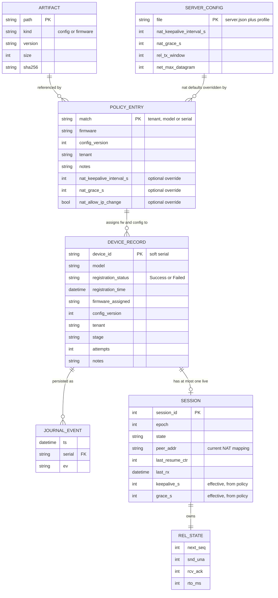

### 14.8 Concurrent devices on one event loop
Three of the demo devices register at the same time. Each datagram is processed to completion in microseconds, so the sessions interleave without locks.
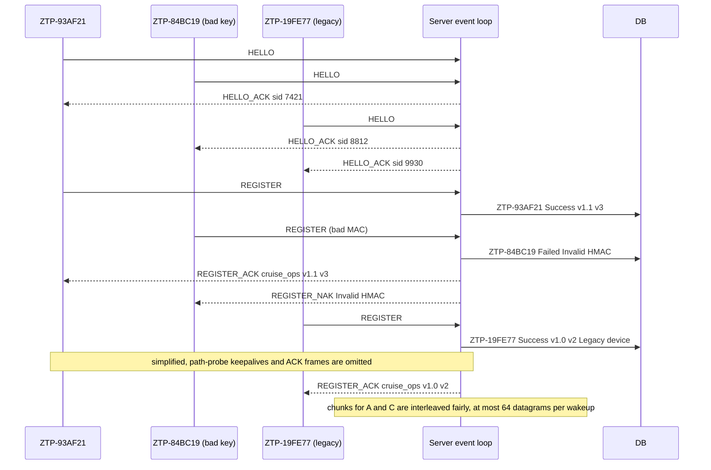

### 14.9 Coverage of the PDF's §9 "Server Robustness"
| PDF §9 point | Design element | QA |
|---|---|---|
| Handle multiple devices registering concurrently | Single-threaded event loop with per-session state machines (§14.1, §14.8) | TC-SRV-01/09, TC-PERF-01 |
| Accept and process registration requests from multiple devices at the same time | No device blocks another; fair draining of datagrams; rate limits per IP (§10.5) | TC-SRV-09, TC-AUTH-10 |
| Determine and assign the appropriate firmware and configuration per device | Policy engine: serial > model > default (§14.3) | TC-SRV-02, TC-UPG-06 |
| Track 1. device identifier | `device_id` (§14.4) | TC-SRV-03 |
| Track 2. timestamp of registration | `registration_time` | TC-SRV-03 |
| Track 3. firmware version assigned | `firmware_assigned` | TC-SRV-03 |
| Track 4. configuration version assigned | `config_version` | TC-SRV-03 |
| Track 5. registration outcome (success or failure) | `registration_status` + `notes` | TC-SRV-03, TC-AUTH-03 |
| In-memory structure or database (file-backed or in-memory) | Both: in-memory table plus the `db.jsonl` journal | TC-SRV-06 |
| Dump the contents of the database | Default dump in the PDF format (§14.5) | TC-SRV-04, TC-PDF-02 |
| Summary: devices successfully registered | "Registered successfully" line | TC-SRV-05 |
| Summary: devices that failed registration | "Failed registration" line with reasons | TC-SRV-05 |
| Summary: firmware and configuration versions per device | "Firmware / config per device" block | TC-SRV-05 |

---

## 15. Device state machine and persistence

### 15.1 State machine
```mermaid
stateDiagram-v2
    [*] --> BOOT
    BOOT --> DISCOVERY: no live session in state file
    BOOT --> RESUME: session_id saved and stage at least REGISTERED
    BOOT --> FAILED: stage FAILED saved
    DISCOVERY --> SESSION: OFFER verified, or static address (configured or fallback)
    SESSION --> REGISTER: HELLO_ACK verified and path-probe KEEPALIVE acknowledged
    SESSION --> DISCOVERY: HELLO budget exhausted or SERVER_BUSY, backoff, blocked-UDP hint
    SESSION --> FAILED: ERROR UNKNOWN_MODEL
    REGISTER --> CONFIG: REGISTER_ACK
    REGISTER --> SESSION: REGISTER_NAK BAD_MAC or REPLAY, attempts below auth.register_attempts
    REGISTER --> FAILED: NAK NO_POLICY, or BAD_MAC on the last attempt
    CONFIG --> FIRMWARE: config verified
    FIRMWARE --> VALIDATE: firmware already current
    FIRMWARE --> UPGRADE: target newer, image verified, FW_STAGED persisted
    UPGRADE --> RESTART: UPGRADE_STATUS acknowledged, commit written
    RESTART --> BOOT: execv
    RESUME --> CONFIG: resumed, stage REGISTERED
    RESUME --> FIRMWARE: resumed, stage CONFIG_OK
    RESUME --> UPGRADE: resumed, stage FW_STAGED
    RESUME --> VALIDATE: resumed, stage FW_INSTALLED
    RESUME --> OPERATIONAL: resumed, stage OPERATIONAL
    RESUME --> RESUME: no reply or RESUME_REJECTED once, backoff, new ctr and epoch, below resume_cycles
    RESUME --> SESSION: SESSION_UNKNOWN, SESSION_EXPIRED, RESUME_REJECTED twice, or resume_cycles used
    VALIDATE --> OPERATIONAL: all checks pass and STATUS_ACK received
    VALIDATE --> FAILED: check failed after rollback, re-fetch or deadline
    OPERATIONAL --> RESUME: session timeout or ERROR RESUME_REQUIRED
    FAILED --> [*]
```
**Rules not drawn as separate arrows:**
- A **session timeout** (E22) in REGISTER, CONFIG, FIRMWARE, UPGRADE or VALIDATE goes to RESUME if the device is registered (persisted stage ≥ REGISTERED), and to SESSION if not. Work then continues from the persisted stage, using the RESUME arrows above.
- **ERROR `RESUME_REQUIRED`** (E25) from any connected state goes to RESUME.
- **MTU fallback** (E27): a delivered fill frame with `MTU_REDUCED`, or the device's own black-hole detection, keeps the state and re-requests the current manifest at the fallback datagram limit (§5.8).
- **FAILED is terminal** for the process: it logs the reason and exits 1. A device restarted while its persisted stage is FAILED stays FAILED until an operator runs it with `--reset-state` (§19.2).

**Device FSM state → persisted `stage` (§15.3) → server DB stage (§14.4):**
| Device FSM state (on entry or exit) | Persisted `stage` after it | Server DB stage when it is reported |
|---|---|---|
| REGISTER, REGISTER_ACK received | REGISTERED | REGISTERED |
| CONFIG, verified | CONFIG_OK | CONFIG_SENT |
| FIRMWARE, image verified | FW_STAGED | FW_SENT |
| UPGRADE, commit | FW_INSTALLED | UPGRADING (on INSTALLING) |
| RESUME after an upgrade | FW_INSTALLED | UPGRADED (on INSTALLED) |
| OPERATIONAL | OPERATIONAL | OPERATIONAL |
| FAILED | FAILED | FAILED |

### 15.2 Mapping states to log tags
| State | Tag | Example |
|---|---|---|
| BOOT | `[BOOT]` | `Device starting`, `Soft serial: ZTP-93AF21`, `Firmware version: v1.0` |
| DISCOVERY | `[DISCOVERY]` | `Provisioning server found 127.0.0.1:5555 (OFFER verified)` / `Using static server IP 10.10.10.5:5555` |
| SESSION/RESUME | `[UDP]` | `Session established (session_id=7421)`, `Session resumed (session_id=7421) epoch=1` |
| SESSION (path probe) | `[NAT]` | `Keepalive sent`, `Keepalive acknowledged` |
| REGISTER | `[AUTH]` | `Registration successful`, `Assigned tenant: cruise_ops` |
| CONFIG/FIRMWARE | `[PROVISION]` | `Receiving config (chunk 1/3)` |
| UPGRADE/RESTART | `[UPGRADE]` | `Current: v1.0 -> Target: v1.1` |
| VALIDATE | `[VALIDATION]` | `Firmware v1.1 verified` |
| OPERATIONAL | `[STATE]` | `Device is OPERATIONAL` |
| FAILED | `[STATE]` | `Device is FAILED (reason: Invalid HMAC)` |

### 15.3 Persisted state (`<state-dir>/device.state`, key=value)
```
format=1
serial=ZTP-93AF21          model=EDGE-GW-100   hw_rev=A1
boot_count=2               active_slot=B       pending_reboot=0
stage=FW_INSTALLED         # NEW|REGISTERED|CONFIG_OK|FW_STAGED|FW_INSTALLED|OPERATIONAL|FAILED (§5.4.3)
session_id=7421            epoch=1             proposed_epoch=1   resume_ctr=2
server=127.0.0.1:5555      tenant=cruise_ops   max_dgram=1200
fw_target=v1.1             fw_sha256=…         cfg_version=3      cfg_sha256=…
reg_attempts=0             last_fail_reason=
```
(One key per line in the real file.) Other files in the state directory: `config.json`, `fw_slot_A.bin`, `fw_slot_B.bin`, `xfer_<id>.part`, `xfer_<id>.map`.

**Atomic write procedure** (`util_atomic_write`, used for every state, map and slot change):
1. write `file.tmp`;
2. `fsync(fd)` (macOS: `fcntl(fd, F_FULLFSYNC)`);
3. `rename(tmp, file)`;
4. `fsync(dirfd)`.

A reader therefore sees either the old file or the new one, never a torn mixture (TC-UNIT-13). On a parse error at boot, `device.state.bak` (the previous generation) is used. It is created as part of each atomic write: before the `rename`, the current file is hard-linked to `device.state.bak` (replacing the old one), and the directory fsync covers both. The durability ordering for the transfer map is in §11.4.

> **Reviewer note.** The state file contains no secrets (§12.3). The factory keys (`K_fleet`, `K_mfg`) live in the binary, as they would in a firmware image.

### 15.4 Event catalogue (device FSM)
Events come from four sources:
- **NET:** an authenticated, in-order frame delivered by the reliability layer, or a verified terminal frame.
- **TMR:** the timer heap.
- **SYS:** process start or signals.
- **INT:** the result of a local check.

| # | Event | Source | Valid in state(s) | Guard | Action | Next state |
|---|---|---|---|---|---|---|
| E1 | `START` | SYS | — | state file says no live session | serial generated, loaded or assigned (§6.1); log BOOT lines | DISCOVERY |
| E2 | `START_RESUME` | SYS | — | `session_id` saved, stage ≥ REGISTERED and ≠ FAILED | log `Restart detected` if `pending_reboot`; persist resume_ctr + 1 and proposed_epoch = max(epoch, proposed_epoch) + 1 (atomic); send resume HELLO | RESUME |
| E2a | `START_FAILED` | SYS | — | stage FAILED saved | log the reason, exit 1 (until `--reset-state`) | FAILED |
| E3 | `OFFER_OK` / `STATIC_ADDR` | NET / SYS | DISCOVERY | OFFER MAC and nonce ok / static mode | log `Provisioning server found` | SESSION |
| E4 | `DISC_TIMEOUT` | TMR | DISCOVERY | `discovery.attempts` used | fall back to the static address | SESSION |
| E5 | `HELLO_ACK` | NET | SESSION | Nd echo matches, K_boot MAC ok | derive K_dev and K_s; adopt clamped KEEPALIVE_S and DEAD_INTERVALS; send path-probe KEEPALIVE | SESSION (probing) |
| E6 | `PROBE_ACK` | NET | SESSION | — | RTT sample; send REGISTER | REGISTER |
| E6a | `HELLO_BUDGET_EXHAUSTED` | reliability | SESSION | no HELLO_ACK after 1 + `rel.max_retries` transmissions | log the blocked-UDP hint (§9.7); backoff | DISCOVERY |
| E6b | `ERROR_UNKNOWN_MODEL` | NET | SESSION | K_boot MAC ok, Nd echo matches | log `[AUTH] Registration failed: UNKNOWN_MODEL`; persist FAILED | FAILED |
| E6c | `ERROR_SERVER_BUSY` | NET | SESSION | K_boot MAC ok, Nd echo matches | backoff with jitter | DISCOVERY |
| E7 | `REGISTER_ACK` | NET | REGISTER | K_s MAC ok | persist stage REGISTERED, session_id, epoch; MANIFEST_REQ(config) | CONFIG |
| E8 | `REGISTER_NAK` | NET | REGISTER | K_boot MAC ok, NONCE_REG matches | BAD_MAC: attempts++, backoff. REPLAY: new nonce, attempts++. NO_POLICY: persist FAILED | SESSION; or FAILED (NO_POLICY, or BAD_MAC at `auth.register_attempts`) |
| E9 | `MANIFEST` | NET | CONFIG, FIRMWARE | — | per-file FSM (§11.5) | (unchanged) |
| E10 | `CHUNK_DATA` | NET | CONFIG, FIRMWARE | chunk not already present | write at offset; set bit; persist the map every `xfer.persist_every_chunks` | (unchanged) |
| E11 | `FILE_VERIFIED` | INT | CONFIG | config sha ok | TRANSFER_DONE; persist CONFIG_OK | FIRMWARE |
| E12 | `FW_CURRENT` | INT | FIRMWARE | running ≥ target | log "no upgrade required" | VALIDATE |
| E13 | `FW_VERIFIED` | INT | FIRMWARE | image sha and header ok | TRANSFER_DONE; persist FW_STAGED; UPGRADE_STATUS(INSTALLING) | UPGRADE |
| E13a | `FW_HASH_FAILED` | INT | FIRMWARE | mismatch after `xfer.hash_attempts` | STATUS_REPORT(FAILED, HASH_MISMATCH); persist FAILED | FAILED |
| E14 | `UPGRADE_ACKED` | NET | UPGRADE | — | atomic commit (§12.1 step 5) | RESTART |
| E15 | `EXEC` | INT | RESTART | — | flush logs, `execv` | BOOT (new process) |
| E16 | `RESUMED` | NET | RESUME | K_dev MAC ok, epoch = proposed, Nd′ echo matches | **persist epoch = proposed_epoch**; log `Session resumed`; continue from the persisted stage (FW_INSTALLED: send UPGRADE_STATUS(INSTALLED)) | CONFIG / FIRMWARE / UPGRADE / VALIDATE / OPERATIONAL (see §15.1) |
| E17 | `RESUME_REJECTED` | NET | RESUME | first time, Nd′ echo matches | resume_ctr + 1 and proposed_epoch + 1, persist, resend resume HELLO | RESUME |
| E17b | `RESUME_BUDGET_EXHAUSTED` | reliability | RESUME | no HELLO_ACK after 1 + `rel.max_retries` transmissions | backoff with jitter; if cycles < `net.resume_cycles`: new ctr and epoch, resend resume HELLO; else fresh HELLO | RESUME, or SESSION |
| E17a | `RESUME_REJECTED` (second time) / `SESSION_UNKNOWN` / `SESSION_EXPIRED` | NET | RESUME | Nd′ echo matches | fresh HELLO, then REGISTER | SESSION |
| E18 | `VALIDATION_OK` | INT | VALIDATE | 3 checks pass (§13.1) | STATUS_REPORT(OPERATIONAL) | VALIDATE (await ack) |
| E19 | `STATUS_ACK` | NET | VALIDATE | — | persist OPERATIONAL; log `[STATE] Device is OPERATIONAL` | OPERATIONAL |
| E20 | `VALIDATION_FAIL` | INT | VALIDATE | after rollback (if upgraded), re-fetch or deadline | STATUS_REPORT(FAILED); persist FAILED | FAILED |
| E21 | `IDLE` | TMR | SESSION…OPERATIONAL | nothing sent for one keepalive interval | KEEPALIVE | (unchanged) |
| E22 | `SESSION_DEAD` | TMR / reliability | any connected state | silent for `nat.dead_intervals`, or a non-keepalive frame exhausted its retries | log timeout; backoff with jitter | RESUME (registered) / SESSION |
| E23 | `RTO` | TMR | any | unacked frame | retransmit (§8.10) | (unchanged) |
| E24 | `SIGINT` / `SIGTERM` | SYS | any | — | persist the map and state, print counters, exit | — |
| E25 | `RESUME_REQUIRED` | NET | any connected state | ERROR code 14 (strict IP-change mode, §9.7) | run the resume handshake on the current socket | RESUME |
| E26 | `CONFIG_INVALID` | SYS | start | config fails validation (§25.8) | print key, value, file and range; exit 78 | — |
| E27 | `MTU_REDUCED` | NET / TMR | CONFIG, FIRMWARE | a CHUNK_DATA fill frame with flag `MTU_REDUCED` delivered, or no CHUNK_DATA for two `net.pmtu_blackhole_s` intervals (a re-request in between) after an ACKed CHUNK_REQ while small server frames arrive (§5.8) | datagram limit 508; re-request the current manifest with MAX_DGRAM 508; convert the bitmap | (unchanged) |

### 15.5 Device event loop
```mermaid
flowchart TD
    S0["start: load config (defaults, profile, device.json, CLI), validate, exit 78 on error"] --> S0b["open log (append), load or create device.state,<br/>open a new UDP socket (new NAT mapping)"]
    S0b --> S1["boot logic: first boot, restart detected, or resume? Pick the start state"]
    S1 --> L["event loop"]
    L --> P["poll(socket, timeout = next timer deadline)"]
    P --> R{"datagram ready?"}
    R -- yes --> RX["receive pipeline (5.7, via netsim and NAT emulator if enabled),<br/>deliver in-order frames as NET events to the FSM"]
    R -- no --> TM["fire expired timers as TMR events:<br/>RTO, delayed ACK, keepalive, liveness, backoff"]
    RX --> TX["flush the send queue within window W"]
    TM --> TX
    TX --> Q{"FSM in RESTART?"}
    Q -- yes --> EX["flush logs, execv self (same argv)"]
    Q -- no --> Z{"OPERATIONAL with exit flag, or FAILED?"}
    Z -- yes --> END["print counters, exit 0 or 1"]
    Z -- no --> L
```

---

## 16. Loss, reorder and duplicate simulation (ZTP-BON-06)

### 16.1 The in-code `netsim` shim (default)
`netsim_sendto()` and `netsim_recvfrom()` wrap the socket calls on both binaries. They are active only when any flag is non-zero. **All impairments are applied on the sender's TX side only**, so a configured value is exactly the per-direction impairment. With `--loss 0.15` on both the server and a device, each direction loses 15% of its datagrams, inside the PDF's 10–20% band. (Applying loss at both TX and RX would compound to 1 − 0.85² ≈ 28%, which is why that is not done.)

| Flag (config key) | Effect | Applied |
|---|---|---|
| `--loss P` (`sim.loss`) | Drop the datagram with probability P | Sender TX |
| `--reorder P` (`sim.reorder`) | With probability P, hold the datagram in a delay queue for `--reorder-delay MS` (`sim.reorder_delay_ms`, 30 ms), so later datagrams overtake it | Sender TX |
| `--dup P` (`sim.dup`) | With probability P, send a second copy (after 0–10 ms) | Sender TX |
| `--delay MS` and `--jitter MS` (`sim.delay_ms`, `sim.jitter_ms`) | Base latency, plus a uniform jitter of ± `jitter_ms` | Sender TX |
| `--sim-mtu N[:emsgsize\|:blackhole]` (`sim.mtu`, `sim.mtu_mode`) | Datagrams larger than N either fail with `EMSGSIZE` (the default mode) or are silently dropped (black hole). This drives §5.8 portably, with no sudo | Sender TX |
| `--seed N` (`sim.seed`) | Seeds a **separate** xorshift PRNG (never the CSPRNG), so runs are reproducible | both |
| `--nat-sim …` (`sim.nat.*`) | Device-side NAT emulator (§9.8). It acts on the device's own socket (mapping expiry, rebind, IP change, port blocking), and inbound drops happen on the device's RX because that is where a NAT drops them | Device |

Held datagrams due at the same millisecond leave in the order they were sent, so only `--reorder` (and `--dup`) ever reorders; a plain `--delay` without jitter keeps the order (fixed in M5: before that, ties were released in queue order, which reordered a delayed burst).

Each decision is logged under `[SIM]` at debug level, and totals are printed at exit (`[SIM] tx=980 dropped=147 (15.0%) reordered=98 duplicated=49`). QA also measures the **end-to-end** loss per direction from both processes' counters (TC-SIM-01).

> **Design rationale (in code rather than netem).** It's portable (macOS has no netem), deterministic with a seed (CI can reproduce a failing pattern exactly), can be configured per process (one device at 30% while the others run at 10%), and needs no root. Its weakness is that it doesn't model a real queue or bursty loss. The OS-level tools below cover that.

### 16.2 OS-level alternatives: Linux `tc netem` (on CI) and macOS dummynet (local)
The project has no local Linux host (PRD D-09), so netem runs **only on the GitHub Actions Ubuntu runner**, and macOS's built-in **dummynet** is the local OS-level option.

**Linux netem** (inline in the CI job `impair-netem`; there is no `scripts/netem.sh`):
```sh
sudo modprobe sch_netem 2>/dev/null || true      # check first; see PRD R-11
sudo tc qdisc add dev lo root netem loss 15% 25% delay 5ms 2ms reorder 10% 50% duplicate 5%
# run the demo with netsim disabled, then:
sudo tc qdisc del dev lo root
```
(`loss 15% 25%` adds correlation, which gives bursty loss, something the in-code shim doesn't model.)

**macOS dummynet** (built in, needs sudo, no install; *as built: not scripted and not run, TC-SIM-04 is waived*):
```sh
sudo dnctl pipe 1 config plr 0.15 delay 5          # 15% packet loss rate, 5 ms delay
printf '%s\n' \
  "dummynet in quick on lo0 proto udp from any to any port {5555,5556} pipe 1" \
  "dummynet in quick on lo0 proto udp from any port {5555,5556} to any pipe 1" | sudo pfctl -f - -e
# both rules are needed: the first impairs device->server, the second server->device replies
# run the demo with netsim disabled, then:
sudo pfctl -f /etc/pf.conf && sudo dnctl -q flush   # restore the default rules
```
| Capability | in-code netsim | netem (CI) | dummynet (macOS) |
|---|---|---|---|
| Loss | ✅ | ✅ (with correlation, for bursts) | ✅ (independent) |
| Delay / jitter | ✅ | ✅ | ✅ delay; no jitter |
| Reorder | ✅ | ✅ | ❌ |
| Duplicate | ✅ | ✅ | ❌ |
| Deterministic seed | ✅ | ❌ | ❌ |
| Needs root | no | yes | yes |
| Small MTU | ✅ `--sim-mtu` | ✅ (netns/veth with a low MTU, CI) | optional (`ifconfig lo0 mtu 1280`, sudo; restore afterwards) |

> **Reviewer note.** The `pfctl` commands replace the active pf ruleset while the test runs; the last line restores it. Run it only on a development machine, never on one that depends on custom pf rules.

### 16.3 Expected behaviour under loss (summary; the full answer is §21.1 Q5)
At 20% loss per direction, the expected number of transmissions per reliable frame is ≤ 1/(0.8 × 0.8) = **1.56** (an upper bound, because cumulative ACKs repair lost ACKs). A device in the demo exchanges about 100 frames per direction, so it needs about 55 extra datagrams. Most losses in the middle of a window are repaired by fast retransmit within about 1 RTT. Tail losses cost one RTO (≥ 200 ms). The expected time to OPERATIONAL is a few seconds of transfer plus the restart and validation, well within the 60 s target (ZTP-NFR-04).

---

## 17. Logging and observability (ZTP-FR-33, NFR-08)

### 17.1 Format
```
2026-11-10T14:32:10.123Z [UDP] HELLO sent (seq=1)                                   <- device
2026-11-10T14:32:10.125Z [UDP] [sid=7421 ZTP-93AF21] Session established            <- server
```
- Tags: `[BOOT] [DISCOVERY] [UDP] [NAT] [AUTH] [PROVISION] [UPGRADE] [VALIDATION] [STATE]` (all from the PDF), plus `[SIM]` (impairments), `[DB]` (server records), `[CONFIG]` (effective configuration, §25.9), `[ERROR]`, and `[TEST]` (a test hook is active or fired; only with `--test-hooks`).
- Levels: `-v` (debug: every frame), the default (lifecycle events and every retransmission, out-of-order and duplicate event, as in the bonus examples), `-q` (warnings only).
- Every server log line about a session carries `[sid=<id> <serial>]` right after the tag, so one device's interleaved lines can be followed with `grep`.

### 17.2 Bonus log lines (ZTP-BON-08)
These are emitted exactly as in the PDF's sample: `Received packet seq=N (out of order, expected=M)`, `Buffered packet seq=N`, `Retransmitting seq=N (timeout)`, `Duplicate packet seq=N ignored`.

### 17.3 Files and counters
- `logs/server.log`, `logs/device_<serial>.log` (the device appends across restarts, so the log of the restart is continuous), `logs/db_dump.txt`.
- Counters at exit, from both sides, with **one canonical set of names** used in every log, dump and test: `tx, rx, retx_timeout, retx_fast, dup, ooo, out_of_window, rx_malformed, rx_unknown, rx_stale, mac_fail, replay_rejected, rate_limited, mtu_stepdowns, sessions_peak, srtt_ms, frames`. `tx` counts every datagram the engine emits (ACKs included); `frames` counts first transmissions of reliable frames, so (frames + retx_timeout + retx_fast) / frames is the transmissions per frame of §21.1 Q5 (TC-PERF-03). *As built (M6):* the server's totals cover every session it has freed; the device's line covers every session of its process, and a device logs it before an upgrade restart too, so the lines of one log add up to the device's total.

### 17.4 Rule for conformance with the PDF's log lines
Every log line the PDF shows, whether in the §1 "Example output", Appendix A Steps 1–9 or the bonus "Sample Log Output", is emitted **verbatim as the prefix of the message** (the text after the timestamp). Extra detail may follow only *after* that prefix, for example `[NAT] Keepalive acknowledged (rtt=2 ms)`. The messages are string constants in `common/logmsg.h`, so they can't drift, and QA matches them with a fixed-string prefix (`grep -F`). The exception is the bonus sample lines, whose sequence numbers are variable (see "Lines with variable numbers" below).

**Matching rule for each log file:**
- **Device logs:** the PDF text is the message prefix, so `grep -F "[AUTH] Registration successful"` matches.
- **Server logs:** the session tag is inserted after the log tag (`[AUTH] [sid=7421 ZTP-93AF21] Registration successful`). QA therefore matches server lines with the pattern `^<ts> \[TAG\] \[sid=[0-9]+ <serial>\] <PDF text>`, after removing the `[sid=… …] ` part (`check_logs.sh --server`).
- The server emits the PDF lines it also owns (`Registration successful`, `Assigned tenant: …`) with this session tag.
- **Lines with variable numbers.** The bonus sample lines carry the real sequence numbers, so in demo logs they are matched generically (`seq=[0-9]+`, TC-LOG-02). The PDF's literal numbers (`seq=3 … expected=2`, `seq=2`) are reproduced by the component test TC-REL-03 (§8.8.1). The Appendix A values (session_id 7421, nonce 984312, 10.10.10.5:5555) are reproduced literally with the test hooks (TC-APX-*).
| PDF line | Emitted by | When |
|---|---|---|
| `[BOOT] Soft serial generated` | device | First boot (§6.1) |
| `[DISCOVERY] Provisioning server found` | device | OFFER verified, or static address configured (§6.3) |
| `[BOOT] Device starting` | device | Every process start |
| `[BOOT] Soft serial: ZTP-93AF21` | device | Every boot |
| `[BOOT] Firmware version: v1.0` | device | Every boot (version of the active slot) |
| `[DISCOVERY] Using static server IP 10.10.10.5:5555` | device | Static mode or fallback |
| `[UDP] HELLO sent (seq=1)` | device | First HELLO transmission |
| `[UDP] Session established (session_id=7421)` | device | HELLO_ACK verified |
| `[NAT] Keepalive sent` / `[NAT] Keepalive acknowledged` | device | Path probe and periodic keepalives (§9.2) |
| `[AUTH] Registration successful` / `[AUTH] Assigned tenant: cruise_ops` | device (and server, with a sid prefix) | REGISTER_ACK |
| `[PROVISION] Receiving config (chunk i/N)` / `[PROVISION] Config checksum verified` | device | §11 |
| `[UPGRADE] Current: v1.0 -> Target: v1.1` / `[UPGRADE] Upgrade complete, restarting device` | device | §12.1 |
| `[BOOT] Restart detected` / `[UDP] Session resumed (session_id=7421)` | device | §12.3 |
| `[VALIDATION] Configuration present` / `[VALIDATION] Firmware v1.1 verified` / `[STATE] Device is OPERATIONAL` | device | §13 |
| `[UDP] Received packet seq=3 (out of order, expected=2)`, `[UDP] Buffered packet seq=3`, `[UDP] Retransmitting seq=2 (timeout)`, `[UDP] Duplicate packet seq=2 ignored` | both | §8.4, §8.3 |


### 17.5 Other defined log lines (used by QA)
These are the non-PDF lines that tests assert on. Each one is a `logmsg.h` constant. Variable parts are shown in angle brackets.
| Line (prefix) | Side | Emitted when | Section |
|---|---|---|---|
| `[BOOT] Soft serial loaded` / `[BOOT] Soft serial assigned (configuration)` | device | Serial origin (§6.1) | §6.1 |
| `[BOOT] Device starting (boot #<n>)` / `[BOOT] Restart detected (pending upgrade to <v>)` | device | Every start / after an upgrade restart | §12.2 |
| `[DISCOVERY] OFFER MAC invalid, ignoring` / `[DISCOVERY] OFFER nonce mismatch, ignoring` | device | Forged or replayed OFFER | §6.2 |
| `[UDP] Retransmitting seq=<n> (fast, sack)` | both | Fast retransmit | §8.3 |
| `[UDP] Delivered seq=<a>..<b> (drained <k> buffered)` | both | Reorder buffer drained | §8.8.1 |
| `[UDP] Path MTU too small for 1200 B (EMSGSIZE): datagram limit now 508` / `[UDP] Suspected PMTU black hole: datagram limit now 508` | both | §5.8 step-down | §5.8 |
| `[UDP] No chunk data for N s: chunks re-requested before a black hole is declared` | device | §5.8 first silent interval (the black hole is declared only after a second) | §5.8 |
| `[UDP] [sid=<s> <serial>] Session <old> superseded by <new>` | server | Supersede (§14.2) | §14.2 |
| `[NAT] Advertised keepalive <a> s clamped to <c> s` | device | Clamp applied (§25.3) | §25.3 |
| `[NAT] Session timeout detected (no response for <t> s)` | device | E22 | §9.3 |
| `[NAT] [sid=<s> <serial>] Peer address changed <old> -> <new> (rebinding)` | server | New frame from a new address | §9.4 |
| `[NAT] [sid=<s> <serial>] Rebinding after <g> s idle: NAT idle timeout is probably below keepalive_interval (<k> s); consider lowering it` | server | §9.7 advice | §9.7 |
| `[NAT] No response from <ip>:<port> after <n> HELLO transmissions: check that outbound UDP to port <port> is allowed (firewall or NAT policy)` (`<n>` = 1 + `rel.max_retries`, 9 by default) | device | E6a | §9.7 |
| `[AUTH] REGISTER: session_id=<s> soft_serial=<serial> model=<m> firmware=<v> nonce=<n>` | device | REGISTER sent | §10.2 |
| `[AUTH] Registration failed: Invalid HMAC (<i>/<n>)` … `, giving up` / `[AUTH] Registration failed: NO_POLICY` / `[AUTH] Registration failed: UNKNOWN_MODEL` | device | §10.3 outcomes | §10.3 |
| `[AUTH] [sid=<s> <serial>] Resume accepted (ctr=<c>, epoch=<e>), no re-registration` | server | §12.3 | §12.3 |
| `[PROVISION] Resuming firmware: <h>/<n> chunks present, requesting <m>` | device | §11.4 | §11.4 |
| `[PROVISION] Checksum mismatch, discarding (attempt <i>/<n>)` | device | §11.3 | §11.3 |
| `[UPGRADE] Firmware <v> is current, no upgrade required` / `[UPGRADE] Validation failed on <v>, rolled back to <old>` | device | §12.1 / §12.5 | §12 |
| `[VALIDATION] Session healthy (rtt=<n> ms)` | device | §13 | §13 |
| `[STATE] Device is FAILED (reason: <reason>)` | device | FAILED entered | §15.2 |
| `[STATE] Exiting after operational hold (run.exit_when_operational, <h> s)` | device | Demo or test exit after OPERATIONAL (§13, §23 OQ-8) | §13 |
| `[CONFIG] profile=<p> file=<f> sha256=<h> keepalive=<k>s grace=<g> window=<w> max_dgram=<d>` (`<g>` is `<n>s` on the server, `-` on the device) | both | Startup | §25.9 |
| `[PROVISION] Config manifest: <v>, <n> bytes, <c> chunks, sha256=<h>` / `[PROVISION] Firmware manifest: <v>, <n> bytes, <c> chunks` | device | MANIFEST received | §11.2 |
| `[PROVISION] Firmware <i>/<n> (<p>%)` / `[PROVISION] Firmware checksum verified` | device | Progress every 8 chunks / firmware verified | §11.2, §11.3 |
| `[UPGRADE] Image <v> staged in slot <S> (verified; commit after the INSTALLING ACK)` | device | Stage FW_STAGED | §12.1 |
| `[NAT] [sid=<s> <serial>] Session idle, entering grace` | server | Idle detection | §9.3 |
| `[NAT] [sid=<s> <serial>] Peer IP changed <old> -> <new> (allowed)` / `[NAT] [sid=<s> <serial>] Peer IP changed <old> -> <new>: RESUME_REQUIRED sent` | server | A new frame from a new IP, with `allow_ip_change` true / false | §9.4 |
| `[UDP] Resume required by server (IP change)` | device | ERROR RESUME_REQUIRED (E25) | §9.4 |
| `[UDP] Resuming session <s> (ctr=<c>, proposed epoch <e>, stage <stage>)` | device | Resume HELLO sent (E2, E17b, E25) | §12.3 |
| `[UDP] Resume rejected: retrying with a new counter and epoch` / `[UDP] Resume rejected twice: registering again` | device | RESUME_REJECTED, first / second (E17, E17a) | §12.3 |
| `[UDP] Session expired on the server: registering again` / `[UDP] Session unknown to the server: registering again` | device | SESSION_EXPIRED / SESSION_UNKNOWN | §12.3 |
| `[UDP] No reply to the resume HELLO (cycle <i>/<n>)` | device | Resume budget exhausted (E17b) | §12.3 |
| `[UDP] [sid=<s> <serial>] Resume for an unknown session: SESSION_EXPIRED` (or `SESSION_UNKNOWN`) | server | §12.3 fallbacks | §12.3 |
| `[NAT] [sid=<s> <serial>] Grace period over (<g> s): session deleted, DB record kept` | server | Grace expiry (IDLE_GRACE or AWAIT_RESUME) | §9.3 |
| `[UPGRADE] Current: <v> -> Target: <t>` / `[UPGRADE] Upgrade complete, restarting device` | device | §12.1 steps 3 and 6 | §12.1 |
| `[UPGRADE] Staged image in slot <S> does not verify: downloading it again` | device | FW_STAGED re-check at boot fails | §12.4 |
| `[PROVISION] Firmware header does not name <model> <v>, discarding (attempt <i>/<n>)` | device | §12.1 step 3 header check | §12.1 |
| `[UPGRADE] [sid=<s> <serial>] Device installing <v>, awaiting resume (grace <g> s)` / `… Device running <v> after the upgrade` / `… Device rolled back to <v>` | server | UPGRADE_STATUS INSTALLING / INSTALLED / ROLLED_BACK | §12 |
| `[BOOT] Restart detected (pending upgrade to <v>)` / `[BOOT] Firmware version: <v> (slot <S>)` | device | Boot after the commit | §12.2 |
| `[VALIDATION] Configuration present (v<n>, sha ok)` / `[VALIDATION] Firmware <v> verified` | device | §13 checks 1 and 2 | §13 |
| `[VALIDATION] Configuration check failed (<why>): fetching it again` / `[VALIDATION] Configuration check failed (<why>)` | device | Config check fails: re-fetch once / then FAILED | §13 |
| `[VALIDATION] Firmware check failed: running <v>, target <t>` | device | Rollback (after an upgrade) or FAILED | §13, §12.5 |
| `[VALIDATION] Session not healthy yet (rtt=<n> ms, srtt=<m> ms): probing again` / `[VALIDATION] Session not healthy within val.deadline_s (<d> s)` | device | Health probe too slow / deadline reached | §13.1 |
| `[TEST] TEST HOOK FIRED: <name>` / `[UPGRADE] Restart delayed by <s> s (test hook)` | both / device | A one-shot hook acts (§19.2) / `--restart-delay` | §19.2 |
| `[DISCOVERY] DISCOVER sent to <group-or-bcast>:<port> (<mode>, attempt <i>/<n>)` / `[DISCOVERY] No valid OFFER after <n> DISCOVER attempts: falling back to the static address` | device | Each attempt / fallback (E4) | §6.2 |
| `[DISCOVERY] DISCOVER from <serial> (<ip>:<port>), attempt <i>: OFFER sent (server <ip>:<port>)` | server | DISCOVER verified | §6.2 |
| `[UDP] Reconnecting in <t> s (<reason>)` | device | Backoff with full jitter before re-discovery (E6a, E6c, E22) | §9.3 |
| `[UDP] Counters: tx=… rx=… …` | both | Exit (the canonical counter names, §17.3) | §17.3 |
| `[PROVISION] [sid=<s> <serial>] Policy: <model> -> fw <v>, cfg <c>, keepalive <k> s, grace <g> s (source: <label>)` | server | Per registration; labels as in §25.9 | §25.6 |
| `[UDP] [sid=<s> <serial>] HELLO seq=1 received (serial <serial>, <model>, <v>), HELLO_ACK seq=1 sent` / `[UDP] [sid=<s> <serial>] Session established` | server | Handshake | §7.1 |
| `[NAT] [sid=<s> <serial>] Keepalive (path probe) acknowledged` | server | Path probe | §9.2 |
| `[AUTH] [sid=<s> <serial>] Assigned tenant: <tenant>, fw <v>, config <c>` | server | REGISTER_ACK sent (the PDF line, with the server's session tag) | §17.4 |
| `[DB]   <serial> <Success\|Failed> fw=<v> cfg=<c>` | server | DB row written | §14.4 |
| `[PROVISION] [sid=<s> <serial>] Sending config <v> (<n> chunks)` / `… Sending firmware <v> (<n> chunks)` | server | MANIFEST sent | §11.2 |
| `[UPGRADE] [sid=<s> <serial>] Device installing <v>, awaiting resume (grace <g> s)` | server | UPGRADE_STATUS INSTALLING received | §12.1 |
| `[STATE] [sid=<s> <serial>] OPERATIONAL` | server | STATUS_REPORT OPERATIONAL received | §13 |

---

## 18. Security analysis

### 18.1 Assets and trust boundaries
Assets: device identity, config integrity, firmware integrity, the integrity of the registration DB, and server availability. Boundary: everything on the network is untrusted, including the LAN for discovery.

**How "secure" in the PDF is interpreted.** The PDF's Problem Statement asks for "a **secure** UDP-based control channel", and §5 spells out the mechanism: verify authenticity "using an HMAC or equivalent", with replay protection. The design therefore defines *secure* as **authenticity, integrity, mutual authentication and replay protection** of every frame. It does not include **confidentiality**. This was a deliberate decision, made in review. Encryption (AEAD or DTLS) would roughly double the crypto surface and change the wire format, without being asked for. It is the first roadmap item (N-01), and the gap is stated openly in §18.3 and the README.

### 18.2 STRIDE
| Threat | Example | Mitigation | Residual risk |
|---|---|---|---|
| **S**poofing a device | A rogue device registers as a known serial | REGISTER MAC under K_s ← K_dev ← K_mfg | Anyone holding K_mfg (one model) can spoof (§3.1) |
| Spoofing the server | A rogue server or OFFER on the LAN | OFFER and HELLO_ACK MACs under K_boot (fleet level), REGISTER_ACK under K_s (model level): mutual authentication | A K_fleet holder can impersonate the server only up to REGISTER_ACK, so the result is denial of service, not provisioning |
| **T**ampering | Modified chunk or config in transit | MAC on every frame plus SHA-256 per file | None, within the model |
| **R**epudiation | A device denies registering | Server journal with timestamps and source address | No device signature (HMAC is symmetric) |
| **I**nformation disclosure | Config read in transit | — (no encryption, see §18.1) | **Yes**: config is in clear text (§22.2) |
| **D**enial of service | HELLO flood, replayed resume, spoofed terminal ERROR or NAK, replayed frames from a new address | Rate limits, half-open caps, failed-record cap, resume counter, NONCE_REG echo in NAKs, MAC before state, peer moved only by new frames (§9.4), no supersede by HELLO (§7.3) | A passive replay of a captured rejection fails (nonce or ECHO_SEQ echo, one RESUME_REQUIRED per echoed seq). An on-path observer could replay a fresh RESUME_REQUIRED against a new frame it has just seen, forcing at most one extra resume per frame (no state loss). An **on-path** attacker that holds K_fleet *and* sees the live nonce can forge terminal ERRORs, for example SESSION_UNKNOWN, which forces a re-registration: harmless to the DB, but noisy. HELLO cookies are on the roadmap |
| **E**levation of privilege | Memory-safety bug in the parser (C) | Fixed offsets, length checks first, fuzzing, ASan/UBSan, `-Werror` | Residual risk inherent to C |

### 18.3 Notable residual risks (for the security reviewer)
1. **Shared keys.** `K_mfg` is shared by every unit of a model, and `K_fleet` by the whole fleet. Extracting `K_mfg` from one unit lets an attacker impersonate any unit of that model. Extracting `K_fleet` only allows bootstrap-level denial of service, because identity rests on K_mfg. This is the most significant weakness, and the production fix is per-device keys or certificates (§22.3, L-01).
2. **No confidentiality.** Configs may contain secrets (SNMP communities, VPN keys). The fix is AEAD or DTLS (N-01).
3. **No forward secrecy.** There is no Diffie-Hellman, so a K_mfg compromise lets an attacker check MACs on recorded traffic. The impact is limited because nothing is encrypted anyway.
4. **Firmware is authenticated by the transport, not signed.** A compromised server can push any image. The fix is an Ed25519 signature checked by the device (N-02).
5. **Replayed resume HELLO just after a server restart** (found in the M7 review, accepted). A restarted server has no cached HELLO_ACK, so an on-path observer who captured the device's last accepted resume HELLO can replay it once: the server re-accepts it (same counter, same nonces, same K_s) and moves the session's peer to the replaying address. The real device's next frames are then out of window, its session times out, and it resumes with a new counter, which recovers it. The effect is a transient stall, the same one the restart itself already causes for a device that was mid-stream; no state is lost and nothing is accepted from the attacker. Persisting the cached reply, or requiring a strictly newer counter after a restart, would remove it.
6. **A forged REGISTER can add a failed attempt** to a serial's DB row (§10.3, "why the session is kept"): an on-path observer can make one REGISTER per session fail the MAC. It cannot change a Success, abort the genuine registration or write anything else.
7. **Hostile-traffic tests are open.** The protections above are implemented, and reviewed, but the tools that would exercise them end to end (forged, replayed or flooded traffic) were not built (QA §12.5, PRD R-15); README §18 lists, for each, which other tests reach the logic.

---

## 19. Build, run and demo plan (Expected Submission §1, §3)

### 19.1 Build
```sh
make             # libztpcommon.a, ztp-server, ztp-device, mkartifacts, artifacts/ (C11, -O2 -Wall -Wextra -Werror)
make test        # every suite (unit, CLI, session, peer_sim, registration, provisioning, upgrade, M5 gate,
                 # Appendix A, fuzz, server, one demo, PERF-03, PDF-05, separation) into results/<date-time>/
make release     # the release regression: test, asan, the whole matrix, PERF-01/02/04, longrun, demo, appendix-a
make demo        # the demo: four of the five devices (S2 needs --bad-key; scripts/run_demo.sh); rewrites logs/
make appendix-a  # the Appendix A journey on 127.0.0.1:5555; rewrites logs/appendix_a/
make matrix ROWS="M1 M2 M3 M4" SEEDS=10   # the demo over QA §6 rows and seeds
make scale N=50  # N devices at 15% loss (TC-PERF-01)
make soak        # 5 devices for an hour (TC-PERF-04)
make longrun     # TC-NAT-07 and TC-NAT-13
make asan        # make test with -fsanitize=address,undefined (build-asan/, results in <run>/asan/)
make debug       # -O0 -g build
make clean       # remove build outputs and state/
make clean-logs  # remove logs/ and pcaps
```
*As built (M7).* The planned `make demo-single` became `make appendix-a`. Every test target records its run in `results/<date-time>/` through `tests/run_suite.sh` (`summary.txt`, each suite's output, logs and state); `RESULTS=DIR` chooses the folder.
Toolchain: gcc ≥ 9 or clang ≥ 11, GNU make, POSIX sh. No other dependencies (ZTP-NFR-01).

> **Reviewer note (environment verified on 2026-11-10).** The development Mac has Apple clang 16.0.0 (arm64) and **GNU Make 3.81**. The Makefile must therefore stay Make-3.81-compatible: no `.ONESHELL`, `$(file …)` or grouped targets. See PRD D-08 and R-10.

### 19.2 Command-line interface
Every flag is a shorthand for a configuration key (§25), set with the same precedence as `--set` (§25.3). Unknown flags are an error (exit 64).

**Server**
```
ztp-server [--config conf/server.json] [--profile NAME] [--set key=value]... [--print-config] [--config-lenient]
           [--bind ADDR] [--port 5555] [--disc-port 5556] [--mcast 239.255.90.90] [--mcast-iface ADDR]
           [--policy conf/policy.json] [--keys conf/keys.json] [--db state/db.jsonl]
           [--log logs/server.log] [--run-for SECS] [--dump-on-exit] [--dump-verbose] [-v|-q]
           [--loss P] [--reorder P] [--reorder-delay MS] [--dup P] [--delay MS] [--jitter MS]
           [--sim-mtu N[:emsgsize|:blackhole]] [--seed N]
           [--demo-timers]          # alias of --profile demo
```
**Device**
```
ztp-device --state-dir DIR [--model MODEL] [--fw VERSION] [--serial ZTP-XXXXXX]
           [--config conf/device.json] [--profile NAME] [--set key=value]... [--print-config] [--config-lenient]
           [--discover mcast|bcast|static] [--server IP:PORT] [--bcast-addr ADDR] [--mcast-iface ADDR]
           [--log logs/device_%s.log] [--exit-when-operational] [--reset-state] [-v|-q]
           [--loss P] [--reorder P] [--reorder-delay MS] [--dup P] [--delay MS] [--jitter MS]
           [--sim-mtu N[:emsgsize|:blackhole]] [--seed N]
           [--nat-sim idle_timeout_s=S,reboot_at_s=T,change_ip_at_s=T,block_server_port]   # §9.8
           [--demo-timers]          # alias of --profile demo
```
`--model`, `--fw` and `--serial` set `identity.model`, `identity.factory_fw` and `identity.serial`; `--exit-when-operational` sets `run.exit_when_operational = true`. `--reset-state` is an operator action, not a test hook: it deletes the state directory before boot, to recover a FAILED device.

**Test hooks.** They are compiled into both binaries but **refused (exit 64) unless `--test-hooks` is also given**, on both sides, so a production invocation can't enable one by accident. **Every one-shot hook fires at most once per state directory.** These are the crash hooks, `--replay-test`, `--hook-delete-config`, `--hook-bad-fw-version`, `--fail-validate`, `--rebind-after` and `--drop-seq`/`--dup-seq`. When one fires, it writes its name to the marker file before acting (an atomic write): `<state-dir>/hooks.fired` for the device, and `state/server.hooks.fired` (next to `db.jsonl`) for the server. The same argv is re-executed after `execv` or a supervisor relaunch, and the marker stops the hook from firing again, so `--crash-at post-exec` crashes exactly once. Every hook logs `[TEST] TEST HOOK ACTIVE: <name>` at startup.
| Hook | Binary | Effect | Used by |
|---|---|---|---|
| `--first-session-id N` | server | The first session gets id N (e.g. 7421), so Appendix A is reproducible | TC-APX-03, Appendix A |
| `--self-fuzz N [--fuzz-seed S]` | server | After the normal startup, feed N generated datagrams (random bytes, valid headers with random fields, genuine and mutated K_boot HELLOs, KEEPALIVE/ACK frames for live sessions with random seq/ack/sack, DISCOVERs) straight into the control and discovery handlers on a virtual clock, then shut down normally; exit 1 if a session cap is exceeded (`server/fuzz.c`) | TC-SRV-07 |
| `--corrupt-chunk IDX` | server | *Not built:* TC-PROV-07 corrupts the artifact file on disk instead (the server serves what is on disk) | TC-PROV-07 |
| `--drop-seq tx:N[,N…]` / `--dup-seq tx:N` | both | Drop the first transmission of TX seq N (and any listed after it) / send one extra copy of the retransmission of seq N | TC-SESS-02/03, TC-REL-02..04/07 / TC-REL-03 |
| `--no-discovery` | server | Don't open the discovery socket | TC-DISC-06 |
| `--bad-key` | device | *Not built (open tooling, PRD R-15, QA §12.5).* Would corrupt the device's **K_mfg** (a counterfeit or mis-provisioned unit); K_fleet stays correct | Demo S2, TC-AUTH-03 |
| `--replay-test` | device | *Not built (open tooling, PRD R-15).* Would re-send its own captured REGISTER: (a) unchanged into the live session; (b) spliced into a second, never-registered half-open session (header session_id rewritten) (§10.4) | Demo S3, TC-AUTH-04/05 |
| `--reuse-nonce` / `--nonce N` | device | *Not built (open tooling, PRD R-15).* Would re-use the previous NONCE_REG / use a fixed NONCE_REG (e.g. 984312) | TC-AUTH-06 / Appendix A, TC-APX-05 |
| `--crash-after-chunks N` | device | `abort()` after **this process** has stored N firmware chunks (chunks already on disk from a previous run don't count) | Demo S3, TC-PROV-08 |
| `--crash-at download\|downloaded\|verified\|committed\|post-exec\|resume-sent` | device | `abort()` at that upgrade crash point (§12.4), or just after sending a resume HELLO (§12.3) | TC-UPG-07, TC-UPG-11 |
| `--restart-mode exec\|exit` / `--restart-delay S` | device | Restart by `execv` or by `exit(75)` for a supervisor / wait S before restarting | TC-UPG-02 / TC-UPG-08 |
| `--rebind-after S` | device | Re-open the socket after S seconds (a new source port) | Demo S4, TC-NAT-05 |
| `--rekey-at SEQ` | device | Use SEQ instead of 2³⁰ as the forced re-key threshold (§8.9), so a test reaches it in seconds | TC-UNIT-06 |
| `--fail-validate` | device | Make the firmware check fail after the upgrade | TC-UPG-09 |
| `--hook-delete-config` / `--no-refetch` | device | Delete `config.json` before VALIDATE / don't re-fetch it | TC-VAL-02 |
| `--hook-hold-health-probe S` | device | Hold the first health probe for S seconds after the other checks pass (logs `Health probe held for S s`), so a test can stop the server at the start of VALIDATE | TC-VAL-04 |
| `--hook-bad-fw-version V` | device | Write version V into the active slot header before VALIDATE; on the factory image (no slot file) report V as the running version | TC-VAL-03 |

> **Reviewer note.** `--first-session-id` and `--nonce` make values predictable that are normally random. They exist only to reproduce the PDF's Appendix A values byte for byte, and the `--test-hooks` gate keeps them out of production use.

### 19.3 Demo scenario (`scripts/run_demo.sh`; the PRD §5.2 scenarios S1–S5)
1. Clean `state/` and `logs/`; run `mkartifacts`.
2. Start `ztp-server --profile demo --test-hooks --dump-verbose --loss 0.15 --reorder 0.10 --dup 0.05 --delay 2 --jitter 1 --seed 42`. This is QA impairment row M3. Loss is applied at the sender only, so each direction loses 15% (§16.1).
3. Launch these at the same time, each with `--profile demo`, the same impairments, a different seed, and `--test-hooks` where a hook is used:
   | Device | Flags | Expected |
   |---|---|---|
   | ZTP-93AF21 | `--serial ZTP-93AF21 --model EDGE-GW-100 --fw v1.0` (multicast discovery) | Upgrade to v1.1, restart, resume, OPERATIONAL |
   | ZTP-84BC19 | `--serial ZTP-84BC19 --model EDGE-GW-100 --test-hooks --bad-key` | 3 × Invalid HMAC → FAILED |
   | ZTP-71DD08 | `--serial ZTP-71DD08 --model EDGE-GW-100 --fw v1.0 --test-hooks --crash-after-chunks 40 --replay-test` (supervised relaunch) | Crash at 40/64 (once); the bitmap persisted at 32, so 32 chunks are re-requested (not 64); both replays rejected (`failed_attempts` = 1, `attempts` = 1); OPERATIONAL |
   | ZTP-55AC90 | `--serial ZTP-55AC90 --model EDGE-GW-100 --fw v1.1 --test-hooks --rebind-after 3` | No upgrade; survives the NAT rebinding; OPERATIONAL |
   | ZTP-19FE77 | `--serial ZTP-19FE77 --model EDGE-GW-050 --fw v0.9 --discover static --server 127.0.0.1:5555` | Legacy: v1.0 / cfg v2, OPERATIONAL |
4. Wait for every device to exit (with a timeout), then send `SIGINT` to the server. The dump and summary go to `logs/db_dump.txt` (and the verbose dump to `logs/db_dump_verbose.txt`).
5. The script checks the results (exit codes, the dump's contents, the required log lines) and prints PASS/FAIL. This is the same check QA uses in TC-E2E-02.

*As built (M6).* `make demo` runs it from the repository root (logs in `logs/`, state in `state/`). The supervisor in step 3 relaunches a device that exits 75 or dies of a signal (the S3 `abort()`), with the same command line, at most 3 times. A `kill -USR1` of the server 4 s in prints a dump mid-run (TC-SRV-04). After the dump, a second server is started on the same journal for one second and its dump must hold identical rows (TC-SRV-06). The checks also run `tests/check_logs.sh` (TC-LOG-01..04) and `tests/check_invariants.sh` (no duplicate rows, no REGISTER after a restart, the kept config and firmware byte-identical to the artifacts). **Scenarios whose hooks the device lacks are skipped and reported**, not counted as passes: S2 needs `--bad-key` and the S3 replays need `--replay-test`, both open tooling (QA §12.5, PRD R-15). Until they exist the dump has 4 rows, and the summary's failure count is not checked. Environment knobs: `SEED`, `IMPAIR` (or `SRV_IMPAIR`/`DEV_IMPAIR` per side), `DEMO_DIR`, `PORT`, `BIN`, `TIMEOUT`, `QUIET`. `scripts/run_matrix.sh` runs it over QA §6 rows and seeds (TC-REL-09, TC-E2E-02, TC-PERF-02).

> **Note.** The demo sets the serials with `--serial`, so that the dump matches the PDF's example table; the boot log then says `Soft serial assigned (configuration)`. Without the flag, serials are generated (FR-01; TC-DISC-01, TC-PDF-01).

### 19.4 Continuous integration: the Linux environment (GitHub Actions)
There is no local Linux host, and disk space on the development Mac is limited (PRD D-09), so **GitHub-hosted runners are the project's Linux platform**. Nothing extra is installed locally. Repository: **https://github.com/heysunilvk/ztp-project**. `.github/workflows/ci.yml` as built (M7):

| Job | Runner | Steps | Covers |
|---|---|---|---|
| `build-test` | `ubuntu-latest` (gcc, clang), `macos-latest` (clang) | `make` → `make test` (broadcast discovery on Ubuntu) | DEL-02, NFR-01, TC-DEL-01/03, every `make test` case |
| `asan` | both | `make asan` with a 1M-input JSON fuzz and 3 × 334,000-datagram server fuzz | TC-DEL-08, TC-SRV-07, TC-UNIT-18 |
| `platform-linux` | `ubuntu-latest` | Multicast/broadcast probes; a tcpdump capture of the session, provisioning and upgrade tests checked by `tests/pcapcheck`; Appendix A on 10.10.10.5:5555 with a capture; `lo` at MTU 1280; netem availability | TC-REL-01, TC-PROV-04/05/12, TC-APX-02/03, TC-PDF-04, TC-NAT-10 (strict) |
| `impair-matrix` | both | The demo over rows M1–M4 (3 seeds per push, 10 nightly); 50 devices; TC-PERF-02 nightly | TC-REL-09, TC-E2E-02, TC-PERF-01/02 |
| `impair-netem` | `ubuntu-latest` | netem on `lo`, the demo with netsim off | TC-SIM-03, row M7 |
| `valgrind` | `ubuntu-latest` | 3-minute soak with the server and one device under memcheck | TC-PERF-04 (Linux) |
| `platform-macos` | `macos-latest` | Multicast on lo0, broadcast probe | PRD R-03 |
| `evidence` | `ubuntu-latest` | `scripts/ci_evidence.sh` renders the run (jobs, steps, notices) as Markdown; nightly and manual runs commit it to `evidence/ci/` | QA §11 M7 row item 7 |

Every job keeps `results/` (`RESULTS` is set for the whole workflow), posts each suite summary as a notice and uploads `results/` as an artifact. The planned `broadcast`, `mtu` and `nat-real` jobs were folded into `build-test` and `platform-linux` or not created (below).

- **Status (2026-11-11, M5).** Running on every push: `build-test` (Ubuntu gcc and clang, macOS clang; unit, CLI, session, `peer_sim`, registration, provisioning and upgrade tests (`tests/m5_upgrade.sh`), with broadcast TC-DISC-05 (b) on Ubuntu), `asan` (both platforms), `platform-linux` (multicast/broadcast probes, the netem availability check, the TC-REL-01 capture of the session, provisioning and upgrade tests checked by `tests/pcapcheck`, the strict TC-NAT-10 case, which needs 127.0.0.2, the Appendix A reference run on 10.10.10.5:5555 with a capture (`tests/check_appendix_a.sh`: TC-APX-01..10, TC-PDF-04), and TC-PROV-12 on `lo` with MTU 1280 instead of the planned veth `mtu` job) and `platform-macos`. `make test` also runs `tests/m5_gate.sh` and three Appendix A seeds on both platforms; `make longrun` runs TC-NAT-07/13 (40 min, not per push).
- **Status (M6).** `make test` also runs the server fuzz (`tests/m6_fuzz.sh`, 3 × 100,000 datagrams; 3 × 334,000 in the `asan` job), `tests/m6_server.sh`, one demo (`tests/m6_demo.sh`), TC-PERF-03 and TC-PDF-05. New jobs: `impair-matrix` (both platforms: the demo over rows M1–M4, 3 seeds per push, 10 nightly, and TC-PERF-02 nightly), `impair-netem` (Ubuntu: row M7, the demo under netem on `lo`), and `valgrind` (Ubuntu: a 3-minute soak with the server and one device under memcheck). A nightly schedule (03:17 UTC) runs the 10-seed variants. Local: `make soak` (TC-PERF-04, 1 h with `leaks`) and `make longrun`; `make scale N=50` (TC-PERF-01) runs in CI too. On macOS the long local targets and `make test` hold a `caffeinate -i` assertion (`KEEP_AWAKE` in the Makefile), because the Mac's idle sleep freezes an unattended run. **Not created:** the optional `nat-real` job (a Linux conntrack MASQUERADE NAT); the NAT emulator and rebinding hooks cover the same behaviour (TC-NAT-05/08/09/10).
- **Cost and footprint:** about 100 runner-minutes per push (11 jobs in parallel, about 20 minutes of wall-clock time); a manual or nightly run with the 10-seed matrix about 140. Free for public repositories; 2,000 min/month on the free plan for private ones. Zero local disk.
- **Triggers:** every push and pull request, plus `workflow_dispatch` to run the full matrix on demand.
- **Evidence (M7):** each job uploads its `results/` as an artifact (90 days); the `evidence` job's Markdown report is committed to `evidence/ci/` on nightly and manual runs, and the release regression run on the Mac is committed to `evidence/` (README §17).
- **Make 3.81 / 4.x:** the same Makefile is used on both runners, which also enforces the Make 3.81 compatibility rule (§19.1).

> **Reviewer note.** Hosted runners are shared VMs, so timing can be noisy. CI asserts on counts and states, not durations; the performance targets (TC-PERF-02) are measured on the Mac. The M1 probe confirmed that `sch_netem` loads on the hosted kernel (PRD R-11), so TC-SIM-03 runs on every push.

---

## 20. Test and verification strategy
The full plan is in [QA_TEST_PLAN.md](QA_TEST_PLAN.md). From the design side:
- **Designed for testing:** a seeded netsim, injected test hooks (§19.2), a deterministic single-threaded server, and counters exposed at exit.
- **Unit level:** crypto known-answer tests (FIPS 180-4, RFC 4231), codec round-trip and malformed inputs, a reliability engine driven by a simulated clock (no sockets) over 10k random loss and reorder permutations, version comparison, atomic writes.
- **Integration level:** device ↔ server on loopback under the impairment matrix; replay, resume, rebinding and crash points.
- **Acceptance:** every PRD requirement → at least one TC (QA §10).

---

## 21. README mapping and draft answers
These drafts become `README.md` in M7, with each answer cross-referenced to the section above.

### 21.1 The five required questions (ZTP-DEL-06)

**Q1. How is reliability implemented over UDP?**
Every frame carries a 32-bit sequence number in its own space per direction. Reliable frames are kept in a send window of 8 until acknowledged. Each frame header piggybacks a cumulative ACK and a 32-bit SACK bitmap, so the sender knows exactly which frames arrived even when they are out of order. Unacknowledged frames are retransmitted when their RTO expires (RFC 6298 estimator, Karn's rule, initial 500 ms, floor 200 ms and cap 4 s (documented deviations from RFC 6298), exponential backoff up to that cap, at most 8 retransmissions; keepalives are limited by the dead interval instead) or earlier, by fast retransmit, when 3 later frames are SACKed. The receiver buffers out-of-order frames (32 slots), delivers in order exactly once, and drops and re-ACKs duplicates. When the retry budget runs out, the session is declared failed and the device resumes it, without losing progress, because all provisioning progress is persisted and every handler is idempotent. (§8)

**Q2. How are replay attacks prevented?**
In layers. (1) Each session key is derived from a fresh server challenge nonce (Ns) and a device nonce, so any message captured from one session fails the MAC check in every other session. (2) Within a session, the receive window works as an anti-replay window: any seq already received is dropped. (3) REGISTER carries a 64-bit nonce that the server caches per serial and rejects if reused. (4) A resume carries a monotonic, persisted counter, so an old resume request can't hijack or reset a live session. (5) An epoch number separates the frames before and after a resume. None of these depends on a clock, which matters because the device has no RTC. (§10.4)

**Q3. Why is IP fragmentation avoided?**
If any fragment is lost, the whole datagram is lost, so loss is amplified: with 2 fragments at 20% loss, 36% of datagrams are lost instead of 20%. Non-first fragments don't carry UDP ports, so NATs, stateful firewalls and ACLs often can't match them and drop them; many networks drop fragments outright (RFC 8900, "IP Fragmentation Considered Fragile"). Reassembly costs the receiver memory and is a classic DoS and evasion vector (overlapping fragments, reassembly exhaustion). At high packet rates the 16-bit IPv4 ID wraps and can cause mis-reassembly (RFC 4963). IPv6 routers never fragment, so a missing ICMP "Packet Too Big" message creates a black hole. We therefore cap every datagram at 1200 bytes (safe on any IPv6 path and on IPv4 paths with MTU ≥ 1228, which leaves room for typical tunnel overheads), set DF so that an oversize datagram fails visibly instead of fragmenting, and split data into 1024-byte chunks at the application layer, where each datagram is independently useful and retransmitted on its own. If a path is smaller (an EMSGSIZE error, or large frames silently lost while small ones get through), the session steps down to 508-byte datagrams and 256-byte chunks, and keeps the data it already has. (§5.5, §5.8)

**Q4. How does NAT affect the protocol design?**
The NAT and firewall belong to the customer or ISP. We can't configure them, and they can change at any time, so the protocol is designed to need **nothing** from them except permission for outbound UDP. Each NAT behaviour shapes one design decision:

| NAT behaviour | Protocol design consequence |
|---|---|
| A mapping exists only after the inside host sends | **The device always initiates**; the server only ever replies, and never contacts a device on its own. Nothing needs port forwarding or hole punching |
| Idle UDP mappings expire quickly (often 30–60 s, sometimes 20 s) | **Keepalives** when idle (20 s by default, configurable per deployment, profile or tenant; §25), plus a **path probe** straight after the handshake, which confirms the return path before registration |
| Silent expiry or NAT reboots | **Liveness detection** on both sides (3 missed intervals) and an authenticated **resume** that keeps the registration, so a lost mapping costs one round trip, not a re-provisioning |
| The external port or IP can change (rebinding, reboot, failover) | Sessions are identified by an authenticated **`session_id`, not by IP:port**. The server moves the return address **only for a new authenticated frame** (MAC valid *and* a never-seen sequence number). A spoofed packet fails the MAC, and a replayed one is a duplicate, so neither can redirect traffic (§9.4) |
| A stateful NAT accepts replies only from the exact address it sent to | The server **replies from the address the device targeted** (`--bind` / `IP_PKTINFO`) |
| Many devices can share one public IP (CGNAT) | Per-IP rate limits are generous and are **never used for identity** |
| Middleboxes handle IP fragments badly | No fragmentation: a 1200 B datagram cap (Q3) |
| Addresses inside payloads break across NAT, and ALGs may rewrite them | **No IP addresses in payloads** (except the server address in OFFER, used only on the same L2 segment), and every frame is MAC-protected |
| A firewall may block UDP outright | The one case that can't be solved in-protocol: a clear diagnostic and a documented deployment prerequisite (outbound UDP 5555/5556) |

NAT changes outside our control (reboots, a shorter timeout, IP changes, blocking) are listed with their handling in §9.7, and are emulated and tested in §9.8 and QA TC-NAT-08..11. (§9)

**Q5. What happens under packet loss?**
| Loss per direction | Expected transmissions per frame (≤) | P(one frame exhausts 9 attempts) | Effect |
|---|---|---|---|
| 0% | 1.00 | 0 | Baseline |
| 10% | 1.23 | 3×10⁻⁷ | Mostly fast retransmits; barely visible |
| 20% | 1.56 | 1×10⁻⁴ | About 55% more datagrams; a few RTO stalls; the target (60 s to OPERATIONAL) holds |
| 30% | 2.04 | 2×10⁻³ | Slower; an occasional session failure → automatic resume |
| 50% | 4.00 | 7.5×10⁻² | Frequent session failures; still converges thanks to resume, but slowly |

Specifically: a lost HELLO or REGISTER is retransmitted with identical bytes and the server answers idempotently; lost chunks are re-sent individually (SACK and fast retransmit); lost ACKs are repaired by the next cumulative ACK or by the duplicate-triggered re-ACK; a lost keepalive is retransmitted on the RTO schedule until the dead deadline, so with production timers a false "dead session" needs about 14 consecutive failed round trips (P ≈ 6×10⁻⁷ per keepalive cycle; §9.3); persistent loss beyond the retry budget tears the session down, and the device resumes it with jittered backoff, keeping every chunk it already has. Loss never corrupts state: frames are MAC-checked, handlers are idempotent, and progress is persisted atomically. (§8, §9.3, §11.4)

### 21.2 The four bonus questions (ZTP-DEL-08)
**B1. How does the implementation handle out-of-order packets?** A frame ahead of the next expected seq (within 32) is stored in a ring buffer and its SACK bit is set, and an immediate ACK tells the sender about the gap. When the missing frame arrives, it is delivered and the buffer is drained in order, so the application always sees strictly increasing sequence numbers. Frames beyond the window are dropped. (§8.4)

**B2. How do you prevent duplicate processing?** At two levels. The transport drops any seq ≤ the cumulative ACK, or already buffered, so a duplicate never reaches the application within an epoch. Above that, handlers are idempotent across epochs and restarts: HELLO is keyed by (serial, nonce), resume by its counter, REGISTER is an upsert by serial, chunks are written at fixed offsets with a bitmap, and stage reports are monotonic. (§8.5–8.6)

**B3. What happens if an ACK is lost but the data arrived?** The receiver has already processed the data. The sender's RTO fires and it retransmits; the receiver recognises the duplicate, does not apply it again, and re-ACKs immediately. Any later frame from the receiver carries the cumulative ACK too, so often the retransmission never happens. A response message, such as REGISTER_ACK, is a separate reliable frame with its own retransmission. (§8.7)

**B4. What tradeoffs did you make between simplicity and correctness?** See §22.1: a fixed window rather than congestion control; a 200 ms RTO floor rather than RFC 6298's 1 s; a single-threaded server; a shared model key rather than a PKI; integrity without confidentiality; an append-only file rather than a database; a small strict in-house JSON parser rather than a third-party library or YAML; a fixed 1200 B datagram with a single 508 B fallback rather than full PMTU discovery; and the bitmap persisted every 16 chunks rather than per chunk. In each case correctness is kept (exactly-once, authenticated, crash-safe) and efficiency or generality is given up.

### 21.3 README sections required by Expected Submission §2 (ZTP-DEL-07, DEL-08)
| README section | Source in this document |
|---|---|
| Quick start (build and run) | §19.1–19.3 |
| Overall architecture and control flow | §4, §15, Appendix A |
| How UDP session management is implemented | §7, §9, §12.3 |
| How identity, authentication and registration are handled | §10 |
| How configuration and firmware provisioning works | §11 |
| How version upgrades and restarts are handled | §12 |
| Known limitations and tradeoffs | §22 |
| Test coverage and known gaps: which QA cases ran where (CI, the Mac), and every case still open at submission with its reason (QA §12.5, PRD R-15) | QA §10, §12.5 |
| *Bonus:* how packet loss and out-of-order delivery are handled | §8.3–8.4 |
| *Bonus:* how duplicate packets are detected and ignored | §8.5–8.6 |
| *Bonus:* how loss and reordering were simulated | §16 |
| Required Q1–Q5 / bonus B1–B4 | §21.1 / §21.2 |
| Configuration reference: each file in `conf/` and `conf/profiles/`, every key with type, default, range and effect | §11, §18 and the config loaders |
| Folder structure: every folder and file with a one-line purpose and any limitation | the source tree |
| Logs and DB dump: where `logs/` and `logs/appendix_a/` come from, the §9 dump, and the waived ZTP-84BC19 row | §14.5, §17, §19.3 |
| Running the tests: the full regression, a single suite or case, on the Mac and on Linux; where each run writes `results/<date-time>/` | §19.4, QA §3 |
| Evidence: the committed release run in `evidence/` and the CI record in `evidence/ci/` | QA §11 M7 row |
| Logs (where to find them, how to read them) | §17 |
| Why keepalives and session-timeout detection matter in real deployments (PDF §4: "Explain in your README…") | §9.6 (ZTP-DEL-12) |
| Walkthrough of the Appendix A example with real logs | §4.5, Appendix A |
| The DB dump and summary, compared with the PDF's example | §14.5 |
| Configuration (files, profiles, policy overrides, NAT parameters) and the deployment prerequisite (outbound UDP) | §25, §9.7 |

---

## 22. Tradeoffs, limitations and future work

### 22.1 Tradeoffs between simplicity and correctness
| Decision | Simpler alternative rejected | More complex alternative rejected | Why |
|---|---|---|---|
| Selective repeat + SACK | Stop-and-wait / go-back-N | Full TCP-like congestion control | The bonus needs a reorder buffer; congestion control is out of proportion for about 70 KB per device |
| Fixed W = 8 | W = 1 | Adaptive cwnd | A bounded burst is enough here |
| RTO 500 ms initial, 200 ms floor, 4 s cap | Fixed RTO | — | Fast recovery on a LAN and a bounded retry budget; documented, configurable deviations from RFC 6298 (§8.3) |
| A single thread with `poll()` | Blocking per-device loop | Thread pool + locks | Deterministic, race-free, more than fast enough |
| Fleet bootstrap key + per-model key + KDF | One per-model key for everything (wrong keys then fail silently, with no audit record) | PKI / BRSKI | Fits "no certificates", makes the "Invalid HMAC" outcome real and recorded, and documents the risk (§10.1) |
| HMAC only (integrity, no confidentiality) | — | DTLS / AEAD | PDF §5 specifies HMAC authenticity; confidentiality is the first roadmap item (§18.1) |
| JSONL journal | Memory only | SQLite | Crash-safe and auditable with no dependencies |
| Small in-house strict JSON parser (`common/json.c`, used for every config file and for validating the provisioned config) | Key scanning only | A third-party library (cJSON) or YAML | No dependencies, a bounded and fuzzable parser, and one format for everything (§25.2) |
| Configurable timers within validated ranges | Hardcoded constants | Fully free-form tuning | Operators can match each customer's NAT and link, while protocol invariants stay fixed (§25.8) |
| Bitmap persisted every 16 chunks | Per chunk (slow fsync) | Never (no resume) | A bounded refetch of ≤ 15 KB |
| One 508 B MTU fallback level | Fixed 1200 B only | Full PLPMTUD (RFC 8899) | Covers small-MTU paths with little code; upward probing is on the roadmap |
| Resumable sessions journaled (no keys) | Re-register after a server restart | Replicated session store | No re-registration after a server restart; no secrets on disk |
| Pull transfer | Push stream | A server-side transfer table | Resume is trivial; the server keeps no state |

### 22.2 Known limitations
1. No confidentiality: "secure" is interpreted as authenticity, integrity and replay protection (§18.1, §18.3).
2. Shared keys: one K_mfg per model (identity blast radius = one model) and one K_fleet (bootstrap-level denial of service only) (§3.1, §18.3).
3. Truncated 128-bit MAC (standard practice); firmware is not signed separately from the transport.
4. No forward secrecy (no DH).
5. No congestion control, and no *upward* PMTU discovery. Datagrams are 1200 B, with a single 508 B fallback (§5.8). Compared with a 1472 B payload on Ethernet, that costs about 2% more bytes on the wire, but **about 36% more packets** (64 instead of 47 for a 64 KiB image).
6. IPv4 only; discovery is limited to the multicast scope or broadcast domain.
7. A single-instance server with no HA and a file-backed DB. The nonce cache is lost on restart (mitigated, §10.4). Half-open sessions are not persisted, so a REGISTER in flight during a server restart is simply repeated (no duplicate row).
8. 24-bit soft serials risk collisions at fleet scale (§6.1).
9. The JSON parser deliberately implements only a subset: UTF-8 strings without `\u` surrogate pairs, numbers limited to 64-bit integers and decimals, nesting depth ≤ 16, file size ≤ 64 KiB. YAML is not supported (§25.2).
10. The in-code simulation doesn't model bursty or queue-induced loss. netem covers this (correlated loss, row M7), but only on the CI Linux runner. dummynet on macOS was not used (TC-SIM-04 waived).
11. Not tested on real customer NAT devices, real flash or real power loss; these are emulated or simulated (the planned CI conntrack NAT job was not built).
12. RX buffer of 32 × 1200 B per session (memory could be cut by sizing it to W).
13. There is no local Linux environment. Linux builds, netem, valgrind and the reduced-MTU tests run only on GitHub Actions (§19.4), so Linux-specific problems show up on push, not on a local run.
14. The NAT's idle timeout is inferred by the server, not measured, and keepalive intervals are not tuned automatically (§9.7). Outbound UDP must be allowed by the customer's firewall; there is no non-UDP fallback.
15. With the demo profile (2 s keepalive, 6 s dead interval), false session timeouts occur at about 6×10⁻³ per keepalive cycle at 20% loss. They are recovered by resume, but they make demo logs noisier than production (§9.3).

### 22.3 Enhancement suggestions (future work)
| Area | Enhancement | Benefit | Effort |
|---|---|---|---|
| Security | DTLS 1.3 (RFC 9147) or ChaCha20-Poly1305 AEAD frames | Confidentiality, forward secrecy (ECDHE) | M–L |
| Security | Per-device keys in a secure element or TPM; IDevID + BRSKI vouchers (RFC 8995) | Removes the shared-key risk | L |
| Security | Ed25519-signed firmware and config, checked by the device | Supply-chain integrity independent of the server | M |
| Security | Stateless HELLO cookie; key rotation; separate admin keys | DoS resistance, hygiene | S–M |
| Networking | PLPMTUD (RFC 8899) → larger chunks where the path allows | Efficiency | M |
| Networking | AIMD congestion control, adaptive window | Fairness on shared links | M |
| Networking | IPv6, multicast `ff02::`, DHCP option 43/60, DNS-SD discovery | Real deployments across sites | M |
| Networking | QUIC as the transport | Standard reliability, security and migration | L |
| Networking | Adaptive keepalive: find the NAT's idle timeout (binary search on the interval, as RFC 5780 describes) and adopt `0.8 ×` it, within the configured bounds | Fewer keepalives on lenient NATs; resilience on strict ones | M |
| Operations | Reload of policy and artifacts on SIGHUP without a restart; config schema versioning and migration | Operations without downtime | S–M |
| Provisioning | Delta or compressed firmware; health-gated A/B commit; staged and canary campaigns | Safe, efficient fleet upgrades | M–L |
| Provisioning | Per-tenant config templating, config diff and rollback | Operations at scale | M |
| Server | SQLite or Postgres; admin CLI or API; Prometheus metrics; JSON logs | Operations and observability | M |
| Server | SO_REUSEPORT sharding, an HA pair with a shared DB | Scale and availability | L |
| Quality | libFuzzer/AFL on the codec in CI; property tests (the Linux and macOS CI matrix itself is already in scope; see §19.4) | Confidence | S–M |

---

## 23. Resolved design decisions
These were the open questions for reviewers. On 2026-11-10 the owner **adopted the proposed answer for every one**. Each decision is recorded as an assumption (§3.8 T-13..T-25, and PRD A-16..A-22) and, where it is an operational choice rather than a wire-protocol invariant, it is a **configuration key**: a customer or operator can change it later without rebuilding (§25). The "Fixed" entries are fixed on purpose; the reason is given.

| # | Question | Decision (adopted) | Assumption | Configurable? |
|---|---|---|---|---|
| OQ-1 | RTO values: 500 ms initial, 200 ms minimum, 4 s maximum, or RFC 6298's 1 s, 1 s and ≥ 60 s? | Keep 500 ms / 200 ms / 4 s; documented deviations (§8.3) | T-13 | **Yes**: `rel.rto_initial_ms`, `rel.rto_min_ms`, `rel.rto_max_ms` (server and device). Setting 1000 / 1000 / 60000 restores RFC 6298 behaviour, and validation allows it (§25.8) |
| OQ-2 | Encrypt config and firmware in this prototype? | No; "secure" = authenticity, integrity and anti-replay (§18.1) | T-14 | **Fixed**: confidentiality would change the wire format and key schedule. It is roadmap item N-01 and would arrive as a new protocol version, not a setting |
| OQ-3 | Grace period configurable per policy or tenant? | Yes | T-15 | **Yes**: `nat.grace_s` in `server.json`, overridable per tenant, model or serial in `policy.json` (§25.6) |
| OQ-4 | Stateless HELLO cookie now, or rate limits? | Rate limits and half-open caps now; cookie later (roadmap) | T-16 | **Yes** (the limits): `limits.hello_rate_per_ip`, `limits.hello_burst`, `limits.max_half_open`, `limits.max_sessions`, `limits.max_failed_records`, `nat.half_open_ttl_s`. The cookie mechanism itself isn't implemented |
| OQ-5 | May a failed attempt mark a previously *successful* serial as Failed? | No: it only increases `failed_attempts` and sets `last_failure` (§10.3) | T-17 | **Fixed**: a security invariant. Making it configurable would let anyone with the fleet key falsify the audit record of real devices |
| OQ-6 | Multicast as the default discovery mode (rather than broadcast)? | Yes; multicast, broadcast and static are all implemented (§6.2) | T-18 | **Yes**: `discovery.mode` (`mcast` \| `bcast` \| `static`), `discovery.server`, `discovery.bcast_addr`, `discovery.mcast_iface_addr`, `net.mcast_group` |
| OQ-7 | Split "registration status" from "stage" in the DB dump? | Yes: the default dump matches the PDF example exactly; stage and provisioning notes appear only in the verbose dump (§3.6, §14.5) | T-19 | **Partly**: `log.dump_verbose` (server) chooses whether the verbose dump is also written. The default dump's format is **fixed** to match the PDF |
| OQ-8 | Device behaviour once OPERATIONAL: exit or keep running? | Keep running and keep sending keepalives (production). The demo exits after a short hold | T-20 | **Yes** (new): `run.exit_when_operational` (device; default `false`, `demo` profile `true`) and `run.operational_hold_s` (2 s; demo 5 s). `--exit-when-operational` is its CLI shorthand |
| OQ-9 | Configuration format: JSON or YAML? | JSON, with a small strict in-house parser (§25.2) | T-21 | **Fixed**: the parser is part of the build. YAML could be added later as an input converter |
| OQ-10 | Accept a source-IP change by default, or require a resume? | Accept by default (mobile and LTE failover); hijacking is already prevented by the new-frame rule (§9.4) | T-22 | **Yes**: `nat.allow_ip_change` in `server.json`, overridable per tenant, model or serial |
| OQ-11 | Add the fleet bootstrap key alongside the per-model key? | Yes: it makes "Invalid HMAC" a verified, recorded outcome; a K_fleet leak allows denial of service only (§10.1, §18.3) | T-23 | **Yes (key material only)**: `fleet` and `models` in `keys.json` (mode 0600), and `paths.keys`. The two-root *scheme* is fixed protocol; key rotation is a roadmap item |
| OQ-12 | Is a single 508 B MTU fallback enough, or is full PLPMTUD needed? | One fallback level now; PLPMTUD on the roadmap (§5.8, §22.3) | T-24 | **Partly**: `net.mtu_fallback` (on/off), `net.pmtu_blackhole_s` (detection time), and `net.max_datagram` (can be lowered to 508 up front for known small-MTU sites). The two levels (1200 and 508) are fixed wire invariants |

---

## 24. Project timeline, dependencies and assumptions (summary)
> **As delivered.** The schedule below is the original estimate, written before development started (16 Nov – 9 Dec 2026). The work was done earlier: design 10 Nov, M1–M6 10–12 Nov, M7 (release regression, README, test report) 12–13 Nov 2026. The dates of each gate are in QA §11 and the git history. The scope and order of the milestones were followed as planned; the changes are recorded in the gate rows.

*The owner is [PRD §11–§12](PRD_ZTP.md#11-release-plan-milestones-and-timeline). This section summarises it from the architecture side.*

| Phase | Design sections built | Effort | Dates (start Mon 2026-11-16) | Architectural checkpoint at the gate |
|---|---|---|---|---|
| P0 | This document | 2 d | 16–17 Nov | Sign-off on §5 (wire format frozen), §8, §10 |
| M1 | §5 codec, §10.1 crypto, §16 netsim, §17 logging, timers, §19.4 CI, §25 JSON parser and config loader | 3 d | 18–20 Nov | Known-answer tests pass on both CI runners; netem availability on the runner confirmed; multicast/broadcast spike on macOS done |
| M2 | §7, §8, §9 (including the §9.8 NAT emulator) | 4 d | 23–26 Nov | The reliability engine passes 10k seeded permutations; review of the window, RTO and peer-update code |
| M3 | §10 (fleet and model keys), §14.2–14.4 (policy, DB, session journal) | 2 d | 27–30 Nov | Replay attack walkthroughs reproduced; every §10.3 outcome produced |
| M4 | §11, §5.8 MTU fallback (moved from M2: the server's EMSGSIZE trigger and the device's black-hole detector both need CHUNK_DATA) | 2 d | 1–2 Dec | kill -9 resume demonstrated |
| M5 | §12, §13, §15 | 2 d | 3–4 Dec | Crash-point table (§12.4) verified |
| M6 | §14.5–14.9, §19 | 1 d | 7 Dec | The demo reproduces the PDF's table; resume across a server restart |
| M7 | §21 → README | 2 d | 8–9 Dec | Docs updated to match the code (version 1.0) |
| **Total** | | **18 working days (≈ 3.5 weeks, one developer)**, including about 20% contingency | **Target: Wed 9 Dec 2026** | |

**Architectural dependencies:** the wire format (§5) must be frozen before QA finalises its cases. The reliability engine (M2) blocks everything above it, which makes M1 → M2 → M4 → M5 the critical path. The platform spike on multicast/broadcast loopback must be done early (M1).
**Technical assumptions:** §3.7. **Caveats and limitations:** §22.2. **Enhancements:** §22.3.

---

## 25. Configuration model (ZTP-FR-34, FR-35)

### 25.1 What changed, and why
Earlier drafts **hardcoded** every operational value, including all NAT and keepalive assumptions, as compile-time constants. The only switches were a `--demo-timers` flag and the `keepalive_interval` in the provisioned config. That's wrong for a real deployment: NAT behaviour belongs to each customer's network and changes over time (§9.7), so the operator must be able to set those values without rebuilding. **All operational parameters are now runtime configuration**, held in JSON files, with defaults, named profiles, per-tenant, per-model and per-serial policy overrides, validation, and a printable effective configuration. Only the **wire-protocol invariants** stay fixed in code (§25.8).

### 25.2 Files and format
| File | Read by | Purpose |
|---|---|---|
| `conf/server.json` | server | Network, NAT/session timers, reliability, transfer, limits, paths, logging, simulation |
| `conf/policy.json` | server | Firmware/config assignment **and** per-tenant, per-model and per-serial overrides of NAT and session parameters (§25.6). Replaces the earlier `policy.conf` |
| `conf/keys.json` | server | The fleet bootstrap key `K_fleet` and `K_mfg` per model (§10.1). Must be mode `0600`, or the server refuses to start. Replaces `keys.conf` |
| `conf/device.json` | device | "Factory defaults" shipped with the firmware image: identity, discovery, NAT and keepalive bounds, reliability, transfer, validation, paths, simulation |
| `conf/profiles/server/<name>.json` and `conf/profiles/device/<name>.json` | server / device | Named overlay presets (§25.7), e.g. `demo` and `strict-nat`. Each side has its own file for every profile name, so the strict unknown-key check (§25.2) applies to each side's own schema. `--profile demo` loads the file for the running binary |
| `<state-dir>/config.json` | device | The **provisioned** configuration (§11.1), whose `keepalive_interval` takes part in precedence (§25.3) |

> **Design rationale: JSON, not YAML.** (1) The provisioned configuration is already JSON (PDF §6), so one format and one parser cover everything. (2) A strict JSON subset parser is about 400 lines of C with no dependencies, small enough to fuzz completely (TC-UNIT-18). A correct YAML parser is much larger, and YAML's implicit typing (for example `no` → false, `1e3` → float) causes real configuration bugs. (3) JSON has no comments, so files use `"_comment"` keys, which the loader ignores. YAML could be added later as an input converter without touching the loader.

**Parser (`common/json.[ch]`):** strict RFC 8259 subset; maximum file size 64 KiB; nesting depth ≤ 16; duplicate keys, trailing commas and comments are rejected; numbers are 64-bit integers or decimals. **Loader (`common/config.[ch]`):** maps JSON paths (for example `nat.keepalive_interval_s`) onto a typed `ztp_config_t`, checks types and ranges (§25.8), and **rejects unknown keys** to catch typos. `--config-lenient` downgrades unknown keys to warnings.

### 25.3 Precedence
```mermaid
flowchart TB
    subgraph SERVER["Server: effective config (later overrides earlier)"]
        S1["built-in defaults<br/>(Appendix B.2)"] --> S3["conf/server.json"] --> S2["profile overlay<br/>conf/profiles/server/name.json"] --> S4["CLI --set and flags"]
    end
    subgraph PERDEV["Server: per-device NAT and session values"]
        P1["server effective nat.*"] --> P2["policy tenant.nat, if set"] --> P3["policy model.nat, if set"] --> P4["policy serial.nat, if set"]
    end
    subgraph DEVICE["Device: effective config (later overrides earlier)"]
        D1["built-in defaults"] --> D3["conf/device.json"] --> D2["profile overlay"] --> D4["provisioned config.json<br/>keepalive_interval, if present"] --> D5["advertised in HELLO_ACK:<br/>KEEPALIVE_S, DEAD_INTERVALS,<br/>clamped to the device bounds"] --> D6["CLI --set (testing)"]
    end
    S4 --> P1
    P4 -->|"KEEPALIVE_S, DEAD_INTERVALS, GRACE_S"| D5
    S4 --> OUT1["validated, logged, --print-config"]
    D6 --> OUT2["validated, logged, --print-config"]
```
- Later sources override earlier ones, **key by key** (a deep merge).
- **A profile is an overlay applied after the file.** `--profile demo` therefore really yields the demo timers, even with a production `server.json` or `device.json`. A file can name its default profile in `"profile"`; `--profile` overrides it.
- **NAT and session values have one authority per device: the server.** The server takes its effective `nat.*` (defaults, file, profile, CLI), then applies any `nat` block that the policy sets for the device's tenant, then model, then serial, and advertises the result in HELLO_ACK. **The shipped `policy.json` sets no `nat` blocks**, so the profile's values reach every device. Per-tenant, model or serial overrides are an operator tool, shown in the QA fixture `policy_override.json` (§25.6).
- **On the device**, the advertised values override `device.json`, the profile and the provisioned `config.json`. The provisioned `keepalive_interval` therefore matters only if a server advertises nothing, and §9.2 follows this rule. Advertised values are clamped to `nat.keepalive_min_s..keepalive_max_s` and `dead_intervals` 2..10, so a misconfigured server can't make a device flood the network or go silent; the clamp is logged (§17.5). A device-side CLI `--set` still wins, for testing.
- At startup the server warns if a policy's effective `keepalive_interval_s` differs from the `keepalive_interval` inside that policy's `config_file`. In that case the device uses the advertised value. With `--profile demo` this warning is **expected**: the profile advertises 2 s while `cfg_v3.json` carries the PDF's `keepalive_interval: 20`.

### 25.4 Server configuration (`conf/server.json`)
```json
{
  "schema_version": 1,
  "_comment": "Production defaults. A --profile overlay is applied after this file; policy.json may override nat.* per tenant/model/serial.",
  "profile": "default",
  "net":    { "bind": "0.0.0.0", "server_port": 5555, "discovery_port": 5556,
              "mcast_group": "239.255.90.90", "mcast_ttl": 1, "mcast_iface_addr": "0.0.0.0",
              "max_datagram": 1200, "set_df": true, "mtu_fallback": true },
  "nat":    { "keepalive_interval_s": 20, "dead_intervals": 3, "server_idle_intervals": 3,
              "grace_s": 120, "half_open_ttl_s": 10, "allow_ip_change": true, "rebind_advice": true },
  "rel":    { "tx_window": 8, "rto_initial_ms": 500, "rto_min_ms": 200, "rto_max_ms": 4000,
              "max_retries": 8, "fast_retx_threshold": 3, "delayed_ack_ms": 20 },
  "xfer":   { "chunk_size": 1024, "chunk_req_max": 32, "tx_queue_max": 64 },
  "limits": { "max_sessions": 1024, "max_half_open": 256, "max_failed_records": 10000,
              "hello_rate_per_ip": 10, "hello_burst": 20,
              "nonce_cache_total": 4096, "nonce_cache_per_serial": 64, "nonce_ttl_s": 600 },
  "paths":  { "policy": "conf/policy.json", "keys": "conf/keys.json", "artifacts": "artifacts/",
              "db": "state/db.jsonl", "log": "logs/server.log", "dump": "logs/db_dump.txt" },
  "log":    { "level": "info", "dump_verbose": false },
  "sim":    { "loss": 0.0, "reorder": 0.0, "reorder_delay_ms": 30, "dup": 0.0,
              "delay_ms": 0, "jitter_ms": 0, "mtu": 0, "mtu_mode": "emsgsize", "seed": 0 }
}
```
`net.mcast_iface_addr = "0.0.0.0"` means "the address of `net.bind`" (§6.2). `sim.mtu = 0` means off.

### 25.5 Device configuration (`conf/device.json`, factory defaults)
```json
{
  "schema_version": 1,
  "profile": "default",
  "identity":  { "model": "EDGE-GW-100", "hw_rev": "A1", "serial": null, "factory_fw": "v1.0" },
  "discovery": { "mode": "mcast", "server": "10.10.10.5:5555", "mcast_group": "239.255.90.90",
                 "mcast_iface_addr": "0.0.0.0", "discovery_port": 5556, "bcast_addr": "255.255.255.255",
                 "attempts": 3, "interval_ms": 1000 },
  "nat":       { "keepalive_interval_s": 20, "dead_intervals": 3, "path_probe": true,
                 "accept_server_keepalive": true, "keepalive_min_s": 5, "keepalive_max_s": 300,
                 "blocked_hint": true },
  "net":       { "reconnect_min_s": 1, "reconnect_max_s": 60, "resume_cycles": 10, "max_datagram": 1200, "set_df": true,
                 "mtu_fallback": true, "pmtu_blackhole_s": 8 },
  "rel":       { "tx_window": 8, "rto_initial_ms": 500, "rto_min_ms": 200, "rto_max_ms": 4000,
                 "max_retries": 8, "fast_retx_threshold": 3, "delayed_ack_ms": 20 },
  "xfer":      { "chunk_req_max": 32, "persist_every_chunks": 16, "hash_attempts": 2 },
  "auth":      { "register_attempts": 3 },
  "run":       { "exit_when_operational": false, "operational_hold_s": 2 },
  "val":       { "srtt_max_ms": 1000, "deadline_s": 180 },
  "paths":     { "state_dir": "state/device", "log": "logs/device_%s.log" },
  "log":       { "level": "info" },
  "sim":       { "loss": 0.0, "reorder": 0.0, "reorder_delay_ms": 30, "dup": 0.0, "delay_ms": 0,
                 "jitter_ms": 0, "mtu": 0, "mtu_mode": "emsgsize", "seed": 0,
                 "nat": { "idle_timeout_s": 0, "reboot_at_s": 0, "change_ip_at_s": 0, "block_server_port": false } }
}
```
- `identity.serial = null` means "generate on first boot" (FR-01). `--serial`, or a non-null value, assigns it (logged as `Soft serial assigned (configuration)`; §6.1).
- `nat.keepalive_interval_s` and `nat.dead_intervals` here are used **only until a server advertises its values** (§25.3).

### 25.6 Policy (`conf/policy.json`) and NAT and session overrides
**The shipped policy** sets assignments only, and no `nat` overrides:
```json
{
  "schema_version": 1,
  "default": { "action": "reject" },
  "tenants": { "cruise_ops": {} },
  "models": {
    "EDGE-GW-100": { "firmware": "v1.1", "firmware_file": "artifacts/fw_EDGE-GW-100_v1.1.bin",
                     "config_version": 3, "config_file": "artifacts/cfg_v3.json", "tenant": "cruise_ops" },
    "EDGE-GW-050": { "firmware": "v1.0", "firmware_file": "artifacts/fw_EDGE-GW-050_v1.0.bin",
                     "config_version": 2, "config_file": "artifacts/cfg_v2.json", "tenant": "cruise_ops",
                     "notes": "Legacy device" }
  },
  "serials": {}
}
```
**An override example**, which is the QA fixture `tests/conf/policy_override.json` (TC-CFG-06, TC-SRV-02). It is the same file plus:
```json
{
  "tenants": { "cruise_ops": { "nat": { "grace_s": 180 } } },
  "serials": {
    "_comment": "Highest precedence. Example: a site whose NAT drops UDP mappings after 15 s.",
    "ZTP-55AC90": { "nat": { "keepalive_interval_s": 10 } }
  }
}
```
- **Resolution per device:** `serial` > `model` > `tenant` > the server's effective `nat.*`, merged key by key.
- **Overridable per policy entry:** `firmware`, `firmware_file`, `config_version`, `config_file`, `tenant`, `notes`, and `nat.{keepalive_interval_s, dead_intervals, server_idle_intervals, grace_s, allow_ip_change}`. Of these, `keepalive_interval_s`, `dead_intervals` and `grace_s` are sent to the device (KEEPALIVE_S, DEAD_INTERVALS, GRACE_S), and `server_idle_intervals` and `allow_ip_change` are server-side only.
- The resolved values are logged once per registration: `[PROVISION] [sid=7421 ZTP-93AF21] Policy: EDGE-GW-100 -> fw v1.1, cfg v3, keepalive 2 s, grace 30 s (source: profile:demo)`. The source labels are the same as in `--print-config` (§25.9): `default`, `file`, `profile:<name>`, `cli`, `policy:tenant <t>`, `policy:model <m>`, `policy:serial <s>`. A file source is printed as `file:<path>`.
- `keys.json` (mode 0600): `{"schema_version":1, "fleet":"<hex32>", "models":{"EDGE-GW-100":"<hex32>", "EDGE-GW-050":"<hex32>"}}`.

### 25.7 Profiles
Every profile below satisfies the §25.8 rules (checked by TC-CFG-07). Each profile is two files, `conf/profiles/server/<name>.json` and `conf/profiles/device/<name>.json`, and each holds only keys that exist in that side's schema (for example `limits.*` only on the server, `discovery.*`, `val.*` and `nat.keepalive_min_s` only on the device). The table lists both halves.

| Profile | Intended for | Settings that differ from the defaults |
|---|---|---|
| `default` | Production | — (as §25.4–25.5: keepalive 20 s, dead and server idle 3 intervals, grace 120 s) |
| `demo` | Demo and CI (`--demo-timers` is kept as an alias) | `nat.keepalive_interval_s` 2, `nat.keepalive_min_s` 1, grace 30 s, `net.reconnect_min_s` 0.5 → `reconnect_max_s` 5, `net.resume_cycles` 3, `net.pmtu_blackhole_s` 3, `discovery.interval_ms` 500, `val.deadline_s` 30, `run.exit_when_operational` true, `run.operational_hold_s` 5 |
| `strict-nat` | Sites with aggressive UDP timers (≤ 20 s) | keepalive 10 s (grace 120 ≥ 2 × 10 × 3) |
| `cgnat` | Many devices behind one public IP | keepalive 15 s, `limits.hello_rate_per_ip` 100, `hello_burst` 200 |
| `lan` | No NAT (same L2 network) | keepalive 60 s, grace 360 s (= 2 × 60 × 3); `path_probe` stays on |
| `metered` | Battery-powered or cellular, where radio wake-ups cost | keepalive 25 s, `dead_intervals` 4, `server_idle_intervals` 4, grace 200 s (= 2 × 25 × 4) |

### 25.8 Validation rules and fixed invariants
**Fixed in code; not configurable** (changing them changes the wire protocol): magic, version, the 44-byte header layout, the 16-byte MAC, the key-derivation labels, the 32-bit SACK width (and so `RX_WINDOW = 32`), `ZTP_TX_WINDOW_MAX = 16`, the frame types and TLV tags, and the two datagram levels 1200 and 508.

**Configurable, but range-checked** (a violation is a fatal error at startup: exit code 78 / `EX_CONFIG`, with a message such as `config: nat.keepalive_interval_s=0 (conf/server.json): must be 1..300`):
| Key | Range / rule |
|---|---|
| `net.max_datagram` | 508..1200. It can be lowered for unusual paths, **never raised above 1200** (FR-20) |
| `xfer.chunk_size` | A power of two, ≥ 256, ≤ 1024 and ≤ `max_datagram − 52` |
| `xfer.chunk_req_max` | 1..32 |
| `rel.tx_window` | 1..16 (≤ RX_WINDOW / 2) |
| `rel.rto_min_ms` ≤ `rto_initial_ms` ≤ `rto_max_ms` | 100 ≤ min; max ≤ 60000 |
| `rel.max_retries` | 1..16 |
| `net.pmtu_blackhole_s` (device) | 2..60 |
| `net.resume_cycles` (device) | 1..100 |
| `auth.register_attempts` (device) | 1..10 |
| `run.operational_hold_s` (device) | 0..3600 |
| `nat.keepalive_interval_s` | 1..300; values < 5 log the warning "demo/test value" |
| `nat.keepalive_min_s` ≤ `keepalive_interval_s` ≤ `keepalive_max_s` (device) | 1 ≤ min; max ≤ 3600 |
| `nat.dead_intervals`, `server_idle_intervals` | 2..10, and `server_idle_intervals ≥ dead_intervals` |
| `nat.grace_s` | ≥ 2 × keepalive × server_idle_intervals; ≤ 3600 |
| `limits.*` | > 0; `max_sessions ≤ 1536` (3/4 of the 2048-slot session table); `max_half_open ≤ max_sessions` |
| `sim.loss`, `sim.reorder`, `sim.dup` | 0.0..1.0 |
| `sim.mtu` | 0 (off) or 68..1500 |
| ports | 1..65535; `server_port ≠ discovery_port` |
| `paths.keys` | The file exists and has mode 0600; it contains `fleet` and one key per policy model |
| policy | Every `firmware_file` and `config_file` exists and parses; each resolved `nat` block passes the rules above |

These rules also apply to **every resolved per-device policy result**, and the server checks them at startup for each tenant, model and serial entry. An override like `keepalive_interval_s = 900` is therefore rejected before any device sees it. A serial entry is checked as resolved with each model, and on its own (no model entry) only if that alone would be assigned: a combination that would get NO_POLICY never applies its NAT values, so it cannot fail the file (fixed in M6: a serial overriding only its keepalive under a tenant's longer grace was wrongly judged against the server's own grace).

### 25.9 Effective configuration and observability
- `--print-config` prints the merged JSON with the **source of every value** (`default`, `file:conf/server.json`, `profile:demo`, `cli`, and for per-device values `policy:tenant cruise_ops`, `policy:model EDGE-GW-100` or `policy:serial ZTP-55AC90`) and exits. This is useful for reviewers and in support cases.
  - **Format.** The nesting follows the configuration file, and each leaf is replaced by `{"value": …, "source": "…"}`. The output is itself valid strict JSON (re-parsed in TC-UNIT-20), so tests and tools can extract values with any JSON reader. Only the keys that exist on the running side are printed, and a `null` serial prints as `"value": null`. Example (server, abridged):
    ```json
    {
      "schema_version": {"value": 1, "source": "file:conf/server.json"},
      "profile": {"value": "demo", "source": "cli"},
      "nat": {
        "keepalive_interval_s": {"value": 2, "source": "profile:demo"},
        "grace_s": {"value": 30, "source": "profile:demo"},
        "half_open_ttl_s": {"value": 10, "source": "file:conf/server.json"}
      }
    }
    ```
- At startup each binary logs one line: `[CONFIG] profile=demo file=conf/server.json sha256=… keepalive=2s grace=30s window=8 max_dgram=1200`. The full dump is logged at `-v`.
  - The **device** prints `grace=-`. The grace period is a server-side setting with no device configuration key; the device learns it from GRACE_S in HELLO_ACK, after this line is logged. Example: `[CONFIG] profile=demo file=conf/device.json sha256=… keepalive=2s grace=- window=8 max_dgram=1200`.
  - With no configuration file, the line shows `file=(none) sha256=-`.
- The verbose DB dump shows each device's effective `keepalive_interval_s` and `grace_s`.
- **Reload:** configuration is read at startup, so a change needs a restart. Reloading policy on SIGHUP is a roadmap item (§22.3).

### 25.10 Mapping from the earlier constants
All the operational values that used to be compile-time constants are now in Appendix B, which gives each **config key** with its default and demo value. The CLI flags in §19.2 (`--loss`, `--seed`, `--port`, …) are shorthands for `--set` on those keys.

---

## Appendix A: Annotated end-to-end log transcript
This is the device ZTP-93AF21 run with **exactly the PDF's Appendix A parameters**: model EDGE-GW-100, firmware v1.0, static server 10.10.10.5:5555 (lo0 alias, §6.3), first session ID 7421 (test hook) and REGISTER nonce 984312 (test hook `--nonce`). This transcript is one seed of the **TC-APX-10 run** (15% loss, 10% reorder and 5% duplication per direction, applied at the sender), so reliability events appear alongside the Appendix A steps. The TC-APX-01..09 reference run uses the same command without `--loss`, `--reorder` and `--dup`, and produces the same Step lines without the `#   ` reliability lines. Lines with `# Step n` mark the PDF's Appendix A steps, and the text after the timestamp starts with the PDF's wording verbatim (§17.4). Other `#` text is annotation, and timestamps are shortened. QA checks this transcript in TC-APX-01..10.

Command:
```sh
sudo ifconfig lo0 alias 10.10.10.5/32
ztp-server --bind 10.10.10.5 --profile demo --test-hooks --first-session-id 7421 --loss 0.15 --reorder 0.10 --dup 0.05 --seed 7 &
ztp-device --state-dir state/93AF21 --serial ZTP-93AF21 --model EDGE-GW-100 --fw v1.0 \
           --discover static --server 10.10.10.5:5555 --profile demo --loss 0.15 --reorder 0.10 --dup 0.05 --seed 8 \
           --test-hooks --nonce 984312
```

**Device (`logs/device_ZTP-93AF21.log`)**
```
10.001 [BOOT] Device starting (boot #1)                                  # Step 1
10.001 [BOOT] Soft serial assigned (configuration)                       # --serial given (a plain first boot logs "Soft serial generated", TC-PDF-01)
10.001 [BOOT] Soft serial: ZTP-93AF21                                    # Step 1
10.001 [BOOT] Firmware version: v1.0 (slot A)                            # Step 1
10.002 [DISCOVERY] Using static server IP 10.10.10.5:5555                # Step 2
10.002 [DISCOVERY] Provisioning server found 10.10.10.5:5555 (static)    # PDF §1 example
10.003 [UDP] HELLO sent (seq=1)                                          # Step 3
10.504 [UDP] Retransmitting seq=1 (timeout)                              #   HELLO lost (simulated); same bytes and Nd
10.506 [UDP] Session established (session_id=7421)                       # Step 3
10.506 [NAT] Keepalive sent                                              # Step 4 (path probe, seq=2)
10.508 [NAT] Keepalive acknowledged (rtt=2 ms)                           # Step 4
10.508 [AUTH] REGISTER: session_id=7421 soft_serial=ZTP-93AF21 model=EDGE-GW-100 firmware=v1.0 nonce=984312   # Step 5
10.511 [AUTH] Registration successful                                    # Step 5
10.511 [AUTH] Assigned tenant: cruise_ops (fw target v1.1, config v3)    # Step 5
10.512 [PROVISION] Config manifest: v3, 2310 bytes, 3 chunks, sha256=5c1e…
10.514 [PROVISION] Receiving config (chunk 1/3)                          # Step 6 (server seq=4)
10.515 [UDP] Received packet seq=6 (out of order, expected=5)            #   chunk 2/3 (seq 5) lost
10.515 [UDP] Buffered packet seq=6
10.716 [PROVISION] Receiving config (chunk 2/3)                          # Step 6, seq 5 repaired after the server's RTO
10.716 [PROVISION] Receiving config (chunk 3/3)                          # Step 6, drained from the buffer
10.717 [PROVISION] Config checksum verified                              # Step 6
10.718 [UPGRADE] Current: v1.0 -> Target: v1.1                           # Step 7
10.719 [PROVISION] Firmware manifest: v1.1, 65536 bytes, 64 chunks
...    [PROVISION] Firmware 32/64 (50%)
11.402 [UDP] Duplicate packet seq=41 ignored                             #   network duplicate
...    [PROVISION] Firmware 64/64 (100%)
11.630 [PROVISION] Firmware checksum verified                            #   stage FW_STAGED persisted, UPGRADE_STATUS INSTALLING sent
11.631 [UPGRADE] Image v1.1 staged in slot B (verified; commit after the INSTALLING ACK)
11.633 [UPGRADE] Upgrade complete, restarting device                     # Step 7
11.640 [BOOT] Device starting (boot #2)
11.640 [BOOT] Restart detected (pending upgrade to v1.1)                 # Step 8
11.640 [BOOT] Soft serial loaded
11.640 [BOOT] Soft serial: ZTP-93AF21
11.641 [BOOT] Firmware version: v1.1 (slot B)
11.643 [UDP] Session resumed (session_id=7421) epoch=1                   # Step 8, no REGISTER sent (UPGRADE_STATUS INSTALLED, seq 2)
11.650 [NAT] Keepalive sent                                              #   health probe
11.652 [NAT] Keepalive acknowledged (rtt=2 ms)
11.653 [VALIDATION] Configuration present (v3, sha ok)                   # Step 9
11.653 [VALIDATION] Firmware v1.1 verified                               # Step 9
11.653 [VALIDATION] Session healthy (rtt=2 ms)                           # Step 9 (session health)
11.656 [STATE] Device is OPERATIONAL                                     # Step 9
13.656 [NAT] Keepalive sent                                              # periodic (Step 4 continues)
13.658 [NAT] Keepalive acknowledged
16.656 [STATE] Exiting after operational hold (run.exit_when_operational, 5 s)   # demo profile only; production keeps running
```
**Server (`logs/server.log`, excerpt for sid 7421)**
```
10.504 [UDP] [sid=7421 ZTP-93AF21] HELLO seq=1 received (serial ZTP-93AF21, EDGE-GW-100, v1.0), HELLO_ACK seq=1 sent
10.506 [UDP] [sid=7421 ZTP-93AF21] Session established
10.507 [NAT] [sid=7421 ZTP-93AF21] Keepalive (path probe) acknowledged
10.511 [AUTH] [sid=7421 ZTP-93AF21] Registration successful (EDGE-GW-100, fw v1.0, nonce=984312)
10.511 [AUTH] [sid=7421 ZTP-93AF21] Assigned tenant: cruise_ops, fw v1.1, config v3
10.511 [DB]   ZTP-93AF21 Success fw=v1.1 cfg=v3
10.513 [PROVISION] [sid=7421 ZTP-93AF21] Sending config v3 (3 chunks)
10.716 [UDP] [sid=7421 ZTP-93AF21] Retransmitting seq=5 (timeout)
10.720 [PROVISION] [sid=7421 ZTP-93AF21] Sending firmware v1.1 (64 chunks)
11.632 [UPGRADE] [sid=7421 ZTP-93AF21] Device installing v1.1, awaiting resume (grace 30 s)
11.643 [NAT] [sid=7421 ZTP-93AF21] Peer address changed 10.10.10.5:50122 -> 10.10.10.5:50131 (rebinding)   # new socket after restart
11.643 [AUTH] [sid=7421 ZTP-93AF21] Resume accepted (ctr=2, epoch=1), no re-registration
11.656 [STATE] [sid=7421 ZTP-93AF21] OPERATIONAL
```

**Mapping to the PDF's Appendix A.**
| PDF step | PDF values | Reproduced here |
|---|---|---|
| Device information | Soft serial ZTP-93AF21, model EDGE-GW-100, firmware v1.0 | `--serial`, `--model`, `--fw` |
| 2 | Server 10.10.10.5, UDP port 5555 | lo0 alias plus `--bind 10.10.10.5` (port 5555 is the default) |
| 3 | HELLO seq=1, HELLO_ACK seq=1, session_id=7421 | HELLO and HELLO_ACK are both seq=1 in their own spaces; sid via `--first-session-id 7421` |
| 4 | NAT keepalive (sent, acknowledged) | Path-probe KEEPALIVE seq 2 under K_boot, before REGISTER (§9.2) |
| 5 | nonce = 984312 | `--nonce 984312` (test hook; normally a random 64-bit value) |
| 5 | tenant cruise_ops | policy.json |
| 6 | the example config, 3 chunks | cfg_v3.json (a superset; 3 chunks) |
| 7 | v1.0 → v1.1 | policy firmware v1.1 |
| 8–9 | resume with the same session_id, then validation | §12.3, §13 |

---

## Appendix B: Constants and configuration defaults
**B.1 Fixed protocol invariants (in code, not configurable; §25.8)**
| Constant | Value | Section |
|---|---|---|
| `ZTP_MAGIC` / `ZTP_VERSION` | 0x5A54 / 1 | §5.2 |
| `ZTP_HDR_LEN` / `ZTP_MAC_LEN` | 44 / 16 B | §5.2 |
| `ZTP_MAX_DGRAM_CAP` (upper bound for `net.max_datagram`) | 1200 B | §5.5 |
| `ZTP_CHUNK_SIZE_CAP` (upper bound for `xfer.chunk_size`) | 1024 B | §5.5 |
| `ZTP_RX_WINDOW` / SACK width | 32 | §8.4 |
| `ZTP_TX_WINDOW_MAX` (upper bound for `rel.tx_window`; TX slot array size) | 16 | §8.2 |
| `ZTP_MIN_DGRAM` / fallback chunk size | 508 B / 256 B | §5.5, §5.8 |
| Forced re-key threshold | `next_seq > 2^30` | §8.9 |
| Key-derivation labels | `ZTP-BOOT-v1`, `ZTP-DEV-v1`, `ZTP-SK-v1` | §10.1 |

**B.2 Configurable values, with the default and the `demo` profile value.** S = `server.json`, D = `device.json`, P = can be overridden per tenant, model or serial in `policy.json`, A = advertised to the device in HELLO_ACK. The device-side names of the discovery settings are `discovery.*`.
| Config key | File | Default (production) | `demo` profile | Section |
|---|---|---|---|---|
| `net.server_port` / `net.discovery_port` | S, D (`discovery.server`, `discovery.discovery_port`) | 5555 / 5556 | same | §5.1 |
| `net.mcast_group` / `net.mcast_ttl` / `net.mcast_iface_addr` | S, D (`discovery.mcast_group`, `discovery.mcast_iface_addr`) | 239.255.90.90 / 1 / address of `net.bind` | same | §6.2 |
| `net.max_datagram` | S, D | 1200 B (fallback 508 B) | same | §5.5, §5.8 |
| `net.set_df` / `net.mtu_fallback` | S, D | true / true | same | §5.1, §5.8 |
| `net.pmtu_blackhole_s` (black-hole detection) | D | 8 s | 3 s | §5.8 |
| `xfer.chunk_size` | S | 1024 B (fallback 256 B) | same | §5.5 |
| `xfer.chunk_req_max` | S (enforced), D (requested) | 32 chunks | same | §11.2 |
| `xfer.tx_queue_max` | S | 64 frames | same | §8.2 |
| `rel.tx_window` (W) | S, D | 8 (1..16) | same | §8.2 |
| `rel.rto_initial_ms` / `rto_min_ms` / `rto_max_ms` | S, D | 500 / 200 / 4000 ms | same | §8.3 |
| `rel.max_retries` | S, D | 8 (keepalives exempt, except the path probe) | same | §8.3 |
| `rel.fast_retx_threshold` | S, D | 3 | same | §8.3 |
| `rel.delayed_ack_ms` | S, D | 20 ms | same | §8.1 |
| `nat.keepalive_interval_s` | S (P, A), D (until advertised) | 20 s | 2 s | §9.2 |
| `nat.keepalive_min_s` / `keepalive_max_s` (device clamp) | D | 5 / 300 s | 1 / 300 s | §25.3 |
| `nat.path_probe` | D | true | true | §9.2 |
| `nat.dead_intervals` | S (P, A), D (until advertised) | 3 (60 s) | 3 (6 s) | §9.3 |
| `nat.server_idle_intervals` | S (P) | 3 (60 s) | 3 (6 s) | §9.3 |
| `nat.grace_s` | S (P, A) | 120 s | 30 s | §9.3, §12.3 |
| `nat.half_open_ttl_s` | S | 10 s | 10 s | §7.4 |
| `nat.allow_ip_change` | S (P) | true | true | §9.7 |
| `nat.rebind_advice` / `nat.blocked_hint` | S / D | true / true | same | §9.7 |
| `net.reconnect_min_s` → `reconnect_max_s` (full jitter) | D | 1 s → 60 s | 0.5 s → 5 s | §9.3 |
| `net.resume_cycles` (resume attempts before a fresh registration) | D | 10 | 3 | §12.3 |
| `discovery.mode` / `discovery.attempts` / `discovery.interval_ms` | D | mcast / 3 / 1000 ms | mcast / 3 / 500 ms | §6.2 |
| `auth.register_attempts` | D | 3 | 3 | §10.3 |
| `run.exit_when_operational` / `run.operational_hold_s` | D | false / 2 s | true / 5 s (long enough for at least one periodic keepalive at 2 s to appear in the log, as in Appendix A) | §13, §23 OQ-8 |
| `limits.nonce_cache_per_serial` / `nonce_cache_total` / `nonce_ttl_s` | S | 64 / 4096 / 600 s | same | §10.4 |
| `limits.hello_rate_per_ip` / `hello_burst` | S | 10/s / 20 | same | §10.5 |
| `limits.max_sessions` / `max_half_open` / `max_failed_records` | S | 1024 / 256 / 10 000 | same | §10.3, §10.5 |
| `xfer.persist_every_chunks` | D | 16 | 16 | §11.4 |
| `xfer.hash_attempts` | D | 2 | 2 | §11.3 |
| `val.srtt_max_ms` / `val.deadline_s` | D | 1000 ms / 180 s | 1000 ms / 30 s | §13 |
| `sim.loss` / `reorder` / `reorder_delay_ms` / `dup` / `delay_ms` / `jitter_ms` / `mtu` / `mtu_mode` / `seed` | S, D | 0 / 0 / 30 / 0 / 0 / 0 / 0 (off) / emsgsize / 0 | set by the demo script (§19.3) | §16 |
| `sim.nat.idle_timeout_s` / `reboot_at_s` / `change_ip_at_s` / `block_server_port` | D | 0 / 0 / 0 / false (off) | off | §9.8 |
| `net.bind` | S | 0.0.0.0 (the Appendix A run uses 10.10.10.5) | same | §9.1 |
| `discovery.server` / `discovery.bcast_addr` | D | 10.10.10.5:5555 / 255.255.255.255 | same (the demo passes `--server 127.0.0.1:5555`) | §6.2, §6.3 |
| `nat.accept_server_keepalive` | D | true (false = ignore KEEPALIVE_S and use the device's own value) | true | §25.3 |
| `identity.model` / `identity.hw_rev` / `identity.factory_fw` / `identity.serial` | D | EDGE-GW-100 / A1 / v1.0 / null (generate) | set per device by the demo script | §6.1, §25.5 |
| `log.level` | S, D | info | info | §17.1 |
| `log.dump_verbose` | S | false | false (the demo writes the verbose dump through `--dump-verbose`) | §14.5, §23 OQ-7 |
| `paths.policy` / `paths.keys` / `paths.artifacts` / `paths.db` / `paths.log` / `paths.dump` | S | conf/policy.json / conf/keys.json / artifacts/ / state/db.jsonl / logs/server.log / logs/db_dump.txt | same | §25.4 |
| `paths.state_dir` / `paths.log` | D | state/device / logs/device_%s.log | per device | §25.5 |

## Appendix C: Reason/error codes
Codes are carried in the REASON/RESULT TLV (0x19) or the INFO TLV (0x24). A *terminal* frame is sent under K_boot and is never ACKed (§5.3).
| Code | Name | Carried in (key) | Meaning | Device action |
|---|---|---|---|---|
| 0 | OK | TRANSFER_DONE RESULT | — | — |
| 1 | BAD_MAC | REGISTER_NAK (K_boot, terminal) | The REGISTER MAC failed: "Invalid HMAC" (wrong or corrupted K_mfg) | Fresh session and retry, at most `auth.register_attempts` (3) in total, then FAILED |
| 2 | REPLAY | REGISTER_NAK (K_boot, terminal) | NONCE_REG already seen | Retry once with a new nonce (counts as an attempt) |
| 3 | UNKNOWN_MODEL | ERROR at HELLO (K_boot, terminal, echoes Nd) | No K_mfg for the model in keys.json | FAILED at once |
| 4 | NO_POLICY | REGISTER_NAK (K_boot, terminal) | Model known, but no assignment (`default.action = reject`) | FAILED at once |
| 5 | RATE_LIMITED | — (never sent) | Counter and log reason only: rate-limited datagrams are dropped silently (§10.5) | — (the device just sees no reply and backs off) |
| 6 | SESSION_UNKNOWN | ERROR (K_boot, terminal, echoes Nd′) | Resume for a session id the server has never seen, or whose tombstone expired | Fresh HELLO + REGISTER |
| 7 | SESSION_EXPIRED | ERROR (K_boot, terminal, echoes Nd′) | Resume for a session deleted after `nat.grace_s` (tombstone found) | Fresh HELLO + REGISTER |
| 8 | RESUME_REJECTED | ERROR (K_boot, terminal, echoes Nd′) | `resume_ctr` not newer than the last one seen | resume_ctr + 1, persist, retry once, then fresh HELLO + REGISTER |
| 9 | BAD_REQUEST | ERROR (K_s) | Missing or invalid TLV (a bug) | Log it; resume, then re-register if it repeats |
| 10 | HASH_MISMATCH | TRANSFER_DONE RESULT / STATUS_REPORT REASON (K_s) | The file SHA-256 differs from the manifest | Download at most `xfer.hash_attempts` (2) times **in total** (attempt 1/2, 2/2), then FAILED |
| 11 | VALIDATION_FAILED | STATUS_REPORT REASON (K_s) | A validation check failed (§13) | Roll back if upgraded in this run, then FAILED |
| 12 | ALREADY_REGISTERED | REGISTER_ACK INFO (K_s) | The serial already had a Success row (re-registration) | Informational |
| 13 | SERVER_BUSY | ERROR at HELLO (K_boot, terminal, echoes Nd) | The session tables are full | Backoff with jitter, then DISCOVERY |
| 14 | RESUME_REQUIRED | ERROR (K_s, unsequenced, sent to the source, echoes ECHO_SEQ) | Source IP changed while `nat.allow_ip_change=false` | Run the resume handshake (§12.3); the server then accepts the new peer |
| 15 | (reserved) | — | Not used as a REASON: the MTU fallback is signalled in-band by the `MTU_REDUCED` flag on CHUNK_DATA fill frames (§5.8), so it can never be blocked behind lost large frames | — |

## Appendix D: Key C data structures
These sketches are for review; field names are indicative. Constant names match Appendix B.1.
```c
/* common/protocol.h */
#define ZTP_MAGIC           0x5A54u
#define ZTP_VERSION         1u
#define ZTP_HDR_LEN         44u
#define ZTP_MAC_LEN         16u
#define ZTP_MAX_DGRAM_CAP   1200u   /* upper bound for net.max_datagram          */
#define ZTP_MIN_DGRAM       508u    /* §5.8 fallback level                       */
#define ZTP_CHUNK_SIZE_CAP  1024u   /* upper bound for xfer.chunk_size           */
#define ZTP_CHUNK_SIZE_MIN  256u    /* fallback chunk size                       */
_Static_assert(ZTP_HDR_LEN + 8u + ZTP_CHUNK_SIZE_CAP <= ZTP_MAX_DGRAM_CAP, "chunk frame exceeds datagram cap");
_Static_assert(ZTP_HDR_LEN + 8u + ZTP_CHUNK_SIZE_MIN <= ZTP_MIN_DGRAM,     "fallback chunk exceeds fallback cap");

enum ztp_flags { ZF_ACK_VALID = 1u<<0, ZF_RETX = 1u<<1, ZF_RESUME = 1u<<2, ZF_FIN = 1u<<3 };
enum ztp_key   { ZK_BOOT = 1, ZK_DEV = 2, ZK_SESSION = 3 };

typedef struct {
    uint8_t  type, flags, key_id;
    uint16_t epoch, payload_len;
    uint32_t session_id, seq, ack, sack;
    uint8_t  mac[ZTP_MAC_LEN];
} ztp_hdr_t;

/* common/reliable.h (as implemented in M2; the engine owns no socket and no clock) */
#define ZTP_TX_WINDOW_MAX 16        /* rel.tx_window is 1..16 */
#define ZTP_RX_WINDOW     32        /* = SACK width, fixed     */
typedef int  (*rel_tx_fn)(void *ctx, const uint8_t *frame, size_t len, bool to_source);  /* to_source: re-ACK of a duplicate (§5.7) */
typedef void (*rel_deliver_fn)(void *ctx, uint8_t type, uint8_t flags, uint32_t seq, const uint8_t *p, uint16_t n);
typedef struct { int window, rto_initial_ms, rto_min_ms, rto_max_ms, max_retries, fast_retx_threshold,
                 delayed_ack_ms, queue_max; uint16_t max_dgram; } rel_cfg_t;                 /* from ztp_config_t (§25) */
typedef struct { uint8_t type, flags; bool keepalive; const uint8_t *key; uint8_t key_id; } rel_msg_t;  /* key copied per TX slot */
typedef enum { REL_RX_NEW = 1, REL_RX_DUP, REL_RX_OOW } rel_rx_t;   /* NEW = never-seen seq (peer-update rule, §9.4) */
typedef struct rel rel_t;   /* opaque: TX slots {seq, payload, key, rto_ms, retries, sacked, ...}, send queue,
                               SRTT/RTTVAR/RTO, rcv_ack, rx_bitmap, rx[32], delayed-ACK state, counters (§17.3) */

rel_t   *rel_new(const rel_cfg_t *, rel_tx_fn, rel_deliver_fn, void *ctx);
void     rel_reset(rel_t *, uint16_t epoch);                                    /* new epoch: both seq spaces restart */
int      rel_send(rel_t *, const rel_msg_t *, const uint8_t *payload, uint16_t len, uint64_t now);
         /* seq (>0) if sent, 0 if queued (window full), ZTP_E_TOOBIG (> max_dgram), REL_E_NOBUFS, REL_E_FAILED */
int      rel_send_ackclass(rel_t *, const rel_msg_t *, const uint8_t *payload, uint16_t len, bool to_source);
rel_rx_t rel_on_rx(rel_t *, const ztp_hdr_t *, const uint8_t *payload, uint64_t now);   /* reliable frames */
void     rel_on_ack(rel_t *, const ztp_hdr_t *, uint64_t now);                          /* ack-class frames */
uint64_t rel_next_deadline(const rel_t *);
int      rel_on_timer(rel_t *, uint64_t now);  /* retransmissions, delayed ACK; REL_E_FAILED on retry exhaustion (keepalives exempt) */

/* server/session.h */
typedef enum { SS_HALF_OPEN, SS_REGISTERED, SS_PROVISIONING, SS_AWAIT_RESUME,
               SS_IDLE_GRACE, SS_OPERATIONAL, SS_FAILED } srv_sess_state_t;   /* §7.4 */
typedef struct srv_session {
    uint32_t session_id; uint16_t epoch; srv_sess_state_t st;
    uint8_t  db_stage;                                 /* SRV_STAGE, §5.4.3 */
    char serial[17], model[17];
    struct sockaddr_in peer;
    uint8_t k_dev[32], k_s[32];                        /* never persisted */
    uint64_t nd, ns, last_rx_ms;
    uint32_t last_resume_ctr;
    uint16_t keepalive_s, grace_s; uint8_t dead_intervals, server_idle_intervals; bool allow_ip_change;
    rel_state_t rel;
    const struct policy_entry *assign;
    uint8_t cached_hello_ack[ZTP_MAX_DGRAM_CAP]; uint16_t cached_hello_ack_len;
    uint32_t timer_gen;
} srv_session_t;
```

## Appendix E: References
- RFC 768: User Datagram Protocol
- RFC 1982: Serial Number Arithmetic
- RFC 2104: HMAC; RFC 4231: HMAC-SHA-256 test vectors; RFC 4868: HMAC-SHA-256-128 in IPsec
- RFC 2365: Administratively Scoped IP Multicast
- RFC 4303 §3.4.3: ESP anti-replay window
- RFC 4787: NAT Behavioral Requirements for Unicast UDP
- RFC 4963: IPv4 Reassembly Errors at High Data Rates
- RFC 6298: Computing TCP's Retransmission Timer
- RFC 8085: UDP Usage Guidelines
- RFC 8200: IPv6 (minimum MTU of 1280)
- RFC 8572: Secure Zero Touch Provisioning (SZTP)
- RFC 8899: Packetization Layer Path MTU Discovery for Datagram Transports
- RFC 8900: IP Fragmentation Considered Fragile
- RFC 8995: BRSKI
- RFC 9000 §14: QUIC datagram size; RFC 9147: DTLS 1.3
- FIPS 180-4: Secure Hash Standard (SHA-256)
- IEEE 802.1AR: Secure Device Identity
