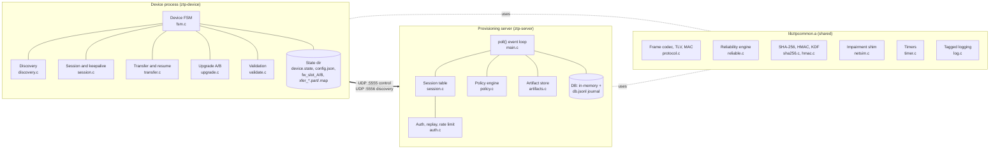
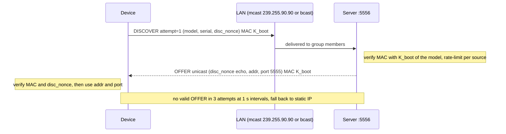
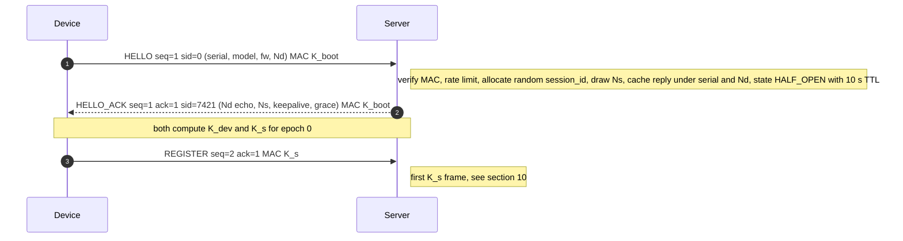
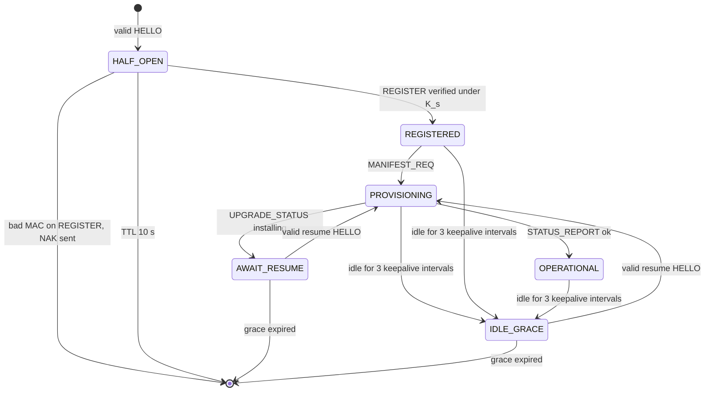
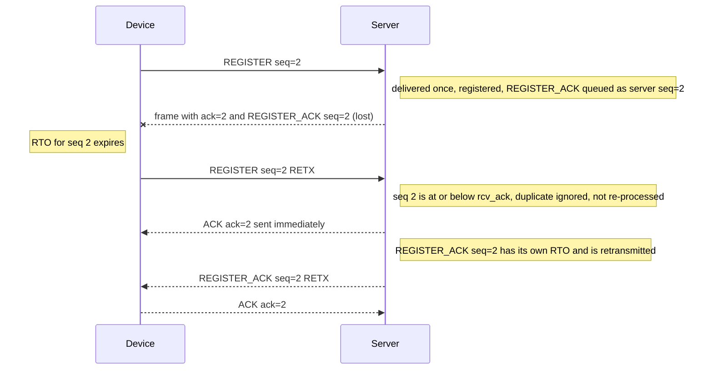
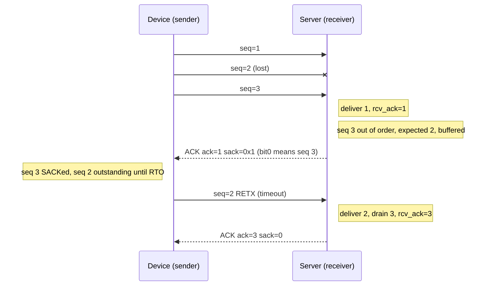
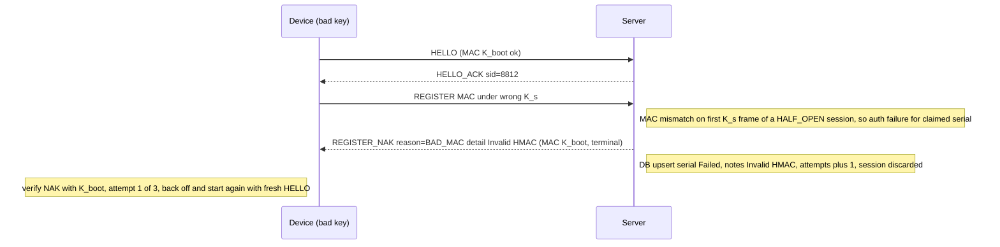
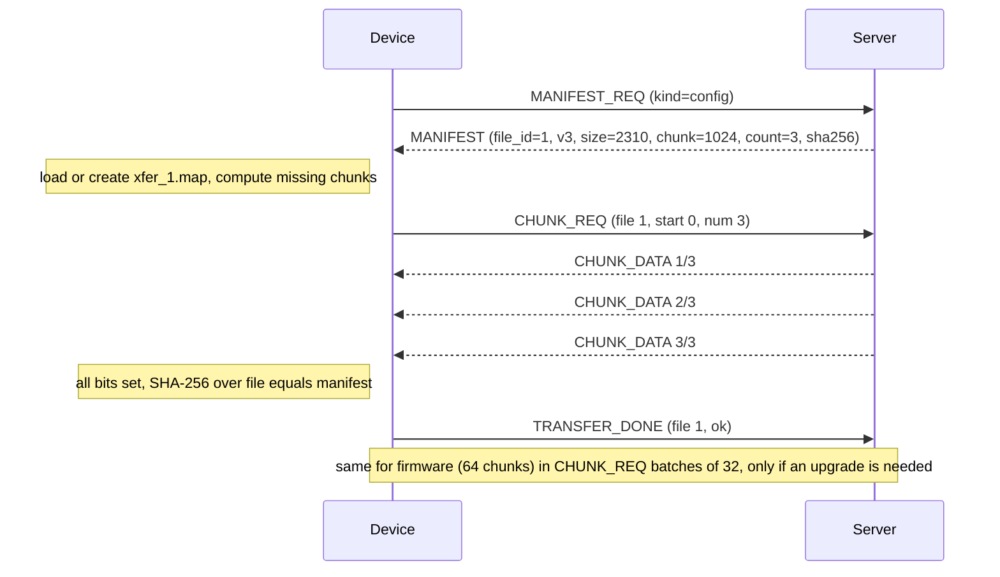
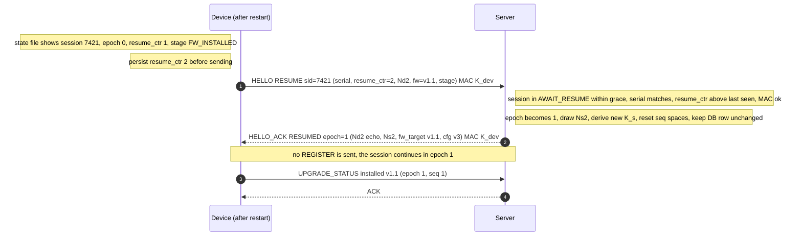
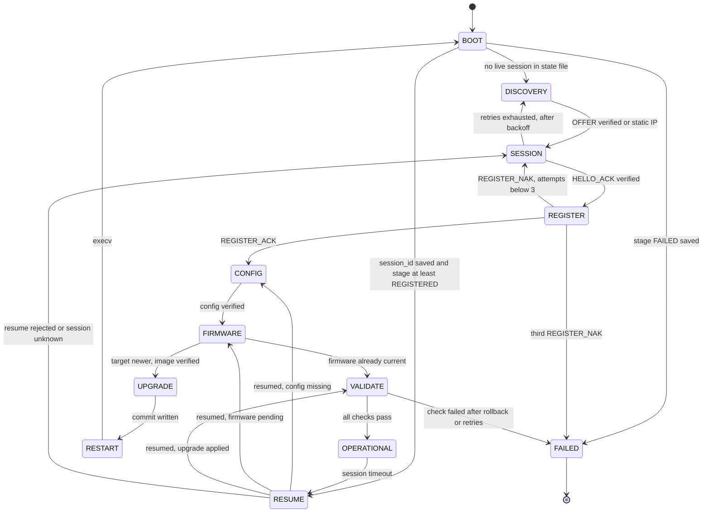

# Architecture & Design: UDP-Based Zero Touch Provisioning (ZTP)

| Field | Value |
|---|---|
| Document | DESIGN.md (Architect persona) |
| Version | 0.1, Draft for review |
| Date | 2026-11-10 |
| Status | For review by senior architects and developers |
| Owner | Sunil Vallamkonda (Architect) |
| Implementation language | C11, POSIX sockets, no third-party libraries |
| Companion documents | [PRD_ZTP.md](PRD_ZTP.md) (requirements: *what* and *why*) · [QA_TEST_PLAN.md](QA_TEST_PLAN.md) (verification: *how it is proven*) |
| Source | `UDP‑Based Zero Touch Provisioning (ZTP) Assignment.pdf` (referred to below as "the PDF") |

> **Reading guide.** §1–§4 give the big picture. §5 is the normative wire specification. §6–§13 follow the device lifecycle in the same order as the PDF. §14 covers the server. §16–§18 cover simulation, observability and security. §21 drafts the README answers the PDF requires. Callouts mark places where reviewers are invited to push back:
>
> - **Design rationale**: why a choice was made over the alternatives.
> - **Reviewer note**: a known weak point, a deliberate deviation from an RFC, or an open choice.
>
> Requirement IDs (`ZTP-FR-*`, `ZTP-NFR-*`, `ZTP-BON-*`, `ZTP-DEL-*`) come from the PRD. Test IDs (`TC-*`) come from the QA plan. All constants are defined once, in [Appendix B](#appendix-b-constants).

---

## Table of contents
0. [Front matter: audience, conventions, glossary](#0-front-matter)
1. [Scope, goals, non-goals](#1-scope-goals-non-goals)
2. [Requirements traceability matrix](#2-requirements-traceability-matrix)
3. [Assumptions and ambiguity resolutions](#3-assumptions-and-ambiguity-resolutions)
4. [System architecture](#4-system-architecture)
5. [Wire protocol specification](#5-wire-protocol-specification)
6. [Boot and discovery](#6-boot-and-discovery)
7. [UDP session establishment](#7-udp-session-establishment)
8. [Reliability layer](#8-reliability-layer)
9. [NAT awareness and keepalives](#9-nat-awareness-and-keepalives)
10. [Identity, authentication and registration](#10-identity-authentication-and-registration)
11. [Configuration and firmware provisioning](#11-configuration-and-firmware-provisioning)
12. [Version upgrade and restart](#12-version-upgrade-and-restart)
13. [Validation and operational state](#13-validation-and-operational-state)
14. [Server design](#14-server-design)
15. [Device state machine and persistence](#15-device-state-machine-and-persistence)
16. [Loss, reorder and duplicate simulation](#16-loss-reorder-and-duplicate-simulation)
17. [Logging and observability](#17-logging-and-observability)
18. [Security analysis](#18-security-analysis)
19. [Build, run and demo plan](#19-build-run-and-demo-plan)
20. [Test and verification strategy](#20-test-and-verification-strategy)
21. [README mapping and draft answers](#21-readme-mapping-and-draft-answers)
22. [Tradeoffs, limitations and future work](#22-tradeoffs-limitations-and-future-work)
23. [Open questions for reviewers](#23-open-questions-for-reviewers)
24. [Project timeline, dependencies and assumptions (summary)](#24-project-timeline-dependencies-and-assumptions-summary)
- [Appendix A: Annotated end-to-end log transcript](#appendix-a-annotated-end-to-end-log-transcript)
- [Appendix B: Constants](#appendix-b-constants)
- [Appendix C: Reason/error codes](#appendix-c-reasonerror-codes)
- [Appendix D: Key C data structures](#appendix-d-key-c-data-structures)
- [Appendix E: References](#appendix-e-references)

---

## 0. Front matter

### 0.1 Audience
Senior architects, who judge the protocol and trust model; senior developers, who will implement against §5 and Appendix D; QA, who derive test cases from the behaviour described here.

### 0.2 Conventions
- **MUST, SHOULD and MAY** are used in the RFC 2119 sense, in §5 only (the normative wire spec).
- Multi-byte integers on the wire are **big-endian** (network byte order).
- "Frame" means one protocol message carried in exactly one UDP datagram. A frame is never split across datagrams and never fragmented at the IP layer.
- `‖` means byte concatenation. `HMAC(K, m)` means HMAC-SHA256 (RFC 2104). `trunc16(x)` means the first 16 bytes of x.
- Times are given as *production / demo* values where they differ (for example 20 s / 2 s).

### 0.3 Glossary
| Term | Meaning |
|---|---|
| ZTP | Zero Touch Provisioning: a device configures itself without human help |
| Soft serial | A software-generated device identifier, `ZTP-XXXXXX` |
| Session | The logical association between one device and the server, named by a 32-bit `session_id` |
| Epoch | A 16-bit counter that increases each time a session is re-keyed (on resume). Each epoch has its own sequence spaces |
| Frame classes | **Reliable** (consumes a seq number, is ACKed, retransmitted and ordered), **ack-class** (ACK and KEEPALIVE_ACK: carry seq but don't consume it, and are never ACKed), **datagram-class** (DISCOVER and OFFER: before a session exists, retried by the application) |
| RTO / SRTT / RTTVAR | Retransmission timeout, smoothed RTT and RTT variance (RFC 6298) |
| SACK | Selective ACK: a bitmap of frames received beyond the cumulative ACK |
| K_mfg, K_boot, K_dev, K_s | Manufacturing secret (per model), the bootstrap key derived from it, the per-device key, and the per-session key (§10.1) |
| Nd, Ns | Device nonce and server nonce (64-bit, from a CSPRNG) |
| Grace period | How long after idle or restart the server keeps a session that can still be resumed |
| Half-open session | A session after HELLO_ACK and before the first frame authenticated with K_s |
| PMTU | Path MTU: the largest IP packet that crosses the path without fragmentation |
| NAT binding / mapping | The NAT's temporary translation from (internal IP:port) to (external IP:port) |
| A/B slots | Two firmware images: the active one and a staging one. The switch between them is atomic |

---

## 1. Scope, goals, non-goals

### 1.1 Goals
1. A complete ZTP lifecycle (boot → discovery → session → registration → config → firmware → upgrade/restart → validation → OPERATIONAL) **using only UDP** (ZTP-FR-03).
2. An application-layer reliability protocol that is **correct under 10–20% loss, reordering and duplication** (ZTP-FR-09, BON-*).
3. A trust model that gives **authenticity, mutual authentication and replay protection** without certificates or a clock (ZTP-FR-13/14).
4. **Crash-consistent** provisioning: every step can be interrupted and resumed without duplicating state (ZTP-FR-19/23, NFR-10).
5. A **concurrent server** with a policy engine and an auditable DB (ZTP-FR-28..32).
6. A design simple enough to build in about 3 weeks (PRD §11) and to review in one sitting.

### 1.2 Non-goals, and what production would do instead
| Non-goal | Rationale | Production equivalent |
|---|---|---|
| Encryption / confidentiality | Not required by the PDF; it would double the crypto surface | DTLS 1.3 (RFC 9147) or an AEAD layer; see §22.3 |
| PKI and certificates | The scenario says "no certificates" | IDevID (IEEE 802.1AR) and BRSKI (RFC 8995); SZTP (RFC 8572) |
| Real flash or bootloader | Mock firmware is acceptable | A/B partitions, verified boot |
| IPv6 | Keeps the scope down; the 1200 B budget is already IPv6-safe | Dual-stack sockets |
| Congestion control | Small, fixed window; control-plane traffic | AIMD or QUIC-style congestion control |
| Multi-instance or HA server | Single host is enough for the exercise | Sharding by `session_id`, shared DB |

---

## 2. Requirements traceability matrix
This is the completeness checklist for reviewers. Each PRD requirement maps to the section that designs it, the module that will implement it, and the QA test cases that verify it (the full matrix is in [QA §10](QA_TEST_PLAN.md#10-requirements-traceability-matrix)).

### 2.1 Functional requirements (PDF §1–§9)
| PRD ID | Requirement (short) | Design § | Module(s) | Key tests |
|---|---|---|---|---|
| ZTP-FR-01 | Soft serial generate/load | §6.1 | device/persist.c | TC-DISC-01/02 |
| ZTP-FR-02 | Static IP discovery | §6.3 | device/discovery.c | TC-DISC-03 |
| ZTP-FR-03 | UDP only | §4.3, §5 | common/protocol.c | TC-SESS-08 |
| ZTP-FR-04 | Session handshake with session ID | §7 | device/session.c, server/session.c | TC-SESS-01/04 |
| ZTP-FR-05 | Seq number on every message | §5.2, §8.1 | common/protocol.c | TC-REL-01, TC-UNIT-03 |
| ZTP-FR-06 | Timeouts and retransmission | §8.3 | common/reliable.c | TC-REL-02, TC-SESS-02/05 |
| ZTP-FR-07 | Acknowledgements | §8.4 | common/reliable.c | TC-UNIT-10, TC-REL-02 |
| ZTP-FR-08 | Duplicate detection | §8.5 | common/reliable.c | TC-REL-05 |
| ZTP-FR-09 | 10–20% loss | §8, §16, §21.1 Q5 | all | TC-REL-09 |
| ZTP-FR-10 | Keepalives | §9.2 | device/session.c | TC-NAT-01/02 |
| ZTP-FR-11 | Session timeout detection | §9.3 | device/session.c, server/session.c | TC-NAT-03/04/07 |
| ZTP-FR-12 | REGISTER: serial, metadata, nonce | §10.2 | device/fsm.c | TC-AUTH-01 |
| ZTP-FR-13 | HMAC authenticity | §10.1–10.3 | common/crypto, server/auth.c | TC-AUTH-02/03 |
| ZTP-FR-14 | Replay protection | §10.4 | server/auth.c, common/reliable.c | TC-AUTH-04..07 |
| ZTP-FR-15 | JSON configuration | §11.1 | server/artifacts.c | TC-PROV-01/02 |
| ZTP-FR-16 | Firmware blob | §11.1 | tools/mkartifacts.c | TC-PROV-03 |
| ZTP-FR-17 | Chunked transfer | §11.2 | device/transfer.c | TC-PROV-01/03/06 |
| ZTP-FR-18 | Hash integrity | §11.3 | device/transfer.c | TC-PROV-07/10 |
| ZTP-FR-19 | Resume after failure | §11.4 | device/transfer.c | TC-PROV-08/09 |
| ZTP-FR-20 | No IP fragmentation | §5.5 | common/protocol.c | TC-PROV-04/05 |
| ZTP-FR-21 | Detect outdated firmware, simulate upgrade | §12.1 | device/upgrade.c | TC-UPG-01/05 |
| ZTP-FR-22 | Restart process | §12.2 | device/main.c | TC-UPG-02 |
| ZTP-FR-23 | Resume without duplicate registration | §12.3 | device/session.c, server/auth.c | TC-UPG-03/04/08 |
| ZTP-FR-24 | Validate config | §13 | device/validate.c | TC-VAL-01/02 |
| ZTP-FR-25 | Validate firmware version | §13 | device/validate.c | TC-VAL-03 |
| ZTP-FR-26 | Validate session health | §13 | device/validate.c | TC-VAL-04 |
| ZTP-FR-27 | OPERATIONAL state | §13, §15 | device/fsm.c | TC-VAL-01/05 |
| ZTP-FR-28 | Concurrent devices | §14.1 | server/main.c | TC-SRV-01/09 |
| ZTP-FR-29 | Per-device assignment | §14.3 | server/policy.c | TC-SRV-02, TC-UPG-06 |
| ZTP-FR-30 | Registration record fields | §14.4 | server/db.c | TC-SRV-03 |
| ZTP-FR-31 | DB dump | §14.5 | server/db.c | TC-SRV-04 |
| ZTP-FR-32 | Summary | §14.5 | server/db.c | TC-SRV-05 |
| ZTP-FR-33 | Tagged logs following Appendix A | §17, App. A | common/log.c | TC-LOG-01, TC-E2E-01 |

### 2.2 Bonus requirements
| PRD ID | Requirement | Design § | Module(s) | Key tests |
|---|---|---|---|---|
| ZTP-BON-01 | Broadcast/multicast discovery | §6.2 | device/discovery.c, server/main.c | TC-DISC-04..08 |
| ZTP-BON-02 | Seq on every message | §5.2, §8.1 | common/protocol.c | TC-REL-01 |
| ZTP-BON-03 | ACK + retransmit on timeout | §8.3 | common/reliable.c | TC-REL-02 |
| ZTP-BON-04 | Out-of-order buffering | §8.4 | common/reliable.c | TC-REL-03/10, TC-UNIT-08 |
| ZTP-BON-05 | Idempotent processing | §8.6 | handlers on both sides | TC-REL-04/05, TC-PROV-11 |
| ZTP-BON-06 | In-code loss simulation | §16 | common/netsim.c | TC-SIM-01..03 |
| ZTP-BON-07 | Lost-ACK handling | §8.7 | common/reliable.c | TC-REL-04 |
| ZTP-BON-08 | Bonus log lines | §17.2 | common/log.c | TC-LOG-02 |

### 2.3 Non-functional requirements
| PRD ID | Design § | How the design satisfies it |
|---|---|---|
| ZTP-NFR-01 | §4.2, §19 | C11, POSIX, in-house crypto, single Makefile |
| ZTP-NFR-02 | §5.5 | `ZTP_MAX_DGRAM = 1200`; static assert plus a runtime check in the encoder |
| ZTP-NFR-03 | §8, §21.1 Q5 | Selective repeat, backoff, resume on session failure |
| ZTP-NFR-04 | §8.3, §16.3 | 200 ms RTO floor, fast retransmit, window of 8 |
| ZTP-NFR-05 | §14.1, §14.6 | `poll()` loop, O(1) session lookup, rate limits, 1024-session cap |
| ZTP-NFR-06 | §10, §18 | CSPRNG, `ct_memeq`, MAC checked before any state change, mutual authentication |
| ZTP-NFR-07 | §5.6, §14.6 | Length checks before reads, bounded buffers, fuzz target |
| ZTP-NFR-08 | §17 | Tagged millisecond logs, per-device files, counters |
| ZTP-NFR-09 | §16.1 | Seeded PRNG in netsim, separate from the CSPRNG |
| ZTP-NFR-10 | §15.3, §14.4 | tmp + fsync + rename; append-only journal |
| ZTP-NFR-11 | §19.1 | `-Wall -Wextra -Werror`; `make asan` target |

### 2.4 Deliverables (Expected Submission)
| PRD ID | Deliverable | Design § |
|---|---|---|
| ZTP-DEL-01 | Working code | §4, §19 |
| ZTP-DEL-02 | Buildable/runnable | §19.1 |
| ZTP-DEL-03 | Device/server separation | §4.2 (separate directories and binaries, shared `common/` library only) |
| ZTP-DEL-04 | UDP only | §4.3 |
| ZTP-DEL-05 | Build/run instructions | §19, §21.3 |
| ZTP-DEL-06 | README: 5 required questions | §21.1 |
| ZTP-DEL-07 | README: design sections | §21.3 |
| ZTP-DEL-08 | README: bonus sections + 4 questions | §21.2, §21.3 |
| ZTP-DEL-09/10 | Server and client logs | §17.3, §19.3 |
| ZTP-DEL-11 | DB dump and summary | §14.5, §19.3 |

---

## 3. Assumptions and ambiguity resolutions
Each decision is stated explicitly so that reviewers can challenge the decision itself, not an unstated assumption.

### 3.1 "No stored credentials" versus "verify authenticity using an HMAC"
The PDF's Appendix says the device has *"no configuration, no certificates, and no stored credentials"*, but §5 requires HMAC verification. An HMAC needs a shared secret, so some secret must exist before provisioning.

**Decision.** The device has no *provisioned* (site-specific or operator-specific) credentials. Every firmware image of a model carries a **manufacturing secret `K_mfg[model]`**, and per-device and per-session keys are derived from it (§10.1). The server keeps a keystore of `K_mfg` per model.

> **Design rationale.** This is how many low-cost devices actually ship: a "model key" or a factory-installed key. The alternatives are worse for the exercise. Trust-on-first-use has no authenticity at first contact. A per-device random key would need a provisioning database of serials and keys that the server must already know, and that contradicts a *soft* serial generated at first boot.
>
> **Reviewer note.** The blast radius is one model: extracting `K_mfg` from any single device lets an attacker impersonate any device of that model. This is the most significant security limitation (§18.3). The production path is a per-device key in a secure element or TPM, or an IDevID certificate (§22.3).

### 3.2 The seq/ACK diagram in the PDF's bonus section
The diagram shows `HELLO seq=1,2,3` being sent and ACKed separately. It is read as **illustrative of selective repeat** (that seq=3 can be ACKed before seq=2 is repaired), not as literally sending three HELLOs.

**Decision.** Each direction has its own sequence space, starting at 1 per epoch. Every frame carries a cumulative `ack` and a 32-bit `sack` bitmap (§8). The PDF scenario is reproduced exactly with any reliable frames in §8.8.1.

### 3.3 Resuming with the same `session_id` after a reboot
The PDF's Appendix shows `[UDP] Session resumed (session_id=7421)` after the restart. **Decision:** the device persists `session_id` and a monotonic `resume_ctr`. The server keeps the session in `AWAIT_RESUME` for a **grace period** (120 s / 30 s). Resuming is an authenticated handshake (§12.3) that re-keys the session (a new epoch) **without sending REGISTER**.

### 3.4 Firmware and config assignment policy
**Decision.** Assignment is by model, with optional per-serial overrides (precedence: serial > model > default-reject). Demo policy:

| Model | Firmware | Config | Tenant | Notes |
|---|---|---|---|---|
| EDGE-GW-100 | v1.1 | v3 | cruise_ops | — |
| EDGE-GW-050 | v1.0 | v2 | cruise_ops | Legacy device |
| *(other)* | — | — | — | Rejected: `UNKNOWN_MODEL` |

### 3.5 No real-time clock on the device
A freshly powered device has no trustworthy time, so timestamp-based replay windows are ruled out. **Decision:** freshness comes from a **server challenge nonce (Ns)** that is bound into the session key, plus device nonces and sequence-based anti-replay (§10.4). All timestamps in the DB come from the server.

### 3.6 What "registration outcome" means
**Decision:** *Registration status* is Success or Failed for authentication and registration (as in the PDF's table). Provisioning progress is tracked in a separate **stage** column (REGISTERED … OPERATIONAL). A device can therefore show "Success / FAILED stage", for example when firmware validation fails, and the dump stays faithful to the PDF's columns.

### 3.7 Technical assumptions (the product-level ones are in PRD §10.3)
- T-01: Loopback or a LAN with an IPv4 path MTU ≥ 1280. The 1200 B budget leaves margin even for IPv6 or tunnel overhead.
- T-02: `/dev/urandom` (or `arc4random_buf` on macOS) is a sufficient CSPRNG.
- T-03: `rename(2)` is atomic within one filesystem, and `fsync` is honoured (POSIX).
- T-04: A monotonic clock (`clock_gettime(CLOCK_MONOTONIC)`) is used for all timers. Wall time is used only for logs and the DB.
- T-05: One device process is one device. Each process has its own state directory.

---

## 4. System architecture

### 4.1 Component view


### 4.2 Source tree and module responsibilities (ZTP-DEL-03)
```
ztp/
├── Makefile                 all, server, device, test, demo, scale, asan, clean
├── README.md                submission README (built from §21)
├── PRD_ZTP.md  DESIGN.md  QA_TEST_PLAN.md
├── common/                  → libztpcommon.a  (no device- or server-specific logic)
│   ├── protocol.[ch]        constants, header encode/decode, TLV codec, MAC apply/verify
│   ├── reliable.[ch]        per-peer reliability engine (TX window, RTO, RX reorder, SACK, dedup)
│   ├── sha256.c hmac.c crypto.h   SHA-256, HMAC-SHA256, KDF helpers, ct_memeq()
│   ├── rand.[ch]            CSPRNG wrapper (/dev/urandom or arc4random_buf)
│   ├── netsim.[ch]          loss/reorder/duplicate/delay shim around sendto()/recvfrom()
│   ├── timer.[ch]           monotonic clock and min-heap timer queue
│   ├── log.[ch]             tagged, millisecond-timestamped logs to stdout and a file
│   └── util.[ch]            atomic file write, hex, version compare, key=value parser
├── device/                  → ztp-device
│   ├── main.c               CLI, lifecycle, execv() restart
│   ├── fsm.[ch]             device state machine (§15)
│   ├── discovery.c          static, multicast and broadcast discovery (§6)
│   ├── session.c            HELLO, resume, keepalive, liveness (§7, §9, §12.3)
│   ├── transfer.c           manifest, CHUNK_REQ, bitmap persistence, hash verify (§11)
│   ├── upgrade.c            A/B slots, install, rollback (§12)
│   ├── validate.c           validation checks (§13)
│   └── persist.c            device.state load/store (§15.3)
├── server/                  → ztp-server
│   ├── main.c               CLI, sockets, poll() loop, signal self-pipe (§14.1)
│   ├── session.[ch]         session table, lifecycle, grace timers (§14.2)
│   ├── auth.c               key derivation, verification, nonce cache, rate limit (§10)
│   ├── policy.c             policy file and assignment (§14.3)
│   ├── artifacts.c          manifests and chunk reads (§11)
│   ├── handlers.c           per-message-type dispatch
│   └── db.c                 in-memory DB, JSONL journal, dump and summary (§14.4–14.5)
├── tools/mkartifacts.c      deterministic mock firmware and configs
├── conf/policy.conf  conf/keys.conf
├── scripts/run_demo.sh  run_scale.sh  netem.sh (Linux/CI)  dummynet.sh (macOS)  pcapcheck.sh
├── tests/                   unit tests (C) and integration scripts (sh)
├── .github/workflows/ci.yml GitHub Actions matrix: ubuntu-latest + macos-latest (§19.4)
└── logs/                    produced by `make demo` and committed for the submission
```

**Separation rule.** `device/` and `server/` never include each other's headers. Both depend only on `common/`. The CI check is that `nm ztp-device` contains no `srv_*` symbols, and vice versa (TC-DEL-03).

### 4.3 Layering (on both sides)
```
┌──────────────────────────────────────────────────────────────┐
│ Application FSM (device fsm.c / server handlers.c)           │  idempotent handlers (§8.6)
├──────────────────────────────────────────────────────────────┤
│ Session layer: session_id, epoch, keys, liveness, resume     │  §7, §9, §12.3
├──────────────────────────────────────────────────────────────┤
│ Reliability: seq, ACK/SACK, RTO, window, reorder, dedup      │  §8
├──────────────────────────────────────────────────────────────┤
│ Frame codec: header and TLV parse, MAC verify, size cap      │  §5
├──────────────────────────────────────────────────────────────┤
│ netsim shim (loss/reorder/dup), active only when flags set   │  §16
├──────────────────────────────────────────────────────────────┤
│ UDP socket (SOCK_DGRAM), non-blocking, DF set                │  ZTP-FR-03
└──────────────────────────────────────────────────────────────┘
```
> **Design rationale.** The MAC is verified **below** the reliability layer. A forged or corrupted frame is dropped before it can touch seq/ACK state, so an attacker can't advance ACKs, poison the reorder buffer or reset timers. The cost is one HMAC per datagram received, about 2 µs for 1 KB, which is negligible.

### 4.4 Threading and I/O model
Both binaries are **single-threaded and event-driven**: a non-blocking UDP socket, `poll()` with a timeout equal to the next timer deadline, and a min-heap of timers. Signals go through the self-pipe trick, which is portable to macOS where `signalfd` isn't available. The reasoning is in §14.1.

---

## 5. Wire protocol specification
*This section is normative.*

### 5.1 Transport
- UDP over IPv4. Server control port **5555** (from the PDF's Appendix); discovery port **5556**.
- One frame per datagram. Every datagram **MUST** be ≤ **1200 bytes** of UDP payload (§5.5).
- Senders **SHOULD** set DF: `IP_MTU_DISCOVER=IP_PMTUDISC_DO` on Linux, `IP_DONTFRAG` on macOS.

### 5.2 Common header (44 bytes)
```
 0                   1                   2                   3
 0 1 2 3 4 5 6 7 8 9 0 1 2 3 4 5 6 7 8 9 0 1 2 3 4 5 6 7 8 9 0 1
+-+-+-+-+-+-+-+-+-+-+-+-+-+-+-+-+-+-+-+-+-+-+-+-+-+-+-+-+-+-+-+-+
|       magic = 0x5A54 ("ZT")   |  version = 1  |     type      |  0
+---------------+---------------+---------------+---------------+
|     flags     | hdr_len = 44  |             epoch             |  4
+---------------+---------------+-------------------------------+
|                          session_id                           |  8
+---------------------------------------------------------------+
|                              seq                              | 12
+---------------------------------------------------------------+
|                       ack (cumulative)                        | 16
+---------------------------------------------------------------+
|              sack bitmap (bit i => seq ack+2+i rcvd)          | 20
+-------------------------------+---------------+---------------+
|          payload_len          |    key_id     |   reserved=0  | 24
+-------------------------------+---------------+---------------+
|                                                               | 28
|            mac[16] = trunc16(HMAC(K, hdr[0..27] ‖ payload))   |
|                                                               |
|                                                               |
+---------------------------------------------------------------+ 44
|                   payload (0..1156 bytes)                     |
+---------------------------------------------------------------+
```

| Field | Size | Semantics |
|---|---|---|
| magic | 2 | `0x5A54`. Anything else is dropped silently (counter `rx_bad_magic`) |
| version | 1 | `1`. A frame with an unknown version is dropped. A future version would negotiate in HELLO |
| type | 1 | Message type (§5.3) |
| flags | 1 | bit0 `ACK_VALID` (the ack/sack fields are meaningful); bit1 `RETX` (this is a retransmission, used for logs and Karn's rule); bit2 `RESUME` (on HELLO); bit3 `FIN`; bits 4–7 reserved, must be 0 |
| hdr_len | 1 | `44`. Allows the header to be extended later; receivers must reject `< 44` |
| epoch | 2 | Session epoch. 0 for a fresh session; increased on each resume. Frames from a stale epoch are dropped before the MAC is computed (a cheap filter) |
| session_id | 4 | 0 before a session exists (DISCOVER, OFFER, fresh HELLO). Otherwise the server-assigned random value |
| seq | 4 | Sender's sequence number. Reliable frames: the consumed seq (1, 2, 3, …). Ack-class frames: the sender's *next* seq, not consumed. Datagram-class frames: the attempt number |
| ack | 4 | Highest seq **N** such that every seq ≤ N from the peer has been received (valid if `ACK_VALID` is set) |
| sack | 4 | Bit *i* set ⇒ seq `ack+2+i` received (covers ack+2 … ack+33). `ack+1` is missing by definition |
| payload_len | 2 | Bytes after the header. Must equal `datagram_len − 44` |
| key_id | 1 | 1 = K_boot, 2 = K_dev, 3 = K_s. This is **a hint only**: the receiver enforces the expected key for each message type (table §5.3), which defeats key-downgrade attempts |
| reserved | 1 | 0 |
| mac | 16 | HMAC-SHA256 truncated to 128 bits, over header bytes 0–27 followed by the payload |

> **Design rationale (header size).** 44 bytes per frame is about 4% overhead on a 1076 B CHUNK_DATA frame. A variable-length header was rejected because fixed offsets make the parser trivially bounds-safe. Truncating the MAC to 128 bits is allowed by RFC 2104 §5 (at least half the hash output) and is the same choice IPsec makes with HMAC-SHA-256-128 (RFC 4868).
>
> **Reviewer note.** The header is authenticated, not encrypted, so `session_id` and `seq` are visible to anyone on the path. That's acceptable because they aren't secrets: the security rests on `K_s` (§18).

### 5.3 Message catalogue
| Code | Name | Dir | Class | Key | Payload (TLV unless noted) |
|---|---|---|---|---|---|
| 0x01 | DISCOVER | D→S (mcast/bcast) | datagram | K_boot | MODEL, SERIAL, DISC_NONCE |
| 0x02 | OFFER | S→D (unicast) | datagram | K_boot | DISC_NONCE (echo), SERVER_ADDR, SERVER_PORT |
| 0x10 | HELLO | D→S | reliable (seq 1) | K_boot (fresh) / K_dev (`RESUME`) | Fresh: SERIAL, MODEL, FW_VER, NONCE_DEV(Nd), CAPS. Resume: SERIAL, RESUME_CTR, NONCE_DEV(Nd′), FW_VER, STAGE |
| 0x11 | HELLO_ACK | S→D | reliable (seq 1) | same key as the HELLO | NONCE_DEV (echo), NONCE_SRV(Ns), KEEPALIVE_S, GRACE_S; on resume also RESUMED=1, SRV_STAGE, FW_TARGET, CFG_VER |
| 0x20 | REGISTER | D→S | reliable | K_s | SERIAL, MODEL, FW_VER, HW_REV, NONCE_REG (64-bit), NONCE_SRV (echo of Ns) |
| 0x21 | REGISTER_ACK | S→D | reliable | K_s | TENANT, FW_TARGET, CFG_VER |
| 0x22 | REGISTER_NAK | S→D | reliable* | K_boot | REASON, DETAIL |
| 0x30 | KEEPALIVE | D→S | reliable | K_s | (empty) or HEALTH_PROBE=1 |
| 0x31 | KEEPALIVE_ACK | S→D | ack-class | K_s | SRV_STAGE |
| 0x40 | MANIFEST_REQ | D→S | reliable | K_s | FILE_KIND (1 = config, 2 = firmware) |
| 0x41 | MANIFEST | S→D | reliable | K_s | FILE_ID, FILE_KIND, VERSION, FILE_SIZE, CHUNK_SIZE, CHUNK_COUNT, SHA256 |
| 0x42 | CHUNK_REQ | D→S | reliable | K_s | FILE_ID, CHUNK_START, CHUNK_NUM (≤ 32) |
| 0x43 | CHUNK_DATA | S→D | reliable | K_s | **Fixed layout** (§5.4.2) |
| 0x44 | TRANSFER_DONE | D→S | reliable | K_s | FILE_ID, RESULT (0 = ok, otherwise a reason) |
| 0x50 | UPGRADE_STATUS | D→S | reliable | K_s | STAGE (installing/installed/rolled_back), FW_VER, FW_TARGET |
| 0x60 | STATUS_REPORT | D→S | reliable | K_s | STATE (OPERATIONAL/FAILED), REASON, FW_VER, CFG_VER |
| 0x61 | STATUS_ACK | S→D | reliable | K_s | (empty) |
| 0x70 | CLOSE | either | reliable | K_s | REASON (flag `FIN`) |
| 0x7E | ERROR | S→D | reliable* | K_s if the session is valid, otherwise K_boot | REASON, DETAIL |
| 0x7F | ACK | either | ack-class | K_s | (empty): carries only ack and sack |

\* A NAK or ERROR sent with K_boot is a **terminal** frame: the server sends it, retransmits it up to 3 times with no ACK expected, and then discards the half-open session. The device can't be expected to ACK under a K_s it may have derived wrongly.

**Class semantics**
- **Reliable:** consumes the next seq; retransmitted until ACKed; delivered **in order, exactly once** to the application.
- **Ack-class:** `seq` = the sender's next seq (it satisfies "every message carries a seq" without consuming one); never ACKed; never retransmitted (a lost one is repaired by the next ACK).
- **Datagram-class:** exists only before a session; the application retries it (§6.2).

### 5.4 Payload encoding
#### 5.4.1 TLV (all types except CHUNK_DATA)
```
+--------+----------------+------------------------+
| tag u8 |  length u16    |  value (length bytes)  |   repeated until payload_len
+--------+----------------+------------------------+
```
| Tag | Name | Type | Tag | Name | Type |
|---|---|---|---|---|---|
| 0x01 | SERIAL | str ≤ 16 | 0x10 | FILE_ID | u8 |
| 0x02 | MODEL | str ≤ 16 | 0x11 | FILE_KIND | u8 |
| 0x03 | FW_VER | str ≤ 8 | 0x12 | FILE_SIZE | u32 |
| 0x04 | HW_REV | str ≤ 8 | 0x13 | CHUNK_SIZE | u16 |
| 0x05 | NONCE_DEV | u64 | 0x14 | CHUNK_COUNT | u32 |
| 0x06 | NONCE_SRV | u64 | 0x15 | SHA256 | 32 B |
| 0x07 | NONCE_REG | u64 | 0x16 | CHUNK_START | u32 |
| 0x08 | TENANT | str ≤ 32 | 0x17 | CHUNK_NUM | u16 |
| 0x09 | FW_TARGET | str ≤ 8 | 0x18 | VERSION | str ≤ 8 |
| 0x0A | CFG_VER | u16 | 0x19 | RESULT/REASON | u16 |
| 0x0B | KEEPALIVE_S | u16 | 0x1A | DETAIL | str ≤ 64 |
| 0x0C | GRACE_S | u16 | 0x1B | STAGE / STATE | u8 |
| 0x0D | RESUME_CTR | u32 | 0x1C | SERVER_ADDR | 4 B IPv4 |
| 0x0E | CAPS | u32 bitmask | 0x1D | SERVER_PORT | u16 |
| 0x0F | DISC_NONCE | u64 | 0x1E | HEALTH_PROBE / RESUMED / SRV_STAGE | u8 |

Rules: unknown tags are **skipped**, which allows forward compatibility. A duplicate tag rejects the frame. A missing required tag gives `BAD_REQUEST`. Strings are not NUL-terminated on the wire and are copied into fixed buffers that are always terminated.

#### 5.4.2 CHUNK_DATA (fixed layout, for efficiency)
```
+---------+---------+------------------+--------------+------------------------+
| file_id | rsvd u8 | chunk_index u32  | data_len u16 |  data (≤ 1024 bytes)   |
+---------+---------+------------------+--------------+------------------------+
   1 B       1 B          4 B               2 B             data_len
```
The frame is 44 + 8 + 1024 = **1076 bytes**, which is under the 1200 B cap with 124 B of margin.

### 5.5 Size budget and avoiding fragmentation (ZTP-FR-20, NFR-02)
| Item | Bytes |
|---|---|
| IPv6 minimum link MTU (RFC 8200) | 1280 |
| − IPv6 header / − UDP header | −40 / −8 |
| = largest UDP payload that never fragments on any compliant IPv6 path | 1232 |
| **Our cap (`ZTP_MAX_DGRAM`)**, the same as QUIC's initial limit (RFC 9000 §14) | **1200** |
| Header + MAC | 44 |
| Maximum payload | 1156 |
| CHUNK_DATA overhead | 8 |
| `ZTP_CHUNK_SIZE` (power of two, leaving margin for tunnels: PPPoE −8, GRE −24, IPsec ~ −60) | **1024** |

Enforcement: `_Static_assert(ZTP_HDR_LEN + 8 + ZTP_CHUNK_SIZE <= ZTP_MAX_DGRAM)`. The encoder returns `-E2BIG` instead of sending an oversize frame, and QA verifies the largest datagram in a pcap (TC-PROV-04). Why fragmentation is avoided is covered in §21.1 Q3.

### 5.6 Parsing and validation rules (robustness)
These checks run in order, and processing stops at the first failure:
1. `len ≥ 44` and `len ≤ 1200`;
2. magic, version and `hdr_len`;
3. `payload_len == len − 44`;
4. type known, and the class and direction valid for this endpoint;
5. key selection by type and state (not by `key_id`); MAC verified with `ct_memeq`;
6. epoch and session lookup;
7. reliability processing;
8. TLV parse with bounds checks;
9. the application handler.

**No state changes before step 5.** All failures increase a counter. Only MAC failures on REGISTER (§10.3) are logged one per event; others are rate-limited in the log so that an attacker can't flood it.

---

## 6. Boot and discovery

### 6.1 Soft serial (ZTP-FR-01)
- First boot: read 3 bytes from the CSPRNG → `ZTP-%06X` (for example `ZTP-93AF21`). Persist it in `device.state` atomically (§15.3). Logs `[BOOT] Soft serial generated: ZTP-93AF21`.
- Later boots: load it from the state file → `[BOOT] Soft serial loaded: ZTP-93AF21`.
- Demo and tests: `--serial ZTP-93AF21` overrides generation, which reproduces the PDF's table.

> **Reviewer note.** 24 bits gives a 50% chance of a collision at about 4,800 devices (birthday bound). That's fine for the exercise, but a real product would derive the serial from a hardware ID (MAC address, eFuse) or use 64 bits. The server can't tell apart two devices with the same serial and model, because they share the same derived `K_dev`. Listed in §22.2.

### 6.2 Multicast and broadcast discovery (ZTP-BON-01)

- **Mode** `--discover=mcast|bcast|static` (default `mcast`, falling back to static when `--server` is also given).
- **Multicast:** group 239.255.90.90 (administratively scoped, RFC 2365), `IP_MULTICAST_TTL=1`, `IP_MULTICAST_LOOP=1` so it works on loopback. The server joins the group on its discovery socket.
- **Broadcast:** `SO_BROADCAST`, to `255.255.255.255` or the interface's directed broadcast address (`--bcast-addr`).
- **The OFFER is authenticated** with K_boot and echoes `disc_nonce`, so a rogue host on the LAN can't redirect the device (a rogue-DHCP-style attack), and an old OFFER can't be replayed.
- If several valid OFFERs arrive, the device takes the first. A future *priority* TLV would allow choosing between servers.

> **Reviewer note (platform).** macOS `lo0` doesn't support broadcast, so the demo default is multicast, which works on loopback on both macOS and Linux. Broadcast is tested (TC-DISC-05) **locally on the Mac's Wi-Fi/Ethernet interface**: both processes run on the Mac, and the device sends to the interface's directed broadcast address (for example `192.168.1.255`; get it with `ifconfig en0 | grep broadcast`). It is tested again on the CI Linux runner. No local Linux host is needed. This is spiked in M1 (PRD R-03).
>
> **Design rationale.** Discovery is *datagram-class* (application retries, no seq/ACK state), because no session exists yet and the server must stay stateless toward unauthenticated multicast traffic.

### 6.3 Static IP (ZTP-FR-02)
`--server 10.10.10.5:5555` → `[DISCOVERY] Using static server IP 10.10.10.5:5555`. This path is used directly when the mode is `static`, and as the fallback otherwise.

---

## 7. UDP session establishment (ZTP-FR-04)

### 7.1 Handshake

Logs: `[UDP] HELLO sent (seq=1)`, then `[UDP] Session established (session_id=7421)`.

### 7.2 Session identifier
- 32-bit, from the CSPRNG; never 0; unique among live sessions (redrawn on a collision).
- > **Design rationale.** A random ID instead of a sequential one is (a) hard to guess, which raises the bar for off-path spoofing even before the MAC check, and (b) the **lookup key instead of the 5-tuple**, so a NAT rebinding doesn't break the session (§9.4).

### 7.3 Retransmitting HELLO is idempotent
HELLO is reliable frame seq=1. Until HELLO_ACK arrives, the device retransmits **exactly the same bytes** (the same Nd), following the RTO schedule. The server keys half-open sessions by `(serial, Nd)`. A duplicate HELLO gets the **cached HELLO_ACK** back and allocates no new session (TC-SESS-02). A new Nd from the same serial (after the device gave up and started again) replaces the earlier half-open session.

### 7.4 Session state on the server

Deleting a session **never** deletes its DB record. The DB is the long-lived truth, and the session is a transient transport association.

---

## 8. Reliability layer
*ZTP-FR-05..09, ZTP-BON-02..05, ZTP-BON-07. This is the core of the networking review.*

### 8.1 Model
- **Selective repeat ARQ** with a cumulative ACK and a SACK bitmap, **per direction, per epoch**. Both peers run the same engine (`common/reliable.c`). The device runs one instance; the server runs one per session.
- Every frame carries a seq (ZTP-BON-02); semantics by class are in §5.3.
- ACK information is **piggybacked** on every outgoing frame (`ACK_VALID`). A standalone ACK frame is sent only when there is nothing to piggyback on, after the delayed-ACK timer (20 ms) or **immediately** for a duplicate, a gap or a KEEPALIVE.

> **Design rationale: why selective repeat.**
> | Scheme | Under 20% loss | Complexity | Verdict |
> |---|---|---|---|
> | Stop-and-wait | 1 frame per RTT; every loss costs a full RTO | Lowest | Too slow for 64+ chunks |
> | Go-back-N | One loss resends the whole window (W frames) | Low | Wastes bandwidth precisely when the link is worst |
> | **Selective repeat + SACK** | Only lost frames are resent; gaps are detected early through SACK | Moderate (a reorder buffer) | **Chosen**: the bonus requires a reorder buffer anyway |

### 8.2 Sender state
```
next_seq            next seq to assign (starts at 1 per epoch)
snd_una             oldest unacknowledged seq
tx_slots[W=8]       { seq, frame bytes, len, first_sent, last_sent, retries, sacked, retx_flag }
srtt, rttvar, rto   RFC 6298 estimator
```
- **Window W = 8** frames in flight. When the window is full, the application's sends are queued (bounded, 64 entries) and back-pressure the producer. The server stops reading chunks from disk, for example.

> **Design rationale (W = 8).** With frames of about 1.1 KB and a 50 ms WAN RTT, 8 in flight gives about 176 KB/s, which provisions 64 KiB of firmware in well under a second of transmit time. The window is a fixed, small cap on how many frames can arrive at once on a lossy link. That cap is our minimal substitute for congestion control, and it follows the RFC 8085 guidance that UDP applications without congestion control should send at a low, bounded rate. Listed as a limitation in §22.2.

### 8.3 Timeouts and retransmission (ZTP-FR-06, BON-03)
- **RTO** follows RFC 6298: the initial RTO is **500 ms**, `RTO = SRTT + max(G, 4·RTTVAR)`, clamped to **[200 ms, 4 s]**.
- **Karn's algorithm:** RTT samples come only from frames that were never retransmitted.
- **Exponential backoff:** RTO ×2 on each timeout of the same frame, up to the 4 s cap.
- **Retry limit:** after **8** retransmissions of one frame (about 27.5 s with backoff 0.5+1+2+4+4+4+4+4 s), the engine raises `SESSION_FAILED`. The device then moves to *resume* (if it's registered) or a fresh HELLO, with jittered reconnect backoff (§9.3). The server moves the session to `IDLE_GRACE`.
- **Fast retransmit:** if frame X is unacknowledged and **3** frames sent after it have been SACKed, X is retransmitted at once, without waiting for its RTO, at most once per RTO period. This recovers losses in the middle of a window in about one RTT instead of one RTO.
- Log: `[UDP] Retransmitting seq=N (timeout)` or `(fast, sack)`.

> **Reviewer note (an RFC deviation).** RFC 6298 recommends a minimum RTO of 1 s. We use 200 ms because: (a) the traffic is a short-lived control plane, not bulk transfer; (b) the window is small and fixed, so a spurious retransmission costs at most 8 frames; (c) the floor of 200 ms matches widespread practice (the Linux TCP `RTO_MIN`). If reviewers prefer, it's a single constant to change (Appendix B).

### 8.4 Receiver: ACK, SACK and out-of-order buffering (ZTP-FR-07, BON-04)
```
rcv_ack           highest in-order seq delivered (cumulative ACK value)
rx_buf[32]        slots for seq rcv_ack+2 .. rcv_ack+33 (ring buffer indexed by seq mod 32)
rx_bitmap u32     occupancy (this becomes the outgoing SACK field)
```
Processing a reliable frame with sequence `s`, after its MAC has been verified:

| Condition | Action | Log |
|---|---|---|
| `s == rcv_ack+1` | Deliver; `rcv_ack++`; **drain** consecutive buffered frames; schedule a delayed ACK | — |
| `rcv_ack+1 < s ≤ rcv_ack+33` and not buffered | Store in `rx_buf`, set the SACK bit, **send an ACK immediately** (it tells the sender about the gap) | `[UDP] Received packet seq=3 (out of order, expected=2)`, `[UDP] Buffered packet seq=3` |
| `s ≤ rcv_ack`, or already buffered | **Duplicate**: drop and **ACK immediately** (§8.7) | `[UDP] Duplicate packet seq=2 ignored` |
| `s > rcv_ack+33` | Outside the window: drop (it can't legitimately happen with W=8, so it suggests a bug or an attack) | rate-limited warning |

The application therefore sees each reliable frame **exactly once, in strictly increasing seq order**.

> **Design rationale (an RX buffer of 32 with a TX window of 8).** The receive window matches the SACK width, so every buffered frame can be reported. The extra space over W covers retransmissions that arrive late from an earlier window. Memory is 32 × 1200 B = 38 KB per session, which is fine for 1024 sessions (≈ 39 MB). It could be reduced to W slots if memory mattered (§22.2).

### 8.5 Duplicate detection (ZTP-FR-08)
Duplicates come from (a) retransmissions after a lost ACK, (b) network duplication, and (c) retransmissions that were spurious but harmless. Detection is purely by seq: `s ≤ rcv_ack` or `rx_bitmap` bit set. Because every frame passes the MAC check first, an attacker can't forge a "future" seq to fill the window.

### 8.6 Idempotent processing (ZTP-BON-05)
The transport guarantees exactly-once delivery **within an epoch**. Across epochs (after a resume, a crash or a re-registration) the same *logical* request can arrive again, so the application handlers are idempotent as well:

| Message | Idempotency rule |
|---|---|
| HELLO (fresh) | Keyed by `(serial, Nd)` → cached HELLO_ACK; no second session |
| HELLO (resume) | Keyed by `(session_id, resume_ctr)`; the same value as last time returns the cached HELLO_ACK; a lower value is rejected (§10.4) |
| REGISTER | DB upsert keyed by serial. If the serial is already `Success`, the same assignment is returned, `attempts++`, and the note says "re-registered"; **never a second row**. The registration timestamp keeps the *first* success time; `last_seen` is updated |
| CHUNK_DATA | Written to a fixed offset `index × 1024`; the bitmap bit is set. A chunk that's already present is ignored, not rewritten |
| TRANSFER_DONE / UPGRADE_STATUS / STATUS_REPORT | Stage transitions are **monotonic**: a report of a stage ≤ the current stage changes nothing, and the server ACKs it with the current view |
| KEEPALIVE | No state beyond `last_rx` |

### 8.7 Lost ACKs (ZTP-BON-07, bonus README Q3)

The data was received, so the receiver's state is already correct. The sender's retransmission is recognised as a duplicate and **not applied again**. The immediate re-ACK stops further retransmissions. The response (REGISTER_ACK) is a reliable frame in the other direction, so its own loss is repaired separately. Since ACKs are cumulative, **any** later frame or ACK from the peer also repairs an earlier lost ACK.

### 8.8 Worked timelines
#### 8.8.1 The PDF's bonus scenario: seq 2 lost, seq 3 buffered

Matching logs on the receiving side (the same format as the PDF):
```
[UDP] Received packet seq=3 (out of order, expected=2)
[UDP] Buffered packet seq=3
[UDP] Retransmitting seq=2 (timeout)          <- sender side
[UDP] Delivered seq=2..3 (drained 1 buffered)
```
And with a duplicate of seq 2 arriving later: `[UDP] Duplicate packet seq=2 ignored`.

#### 8.8.2 The retransmission is lost too
seq 2 is lost again → RTO doubles (for example 400 → 800 ms) → third attempt. Each retry adds `RETX`; `retries` counts up to 8 → `SESSION_FAILED` → resume (§9.3). Probabilities at various loss rates are in §21.1 Q5.

#### 8.8.3 Network duplicates a frame
The second copy hits `s ≤ rcv_ack` → dropped and re-ACKed. The counter `rx_dup` is increased. The application never sees it.

### 8.9 Sequence wraparound
Comparisons use serial-number arithmetic (RFC 1982): `seq_lt(a,b) = (int32_t)(a-b) < 0`. A sequence space resets to 1 on every epoch. At 1000 frames/s, wrapping 2³¹ takes about 24 days. For safety, the device forces a re-key (resume) when `next_seq > 2³⁰`, so wraparound is defined but never reached in practice (TC-UNIT-06).

---

## 9. NAT awareness and keepalives (ZTP-FR-10, FR-11)

### 9.1 Principles
1. **The device always initiates.** The server never sends to a device that hasn't contacted it recently: a NAT drops unsolicited inbound UDP.
2. **The server replies to the source address and port of the most recent *authenticated* frame,** not to an address carried in the payload.
3. **Sessions are identified by `session_id`, not by the 5-tuple,** so a change of external port (rebinding) is survivable.
4. **The server replies from the address the device targeted.** On multi-homed servers, bind to a specific IP (`--bind`) or use `IP_PKTINFO` (Linux) or `IP_RECVDSTADDR` (BSD/macOS) to source replies correctly. Otherwise a stateful NAT or firewall drops replies that come from an unexpected address.

### 9.2 Keepalives
- The device sends KEEPALIVE when **no frame has been sent for `keepalive_interval`** (20 s in production / 2 s in the demo; the config's `keepalive_interval` overrides it in production). The trigger is idle time, so it costs nothing while a transfer is running.
- KEEPALIVE is reliable, so a lost one is retransmitted. The server answers immediately with **KEEPALIVE_ACK** (ack-class, carrying the ACK fields).
- Logs: `[NAT] Keepalive sent`, `[NAT] Keepalive acknowledged (rtt=3 ms)`.

> **Design rationale (20 s).** RFC 4787 (REQ-5) asks NATs to keep UDP mappings at least 2 min, but measured home and CGNAT devices often use 30–60 s, and some use as little as 20 s for "UDP stream" timers. 20 s refreshes reliably below the common 30 s floor. The cost per device is about 44 + 44 bytes every 20 s ≈ 35 bit/s. On battery-powered or cellular devices, the tradeoff is radio wake-ups, which is why the interval is set by policy and the config.

### 9.3 Detecting session timeouts
| Side | Detection | Action |
|---|---|---|
| Device | No authenticated frame from the server for **3 × keepalive_interval** (60 s / 6 s), **or** the reliability engine signals `SESSION_FAILED` | `[NAT] Session timeout detected (no response for 6.0 s)` → if registered: **resume** (§12.3); otherwise a fresh HELLO. Reconnects use **exponential backoff with full jitter** (1 s doubling to 60 s / 0.5 s to 5 s), so a fleet doesn't reconnect all at once after a server outage |
| Server | No authenticated frame for **3 × keepalive_interval** | `[NAT] Session 7421 idle, entering grace` → `IDLE_GRACE`. Reliable TX state is discarded. After **grace (120 s / 30 s)** the session is deleted; the DB record is kept |

> **Reviewer note.** Three missed intervals at 20% loss: a keepalive is retransmitted several times within one interval (RTO ≤ 4 s against a 20 s interval), so a false timeout needs about 3 × 5 consecutive failed round trips, with probability 0.36¹⁵ ≈ 2×10⁻⁷. QA soak-tests this (TC-NAT-07).

### 9.4 NAT rebinding
When a frame passes the MAC check for session S but arrives from a different `ip:port` than `S.peer`:
`[NAT] Peer address changed 203.0.113.7:40001 -> 203.0.113.7:40999 (rebinding)` → `S.peer` is updated, and all later replies go to the new address. **This happens only after the MAC check,** so a spoofed packet from another address can't hijack the return path (TC-NAT-06). Simulated with the device flag `--rebind-after N`, which closes the socket and opens a new one with a new ephemeral port.

---

## 10. Identity, authentication and registration (ZTP-FR-12..14)

### 10.1 Key hierarchy
```
K_mfg[model]   32 B   in the firmware image (device) / keys.conf (server)
   │
   ├── K_boot = HMAC(K_mfg, "ZTP-BOOT-v1")                       DISCOVER, OFFER, fresh HELLO/HELLO_ACK, NAK
   │
   └── K_dev  = HMAC(K_mfg, "ZTP-DEV-v1" ‖ serial)               resume HELLO/HELLO_ACK, root of K_s
          │
          └── K_s = HMAC(K_dev, "ZTP-SK-v1" ‖ Nd ‖ Ns ‖ be32(session_id) ‖ be16(epoch))
                                                                every in-session frame
```
- **Domain separation** by label strings means one key is never used for two purposes.
- The server derives `K_dev` on demand from `(model, serial)`. **No per-device secrets are stored on the server.**
- **Mutual authentication:** the device authenticates the server at model level (the HELLO_ACK MAC under K_boot binds Nd) and at device level (the first K_s frame from the server, REGISTER_ACK, can only come from someone holding K_dev).
- Comparisons use constant time (`ct_memeq`). Nonces and IDs come from the CSPRNG. Keys are wiped (`explicit_bzero` or a volatile loop) when a session is freed.

### 10.2 REGISTER contents (ZTP-FR-12)
| Field | Example | Purpose |
|---|---|---|
| SERIAL | ZTP-93AF21 | Identity (must match the HELLO) |
| MODEL | EDGE-GW-100 | Metadata, selects the policy and K_mfg |
| FW_VER | v1.0 | Metadata, drives the upgrade decision |
| HW_REV | A1 | Metadata (informational) |
| NONCE_REG | 0x00000000000F04F8 (984312) | The nonce the PDF requires; input to the replay cache |
| NONCE_SRV | Ns from HELLO_ACK | Explicit proof of freshness (it is also bound in K_s) |
| *(frame MAC)* | trunc16(HMAC(K_s, …)) | Authenticity and integrity of all of the above |

### 10.3 Verification and failure path (ZTP-FR-13)

- After **3** NAKs the device enters `FAILED` (terminal), with `[AUTH] Registration failed: Invalid HMAC (3/3), giving up`. This avoids hammering the server (PRD Q-04).
- **DB protection:** a failed attempt for a serial that already has a `Success` row does **not** overwrite its status. It only increases `failed_attempts` and adds `last_failure`. Otherwise an attacker holding only the model key (K_boot) could make legitimate devices look failed in the DB.
- Only the *first* K_s frame of a HALF_OPEN session is treated as a registration attempt. Any later MAC failure is a silent drop (counter `mac_fail`), because that's noise or an attack, not a credential problem.

### 10.4 Replay protection (ZTP-FR-14): defence in depth
| # | Mechanism | Defeats | Notes |
|---|---|---|---|
| 1 | **Server challenge Ns bound into K_s** (and echoed in REGISTER) | Replaying a captured REGISTER into any *other* session, because that session has a different Ns, hence a different K_s, so the MAC fails | The **primary** defence; needs no clock and no server memory beyond the live session |
| 2 | **Anti-replay on seq within an epoch** (the reliability window: `s ≤ rcv_ack` or already buffered → dropped) | Replaying any frame inside the same session | The same mechanism as IPsec ESP's anti-replay window (RFC 4303 §3.4.3) |
| 3 | **REGISTER nonce cache**: per serial, the last 64 `NONCE_REG` values, TTL 600 s, 4096 entries overall, LRU | A device or test hook re-using a nonce; also defence in depth if Ns generation is ever weak | Rejects with `REPLAY` (TC-AUTH-06) |
| 4 | **Resume counter** `resume_ctr` (monotonic, persisted on the device *before* it sends) | Replaying an old resume HELLO to disrupt a live session | Equal value → cached reply (a genuine retransmission); lower value → `RESUME_REJECTED` |
| 5 | **Epoch in the header and in K_s** | Frames from an earlier epoch, after a resume | Dropped cheaply before the MAC |
| 6 | **disc_nonce** in DISCOVER/OFFER | Replaying an old OFFER to redirect discovery | §6.2 |

> **Reviewer note.** Mechanism 3 is largely redundant with mechanism 1. It's kept because the PDF explicitly asks for a nonce, and because it remains useful if the server nonce ever repeats, for example through a CSPRNG failure. Its state is lost when the server restarts, which is acceptable because mechanism 1 still holds.

Attack walkthroughs (all of them tested in QA §7):
1. **Replay REGISTER in the same session** → seq ≤ rcv_ack → dropped as a duplicate (mechanism 2).
2. **Replay REGISTER after a new HELLO** (the attacker starts a session with a stolen serial but has no K_dev) → the K_s differs, so the MAC fails → counted as a failed attempt, and the DB status isn't overwritten (§10.3).
3. **Replay a fresh HELLO** → returns the cached HELLO_ACK, or creates a half-open session that the attacker can't use and that expires in 10 s.
4. **Replay a resume HELLO** → `resume_ctr` is not newer → rejected.
5. **Forged OFFER** → bad MAC or wrong disc_nonce → ignored.

The demo exercises 1 and 2 with `ztp-device --replay-test`, which keeps the raw bytes of its REGISTER datagram and sends them again (a) in the same session and (b) after opening a second session.

### 10.5 Rate limiting and resource bounds
- A token bucket per source IP for HELLO and DISCOVER: 10/s, burst 20. Excess traffic is dropped, with a rate-limited log line.
- Half-open sessions are capped at 256, total sessions at 1024. When full, the server replies `SERVER_BUSY` and the device backs off.
- > **Reviewer note (CGNAT).** Many devices may share one public IP behind CGNAT, so the per-IP limit is deliberately generous and is **not** used for identification. A stateless cookie (as in DTLS HelloVerifyRequest) is the proper fix for HELLO floods and is a roadmap item (§22.3).

---

## 11. Configuration and firmware provisioning (ZTP-FR-15..19)

### 11.1 Artifacts
| Artifact | Example | Size | Chunks |
|---|---|---|---|
| Config v3 (EDGE-GW-100) | `artifacts/cfg_v3.json` | ≈ 2.3 KB | 3 (matching the PDF's "chunk 1/3") |
| Config v2 (legacy) | `artifacts/cfg_v2.json` | ≈ 1.8 KB | 2 |
| Firmware v1.1 | `artifacts/fw_EDGE-GW-100_v1.1.bin` | 64 KiB | 64 |
| Firmware v1.0 | `artifacts/fw_EDGE-GW-050_v1.0.bin` | 48 KiB | 48 |

Config (JSON, ZTP-FR-15), extending the PDF example:
```json
{
  "config_version": 3,
  "tenant": "cruise_ops",
  "interfaces": { "wan": "eth0", "lan": "eth1" },
  "mtu": 1500,
  "keepalive_interval": 20,
  "ntp": ["10.10.10.1"], "syslog": "10.10.10.2:514",
  "vlans": [ { "id": 10, "name": "mgmt" }, { "id": 20, "name": "data" } ],
  "acl": [ "...padding entries to make a realistic 3-chunk payload..." ]
}
```
Mock firmware (ZTP-FR-16): a 64-byte header followed by deterministic pseudo-random bytes (seeded by model and version), made by `tools/mkartifacts`:
```
magic "ZTPFW\0" | fmt u8 | model[16] | version[8] | payload_len u32 | reserved | payload…
```
The device's "running firmware version" is read from the header of the **active slot**, so the validation check (§13) tests something real.

### 11.2 Transfer protocol: device pulls

- The device requests **contiguous runs of missing chunks**, at most 32 per CHUNK_REQ. The server queues them into the session's reliable sender, which drains at the window W = 8 and reads each chunk from the artifact file on demand (`pread`), so server memory is O(W), not O(file).
- Logs: `[PROVISION] Receiving config (chunk 2/3)`, `[PROVISION] Config checksum verified`, `[PROVISION] Firmware 37/64 (58%)` (progress every 8 chunks).

> **Design rationale: pull, not push.** (1) **Resume is trivial**: the device knows exactly what it has and asks for the rest. (2) **The server keeps no transfer state** beyond the current request queue, so a server restart or a device crash needs no coordination. (3) The device paces the flow (flow control at the receiver), which suits constrained devices. The cost is one extra request per 32 chunks, which is negligible.

### 11.3 Integrity (ZTP-FR-18)
- **Per frame:** the HMAC under K_s covers each chunk, so corruption or tampering in transit is dropped and retransmitted.
- **Per file:** SHA-256 over the assembled artifact must equal `MANIFEST.sha256` before the file is used. This catches bugs in assembly or on disk, and a mismatch between the artifact and the manifest on the server.
- On mismatch: `[PROVISION] Checksum mismatch, discarding (attempt 1/2)` → the partial file and bitmap are deleted → full re-download. After 2 failed attempts: STATUS_REPORT(FAILED, HASH_MISMATCH).

### 11.4 Resume after failure (ZTP-FR-19)
- **Persistence:** `xfer_<id>.part` (preallocated to `size`; chunks written at offset `i×1024`) and `xfer_<id>.map` (`sha256`, `size`, `count`, bitmap). The map is written atomically (§15.3) **every 16 chunks** and on clean shutdown.
- On restart, or after the session is lost, the device sends MANIFEST_REQ again. **If the manifest's sha256 equals the map's** → it continues and requests only the missing chunks: `[PROVISION] Resuming firmware: 32/64 chunks present, requesting 32`. If they differ (the artifact changed on the server) → the partial is discarded (TC-PROV-10).
- > **Reviewer note.** Because the map is written every 16 chunks, up to 15 chunks may be fetched again after a crash. They are already on disk, but their bits weren't persisted. That's a deliberate tradeoff of fsync cost against refetch cost, and it is harmless because writing a chunk is idempotent.

---

## 12. Version upgrade and restart (ZTP-FR-21..23)

### 12.1 Deciding and installing
1. REGISTER_ACK carries `FW_TARGET`. The device compares it with its running version using a numeric comparison of each dotted component (`v1.10 > v1.9`; TC-UNIT-12).
2. If `running ≥ target` → `[UPGRADE] Firmware v1.1 is current, no upgrade required` → VALIDATE.
3. Otherwise → `[UPGRADE] Current: v1.0 -> Target: v1.1` → download into the **inactive slot** (§11), verify its SHA-256 and its header (model and version match).
4. UPGRADE_STATUS(installing) is sent reliably and **its ACK awaited**. The server moves the session to `AWAIT_RESUME` and the DB stage to `UPGRADING`.
5. **Commit point.** Atomically write `device.state` with `active_slot=B`, `pending_reboot=1`, `stage=FW_INSTALLED`, `fw_target=v1.1`, `session_id` and `resume_ctr`. The slot switch *is* this state write, so there's exactly one atomic commit.
6. `[UPGRADE] Upgrade complete, restarting device` → flush the logs → `execv(self_path, saved_argv)`.

### 12.2 Restarting the process (ZTP-FR-22)
- `self_path` is resolved at startup (`realpath(argv[0])`; `/proc/self/exe` on Linux). The original argv is saved.
- All fds have `FD_CLOEXEC`, so the socket and log file don't leak across the exec. Logs are reopened in append mode.
- The test hook `--restart-mode=exec|exit` exists because a real reboot is better simulated by a supervisor restarting the process (`exit(75)`, and `run_demo.sh` relaunches it). Both paths go through the same boot logic.
- After the exec: `[BOOT] Device starting` → `[BOOT] Restart detected (pending upgrade to v1.1, boot #2)`.

### 12.3 Resuming without duplicate registration (ZTP-FR-23)

Logs: `[UDP] Session resumed (session_id=7421, epoch=1)` on the device; `[AUTH] Resume accepted for ZTP-93AF21 (no re-registration)` on the server.

**Fallbacks**
| Situation | Server reply | Device behaviour | DB effect |
|---|---|---|---|
| Grace period expired, or the server restarted (session unknown) | ERROR `SESSION_UNKNOWN` / `SESSION_EXPIRED` | Fresh HELLO + REGISTER | Same row (upsert by serial); note "re-registered after session expiry"; **no duplicate row** |
| `resume_ctr` not newer | `RESUME_REJECTED` | Increase the counter, persist it, retry once, then do a fresh registration | none |
| Bad MAC on the resume HELLO | silent drop | Retries time out → fresh HELLO | none |

> **Design rationale.** Persisting `resume_ctr` instead of `K_s` means **no session key is ever written to disk**. The resume proves possession of K_dev again, and the new Nd2/Ns2 give fresh keys for the new epoch. The persisted state is therefore not a secret, apart from what the firmware image already contains.

### 12.4 Crash consistency of the upgrade
| Crash point | Disk state on the next boot | Recovery |
|---|---|---|
| During the download | `.part` + `.map` | Resume the missing chunks (§11.4) |
| After the download, before the hash check | complete `.part` | Re-hash on boot; continue or discard |
| After verify, before the commit (step 5) | Slot B written, state says slot A | Boot still uses A (v1.0); re-verify B's hash, then commit (no re-download) |
| After the commit, before the exec | state says slot B and `pending_reboot` | A normal "restart detected" path |
| After the exec, before the resume | the same | Resume |

### 12.5 Rollback
If validation on the new firmware fails (§13), for example a version mismatch or the test hook `--fail-validate`: switch `active_slot` back (an atomic state write) → `[UPGRADE] Validation failed on v1.1, rolled back to v1.0` → UPGRADE_STATUS(rolled_back) and STATUS_REPORT(FAILED, VALIDATION_FAILED). The DB keeps registration `Success` with stage `FAILED` and a note.

---

## 13. Validation and operational state (ZTP-FR-24..27)
| Check | Pass condition | Log |
|---|---|---|
| Configuration available | `config.json` exists, SHA-256 equals the stored `cfg_sha256`, required keys `interfaces`, `mtu`, `keepalive_interval` and `config_version` present (a minimal key scanner, not a full JSON parser; see §22.2), and `config_version` equals the assigned value | `[VALIDATION] Configuration present (v3, sha ok)` |
| Firmware version | The active slot's header version equals `fw_target`, and its hash equals the stored hash | `[VALIDATION] Firmware v1.1 verified` |
| Session health | (a) a **fresh** KEEPALIVE(HEALTH_PROBE) round trip within 2 × RTO; (b) last authenticated RX < 1 keepalive interval ago; (c) SRTT < 1000 ms | `[VALIDATION] Session healthy (rtt=2 ms)` |

If all three pass → STATUS_REPORT(OPERATIONAL), and wait for STATUS_ACK → `[STATE] Device is OPERATIONAL`. Persist `stage=OPERATIONAL`. The device stays in operational mode, sending keepalives; with `--exit-when-operational` (demo) it exits 0 after a short hold.

If a check fails: firmware problems trigger the rollback (§12.5). A missing or corrupt config triggers one re-fetch of the config, then FAILED. An unhealthy session waits for recovery (resume), with a 3-minute or 30-second validation deadline, then FAILED.

---

## 14. Server design (ZTP-FR-28..32)

### 14.1 Concurrency model
```
loop:
    timeout = timer_heap_next_deadline() - now
    poll([ctl_sock:5555, disc_sock:5556, self_pipe], timeout)
    drain self_pipe          -> SIGUSR1: dump DB; SIGINT/SIGTERM: dump + summary + exit
    drain each socket until EAGAIN (at most 64 datagrams per wakeup, for fairness)
        -> netsim_rx -> decode -> verify -> session lookup -> reliable_rx -> handler
    run expired timers       -> retransmissions, delayed ACKs, idle and grace expiry, half-open TTL
    flush per-session send queues within the window
```
> **Design rationale: a single-threaded event loop, not threads.**
> - UDP has **one socket for all devices**. Per-device threads would still demultiplex from a single socket, adding locks and handoffs without adding parallelism where it matters.
> - All session state is touched by one thread, so **there are no locks, no data races, and logs come out in a deterministic order**. That makes the reliability tests reproducible with a seed.
> - Per datagram the work is one HMAC plus a handful of copies: ~µs. One core handles tens of thousands of datagrams per second, far above the needs here (TC-PERF-01).
> - **Scale-out path:** N processes using `SO_REUSEPORT`, with an eBPF or hash steering on `session_id`, plus a shared DB (§22.3).
>
> "Concurrent" in ZTP-FR-28 therefore means **interleaved progress across many sessions**, visible in the server log (TC-SRV-09), not OS threads.

### 14.2 Session table
- An open-addressing hash table keyed on `session_id` (1024 capacity, load ≤ 0.5), plus a secondary index `serial → session_id` that enforces **one live session per serial**. A new valid session for a serial supersedes the old one (`[UDP] Session 7421 superseded by 9930`).
- Each session holds: peer address, epoch, keys, the reliability engine state, stage, assignment, last_rx, timers, `last_resume_ctr`, response caches (HELLO_ACK and last resume ACK).
- Expiry runs from the timer heap, using generation counters so a stale timer is ignored.

### 14.3 Policy engine (ZTP-FR-29)
`conf/policy.conf`:
```ini
[model EDGE-GW-100]
firmware        = v1.1
firmware_file   = artifacts/fw_EDGE-GW-100_v1.1.bin
config_version  = 3
config_file     = artifacts/cfg_v3.json
tenant          = cruise_ops

[model EDGE-GW-050]
firmware        = v1.0
firmware_file   = artifacts/fw_EDGE-GW-050_v1.0.bin
config_version  = 2
config_file     = artifacts/cfg_v2.json
tenant          = cruise_ops
notes           = Legacy device

# [serial ZTP-XXXXXX] sections override model rules (highest precedence)

[default]
action = reject           # unknown model -> REGISTER_NAK(UNKNOWN_MODEL)
```
At startup each artifact is loaded, sized and hashed. A missing or unreadable artifact is a **fatal configuration error**: it fails fast at boot instead of failing a device in the middle of provisioning. Logs: `[AUTH] Assigned tenant: cruise_ops`, `[PROVISION] Policy: EDGE-GW-100 -> fw v1.1, cfg v3`.

### 14.4 Registration database (ZTP-FR-30)
**Record (in memory, one per serial):**
| Field | Type | Example |
|---|---|---|
| device_id (soft serial) | str | ZTP-93AF21 |
| model / hw_rev | str | EDGE-GW-100 / A1 |
| **registration_status** | enum Success / Failed / Pending | Success |
| **registration_time** (first success, or first attempt if it never succeeded) | UTC ms | 2026-11-10 14:32:10 |
| **firmware_assigned** | str | v1.1 |
| fw_initial | str | v1.0 |
| **config_version** | u16 | 3 |
| tenant | str | cruise_ops |
| stage | enum HELLO…OPERATIONAL/FAILED | OPERATIONAL |
| attempts / failed_attempts | u16 | 1 / 0 |
| last_seen, last_src | UTC, ip:port | … |
| **notes** (outcome detail) | str | "Legacy device", "Invalid HMAC", "Resumed after upgrade", "Transfer resumed" |

**Durability:** every change is appended as one JSON line to `state/db.jsonl` (`fflush` + `fsync` on registration events, buffered for stage events). At startup the server replays the journal to rebuild memory, so **records survive server restarts**, and duplicate detection keeps working across them (TC-SRV-06). The journal is compacted on clean shutdown.
```json
{"ts":"2026-11-10T14:32:10.412Z","serial":"ZTP-93AF21","ev":"REGISTER_OK","model":"EDGE-GW-100","fw_initial":"v1.0","fw_assigned":"v1.1","cfg":3,"tenant":"cruise_ops","src":"127.0.0.1:50123"}
{"ts":"2026-11-10T14:32:13.020Z","serial":"ZTP-93AF21","ev":"STAGE","stage":"OPERATIONAL"}
```
> **Design rationale.** An append-only journal is the simplest storage that is both crash-safe and auditable, and it needs no dependencies. SQLite is the obvious next step (§22.3).

### 14.5 Dump and summary (ZTP-FR-31, FR-32)
Triggered by `SIGUSR1` (while running), by `SIGINT` or `SIGTERM` (dump, summary, exit), or by `--dump-on-exit`/`--run-for N` (demo). Written to stdout, the server log and `logs/db_dump.txt`:
```
================================ Device Registration Details ================================
Device ID    Status   Firmware  Config  Registration Time    Stage        Att  Notes
ZTP-93AF21   Success  v1.1      v3      2026-11-10 14:32:10  OPERATIONAL  1    —
ZTP-84BC19   Failed   —         —       2026-11-10 14:32:10  FAILED       3    Invalid HMAC
ZTP-71DD08   Success  v1.1      v3      2026-11-10 14:32:10  OPERATIONAL  1    Transfer resumed
ZTP-55AC90   Success  v1.1      v3      2026-11-10 14:32:11  OPERATIONAL  1    —
ZTP-19FE77   Success  v1.0      v2      2026-11-10 14:32:11  OPERATIONAL  1    Legacy device
=============================================================================================
Summary
  Registered successfully : 4   ZTP-93AF21, ZTP-71DD08, ZTP-55AC90, ZTP-19FE77
  Failed registration     : 1   ZTP-84BC19 (Invalid HMAC, 3 attempts)
  Firmware / config per device:
    ZTP-93AF21  EDGE-GW-100  v1.0 -> v1.1  cfg v3  cruise_ops  upgraded + resumed
    ZTP-71DD08  EDGE-GW-100  v1.0 -> v1.1  cfg v3  cruise_ops  upgraded + resumed
    ZTP-55AC90  EDGE-GW-100  v1.1 (current) cfg v3 cruise_ops
    ZTP-19FE77  EDGE-GW-050  v0.9 -> v1.0  cfg v2  cruise_ops  legacy
  Protocol counters: rx=1834 tx=1702 retx=311 fast_retx=96 dup=142 ooo=118 mac_fail=3 replay_rej=2
```
*(The counters shown are illustrative.)*

### 14.6 Robustness and limits
| Concern | Control |
|---|---|
| Malformed input | The ordered checks in §5.6; fuzz target `tests/fuzz_decode.c` (TC-SRV-07) |
| Memory | Fixed caps: 1024 sessions, 256 half-open, 64 queued frames per session, nonce cache of 4096. No allocation inside the per-datagram path after a session is created |
| Floods | Per-IP token bucket; half-open TTL of 10 s; `SERVER_BUSY` |
| Slow or stuck devices | Idle → grace → delete; no unbounded queues |
| Bad configuration | Fail fast at startup (missing artifact, unparseable policy, missing key for a model) |

---

## 15. Device state machine and persistence

### 15.1 State machine

*Not drawn, to keep the diagram readable: a session timeout in any state from REGISTER onward goes to RESUME (when registered) or back to SESSION (when not), and then continues from the persisted stage.*

### 15.2 Mapping states to log tags
| State | Tag | Example |
|---|---|---|
| BOOT | `[BOOT]` | `Device starting`, `Soft serial: ZTP-93AF21`, `Firmware version: v1.0` |
| DISCOVERY | `[DISCOVERY]` | `Provisioning server found 127.0.0.1:5555 (multicast)` |
| SESSION/RESUME | `[UDP]` | `Session established (session_id=7421)` |
| REGISTER | `[AUTH]` | `Registration successful`, `Assigned tenant: cruise_ops` |
| CONFIG/FIRMWARE | `[PROVISION]` | `Receiving config (chunk 1/3)` |
| UPGRADE/RESTART | `[UPGRADE]` | `Current: v1.0 -> Target: v1.1` |
| VALIDATE | `[VALIDATION]` | `Firmware v1.1 verified` |
| OPERATIONAL | `[STATE]` | `Device is OPERATIONAL` |

### 15.3 Persisted state (`<state-dir>/device.state`, key=value)
```
format=1
serial=ZTP-93AF21          model=EDGE-GW-100   hw_rev=A1
boot_count=2               active_slot=B       pending_reboot=0
stage=FW_INSTALLED         # NEW|REGISTERED|CONFIG_OK|FW_STAGED|FW_INSTALLED|OPERATIONAL|FAILED
session_id=7421            epoch=1             resume_ctr=2
server=127.0.0.1:5555      tenant=cruise_ops
fw_target=v1.1             fw_sha256=…         cfg_version=3      cfg_sha256=…
reg_attempts=0             last_fail_reason=
```
(One key per line in the real file.) Other files in the state directory: `config.json`, `fw_slot_A.bin`, `fw_slot_B.bin`, `xfer_<id>.part`, `xfer_<id>.map`.

**Atomic write procedure** (`util_atomic_write`, used for every state, map and slot change): write `file.tmp` → `fsync(fd)` → `rename(tmp, file)` → `fsync(dirfd)`. A reader therefore sees either the old file or the new one, never a torn mixture (TC-UNIT-13). On a parse error at boot, `device.state.bak` (the previous generation) is used.

> **Reviewer note.** The state file contains no secrets (§12.3). The factory key lives in the binary, as it would in a firmware image.

---

## 16. Loss, reorder and duplicate simulation (ZTP-BON-06)

### 16.1 The in-code `netsim` shim (default)
`netsim_sendto()` and `netsim_recvfrom()` wrap the socket calls on both binaries. They are active only when any flag is non-zero:
| Flag | Effect | Applied |
|---|---|---|
| `--loss P` | Drop the datagram with probability P | TX and RX (independently) |
| `--reorder P` | With probability P, hold the datagram in a delay queue for `--reorder-delay` (default 30 ms), so later datagrams overtake it | TX |
| `--dup P` | With probability P, send a second copy (after 0–10 ms) | TX |
| `--delay MS[±J]` | Base latency with jitter | TX |
| `--seed N` | Seeds a **separate** xorshift PRNG (never the CSPRNG), so runs are reproducible | both |

Each decision is logged under `[SIM]` at debug level, and totals are printed at exit (`[SIM] tx=980 dropped=147 (15.0%) reordered=98 duplicated=49`).

> **Design rationale (in code rather than netem).** It's portable (macOS has no netem), deterministic with a seed (CI can reproduce a failing pattern exactly), can be configured per process (one device at 30% while the others run at 10%), and needs no root. Its weakness is that it doesn't model a real queue or bursty loss. The OS-level tools below cover that.

### 16.2 OS-level alternatives: Linux `tc netem` (on CI) and macOS dummynet (local)
The project has no local Linux host (PRD D-09), so netem runs **only on the GitHub Actions Ubuntu runner**, and macOS's built-in **dummynet** is the local OS-level option.

**Linux netem** (`scripts/netem.sh`, CI job `impair-netem`):
```sh
sudo modprobe sch_netem 2>/dev/null || true      # check first; see PRD R-11
sudo tc qdisc add dev lo root netem loss 15% 25% delay 5ms 2ms reorder 10% 50% duplicate 5%
# run the demo with netsim disabled, then:
sudo tc qdisc del dev lo root
```
(`loss 15% 25%` adds correlation, which gives bursty loss, something the in-code shim doesn't model.)

**macOS dummynet** (`scripts/dummynet.sh`, built in, needs sudo, no install):
```sh
sudo dnctl pipe 1 config plr 0.15 delay 5          # 15% packet loss rate, 5 ms delay
echo "dummynet in quick on lo0 proto udp from any to any port {5555,5556} pipe 1" | sudo pfctl -f - -e
# run the demo with netsim disabled, then:
sudo pfctl -f /etc/pf.conf && sudo dnctl -q flush   # restore the default rules
```
| Capability | in-code netsim | netem (CI) | dummynet (macOS) |
|---|---|---|---|
| Loss | ✅ | ✅ (with correlation, for bursts) | ✅ (independent) |
| Delay / jitter | ✅ | ✅ | ✅ delay; no jitter |
| Reorder | ✅ | ✅ | ❌ |
| Duplicate | ✅ | ✅ | ❌ |
| Deterministic seed | ✅ | ❌ | ❌ |
| Needs root | no | yes | yes |

> **Reviewer note.** The `pfctl` commands replace the active pf ruleset while the test runs. `dummynet.sh` saves and restores the rules. Run it only on a development machine, never on one that depends on custom pf rules.

### 16.3 Expected behaviour under loss (summary; the full answer is §21.1 Q5)
At 20% loss per direction, the expected number of transmissions per reliable frame is ≤ 1/(0.8 × 0.8) = **1.56** (an upper bound, because cumulative ACKs repair lost ACKs). A device in the demo exchanges about 100 frames per direction, so it needs about 55 extra datagrams. Most losses in the middle of a window are repaired by fast retransmit within about 1 RTT. Tail losses cost one RTO (≥ 200 ms). The expected time to OPERATIONAL is a few seconds of transfer plus the restart and validation, well within the 60 s target (ZTP-NFR-04).

---

## 17. Logging and observability (ZTP-FR-33, NFR-08)

### 17.1 Format
```
2026-11-10T14:32:10.123Z [UDP] HELLO sent (seq=1)                                   <- device
2026-11-10T14:32:10.125Z [UDP] [sid=7421 ZTP-93AF21] Session established            <- server
```
- Tags: `[BOOT] [DISCOVERY] [UDP] [NAT] [AUTH] [PROVISION] [UPGRADE] [VALIDATION] [STATE]` (all from the PDF), plus `[SIM]` (impairments), `[DB]` (server records) and `[ERROR]`.
- Levels: `-v` (debug: every frame), the default (lifecycle events and every retransmission, out-of-order and duplicate event, as in the bonus examples), `-q` (warnings only).
- Every server log line about a session carries the `sid` and the serial, so one device's interleaved lines can be followed with `grep`.

### 17.2 Bonus log lines (ZTP-BON-08)
These are emitted exactly as in the PDF's sample: `Received packet seq=N (out of order, expected=M)`, `Buffered packet seq=N`, `Retransmitting seq=N (timeout)`, `Duplicate packet seq=N ignored`.

### 17.3 Files and counters
- `logs/server.log`, `logs/device_<serial>.log` (the device appends across restarts, so the log of the restart is continuous), `logs/db_dump.txt`.
- Counters at exit, from both sides: `tx, rx, retx_timeout, retx_fast, dup, ooo, out_of_window, mac_fail, replay_rejected, rate_limited, sessions_peak, srtt_ms`.

---

## 18. Security analysis

### 18.1 Assets and trust boundaries
Assets: device identity, config integrity, firmware integrity, the integrity of the registration DB, and server availability. Boundary: everything on the network is untrusted, including the LAN for discovery.

### 18.2 STRIDE
| Threat | Example | Mitigation | Residual risk |
|---|---|---|---|
| **S**poofing a device | A rogue device registers as a known serial | REGISTER MAC under K_s ← K_dev ← K_mfg | Anyone holding K_mfg (one model) can spoof (§3.1) |
| Spoofing the server | A rogue server or OFFER on the LAN | MACs on OFFER and HELLO_ACK under K_boot, REGISTER_ACK under K_s (mutual) | The same K_mfg caveat |
| **T**ampering | Modified chunk or config in transit | MAC on every frame plus SHA-256 per file | None, within the model |
| **R**epudiation | A device denies registering | Server journal with timestamps and source address | No device signature (HMAC is symmetric) |
| **I**nformation disclosure | Config read in transit | — (no encryption) | **Yes**: config is in clear text (§22.2) |
| **D**enial of service | HELLO flood, replayed resume, spoofed ERROR | Rate limits, half-open caps, resume counter, MAC before state | A spoofed K_boot ERROR can force a re-registration (harmless but noisy); HELLO cookies are on the roadmap |
| **E**levation of privilege | Memory-safety bug in the parser (C) | Fixed offsets, length checks first, fuzzing, ASan/UBSan, `-Werror` | Residual risk inherent to C |

### 18.3 Notable residual risks (for the security reviewer)
1. **Shared model key.** The most significant weakness. The production fix is per-device keys or certificates (§22.3, L-01).
2. **No confidentiality.** Configs may contain secrets (SNMP communities, VPN keys). The fix is AEAD or DTLS (N-01).
3. **No forward secrecy.** There is no Diffie-Hellman, so a K_mfg compromise lets an attacker check MACs on recorded traffic. The impact is limited because nothing is encrypted anyway.
4. **Firmware is authenticated by the transport, not signed.** A compromised server can push any image. The fix is an Ed25519 signature checked by the device (N-02).

---

## 19. Build, run and demo plan (Expected Submission §1, §3)

### 19.1 Build
```sh
make            # builds libztpcommon.a, ztp-server, ztp-device, mkartifacts (C11, -O2 -Wall -Wextra -Werror)
make test       # unit tests (crypto vectors, codec, reliability engine, util)
make demo       # generates artifacts, runs scripts/run_demo.sh, leaves logs/ populated
make scale N=50 # scale test
make asan       # the same with -fsanitize=address,undefined
make clean
```
Toolchain: gcc ≥ 9 or clang ≥ 11, GNU make, POSIX sh. No other dependencies (ZTP-NFR-01).

> **Reviewer note (environment verified on 2026-11-10).** The development Mac has Apple clang 16.0.0 (arm64) and **GNU Make 3.81**. The Makefile must therefore stay Make-3.81-compatible: no `.ONESHELL`, `$(file …)` or grouped targets. See PRD D-08 and R-10.

### 19.2 Command-line interface
**Server**
```
ztp-server [--bind 0.0.0.0] [--port 5555] [--disc-port 5556] [--mcast 239.255.90.90]
           [--policy conf/policy.conf] [--keys conf/keys.conf] [--db state/db.jsonl]
           [--log logs/server.log] [--demo-timers] [--run-for SECS] [--dump-on-exit]
           [--loss P] [--reorder P] [--dup P] [--delay MS] [--seed N] [-v|-q]
```
**Device**
```
ztp-device --state-dir DIR --model MODEL [--fw v1.0] [--serial ZTP-XXXXXX]
           [--discover mcast|bcast|static] [--server IP:PORT] [--bcast-addr ADDR]
           [--log logs/device_%s.log] [--demo-timers] [--exit-when-operational]
           [--loss P] [--reorder P] [--dup P] [--delay MS] [--seed N] [-v|-q]
           # test hooks (compiled in, clearly marked, used only by demo and QA):
           [--bad-key] [--replay-test] [--reuse-nonce] [--crash-after-chunks N]
           [--rebind-after SECS] [--fail-validate] [--restart-mode exec|exit]
```

### 19.3 Demo scenario (`scripts/run_demo.sh`; the PRD §5.2 scenarios S1–S5)
1. Clean `state/` and `logs/`; run `mkartifacts`.
2. Start `ztp-server --demo-timers --loss 0.15 --reorder 0.10 --dup 0.05 --seed 42`.
3. Launch these at the same time (each with `--demo-timers`, the same impairments and a different seed):
   | Device | Flags | Expected |
   |---|---|---|
   | ZTP-93AF21 | `--model EDGE-GW-100 --fw v1.0` (multicast discovery) | Upgrade to v1.1, restart, resume, OPERATIONAL |
   | ZTP-84BC19 | `--model EDGE-GW-100 --bad-key` | 3 × Invalid HMAC → FAILED |
   | ZTP-71DD08 | `--model EDGE-GW-100 --fw v1.0 --crash-after-chunks 40` (supervised relaunch) plus `--replay-test` | Crash at 40/64; the bitmap persisted at 32, so 32 chunks are re-requested (not 64); rejects the replays; OPERATIONAL |
   | ZTP-55AC90 | `--model EDGE-GW-100 --fw v1.1 --rebind-after 3` | No upgrade; survives the NAT rebinding; OPERATIONAL |
   | ZTP-19FE77 | `--model EDGE-GW-050 --fw v0.9 --discover static --server 127.0.0.1:5555` | Legacy: v1.0 / cfg v2, OPERATIONAL |
4. Wait for every device to exit (with a timeout), send `SIGINT` to the server → dump and summary to `logs/db_dump.txt`.
5. The script checks the results (exit codes, the dump's contents, required log lines) and prints PASS/FAIL. This is the same check QA uses in TC-E2E-02.

> **Note.** The demo sets the serials with `--serial` so that the dump matches the PDF's example table. Without the flag, serials are generated (FR-01; TC-DISC-01).

### 19.4 Continuous integration: the Linux environment (GitHub Actions)
There is no local Linux host, and disk space on the development Mac is limited (PRD D-09), so **GitHub-hosted runners are the project's Linux platform**. Nothing extra is installed locally. Repository: **https://github.com/heysunilvk/ztp-project**. Planned `.github/workflows/ci.yml`:

| Job | Runner | Steps | Covers |
|---|---|---|---|
| `build-test` | `ubuntu-latest`, `macos-latest` (matrix) | `make CC=gcc` / `make CC=clang` → `make test` → `make demo` → upload `logs/` as an artifact | DEL-02, NFR-01, NFR-11, TC-DEL-01/02 |
| `asan` | both | `make asan test demo` | TC-DEL-08, TC-SRV-07 |
| `impair-matrix` | both | Impairment rows M1–M4, 3 seeds each per push (all 10 seeds nightly or on demand) | TC-REL-09, QA §6 |
| `impair-netem` | `ubuntu-latest` | `scripts/netem.sh on` → demo with netsim off → off | TC-SIM-03, QA matrix row M7 |
| `broadcast` | `ubuntu-latest` | Server and device on the runner; `--discover bcast` to the runner's directed broadcast address | TC-DISC-05 (second platform) |
| `valgrind` | `ubuntu-latest` | `apt-get install -y valgrind` → single-device demo under `valgrind --leak-check=full --error-exitcode=1` | TC-PERF-04 (Linux half) |

- **Cost and footprint:** about 5–8 runner-minutes per push. Free for public repositories; 2,000 min/month on the free plan for private ones. Zero local disk.
- **Triggers:** every push and pull request, plus `workflow_dispatch` to run the full matrix on demand.
- **Evidence:** the CI artifacts (logs, `db_dump.txt`, the test report) back up the submission's claim that it works on Linux and macOS.
- **Make 3.81 / 4.x:** the same Makefile is used on both runners, which also enforces the Make 3.81 compatibility rule (§19.1).

> **Reviewer note.** Hosted runners are shared VMs, so timing can be noisy. CI asserts on counts and states, not durations; the performance targets (TC-PERF-02) are measured on the Mac. Whether the `sch_netem` module loads on the hosted kernel is checked in M1 (PRD R-11). If it doesn't, TC-SIM-03 is waived, and the in-code netsim and dummynet cover the requirement.

---

## 20. Test and verification strategy
The full plan is in [QA_TEST_PLAN.md](QA_TEST_PLAN.md). From the design side:
- **Designed for testing:** a seeded netsim, injected test hooks (§19.2), a deterministic single-threaded server, and counters exposed at exit.
- **Unit level:** crypto known-answer tests (FIPS 180-4, RFC 4231), codec round-trip and malformed inputs, a reliability engine driven by a simulated clock (no sockets) over 10k random loss and reorder permutations, version comparison, atomic writes.
- **Integration level:** device ↔ server on loopback under the impairment matrix; replay, resume, rebinding and crash points.
- **Acceptance:** every PRD requirement → at least one TC (QA §10).

---

## 21. README mapping and draft answers
These drafts become `README.md` in M7, with each answer cross-referenced to the section above.

### 21.1 The five required questions (ZTP-DEL-06)

**Q1. How is reliability implemented over UDP?**
Every frame carries a 32-bit sequence number in its own space per direction. Reliable frames are kept in a send window of 8 until acknowledged. Each frame header piggybacks a cumulative ACK and a 32-bit SACK bitmap, so the sender knows exactly which frames arrived even when they are out of order. Unacknowledged frames are retransmitted when their RTO expires (RFC 6298 estimator, Karn's rule, exponential backoff from 500 ms up to a 4 s cap, at most 8 retries) or earlier, by fast retransmit, when 3 later frames are SACKed. The receiver buffers out-of-order frames (32 slots), delivers in order exactly once, and drops and re-ACKs duplicates. When the retry budget runs out, the session is declared failed and the device resumes it, without losing progress, because all provisioning progress is persisted and every handler is idempotent. (§8)

**Q2. How are replay attacks prevented?**
In layers. (1) Each session key is derived from a fresh server challenge nonce (Ns) and a device nonce, so any message captured from one session fails the MAC check in every other session. (2) Within a session, the receive window works as an anti-replay window: any seq already received is dropped. (3) REGISTER carries a 64-bit nonce that the server caches per serial and rejects if reused. (4) A resume carries a monotonic, persisted counter, so an old resume request can't hijack or reset a live session. (5) An epoch number separates the frames before and after a resume. None of these depends on a clock, which matters because the device has no RTC. (§10.4)

**Q3. Why is IP fragmentation avoided?**
If any fragment is lost, the whole datagram is lost, so loss is amplified: with 2 fragments at 20% loss, 36% of datagrams are lost instead of 20%. Non-first fragments don't carry UDP ports, so NATs, stateful firewalls and ACLs often can't match them and drop them; many networks drop fragments outright (RFC 8900, "IP Fragmentation Considered Fragile"). Reassembly costs the receiver memory and is a classic DoS and evasion vector (overlapping fragments, reassembly exhaustion). At high packet rates the 16-bit IPv4 ID wraps and can cause mis-reassembly (RFC 4963). IPv6 routers never fragment, so a missing ICMP "Packet Too Big" message creates a black hole. We therefore cap every datagram at 1200 bytes (safe on any IPv6 path and within typical tunnel overheads), set DF, and split data into 1024-byte chunks at the application layer, where each datagram is independently useful and retransmitted on its own. (§5.5)

**Q4. How does NAT affect the protocol design?**
A NAT only creates a mapping when the inside host sends, and it removes idle UDP mappings after a short time, often 30–60 s. So: the device always initiates and the server only replies; idle-triggered keepalives every 20 s refresh the mapping; both sides detect a dead session after 3 missed intervals and the device resumes it. The NAT may also change the external port (rebinding), so sessions are identified by an authenticated `session_id`, not by IP:port, and the server updates the return address only after a frame from the new address passes the MAC check. The server must reply from the address the device contacted, or a stateful NAT drops the reply. Rate limits are per IP but generous, because many devices may share one CGNAT address. Nothing in the payload depends on the device's own IP. (§9)

**Q5. What happens under packet loss?**
| Loss per direction | Expected transmissions per frame (≤) | P(one frame exhausts 9 attempts) | Effect |
|---|---|---|---|
| 0% | 1.00 | 0 | Baseline |
| 10% | 1.23 | 3×10⁻⁷ | Mostly fast retransmits; barely visible |
| 20% | 1.56 | 1×10⁻⁴ | About 55% more datagrams; a few RTO stalls; the target (60 s to OPERATIONAL) holds |
| 30% | 2.04 | 2×10⁻³ | Slower; an occasional session failure → automatic resume |
| 50% | 4.00 | 7.5×10⁻² | Frequent session failures; still converges thanks to resume, but slowly |

Specifically: a lost HELLO or REGISTER is retransmitted with identical bytes and the server answers idempotently; lost chunks are re-sent individually (SACK and fast retransmit); lost ACKs are repaired by the next cumulative ACK or by the duplicate-triggered re-ACK; a lost keepalive is retransmitted within its interval, so the session isn't falsely declared dead; persistent loss beyond the retry budget tears the session down, and the device resumes it with jittered backoff, keeping every chunk it already has. Loss never corrupts state: frames are MAC-checked, handlers are idempotent, and progress is persisted atomically. (§8, §9.3, §11.4)

### 21.2 The four bonus questions (ZTP-DEL-08)
**B1. How does the implementation handle out-of-order packets?** A frame ahead of the next expected seq (within 32) is stored in a ring buffer and its SACK bit is set, and an immediate ACK tells the sender about the gap. When the missing frame arrives, it is delivered and the buffer is drained in order, so the application always sees strictly increasing sequence numbers. Frames beyond the window are dropped. (§8.4)

**B2. How do you prevent duplicate processing?** At two levels. The transport drops any seq ≤ the cumulative ACK, or already buffered, so a duplicate never reaches the application within an epoch. Above that, handlers are idempotent across epochs and restarts: HELLO is keyed by (serial, nonce), resume by its counter, REGISTER is an upsert by serial, chunks are written at fixed offsets with a bitmap, and stage reports are monotonic. (§8.5–8.6)

**B3. What happens if an ACK is lost but the data arrived?** The receiver has already processed the data. The sender's RTO fires and it retransmits; the receiver recognises the duplicate, does not apply it again, and re-ACKs immediately. Any later frame from the receiver carries the cumulative ACK too, so often the retransmission never happens. A response message, such as REGISTER_ACK, is a separate reliable frame with its own retransmission. (§8.7)

**B4. What tradeoffs did you make between simplicity and correctness?** See §22.1: a fixed window rather than congestion control; a 200 ms RTO floor rather than RFC 6298's 1 s; a single-threaded server; a shared model key rather than a PKI; integrity without confidentiality; an append-only file rather than a database; a minimal JSON key check rather than a full parser; and the bitmap persisted every 16 chunks rather than per chunk. In each case correctness is kept (exactly-once, authenticated, crash-safe) and efficiency or generality is given up.

### 21.3 README sections required by Expected Submission §2 (ZTP-DEL-07, DEL-08)
| README section | Source in this document |
|---|---|
| Quick start (build and run) | §19.1–19.3 |
| Overall architecture and control flow | §4, §15, Appendix A |
| How UDP session management is implemented | §7, §9, §12.3 |
| How identity, authentication and registration are handled | §10 |
| How configuration and firmware provisioning works | §11 |
| How version upgrades and restarts are handled | §12 |
| Known limitations and tradeoffs | §22 |
| *Bonus:* how packet loss and out-of-order delivery are handled | §8.3–8.4 |
| *Bonus:* how duplicate packets are detected and ignored | §8.5–8.6 |
| *Bonus:* how loss and reordering were simulated | §16 |
| Required Q1–Q5 / bonus B1–B4 | §21.1 / §21.2 |
| Logs (where to find them, how to read them) | §17 |

---

## 22. Tradeoffs, limitations and future work

### 22.1 Tradeoffs between simplicity and correctness
| Decision | Simpler alternative rejected | More complex alternative rejected | Why |
|---|---|---|---|
| Selective repeat + SACK | Stop-and-wait / go-back-N | Full TCP-like congestion control | The bonus needs a reorder buffer; congestion control is out of proportion for about 70 KB per device |
| Fixed W = 8 | W = 1 | Adaptive cwnd | A bounded burst is enough here |
| RTO floor of 200 ms | Fixed RTO | — | Fast recovery on a LAN; documented deviation from RFC 6298 |
| A single thread with `poll()` | Blocking per-device loop | Thread pool + locks | Deterministic, race-free, more than fast enough |
| Model key + KDF | Pre-shared key per serial | PKI / BRSKI | Fits "no certificates"; the risk is documented |
| HMAC only | — | DTLS | The PDF asks for authenticity; DTLS is the roadmap |
| JSONL journal | Memory only | SQLite | Crash-safe and auditable with no dependencies |
| Minimal JSON key scan | No validation | A full JSON parser | Enough to validate the presence of keys; a parser is a roadmap item |
| Bitmap persisted every 16 chunks | Per chunk (slow fsync) | Never (no resume) | A bounded refetch of ≤ 15 KB |
| Pull transfer | Push stream | A server-side transfer table | Resume is trivial; the server keeps no state |

### 22.2 Known limitations
1. No confidentiality (§18.3).
2. One shared K_mfg per model, which defines the blast radius (§3.1).
3. Truncated 128-bit MAC (standard practice); firmware not signed separately from the transport.
4. No forward secrecy (no DH).
5. No congestion control or PMTU discovery; the 1200 B datagram is fixed (about 10% less efficient than 1472 B on Ethernet).
6. IPv4 only; discovery limited to multicast scope or broadcast domain.
7. A single-instance server with no HA; file-backed DB; nonce cache lost on restart (mitigated, §10.4).
8. 24-bit soft serials risk collisions at fleet scale (§6.1).
9. JSON validation checks the presence of keys, not the full syntax.
10. The in-code simulation doesn't model bursty or queue-induced loss. netem covers this, but only on the CI Linux runner. dummynet on macOS adds OS-level loss and delay, but not reordering or duplication.
11. Not tested on real NAT devices, real flash or real power loss; only simulated.
12. RX buffer of 32 × 1200 B per session (memory could be cut by sizing it to W).
13. There is no local Linux environment. Linux builds, netem and valgrind run only on GitHub Actions (§19.4), so Linux-specific problems show up on push, not on a local run.

### 22.3 Enhancement suggestions (future work)
| Area | Enhancement | Benefit | Effort |
|---|---|---|---|
| Security | DTLS 1.3 (RFC 9147) or ChaCha20-Poly1305 AEAD frames | Confidentiality, forward secrecy (ECDHE) | M–L |
| Security | Per-device keys in a secure element or TPM; IDevID + BRSKI vouchers (RFC 8995) | Removes the shared-key risk | L |
| Security | Ed25519-signed firmware and config, checked by the device | Supply-chain integrity independent of the server | M |
| Security | Stateless HELLO cookie; key rotation; separate admin keys | DoS resistance, hygiene | S–M |
| Networking | PLPMTUD (RFC 8899) → larger chunks where the path allows | Efficiency | M |
| Networking | AIMD congestion control, adaptive window | Fairness on shared links | M |
| Networking | IPv6, multicast `ff02::`, DHCP option 43/60, DNS-SD discovery | Real deployments across sites | M |
| Networking | QUIC as the transport | Standard reliability, security and migration | L |
| Provisioning | Delta or compressed firmware; health-gated A/B commit; staged and canary campaigns | Safe, efficient fleet upgrades | M–L |
| Provisioning | Per-tenant config templating, config diff and rollback | Operations at scale | M |
| Server | SQLite or Postgres; admin CLI or API; Prometheus metrics; JSON logs | Operations and observability | M |
| Server | SO_REUSEPORT sharding, an HA pair with a shared DB | Scale and availability | L |
| Quality | libFuzzer/AFL on the codec in CI; property tests (the Linux and macOS CI matrix itself is already in scope; see §19.4) | Confidence | S–M |

---

## 23. Open questions for reviewers
| # | Question | Current proposal |
|---|---|---|
| OQ-1 | Should we accept the 200 ms RTO floor (deviating from RFC 6298), or use 1 s? | 200 ms; it's one constant |
| OQ-2 | Should the config be encrypted even in this prototype? | No; documented (PRD Q-01) |
| OQ-3 | Should the grace period be configurable per policy or tenant? | Global for now (PRD Q-02) |
| OQ-4 | Should we add a stateless HELLO cookie now, or rely on rate limits? | Rate limits now (PRD Q-03) |
| OQ-5 | Should a failed attempt from a key holder be allowed to mark a previously *successful* serial as Failed? | No: increase failed_attempts only (§10.3) |
| OQ-6 | Is the multicast default (rather than broadcast) acceptable for the bonus? | Yes; both are implemented (§6.2) |
| OQ-7 | Is the "registration status" vs "stage" split acceptable for the DB dump? | Yes (§3.6) |
| OQ-8 | Should the device exit or stay running once OPERATIONAL? | Stay running, sending keepalives; the demo uses `--exit-when-operational` |

---

## 24. Project timeline, dependencies and assumptions (summary)
*The owner is [PRD §11–§12](PRD_ZTP.md#11-release-plan-milestones-and-timeline). This section summarises it from the architecture side.*

| Phase | Design sections built | Effort | Architectural checkpoint at the gate |
|---|---|---|---|
| P0 | This document | 1.5–2 d | Sign-off on §5 (wire format frozen), §8, §10 |
| M1 | §5 codec, §10.1 crypto, §16 netsim, §17 logging, timers, §19.4 CI | 2 d | Known-answer tests pass on both CI runners; netem availability on the runner confirmed; multicast/broadcast spike on macOS done |
| M2 | §7, §8, §9 | 3 d | The reliability engine passes 10k seeded permutations; review of the window and RTO code |
| M3 | §10, §14.3–14.4 | 1.5–2 d | Replay attack walkthroughs reproduced |
| M4 | §11 | 2 d | kill -9 resume demonstrated |
| M5 | §12, §13, §15 | 1.5–2 d | Crash-point table (§12.4) verified |
| M6 | §14.5–14.6, §19 | 1–1.5 d | The demo reproduces the PDF's table |
| M7 | §21 → README | 2–3 d | Docs updated to match the code (version 1.0) |
| **Total** | | **≈ 15–16 working days (≈ 3 weeks, one developer)** | |

**Architectural dependencies:** the wire format (§5) must be frozen before QA finalises its cases. The reliability engine (M2) blocks everything above it, which makes M1 → M2 → M4 → M5 the critical path. The platform spike on multicast/broadcast loopback must be done early (M1).
**Technical assumptions:** §3.7. **Caveats and limitations:** §22.2. **Enhancements:** §22.3.

---

## Appendix A: Annotated end-to-end log transcript
The flow of device ZTP-93AF21 at 15% loss, following the PDF's Appendix A. Lines prefixed `#` are annotations. Timestamps are shortened.

**Device (`logs/device_ZTP-93AF21.log`)**
```
10.001 [BOOT] Device starting (boot #1)
10.001 [BOOT] Soft serial: ZTP-93AF21 (set via --serial; normally "generated" on first boot)
10.001 [BOOT] Firmware version: v1.0 (slot A)
10.002 [DISCOVERY] Sending DISCOVER to 239.255.90.90:5556 (attempt 1/3)
10.004 [DISCOVERY] Provisioning server found 127.0.0.1:5555 (OFFER verified)
10.004 [UDP] HELLO sent (seq=1)
10.505 [UDP] Retransmitting seq=1 (timeout)          # HELLO lost (simulated)
10.507 [UDP] Session established (session_id=7421)
10.508 [AUTH] REGISTER sent (nonce=984312)
10.511 [AUTH] Registration successful
10.511 [AUTH] Assigned tenant: cruise_ops (fw target v1.1, config v3)
10.512 [PROVISION] Config manifest: v3, 2310 bytes, 3 chunks, sha256=5c1e…
10.514 [PROVISION] Receiving config (chunk 1/3)
10.515 [UDP] Received packet seq=6 (out of order, expected=5)
10.515 [UDP] Buffered packet seq=6
10.716 [PROVISION] Receiving config (chunk 2/3)      # seq 5 repaired after server RTO
10.716 [PROVISION] Receiving config (chunk 3/3)
10.717 [PROVISION] Config checksum verified
10.718 [UPGRADE] Current: v1.0 -> Target: v1.1
10.719 [PROVISION] Firmware manifest: v1.1, 65536 bytes, 64 chunks
...    [PROVISION] Firmware 32/64 (50%)
11.402 [UDP] Duplicate packet seq=41 ignored          # network duplicate
...    [PROVISION] Firmware 64/64 (100%)
11.630 [PROVISION] Firmware checksum verified
11.631 [UPGRADE] Installed v1.1 into slot B
11.633 [UPGRADE] Upgrade complete, restarting device
11.640 [BOOT] Device starting (boot #2)
11.640 [BOOT] Restart detected (pending upgrade to v1.1)
11.641 [BOOT] Firmware version: v1.1 (slot B)
11.643 [UDP] Session resumed (session_id=7421, epoch=1)  # no REGISTER sent
11.650 [NAT] Keepalive sent
11.652 [NAT] Keepalive acknowledged (rtt=2 ms)
11.653 [VALIDATION] Configuration present (v3, sha ok)
11.653 [VALIDATION] Firmware v1.1 verified
11.653 [VALIDATION] Session healthy (rtt=2 ms)
11.656 [STATE] Device is OPERATIONAL
13.656 [NAT] Keepalive sent
13.658 [NAT] Keepalive acknowledged
```
**Server (`logs/server.log`, excerpt for sid 7421)**
```
10.004 [DISCOVERY] DISCOVER from 127.0.0.1:50122 model=EDGE-GW-100, OFFER sent
10.507 [UDP] [sid=7421 ZTP-93AF21] Session established (HELLO seq=1 dup -> cached HELLO_ACK)
10.511 [AUTH] [sid=7421 ZTP-93AF21] Registration successful (EDGE-GW-100, fw v1.0, nonce=984312)
10.511 [AUTH] [sid=7421 ZTP-93AF21] Assigned tenant: cruise_ops, fw v1.1, config v3
10.511 [DB]   ZTP-93AF21 Success fw=v1.1 cfg=v3
10.716 [UDP] [sid=7421] Retransmitting seq=5 (timeout)
11.633 [UPGRADE] [sid=7421 ZTP-93AF21] Device installing v1.1, awaiting resume (grace 30 s)
11.643 [AUTH] [sid=7421 ZTP-93AF21] Resume accepted (ctr=2, epoch=1), no re-registration
11.656 [STATE] [sid=7421 ZTP-93AF21] OPERATIONAL
```

---

## Appendix B: Constants
| Constant | Production | Demo (`--demo-timers`) | Section |
|---|---|---|---|
| `ZTP_PORT` / `ZTP_DISC_PORT` | 5555 / 5556 | same | §5.1 |
| `ZTP_MCAST_GROUP` | 239.255.90.90 (TTL 1) | same | §6.2 |
| `ZTP_MAX_DGRAM` | 1200 B | same | §5.5 |
| `ZTP_HDR_LEN` / `ZTP_MAC_LEN` | 44 / 16 B | same | §5.2 |
| `ZTP_MAX_PAYLOAD` | 1156 B | same | §5.5 |
| `ZTP_CHUNK_SIZE` | 1024 B | same | §5.5 |
| `ZTP_CHUNK_REQ_MAX` | 32 chunks | same | §11.2 |
| `ZTP_TX_WINDOW` (W) | 8 | same | §8.2 |
| `ZTP_RX_WINDOW` / SACK width | 32 | same | §8.4 |
| `ZTP_TX_QUEUE_MAX` | 64 frames | same | §8.2 |
| RTO initial / min / max | 500 ms / 200 ms / 4 s | same | §8.3 |
| Max retransmissions per frame | 8 | same | §8.3 |
| Fast retransmit threshold | 3 SACKed later frames | same | §8.3 |
| Delayed ACK | 20 ms | same | §8.1 |
| Keepalive interval | 20 s | 2 s | §9.2 |
| Dead-session threshold | 3 intervals (60 s) | 3 intervals (6 s) | §9.3 |
| Server idle → grace | 60 s | 6 s | §9.3 |
| Grace period | 120 s | 30 s | §9.3, §12.3 |
| Half-open TTL | 10 s | 10 s | §7.4 |
| Reconnect backoff (full jitter) | 1 s → 60 s | 0.5 s → 5 s | §9.3 |
| Discovery attempts / interval | 3 / 1 s | 3 / 0.5 s | §6.2 |
| Registration attempts before FAILED | 3 | 3 | §10.3 |
| Nonce cache | 64 per serial, 4096 total, TTL 600 s | same | §10.4 |
| Rate limit (HELLO/DISCOVER per IP) | 10/s, burst 20 | same | §10.5 |
| Max sessions / half-open | 1024 / 256 | same | §10.5 |
| Bitmap persist interval | every 16 chunks | same | §11.4 |
| Hash-mismatch re-downloads | 2 | 2 | §11.3 |
| Health: SRTT threshold | 1000 ms | 1000 ms | §13 |
| Forced re-key | `next_seq > 2^30` | same | §8.9 |

## Appendix C: Reason/error codes
| Code | Name | Sent in | Meaning / device action |
|---|---|---|---|
| 0 | OK | — | — |
| 1 | BAD_MAC | REGISTER_NAK | "Invalid HMAC" → retry with a fresh session, ≤ 3 attempts |
| 2 | REPLAY | REGISTER_NAK | Nonce reused → retry with a new nonce |
| 3 | UNKNOWN_MODEL | REGISTER_NAK | No K_mfg or policy → FAILED |
| 4 | NO_POLICY | REGISTER_NAK | No assignment → FAILED |
| 5 | RATE_LIMITED | ERROR | Back off |
| 6 | SESSION_UNKNOWN | ERROR | Fresh registration |
| 7 | SESSION_EXPIRED | ERROR | Fresh registration |
| 8 | RESUME_REJECTED | ERROR | Increase resume_ctr, retry once, then re-register |
| 9 | BAD_REQUEST | ERROR | A bug; log it, then re-register |
| 10 | HASH_MISMATCH | TRANSFER_DONE / STATUS_REPORT | Re-download ≤ 2 times |
| 11 | VALIDATION_FAILED | STATUS_REPORT | Roll back |
| 12 | ALREADY_REGISTERED | (info TLV in REGISTER_ACK) | Informational |
| 13 | SERVER_BUSY | ERROR | Back off |

## Appendix D: Key C data structures
These sketches are for review; field names are indicative.
```c
/* common/protocol.h */
#define ZTP_MAGIC        0x5A54u
#define ZTP_VERSION      1u
#define ZTP_HDR_LEN      44u
#define ZTP_MAC_LEN      16u
#define ZTP_MAX_DGRAM    1200u
#define ZTP_CHUNK_SIZE   1024u
_Static_assert(ZTP_HDR_LEN + 8u + ZTP_CHUNK_SIZE <= ZTP_MAX_DGRAM, "chunk frame exceeds datagram cap");

enum ztp_flags { ZF_ACK_VALID = 1u<<0, ZF_RETX = 1u<<1, ZF_RESUME = 1u<<2, ZF_FIN = 1u<<3 };
enum ztp_key   { ZK_BOOT = 1, ZK_DEV = 2, ZK_SESSION = 3 };

typedef struct {
    uint8_t  type, flags, key_id;
    uint16_t epoch, payload_len;
    uint32_t session_id, seq, ack, sack;
    uint8_t  mac[ZTP_MAC_LEN];
} ztp_hdr_t;

/* common/reliable.h */
#define ZTP_TX_WINDOW 8
#define ZTP_RX_WINDOW 32
typedef struct {
    uint32_t seq; uint16_t len; uint8_t retries; bool in_use, sacked, retransmitted;
    uint64_t first_sent_ms, last_sent_ms, deadline_ms;
    uint8_t  bytes[ZTP_MAX_DGRAM];
} rel_tx_slot_t;

typedef struct {
    /* sender */
    uint32_t next_seq, snd_una;
    rel_tx_slot_t tx[ZTP_TX_WINDOW];
    uint32_t srtt_ms, rttvar_ms, rto_ms;
    /* receiver */
    uint32_t rcv_ack, rx_bitmap;
    struct { uint16_t len; uint8_t type; uint8_t payload[ZTP_MAX_DGRAM]; } rx[ZTP_RX_WINDOW];
    bool ack_pending; uint64_t ack_deadline_ms;
    /* stats */
    uint32_t c_retx_to, c_retx_fast, c_dup, c_ooo, c_oow;
} rel_state_t;

/* reliable.c API (shared by device and server) */
int  rel_send(rel_state_t *, uint8_t type, const uint8_t *payload, uint16_t len, uint64_t now);
int  rel_on_rx(rel_state_t *, const ztp_hdr_t *, const uint8_t *payload, uint64_t now,
               void (*deliver)(void *ctx, uint8_t type, const uint8_t *p, uint16_t n), void *ctx);
uint64_t rel_next_deadline(const rel_state_t *);
int  rel_on_timer(rel_state_t *, uint64_t now);          /* retransmissions; returns -ETIMEDOUT on retry exhaustion */

/* server/session.h */
typedef enum { SS_HALF_OPEN, SS_REGISTERED, SS_PROVISIONING, SS_AWAIT_RESUME,
               SS_IDLE_GRACE, SS_OPERATIONAL } srv_sess_state_t;
typedef struct srv_session {
    uint32_t session_id; uint16_t epoch; srv_sess_state_t st;
    char serial[17], model[17];
    struct sockaddr_in peer;
    uint8_t k_dev[32], k_s[32];
    uint64_t nd, ns, last_rx_ms;
    uint32_t last_resume_ctr;
    rel_state_t rel;
    const struct policy_entry *assign;
    uint8_t cached_hello_ack[ZTP_MAX_DGRAM]; uint16_t cached_hello_ack_len;
    uint32_t timer_gen;
} srv_session_t;
```

## Appendix E: References
- RFC 768: User Datagram Protocol
- RFC 1982: Serial Number Arithmetic
- RFC 2104: HMAC; RFC 4231: HMAC-SHA-256 test vectors; RFC 4868: HMAC-SHA-256-128 in IPsec
- RFC 2365: Administratively Scoped IP Multicast
- RFC 4303 §3.4.3: ESP anti-replay window
- RFC 4787: NAT Behavioral Requirements for Unicast UDP
- RFC 4963: IPv4 Reassembly Errors at High Data Rates
- RFC 6298: Computing TCP's Retransmission Timer
- RFC 8085: UDP Usage Guidelines
- RFC 8200: IPv6 (minimum MTU of 1280)
- RFC 8572: Secure Zero Touch Provisioning (SZTP)
- RFC 8899: Packetization Layer Path MTU Discovery for Datagram Transports
- RFC 8900: IP Fragmentation Considered Fragile
- RFC 8995: BRSKI
- RFC 9000 §14: QUIC datagram size; RFC 9147: DTLS 1.3
- FIPS 180-4: Secure Hash Standard (SHA-256)
- IEEE 802.1AR: Secure Device Identity
