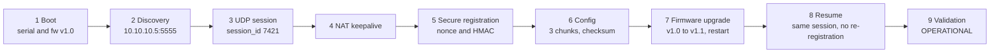
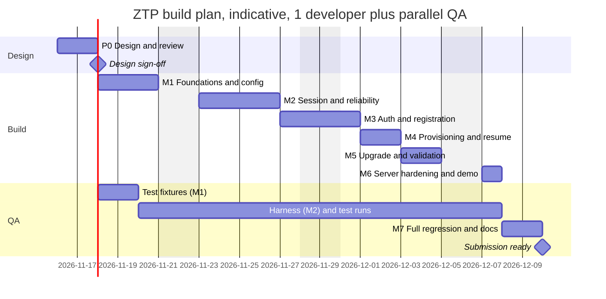

# Product Requirements Document — UDP-Based Zero Touch Provisioning (ZTP)

| Field | Value |
|---|---|
| Document | PRD_ZTP.md (Product Manager persona) |
| Version | 1.0, as delivered (M7) |
| Date | 2026-11-12 (first draft 2026-11-10) |
| Status | Final for submission; open items in R-15 and the waivers in the QA §12.1 M7 gate row |
| Owner | Sunil Vallamkonda (Product Manager) |
| Companion documents | [DESIGN.md](DESIGN.md) (Architect: how it is built) · [QA_TEST_PLAN.md](QA_TEST_PLAN.md) (QA: how it is proven) |
| Source of truth for requirements | `UDP‑Based Zero Touch Provisioning (ZTP) Assignment.pdf` (referred to below as "the PDF") |

> **How the three documents fit together.** This PRD says *what* gets built and *why*, and it defines every requirement ID (`ZTP-FR-*`, `ZTP-NFR-*`, `ZTP-BON-*`, `ZTP-DEL-*`). [DESIGN.md §2](DESIGN.md#2-requirements-traceability-matrix) maps each ID to a design section and a source module. [QA_TEST_PLAN.md §10](QA_TEST_PLAN.md#10-requirements-traceability-matrix) maps each ID to test cases (`TC-*`). Constants, glossary and the demo scenario are defined once (DESIGN Appendix B and §19) and only referenced from here.

---

## Table of contents
1. [Document control and approvals](#1-document-control-and-approvals)
2. [Problem statement and background](#2-problem-statement-and-background)
3. [Goals, non-goals and success metrics](#3-goals-non-goals-and-success-metrics)
4. [Personas and stakeholders](#4-personas-and-stakeholders)
5. [User stories and end-to-end scenarios](#5-user-stories-and-end-to-end-scenarios)
6. [Functional requirements](#6-functional-requirements)
7. [Non-functional requirements](#7-non-functional-requirements)
8. [Bonus requirements](#8-bonus-requirements)
9. [Deliverables (Expected Submission)](#9-deliverables-expected-submission)
10. [Scope, assumptions and interpretation decisions](#10-scope-assumptions-and-interpretation-decisions)
11. [Release plan, milestones and timeline](#11-release-plan-milestones-and-timeline)
12. [Dependencies, risks and resolved questions](#12-dependencies-risks-and-resolved-questions)
13. [Caveats and limitations (product impact)](#13-caveats-and-limitations-product-impact)
14. [Enhancement roadmap (Now / Next / Later)](#14-enhancement-roadmap-now--next--later)
15. [Definition of Done](#15-definition-of-done)
16. [Glossary](#16-glossary)
- [Appendix: PDF coverage map](#appendix-pdf-coverage-map)

---

## 1. Document control and approvals

| Role | Responsibility for this PRD | Sign-off |
|---|---|---|
| Product Manager | Owns scope, priorities, acceptance criteria, timeline | ☐ |
| Architect | Confirms every requirement is feasible and traced in DESIGN.md | ☐ |
| QA Lead | Confirms every requirement is testable and traced in QA_TEST_PLAN.md | ☐ |
| Senior Developer(s) | Confirms the effort estimates in §11 | ☐ |

**Change control.** Any change to a requirement ID or its acceptance criteria means updating all three documents in the same revision and bumping the shared version number. IDs are never re-used. A dropped requirement is marked *Withdrawn* instead of being deleted.

| Version | Date | Change |
|---|---|---|
| 0.1 | 2026-11-10 | First complete draft for architecture, development and QA review |
| 1.0 | 2026-11-13 | As delivered (M7): requirement statuses, waivers and the open tooling (R-15) recorded; schedule kept as the original estimate (§11) |

---

## 2. Problem statement and background

### 2.1 The problem
A network device (an edge gateway, in this exercise) is installed in the field by someone who isn't a network engineer. It powers on with **no configuration, no certificates and no provisioned credentials**, so it must, without human help:

1. find a provisioning server;
2. set up a trustworthy control channel over **UDP** (the PDF requires this);
3. prove who it is and register;
4. receive its configuration and firmware, upgrading itself if necessary;
5. check its own health and enter an **OPERATIONAL** state.

### 2.2 Why it matters (business framing)
- **Cost:** provisioning by hand ("truck rolls", console cables, staff typing CLI) is the main cost of large edge rollouts. ZTP turns that into "plug it in and walk away".
- **Consistency:** central policy means each device gets the correct firmware and config for its model and tenant, with no copy-paste drift.
- **Security:** an unauthenticated provisioning channel lets anyone push a malicious config. Authenticity and replay protection are part of the product, not a later hardening step.
- **Field reality:** devices sit behind NAT and firewalls, on lossy links (cellular, satellite, Wi-Fi), and lose power at awkward moments. The control plane must tolerate **10–20% packet loss**, reordering and duplication, and recover from restarts.

### 2.3 What this exercise is evaluated on
The PDF says reviewers care about *"reasoning and tradeoffs more than feature completeness"* and about networking fundamentals: reliability, security and system behaviour. That shapes the priorities here. Correctness and explained tradeoffs come before breadth of features, and every limitation is written down instead of hidden.

---

## 3. Goals, non-goals and success metrics

### 3.1 Goals
- **G1:** A complete, runnable ZTP flow in C11 over UDP, from boot to OPERATIONAL.
- **G2:** Reliable delivery at the application layer that provably survives 10–20% loss, reordering and duplication.
- **G3:** Authenticated registration with replay protection, and no IP fragmentation.
- **G4:** Firmware upgrade with a process restart and resumption, with **no duplicate registration**.
- **G5:** A server that handles devices concurrently, applies per-device policy and keeps an auditable registration DB with a dump and summary.
- **G6:** Documentation (README, design, logs) that explains each decision and tradeoff well enough to convince senior reviewers.

### 3.2 Non-goals (and why)
| Non-goal | Why it's out of scope | Where production would go |
|---|---|---|
| Confidentiality (encryption) | The PDF's "secure UDP-based control channel" is specified in §5 as HMAC authenticity plus replay protection, which the design provides. Encryption would roughly double the crypto surface and change the wire format. The interpretation is explicit in DESIGN §18.1 | DTLS 1.3 or an AEAD; see §14 (N-01) |
| Real PKI and certificates | The scenario says "no certificates" | IDevID and BRSKI (RFC 8995), SZTP (RFC 8572) |
| Real flash writes and a bootloader | Firmware is mock data, as the PDF allows | A/B partitions with a secure boot chain |
| GUI or REST API | The PDF says explicitly that it is "not a REST or API exercise" | An admin API on the server |
| Production packaging | The PDF says it is not required | Packages, systemd units, containers |
| Windows support | POSIX sockets only | A Winsock port |

### 3.3 Success metrics (measurable; verified by QA)
| ID | Metric | Target | Linked requirement | Verified by |
|---|---|---|---|---|
| SM-1 | Valid devices that reach OPERATIONAL under 20% loss, 10% reorder and 5% duplication | **100%** across 10 seeded runs | ZTP-NFR-03 | TC-REL-09, TC-E2E-02 |
| SM-2 | Duplicate registrations after an upgrade restart, a NAT rebind or a session timeout | **0** | ZTP-FR-23 | TC-UPG-03/04, TC-NAT-05 |
| SM-3 | Forged, tampered or replayed registrations accepted | **0** (100% rejected) | ZTP-FR-13/14 | TC-AUTH-03..08 (as delivered: the logic is built and reviewed, but all six cases are open, R-15; TEST_REPORT §6) |
| SM-4 | Median time from boot to OPERATIONAL per device at 20% loss (demo timers) | **≤ 60 s** (p95 ≤ 90 s) | ZTP-NFR-04 | TC-PERF-02 |
| SM-5 | Concurrent devices provisioned in one run | **≥ 50**, server RSS ≤ 64 MB | ZTP-NFR-05 | TC-PERF-01 |
| SM-6 | IP fragments on the wire | **0**; every datagram ≤ 1200 B | ZTP-FR-20, NFR-02 | TC-PROV-04/05 |
| SM-7 | Crashes or sanitizer errors under fuzzing (1M malformed datagrams) | **0** | ZTP-NFR-07 | TC-SRV-07 |
| SM-8 | Required README questions answered (5 required + 4 bonus), plus the PDF §4 keepalive explanation | **10/10** | ZTP-DEL-06/08/12 | TC-DEL-05/07/10 |
| SM-9 | PDF Appendix A steps reproduced, with the PDF's log text verbatim | **9/9 steps** | ZTP-FR-33 | TC-APX-01..10 |
| SM-10 | The DB dump matches the PDF's "Example of a Dump from Server DB" (title, 6 columns, order, formats, notes) | **Exact match** | ZTP-FR-31 | TC-PDF-02 |

---

## 4. Personas and stakeholders

| Persona | Who | Needs from the system | Key requirements |
|---|---|---|---|
| **Field technician** ("Tess") | Installs hardware, not networking-literate | Plug it in, and see a green light without any CLI | FR-01..02, FR-27, BON-01 |
| **Network operations admin** ("Omar") | Runs the provisioning server and owns policy | Correct firmware and config per model and tenant; audit of who registered and when; failure reasons | FR-28..32 |
| **Security officer** ("Sasha") | Signs off on the trust model | No rogue devices, no rogue servers, no replays, documented residual risks | FR-13/14, NFR-06, §13 |
| **Firmware release manager** ("Felix") | Ships firmware versions | Upgrades that verify integrity and survive crashes, with no bricking and no double registration | FR-16..23 |
| **Evaluator / senior reviewer** | Reads the submission | Runnable code, a clear README, logs that prove behaviour, honest tradeoffs | DEL-01..12 |

---

## 5. User stories and end-to-end scenarios

### 5.1 User stories
| ID | As a… | I want… | So that… | Requirements |
|---|---|---|---|---|
| US-01 | field technician | the device to find the server itself | I never type an IP address | FR-02, BON-01 |
| US-02 | ops admin | each model to get its assigned firmware and config | the fleet is consistent | FR-29 |
| US-03 | security officer | registrations with a bad key or a replayed message rejected and recorded | rogue devices can't join and I can audit attempts | FR-13, FR-14, FR-30 |
| US-04 | release manager | outdated devices to upgrade and restart automatically | the fleet converges on the target version | FR-21..23 |
| US-05 | ops admin | provisioning to finish over a bad link | rural and satellite sites work | FR-09, NFR-03 |
| US-06 | ops admin | an interrupted download to continue where it stopped | a 1% loss of power doesn't cost a full re-download | FR-19 |
| US-07 | ops admin | a DB dump and a success/failure summary | I can report rollout status | FR-31, FR-32 |
| US-08 | evaluator | one command that builds and runs a realistic demo | I can verify the claims myself | DEL-02, DEL-05, DEL-11 |

### 5.2 End-to-end scenarios (these become the demo; defined in [DESIGN §19](DESIGN.md#19-build-run-and-demo-plan-expected-submission-1-3))
| Scenario | Device | Model / start firmware | Expected outcome | Notes column in DB |
|---|---|---|---|---|
| S1 First boot, upgrade (the Appendix A device) | ZTP-93AF21 | EDGE-GW-100 / v1.0 | Success, v1.1 / cfg v3, OPERATIONAL after restart | — |
| S2 Bad credential | ZTP-84BC19 | EDGE-GW-100, with a corrupted **model key** (K_mfg), as from a counterfeit or mis-provisioned unit; the fleet bootstrap key is correct | **Failed** after 3 verified "Invalid HMAC" rejections; no firmware or config | Invalid HMAC |
| S3 Power loss mid-download | ZTP-71DD08 | EDGE-GW-100 / v1.0 | A crash during the firmware download (the demo uses the `--crash-after-chunks 40` hook, which calls `abort()`; QA also uses a real external `kill -9`, TC-PROV-08); resumes the missing chunks only; replays of its REGISTER are rejected; Success v1.1 / v3 | — (verbose dump: "Transfer resumed") |
| S4 Already current | ZTP-55AC90 | EDGE-GW-100 / v1.1 | Success v1.1 / v3, no upgrade or restart | — |
| S5 Legacy model | ZTP-19FE77 | EDGE-GW-050 / v0.9 | Success v1.0 / cfg v2 after upgrade | Legacy device |

All five run **concurrently** with 15% loss, 10% reordering and 5% duplication injected on both sides. The resulting dump mirrors the example table in the PDF.

### 5.3 Reference journey: the PDF's Appendix A, step by step
This is the canonical user journey that the product must reproduce: one new EDGE-GW-100 device (ZTP-93AF21, firmware v1.0) going from power-on to OPERATIONAL. The full message flow is in [DESIGN §4.5](DESIGN.md#45-end-to-end-control-and-event-flow-following-pdf-appendix-a-steps-19) and the log transcript in [DESIGN Appendix A](DESIGN.md#appendix-a-annotated-end-to-end-log-transcript). Each step is verified by its own test.

| Step | What the user or operator sees | Log lines (PDF wording, verbatim) | Requirements | Acceptance test |
|---|---|---|---|---|
| 1 Device boot | The device starts with no configuration and identifies itself | `[BOOT] Device starting`, `[BOOT] Soft serial: ZTP-93AF21`, `[BOOT] Firmware version: v1.0` | FR-01 | TC-APX-01 |
| 2 Server discovery | It finds the provisioning server without a technician | `[DISCOVERY] Using static server IP 10.10.10.5:5555` | FR-02 (BON-01 for multicast) | TC-APX-02 |
| 3 UDP session | A logical session is set up over UDP | `[UDP] HELLO sent (seq=1)`, `[UDP] Session established (session_id=7421)` | FR-03..06 | TC-APX-03 |
| 4 NAT keepalive | The path through NAT is confirmed and kept alive | `[NAT] Keepalive sent`, `[NAT] Keepalive acknowledged` | FR-10, FR-11 | TC-APX-04 |
| 5 Secure registration | The device proves who it is; the operator sees it registered under the tenant | `[AUTH] Registration successful`, `[AUTH] Assigned tenant: cruise_ops` | FR-12..14, FR-29, FR-30 | TC-APX-05 |
| 6 Configuration | The config arrives in pieces and is verified | `[PROVISION] Receiving config (chunk 1/3)` … `(chunk 3/3)`, `[PROVISION] Config checksum verified` | FR-15, FR-17, FR-18, FR-20 | TC-APX-06 |
| 7 Firmware upgrade | Outdated firmware is replaced and the device restarts itself | `[UPGRADE] Current: v1.0 -> Target: v1.1`, `[UPGRADE] Upgrade complete, restarting device` | FR-16..19, FR-21, FR-22 | TC-APX-07 |
| 8 Resume after restart | The device continues where it left off; the operator sees **one** registration | `[BOOT] Restart detected`, `[UDP] Session resumed (session_id=7421)` | FR-23 | TC-APX-08 |
| 9 Validation and operational mode | The device checks itself and goes live | `[VALIDATION] Configuration present`, `[VALIDATION] Firmware v1.1 verified`, `[STATE] Device is OPERATIONAL` | FR-24..27 | TC-APX-09 |
| All | The same journey under 15% loss, reordering and duplication | All of the above, in order | FR-09, NFR-03 | TC-APX-10 |

---

## 6. Functional requirements

Priority key: **M** = Must (required by the PDF), **S** = Should (strongly implied by the PDF or needed for a credible solution).

| ID | Requirement | PDF source | Pri | Acceptance criteria |
|---|---|---|---|---|
| ZTP-FR-01 | The device generates a soft serial on first boot, persists it, and loads it on later boots | §1 | M | Format `ZTP-[0-9A-F]{6}`; the same serial survives restarts; logs `[BOOT] Soft serial generated` on first boot, `[BOOT] Soft serial loaded` on later boots (`assigned (configuration)` when set with `--serial`), each followed by `[BOOT] Soft serial: <serial>` |
| ZTP-FR-02 | The device can find the server through a static IP and port | §1 | M | `--server IP:PORT` works; logs `[DISCOVERY] Using static server IP …` |
| ZTP-FR-03 | All provisioning traffic uses UDP sockets only | §2, Exp. Sub. | M | No TCP sockets anywhere in the code; a pcap shows UDP only |
| ZTP-FR-04 | A session handshake sets up a server-assigned session identifier | §2 | M | HELLO/HELLO_ACK; session_id is non-zero, random, and unique among live sessions |
| ZTP-FR-05 | Every protocol message carries a sequence number | §2, Bonus 1 | M | The `seq` header field is present on every frame type |
| ZTP-FR-06 | Timeouts and retransmission of unacknowledged messages | §2, §3 | M | Retransmits after RTO with exponential backoff; gives up after the retry limit and recovers |
| ZTP-FR-07 | Acknowledgement of received messages | §3 | M | Cumulative ACK and SACK; piggybacked or as a pure ACK |
| ZTP-FR-08 | Duplicate detection | §3 | M | Duplicates are logged, re-ACKed and never re-delivered to the application |
| ZTP-FR-09 | Correct operation under 10–20% simulated packet loss | §3 | M | See SM-1. The loss rate is defined **per direction** (applied at the sender only, so it doesn't compound; DESIGN §16.1) |
| ZTP-FR-10 | Periodic keepalive messages | §4, App. A Step 4 | M | A path-probe keepalive right after the session is established (before registration, as in Appendix A), then one whenever the session has been idle for an interval; each is acknowledged; logs `[NAT] Keepalive sent` and `[NAT] Keepalive acknowledged` |
| ZTP-FR-11 | Detection of session timeouts, on device and server | §4 | M | Device: declares the session dead after 3 missed intervals and recovers. Server: expires an idle session after 3 intervals, then enforces a grace period |
| ZTP-FR-12 | Registration carries the soft serial, device metadata and a nonce | §5 | M | REGISTER TLVs: serial, model, fw version, hw revision, 64-bit device nonce, echoed server nonce |
| ZTP-FR-13 | The server checks authenticity with HMAC | §5 | M | HMAC-SHA256 on every frame. A wrong or corrupted model key gives a *verified* REGISTER_NAK(BAD_MAC, "Invalid HMAC") and a Failed DB row; an unknown model gives UNKNOWN_MODEL, and a known model without a policy gives NO_POLICY; all are deterministic (DESIGN §10.3) |
| ZTP-FR-14 | Replay protection | §5 | M | Replayed REGISTER in the same session, replayed into a new session, reused nonce, replayed resume and replayed NAK are all rejected, and none changes state. A replayed valid frame from another address can't move the session's return address (DESIGN §9.4) |
| ZTP-FR-15 | The server sends a configuration payload in JSON | §6 | M | The config is valid JSON and a superset of the PDF's Appendix A example: `interfaces.wan = "eth0"`, `interfaces.lan = "eth1"`, `mtu = 1500` and `keepalive_interval = 20` unchanged, plus `config_version` |
| ZTP-FR-16 | The server sends a (mock) firmware blob | §6 | M | Per-model firmware artifact with a version header |
| ZTP-FR-17 | Data is transferred in chunks | §6 | M | 1024-byte chunks; logs `Receiving config (chunk i/N)` |
| ZTP-FR-18 | Integrity is validated with a hash | §6 | M | SHA-256 of the whole artifact matches the manifest before use; on mismatch, re-download (limited retries) |
| ZTP-FR-19 | Transfers resume after a failure | §6 | M | After a crash or session loss, only the missing chunks are requested again |
| ZTP-FR-20 | No reliance on IP fragmentation | §6 | M | Every datagram ≤ 1200 B UDP payload; DF set; 0 fragments. On a path that can't carry 1200 B (EMSGSIZE or a black hole), the session steps down to 508 B datagrams and 256 B chunks and keeps its progress (DESIGN §5.8) |
| ZTP-FR-21 | Outdated firmware is detected and the upgrade simulated | §7 | M | Version compare; staged, verified install; logs `[UPGRADE] Current: vX -> Target: vY` |
| ZTP-FR-22 | The device process restarts after the upgrade | §7 | M | Process re-exec; logs `[BOOT] Restart detected` |
| ZTP-FR-23 | Provisioning resumes after the restart **without duplicate registration** | §7 | M | Authenticated resume of the same session_id; no REGISTER sent; one DB row per serial. This also holds when the device restarts before the server notices, and across a **server** restart (resumable sessions are journaled; DESIGN §12.3, §14.4) |
| ZTP-FR-24 | Validation: configuration is present | §8 | M | The config file exists, its hash matches, required keys are present |
| ZTP-FR-25 | Validation: firmware version | §8 | M | The active slot's version equals the assigned version |
| ZTP-FR-26 | Validation: session health | §8 | M | A fresh keepalive round trip succeeds, the last authenticated RX is recent, SRTT is under the threshold |
| ZTP-FR-27 | Transition to the OPERATIONAL state | §8 | M | Logs `[STATE] Device is OPERATIONAL`; the server records stage OPERATIONAL |
| ZTP-FR-28 | The server handles many devices registering at the same time | §9 | M | 5-device demo with interleaved progress; 50-device scale test |
| ZTP-FR-29 | The server assigns the correct firmware and config per device | §9 | M | Policy: serial override > model > default; legacy model gets v1.0 / cfg v2 |
| ZTP-FR-30 | The server stores registration details: device ID, timestamp, firmware assigned, config version, outcome | §9 | M | All five fields present in every row (plus stage, notes, attempts) |
| ZTP-FR-31 | The server can dump its DB | §9 | M | On SIGUSR1, on SIGINT, and at the end of the demo. The default format **exactly** matches the PDF's "Example of a Dump from Server DB": title "Device Registration Details"; columns *Device ID, Registration Status, Firmware Assigned, Config Version, Registration Time, Notes* in that order; `YYYY-MM-DD HH:MM:SS`; `—` for empty cells; notes such as "Invalid HMAC" and "Legacy device". Extra fields appear only in a verbose dump |
| ZTP-FR-32 | The server displays a summary: successful devices, failed devices, firmware and config per device | §9 | M | Summary block printed after the dump |
| ZTP-FR-33 | Both sides emit tagged logs that follow the Appendix A flow and the §1 example output | §1 example, App. A | M | Tags `[BOOT] [DISCOVERY] [UDP] [NAT] [AUTH] [PROVISION] [UPGRADE] [VALIDATION] [STATE]`. Every log line shown in the PDF §1 example and Appendix A Steps 1–9 is emitted **verbatim as a prefix**, in Appendix A order (§5.3). The bonus sample lines are emitted in the **same format** with the real sequence numbers; the PDF's literal numbers are reproduced by the component test TC-REL-03 (DESIGN §17.4) |
| ZTP-FR-34 | All operational parameters (network, NAT and keepalive timers, reliability, transfer, limits, paths, logging, simulation) are **runtime configuration** in JSON files, not hardcoded | §4, §6, §9 (operability) | M | `server.json`, `device.json`, `policy.json`, `keys.json` and named profiles; precedence defaults < file < profile < CLI, then per-device policy (tenant < model < serial) for NAT values, which the device applies over its own files and clamps (DESIGN §25.3); out-of-range or unknown keys fail fast with a clear message; `--print-config` shows each value and its source (DESIGN §25) |
| ZTP-FR-35 | NAT and session parameters (keepalive interval, dead intervals, server idle, grace, IP-change policy) can be set per deployment **and** per tenant, model or serial, and are delivered to the device | §4 | M | A policy override changes the device's effective keepalive, shown in the device log and the verbose dump; the device clamps it to its configured bounds |
| ZTP-FR-36 | NAT changes outside the operator's control are handled or clearly diagnosed: idle timeout below the keepalive, NAT reboot, public-IP change, outbound UDP blocked | §4 | M | Sessions survive timeout, reboot and IP change without re-registration; the server logs the advice when the NAT timeout looks shorter than the keepalive; a blocked UDP path produces the documented diagnostic and capped retries |

---

## 7. Non-functional requirements

| ID | Category | Requirement | Acceptance criteria |
|---|---|---|---|
| ZTP-NFR-01 | Portability | C11, POSIX sockets, builds on Linux (gcc) and macOS (clang), **no third-party libraries** | `make` works from a clean checkout on both platforms |
| ZTP-NFR-02 | Network | Maximum UDP payload of 1200 bytes per datagram | Enforced at compile time and at runtime (assert in the encoder) |
| ZTP-NFR-03 | Reliability | 100% success for valid devices at ≤20% loss, with 10% reorder and 5% duplication | SM-1 |
| ZTP-NFR-04 | Performance | Median boot-to-OPERATIONAL ≤ 60 s at 20% loss (demo timers) | SM-4 |
| ZTP-NFR-05 | Scalability | ≥ 50 concurrent devices tested; design limit 1024 sessions; per-source rate limiting | SM-5 |
| ZTP-NFR-06 | Security | CSPRNG nonces and IDs, constant-time MAC comparison, no state change from unauthenticated input, mutual authentication | TC-AUTH-08/11, TC-UNIT-05 |
| ZTP-NFR-07 | Robustness | Malformed input never crashes either process; memory bounded | SM-7 |
| ZTP-NFR-08 | Observability | Tagged logs with millisecond timestamps, one log file per device, protocol counters at exit | TC-LOG-03/04 |
| ZTP-NFR-09 | Determinism | Impairment simulation is reproducible from `--seed` | TC-UNIT-15 |
| ZTP-NFR-10 | Durability | Device state and the server DB survive crashes (atomic writes, append-only log) | TC-UPG-07, TC-SRV-06 |
| ZTP-NFR-11 | Code quality | `-Wall -Wextra -Werror` clean; ASan and UBSan clean during the demo | TC-DEL-01/08 |

---

## 8. Bonus requirements

The PDF's bonus section is optional. **All bonus items are in scope** for this submission.

| ID | Requirement | PDF source | Acceptance criteria |
|---|---|---|---|
| ZTP-BON-01 | Broadcast or multicast discovery | §1 (bonus) | Multicast and broadcast both supported; authenticated OFFER; falls back to static IP |
| ZTP-BON-02 | Every UDP message has a sequence number | Bonus req. 1 | Same as FR-05, checked under impairment |
| ZTP-BON-03 | Acknowledgement and retransmission on timeout | Bonus req. 2 | Logs `[UDP] Retransmitting seq=N (timeout)` |
| ZTP-BON-04 | Out-of-order frames buffered and delivered in order | Bonus assumptions / example | Logs in the format `[UDP] Received packet seq=<n> (out of order, expected=<m>)` and `[UDP] Buffered packet seq=<n>`; the PDF's exact case (seq=3, expected=2) is reproduced by TC-REL-03; the application sees strictly increasing seq |
| ZTP-BON-05 | Idempotent processing: duplicates cause no duplicate state change | Bonus req. 3 | Duplicate REGISTER, CHUNK or STATUS gives no second DB transition or file write |
| ZTP-BON-06 | Packet loss simulated in code (plus reordering and duplication) | Bonus req. 4 | `--loss/--reorder/--dup/--seed` flags on both binaries; Linux `netem` recipe documented |
| ZTP-BON-07 | Correct behaviour when the ACK is lost but the data arrived | Bonus README Q3 | Duplicate detected, re-ACKed, not re-applied |
| ZTP-BON-08 | Bonus-style log output | Bonus "Sample Log Output" | All four sample log lines appear in the demo logs in the PDF's format (generic sequence numbers, TC-LOG-02), and verbatim with the PDF's numbers in the component test TC-REL-03 |

---

## 9. Deliverables (Expected Submission)

Every bullet in the PDF's "Expected Submission" section has an ID. A submission with only code, or only documents, is incomplete, as the PDF says.

| ID | Deliverable | PDF source | Acceptance criteria |
|---|---|---|---|
| ZTP-DEL-01 | Working code that implements the ZTP functionality | Exp. Sub. 1 | The demo reproduces scenarios S1–S5 (as delivered: S1, S3, S4, S5; S2 needs `--bad-key`, R-15) |
| ZTP-DEL-02 | Runnable or buildable as submitted | Exp. Sub. 1 | `make && make demo` from a clean checkout |
| ZTP-DEL-03 | Device and server logic clearly separated | Exp. Sub. 1 | `device/`, `server/` and `common/` directories; two binaries |
| ZTP-DEL-04 | UDP sockets for all provisioning communication | Exp. Sub. 1 | Same as FR-03 |
| ZTP-DEL-05 | Basic build and run instructions | Exp. Sub. 1 | A "Quick start" section in the README |
| ZTP-DEL-06 | README answers the five required questions (reliability over UDP, replay prevention, avoiding fragmentation, NAT impact, behaviour under loss) | README Requirements | One section per question |
| ZTP-DEL-07 | README covers architecture and control flow, UDP session management, identity/auth/registration, config and firmware provisioning, upgrades and restarts, known limitations and tradeoffs | Exp. Sub. 2 | One section per topic |
| ZTP-DEL-08 | README bonus coverage: loss and out-of-order handling, duplicate detection, simulation method, and the four bonus questions | Exp. Sub. 2, Bonus README Qs | One section per topic and question |
| ZTP-DEL-09 | Server logs | Exp. Sub. 3 | `logs/server.log` from the demo run |
| ZTP-DEL-10 | Client (device) logs | Exp. Sub. 3 | `logs/device_<serial>.log` for every demo device |
| ZTP-DEL-11 | DB dump and summary from the demo run | §9 (supports FR-31/32) | `logs/db_dump.txt` |
| ZTP-DEL-12 | README explains why keepalives and session-timeout detection matter in real deployments | §4 ("Explain in your README why this is important for real deployments") | A dedicated README section (from DESIGN §9.6) |

---

## 10. Scope, assumptions and interpretation decisions

### 10.1 In scope
Everything in §6–§9: all core requirements, **all bonus items**, and all deliverables. A clause-by-clause map of the PDF is in [Appendix: PDF coverage map](#appendix-pdf-coverage-map).

**The PDF's "Scope & Expectations", and the product decisions taken:**
| PDF expectation | Decision |
|---|---|
| Language: C or Python | **C11**: realistic for device firmware, and gives explicit control of sockets, byte order and memory (rationale: DESIGN §1.3) |
| Deliverables: working code and a README explaining the design choices | Code plus README plus logs; see §9 (DEL-01..12) |
| Focus on correctness and networking fundamentals rather than UI or packaging | No UI (CLI, logs, a text dump); packaging is a Makefile only; effort goes into the protocol and the tests |
| "This is not a REST or API exercise" | A binary protocol over raw UDP sockets; no HTTP or REST anywhere (TC-PDF-05) |
| "Reasoning and tradeoffs more than feature completeness" | Every interpretation and tradeoff is documented (§10.4, DESIGN §3 and §22) |

### 10.2 Out of scope
See §3.2 for the non-goals. Also out of scope: real NAT hardware, real power-loss rigs, IPv6, and multiple server instances.

### 10.3 Assumptions (owner: this section; DESIGN §3 records the technical ones)
| ID | Assumption | Impact if wrong |
|---|---|---|
| A-01 | The implementation is C11 on POSIX (Linux and macOS), tested on loopback or a LAN | A port is needed for other operating systems |
| A-02 | The device has no RTC and no *provisioned* credentials, but carries two **factory secrets** in its firmware image: a fleet-wide **bootstrap key** (only for discovery, the handshake and authenticated rejections) and a **per-model manufacturing secret** (identity) (DESIGN §3.1, §10.1) | If reviewers read "no stored credentials" strictly, the alternative is trust-on-first-use, which is weaker. The tradeoff is documented |
| A-03 | Firmware is mock data, and "install" is an atomic file operation (A/B slot files) | None for the evaluation |
| A-04 | A single, trusted provisioning server, reachable by static IP or by broadcast/multicast in the same L2 segment | Multi-site setups would need a relay or DNS-SD (§14) |
| A-05 | The demo uses 5 devices, the scale test 50 or more; impairments are 10–20% loss with reordering and duplication; timers are shortened in the demo | Production timers are documented separately (DESIGN Appendix B) |
| A-06 | Firmware and config are assigned by model, with optional per-serial overrides | — |
| A-07 | Reviewers value reasoning and correctness over breadth of features, as the PDF says | Scope is prioritised accordingly |
| A-08 | Demo serials are set explicitly with `--serial` so that they match the PDF table; normal runs generate them | — |
| A-09 | **Deployment prerequisite:** the customer's firewall or NAT allows **outbound UDP** from the device to the server's port 5555 (and 5556 for multicast or broadcast discovery), plus the replies. Nothing else is needed: no port forwarding, static mappings or inbound rules | Without it, ZTP can't work. The PDF requires UDP, so there's no TCP fallback. The device logs a clear diagnostic (FR-36) |
| A-10 | The NAT and firewall belong to the customer or ISP, and their settings (idle timeout, NAT type, public IP) can change at any time without notice. The design assumes nothing about them | Covered by FR-35 and FR-36 and DESIGN §9.7 |
| A-11 | **Default NAT timing:** most customer NATs keep idle UDP mappings for **≥ 30 s** (typical 30–60 s), so the default 20 s keepalive is enough. Sites with stricter timers are handled by per-tenant, model or serial overrides or the `strict-nat` profile (FR-35) | If a NAT's timeout is below the configured keepalive, replies are lost in the gap until the next keepalive rebinds; the server logs advice (FR-36). Correctness holds and efficiency drops |
| A-12 | **NAT behaviour:** the NAT forwards replies that come from the exact server IP:port the device sent to. This holds for every RFC 4787 filtering type, including symmetric and port-restricted NATs. The design does **not** need endpoint-independent mapping, hairpinning, port preservation, a UDP ALG, UPnP/NAT-PMP or inbound reachability, and works through double NAT and CGNAT | A NAT that rewrites UDP payloads (a broken ALG) causes MAC failures, which show up as loss and then a diagnostic (DESIGN §9.7) |
| A-13 | **Discovery scope:** multicast and broadcast discovery work only inside the device's own L2 or multicast scope and don't cross NAT. Devices behind NAT at remote sites use the static server address (as in PDF Appendix A) | Remote sites need the static address configured (`discovery.server`) |
| A-14 | **NAT mapping lifecycle:** (1) the device's first outbound UDP datagram creates the mapping; (2) one device socket, so one mapping, carries the whole session; (3) any mapping type works, symmetric NAT included; (4) the mapping is refreshed by **outbound** traffic only, never by relying on inbound; (5) its lifetime is unknown and may change; (6) its external IP:port may change at any time and is never used as identity; (7) a device restart creates a **new** mapping; (8) it can be deleted without notice; (9) no port forwarding or static mapping is needed. Details: DESIGN T-12 | Each point has a matching design response (device-initiated keepalives, `session_id`-based sessions, authenticated resume, liveness detection). A NAT that refreshes only on inbound traffic, or that changes the mapping while it is in use, is still handled through rebinding, at some efficiency cost |
| A-15 | **Path MTU:** the device-to-server path carries 1228-byte IP packets (any compliant IPv6 path, and most IPv4 paths), or at least the IPv4 minimum of 576 bytes, in which case the session falls back to 508-byte datagrams (DESIGN §5.8) | Below 576 (not compliant with IPv4) the design can't operate; this is documented |
| A-16 | (Q-01, DESIGN OQ-2) Provisioning payloads are **integrity-protected, not encrypted**. Configs in this release must not carry secrets that need confidentiality. *Fixed* | If secrets must be provisioned, encryption (N-01) must come first |
| A-17 | (Q-02, OQ-3) The resume grace period is a deployment setting. *Configurable:* `nat.grace_s` per tenant, model or serial | — |
| A-18 | (Q-03, OQ-4) Rate limits and table caps, without a stateless cookie, are enough against HELLO floods for this release. *Configurable:* `limits.*`, `nat.half_open_ttl_s` | A large distributed flood could exhaust half-open capacity; cookies are on the roadmap (N-03) |
| A-19 | (Q-04) A device whose model key is rejected (BAD_MAC) stops after a bounded number of attempts and stays FAILED until an operator resets it (`--reset-state`). *Configurable:* `auth.register_attempts` (1..10, default 3) | A transiently mis-keyed device needs operator action |
| A-20 | (Q-05) The 18-working-day single-developer plan (target Wed 9 Dec 2026) is the baseline; the team variant is the contingency | If dates slip, the plan switches to the team variant (R-09) |
| A-21 | (Q-06, OQ-9) All configuration files are JSON, read by the in-house strict parser. *Fixed* format; all values configurable | Operators who want YAML need a converter (roadmap) |
| A-22 | (DESIGN OQ-1, OQ-5..OQ-8, OQ-10..OQ-12) The other design decisions are adopted as stated in DESIGN §23, with their assumptions in DESIGN §3.8 (T-13..T-25). Configurable ones: RTO values (`rel.rto_*`), discovery mode (`discovery.mode`), verbose dump (`log.dump_verbose`), behaviour after OPERATIONAL (`run.exit_when_operational`), IP-change policy (`nat.allow_ip_change`), key material (`keys.json`), MTU fallback (`net.mtu_fallback`, `net.pmtu_blackhole_s`, `net.max_datagram`). Fixed: never overwrite a Success row with a failure, the dump format, the two-root key scheme, the two datagram levels | — |

### 10.4 Interpretation decisions on ambiguities in the PDF (details in [DESIGN §3](DESIGN.md#3-assumptions-and-ambiguity-resolutions))
1. **"No stored credentials" versus HMAC.** Factory secrets are used: a fleet bootstrap key, and a per-model key from which the per-device key is derived. The fleet key lets a device with a wrong model key reach REGISTER, so "Invalid HMAC" is a verified, recorded outcome. Documented as a limitation.
2. **The seq/ACK diagram in the Appendix is illustrative.** The design uses an independent sequence space per direction, a cumulative ACK and a SACK bitmap.
3. **Session resume keeps the session_id after a reboot.** The server holds a grace period and accepts an authenticated, counter-protected resume.
4. **"Registration outcome"** means the outcome of authentication and registration (Success or Failed). Provisioning progress is tracked in a separate *stage* column.

---

## 11. Release plan, milestones and timeline
> **As delivered.** The schedule below is the original estimate, written before development started (16 Nov – 9 Dec 2026). The work was done earlier: design 10 Nov, M1–M6 10–12 Nov, M7 (release regression, README, test report) 12–13 Nov 2026. The dates of each gate are in QA §11 and the git history. The scope and order of the milestones were followed as planned; the changes are recorded in the gate rows.

### 11.1 Effort and timeline (approximate)
These estimates assume one senior C developer full-time, a QA engineer working in parallel from M1 onward (building the fixtures in M1 and the protocol harness, `peer_sim` and the log checkers, in M2 when there is session traffic to drive; then running each milestone's tests), and a part-time architect for reviews. They include about 20% contingency.

| Phase | Scope | Effort | Indicative dates (start Mon 2026-11-16) | Exit criteria |
|---|---|---|---|---|
| **P0** Design and review | PRD, DESIGN and QA plan reviewed; open questions closed | 2 d | 16–17 Nov | All three documents signed off (§1) |
| **M1** Foundations | Codec, SHA-256/HMAC with test vectors, logging, netsim (TX-side impairments, MTU simulation), timer heap, Makefile; **JSON parser and configuration loader with profiles and validation (FR-34)**; **GitHub Actions CI (Ubuntu + macOS) with a netem check on the runner**; **spike: multicast and broadcast on macOS** | 3 d | 18–20 Nov | The QA §12.1 **M1 gate set** passes (unit, config, netsim) |
| **M2** Session and reliability | HELLO handshake, seq/ACK/SACK, RTO and backoff, reorder buffer, dedup, keepalive, timeout, NAT rebinding (new-frame rule), **NAT emulator and diagnostics (FR-36)** | 4 d | 23–26 Nov | The QA §12.1 **M2 gate set** passes (discovery, session, reliability, path probe), including at 20% loss |
| **M3** Auth and registration | Fleet and model key hierarchy, REGISTER, NAK paths (BAD_MAC, REPLAY, NO_POLICY, UNKNOWN_MODEL), replay defences, policy (with NAT overrides, FR-35), DB rows, **resumable-session journal** | 2 d | 27–30 Nov | The QA §12.1 **M3 gate set** passes (every registration outcome, replay, policy) |
| **M4** Provisioning | Manifest, pulling chunks, hash verify, persisted bitmap (durability order), resume, **small-MTU fallback (FR-20)**: both of its triggers involve CHUNK_DATA, so it is built with the transfer (moved from M2 on 2026-11-11) | 2 d | 1–2 Dec | The QA §12.1 **M4 gate set** passes (transfers, many frames in flight, PROVISIONING-session cases) |
| **M5** Upgrade and validation | A/B slots, execv restart, resume handshake (any live state), validation, OPERATIONAL, rollback | 2 d | 3–4 Dec | The QA §12.1 **M5 gate set** passes (upgrade, crash points, every resume case including kill -9 and server restart, MTU fallback, validation, Appendix A) |
| **M6** Server hardening and demo | Rate limits, failed-record cap, dump and summary, `run_demo.sh`, scale harness | 1 d | 7 Dec | The QA §12.1 **M6 gate set** passes (server, dump, demo, scale) |
| **M7** QA cycle and documentation | Full regression, impairment matrix, perf/soak, fixes; README (PDF requirements, bonus, conf reference, folder map, how to run tests), committed logs and §9 dump, `evidence/` from a release run and CI (scope in QA §11 M7 row) | 2 d | 8–9 Dec | The M7 gate set and a full regression pass; exit criteria in QA §11 met; DoD (§15) |
| **Total** | | **18 working days (≈ 3.5 weeks)**, including about 20% contingency. The configuration model, NAT emulation, fleet key, session journal and MTU fallback are included | **Target: Wed 9 Dec 2026** | |

**Team variant:** with two developers (one on `device/`, one on `server/` after M1) plus one QA engineer, the build takes about **10–12 working days (≈ 2.5 weeks)**. The critical path is still M1 → M2.

**Critical path:** M1 → M2 → M4 → M5. Upgrade and resume depend on both the session layer and the transfer layer. M3 and M6 can partly overlap M4 when two developers are available.

**Adjust for holidays.** The indicative dates ignore public holidays (for example US Thanksgiving, 26 Nov) and must be shifted to fit the team's calendar.

*The Gantt chart rounds durations to whole days.*

### 11.2 Milestone gates
Each milestone ends with a 30-minute review: a demo of the milestone's tests, review of the diff against the DESIGN section concerned, and a defect triage. No milestone may start with Sev-1 defects open from an earlier one (QA §11.3).

---

## 12. Dependencies, risks and resolved questions

### 12.1 Dependencies (owner: this section)
| ID | Dependency | Type | Notes |
|---|---|---|---|
| D-01 | gcc ≥ 9 or clang ≥ 11 with C11, GNU make, POSIX `sh` | Toolchain | Both platforms |
| D-02 | **No third-party libraries.** SHA-256 and HMAC are written in-house | Design | Depends on the FIPS 180-4 and RFC 4231 test vectors to prove correctness |
| D-03 | `leaks`, ASan/UBSan and tcpdump on the Mac (all built in or part of the CLT); valgrind on CI only | QA tooling | Used for TC-PERF-04 (`leaks`, valgrind) and the ASan runs; as delivered, packet captures (TC-REL-01, TC-PROV-04/05) run with tcpdump in CI, not on the Mac |
| D-04 | Linux `tc netem` (on the CI runners) and macOS dummynet (`dnctl` + `pfctl`, built in) | QA tooling | Optional; the in-code netsim is the default. As delivered: netem used on CI; dummynet not used (TC-SIM-04 waived) |
| D-05 | Internal ordering: PRD IDs → DESIGN traceability → QA cases; the protocol spec (DESIGN §5) frozen before QA finalises its cases | Process | Changes to the frozen spec go through change control |
| D-06 | Reviewer availability for P0 and the milestone gates | People | A slip in P0 moves the whole plan |
| D-07 | Platform behaviour of broadcast and multicast on loopback | Platform | Spiked in M1 (R-03) |
| D-08 | Xcode Command Line Tools on the development Mac. **Verified installed on 2026-11-10:** Apple clang 16.0.0 (arm64), GNU Make 3.81 | Toolchain | Satisfied. Make 3.81 is old, so the Makefile must avoid GNU Make ≥ 4 features (`.ONESHELL`, `$(file …)`, grouped targets) |
| D-09 | **GitHub Actions** with hosted `ubuntu-latest` and `macos-latest` runners: the **only Linux environment**, since there is no local Linux host and disk space on the Mac is limited | CI / platform | Repo: **https://github.com/heysunilvk/ztp-project** (created and empty as of 2026-11-10). Private repos get 2,000 free minutes/month; public repos are free. Each run takes about 5 min. No local disk cost |

### 12.2 Risk register
| ID | Risk | Likelihood | Impact | Mitigation | Owner |
|---|---|---|---|---|---|
| R-01 | Subtle reliability bugs (window, reorder, wraparound) appear only under certain loss patterns | H | H | Seeded netsim, property-style unit tests over 10k permutations, an impairment matrix with many seeds | Dev / QA |
| R-02 | Bugs in the in-house crypto | M | H | Known-answer tests from FIPS and RFC vectors run in `make test`; keep the code small and auditable | Dev |
| R-03 | Broadcast on loopback doesn't work on macOS (`lo0` has no broadcast) | H | M | Multicast with `IP_MULTICAST_LOOP` as the demo default; broadcast tested locally on the Mac's Wi-Fi/Ethernet interface (its directed broadcast address) and on the CI Linux runner; static fallback; spike in M1 | Dev |
| R-04 | `execv` restart leaks file descriptors or loses log buffers | M | M | `FD_CLOEXEC` on all fds, flush logs before exec, a dedicated test (TC-UPG-02) | Dev |
| R-05 | Timer-based tests are flaky on loaded CI machines | M | M | Deterministic seeds, generous upper bounds, retries counted rather than timed | QA |
| R-06 | Reviewers disagree with how a PDF ambiguity was read | M | M | Every interpretation is explicit, with its rationale (§10.4, DESIGN §3) | PM / Architect |
| R-07 | Scope creep (DTLS, IPv6, a DB engine) threatens the timeline | M | M | Kept on the roadmap (§14); PM rejects in-sprint additions | PM |
| R-08 | Platform differences in the DF bit (`IP_MTU_DISCOVER` on Linux, `IP_DONTFRAG` on macOS) | M | L | Best effort; the size cap (≤ 1200 B) is the actual guarantee | Dev |
| R-09 | The estimate misses the 3.5-week (18-day) target | M | M | 20% contingency built in; M6 scale work, the rollback feature and the optional real-NAT CI job can be descoped first | PM |
| R-10 | Toolchain differences: macOS ships GNU Make 3.81 and Apple clang, while Linux has gcc and Make 4.x | L | L | Keep the Makefile Make-3.81-compatible; the CI matrix (D-09) builds on both platforms from M1 | Dev |
| R-11 | No local Linux host, so Linux-only checks (netem, valgrind, the gcc build) run only on CI; feedback is slower, and the `sch_netem` kernel module may be unavailable on hosted runners | M | L | Set up CI in M1 and **verify netem on the runner first**. If it's missing, TC-SIM-03 is waived, because the in-code netsim (BON-06) and macOS dummynet (TC-SIM-04) cover the requirement. Daily work uses macOS substitutes (QA §3.1) | Dev / QA |
| R-12 | A customer's firewall blocks outbound UDP 5555/5556, or a NAT drops UDP mappings faster than the keepalive interval | M | H for that site | The prerequisite is documented (A-09); a clear device diagnostic; per-site, tenant or serial keepalive override (FR-35); a server-side hint when the NAT timeout looks short (FR-36) | PM / Ops |
| R-13 | Misconfiguration of the new runtime config (typos, unsafe values) | M | M | Unknown keys rejected; range checks; fixed protocol invariants; `--print-config` with sources; device-side clamp on advertised values (DESIGN §25.8) | Dev |
| R-14 | Extraction of the fleet bootstrap key from a device image | L | M | It grants no identity (that needs K_mfg): at most rogue OFFERs or HELLO_ACKs, forged terminal ERRORs and Failed-row noise, all bounded (rate limits, failed-record cap, NONCE_REG echo, Success rows never overwritten). Per-device keys are on the roadmap (L-01) | Security |
| R-15 | The attack-simulation test tooling (device hooks `--bad-key`, `--replay-test`, `--reuse-nonce`/`--nonce`; `peer_sim` rogue, forged, replayed and load modes) wasn't built with M3 (recorded 2026-11-11; extended at M4 and M5). Fifteen security cases and the CHUNK_REQ half of TC-NAT-12 stay unexercised end to end (QA §12.5: eleven TC-AUTH cases, TC-SRV-08/11, TC-SESS-07/09), and **the demo's "Invalid HMAC" row (device ZTP-84BC19, S2) and the replay device (ZTP-71DD08, S3) depend on `--bad-key` and `--replay-test`** | H (already open) | M | The protection logic is built and partly unit-tested; the owner writes the tooling, `--bad-key` first (needed for the M6 demo and TC-PDF-02). **Status at M7 (as delivered): still open, waived by the owner** for this submission: 15 cases and the CHUNK_REQ half of TC-NAT-12; the PDF dump's failed row is not demonstrated. Declared in the README (status block, §18) and TEST_REPORT §6 | Owner / QA |

### 12.3 Resolved questions (decided 2026-11-10)
These were open for P0. The owner **adopted the proposed answer for each one**. Each decision is recorded as an assumption (§10.3, A-16..A-22) and, where it is an operational choice, it is exposed as configuration that a customer or operator can change later without a rebuild (DESIGN §25). The design-level questions are in DESIGN §23 (OQ-1..OQ-12).

| ID | Question | Decision (adopted) | Assumption | Configurable? | Decider |
|---|---|---|---|---|---|
| Q-01 | Should the config be encrypted, given that it can contain secrets? | No, for this release. Integrity, authenticity and anti-replay only; encryption is roadmap item N-01 | A-16 | **Fixed** (it would change the wire protocol) | PM + Security |
| Q-02 | Should the grace period be configurable per policy (model or tenant)? | Yes | A-17 | **Yes**: `nat.grace_s` in `server.json`, overridable per tenant, model or serial in `policy.json` | Architect |
| Q-03 | Should we add a stateless HELLO cookie against DoS now? | Not now; per-IP rate limiting plus caps on half-open sessions, sessions and failed records | A-18 | **Yes** (the limits): `limits.hello_rate_per_ip`, `limits.hello_burst`, `limits.max_half_open`, `limits.max_sessions`, `limits.max_failed_records`, `nat.half_open_ttl_s` | Architect |
| Q-04 | Should the bad-key device keep retrying forever or stop? | Stop after 3 verified BAD_MAC rejections and enter FAILED, so it doesn't hammer the server | A-19 | **Yes**: `auth.register_attempts` (device; 1..10, default 3) | PM |
| Q-05 | Is the 3.5-week (18 working days) timeline acceptable, or should the team variant be used? | The single-developer plan (18 working days, target Wed 9 Dec 2026) is the baseline. The team variant (10–12 days) is the contingency if R-09 materialises | A-20 | n/a (a plan, not software) | PM |
| Q-06 | Should configuration files be JSON or YAML? | JSON, with a small in-house parser and no dependencies (DESIGN §25.2) | A-21 | **Fixed** (the format); every *value* is configurable | Architect |

---

## 13. Caveats and limitations (product impact)
The technical detail is in [DESIGN §22](DESIGN.md#22-tradeoffs-limitations-and-future-work); this section gives the product view.

| Limitation | Impact on users or the business | Acceptable for this release because… |
|---|---|---|
| No confidentiality: config and firmware are sent in clear text, with integrity only | Anyone on the path can read the config contents | The PDF asks for authenticity; the release is a lab prototype |
| Shared factory secrets (one per model, one fleet-wide) | Extracting the model key from one device lets an attacker impersonate any device of that model. Extracting the fleet key allows only bootstrap-level denial of service | No PKI exists in the scenario; the roadmap has per-device keys |
| No forward secrecy (no Diffie-Hellman) | A later key compromise exposes past session MACs (not contents, since nothing is encrypted) | Follows from the above |
| Fixed window, no congestion control | Not suitable for very large firmware over constrained links | Mock firmware is 64 KiB; the window is deliberately small |
| Datagrams fixed at 1200 B, with a single 508 B fallback (no upward PMTUD) | About 2% more bytes on the wire, but about 36% more packets, than 1472 B payloads on Ethernet | Safety comes before efficiency; PLPMTUD is on the roadmap |
| Discovery limited to the local L2 segment or multicast scope | Remote sites need a static IP | The static fallback always works |
| Single-threaded server with a file-backed DB | No HA; limited to roughly 1000 sessions per instance | Far above the needs of the demo |
| Outbound UDP must be allowed by the customer's firewall; no non-UDP fallback | Sites that block UDP can't be provisioned until they open the port | The PDF requires UDP; the prerequisite is documented and diagnosed (A-09, FR-36) |
| The NAT idle timeout is inferred, not auto-tuned | Keepalive intervals must be tuned per site by the operator | Per-site, tenant and serial overrides exist (FR-35); automatic tuning is on the roadmap |
| Configuration changes need a restart | No hot reload of policy | A small operational cost for a prototype; SIGHUP reload is on the roadmap |
| Loss is simulated in code, not on real networks | Real-world timing may differ | OS-level impairment also tested with netem on CI (dummynet on the Mac was not used); the design follows RFC guidance |
| No local Linux machine; Linux is tested only on CI | Linux-specific bugs are found later (on push, not on a local run) | CI runs on every push from M1 onward |
| No real power-loss or flash-wear testing | The crash-consistency claims are tested only by simulation | Crash points are injected at every step |

---

## 14. Enhancement roadmap (Now / Next / Later)
Technical detail is in [DESIGN §22.3](DESIGN.md#223-enhancement-suggestions-future-work).

| Horizon | ID | Enhancement | Value |
|---|---|---|---|
| **Now** (in this release) | — | All core and bonus requirements | Meets the PDF |
| **Next** | N-01 | AEAD encryption (ChaCha20-Poly1305) or DTLS 1.3 | Confidentiality of configs |
| Next | N-02 | Ed25519-signed firmware, verified independently of the transport | Supply-chain integrity |
| Next | N-03 | Stateless HELLO cookie | DoS resistance |
| Next | N-04 | SQLite-backed DB and an admin CLI | Operations at scale |
| Next | N-05 | Codec fuzzing in CI (libFuzzer/AFL). *The Linux and macOS CI matrix moved to **Now**: it is required because there is no local Linux host (D-09)* | Quality |
| Next | N-06 | Reload of policy and config on SIGHUP without a restart | Operations without downtime |
| **Later** | L-01 | Per-device keys in a secure element or TPM; IDevID and BRSKI vouchers | Removes the shared-secret risk |
| Later | L-02 | PLPMTUD (RFC 8899), congestion control (AIMD), adaptive window | Efficiency on large transfers |
| Later | L-03 | IPv6, DHCP option 43 or DNS-SD discovery | Multi-site rollouts |
| Later | L-04 | Delta or compressed firmware, staged and canary rollouts, health-gated A/B commit | Safe fleet upgrades |
| Later | L-05 | SO_REUSEPORT sharding or an HA pair; Prometheus metrics; JSON logs | Scale and observability |
| Later | L-06 | QUIC as the transport | Standardised reliability and security |
| Later | L-07 | Adaptive keepalive: discover each NAT's idle timeout and tune the interval automatically | Fewer keepalives; resilience to strict NATs without manual tuning |

---

## 15. Definition of Done
The submission is done when **all** of the following hold:
1. Every `ZTP-FR-*`, `ZTP-BON-*` and `ZTP-DEL-*` requirement has at least one passing test case in QA_TEST_PLAN.md §10.
2. Every `ZTP-NFR-*` target is met or has a waiver signed off (with a documented rationale).
3. `make && make test && make demo` succeeds from a clean checkout on Linux and on macOS, shown by a green run of the CI workflow on both runners and a local macOS run.
4. The README answers the 5 required and 4 bonus questions, explains why keepalives matter (DEL-12), and covers every section listed in DEL-07 and DEL-08. The Appendix A journey (§5.3) passes all 9 steps (TC-APX-01..10), and the DB dump matches the PDF's example format (TC-PDF-02).
5. `logs/` contains `server.log`, one `device_<serial>.log` per demo device, and `db_dump.txt`, and they show scenarios S1–S5. *As delivered: S1, S3, S4 and S5; S2 (the failed row) is waived, R-15.*
6. No Sev-1 or Sev-2 defects are open (QA §11.3).
7. All three documents are updated to match the final implementation (version bumped to 1.0).

---

## 16. Glossary
The full glossary is in [DESIGN §0.3](DESIGN.md#03-glossary). The key terms are:
**ZTP:** Zero Touch Provisioning. **Session:** a logical association between a device and the server, identified by `session_id`. **Epoch:** the counter of session re-keys (it increases on each resume). **RTO:** retransmission timeout. **SACK:** selective acknowledgement. **K_fleet / K_boot:** the fleet bootstrap secret and the bootstrap key derived from it (discovery, handshake and rejections only; no identity). **K_mfg / K_dev / K_s:** the per-model manufacturing secret, the per-device key and the per-session key (identity). **Grace period:** how long the server keeps a session that can still be resumed. **OPERATIONAL:** the final, validated device state.

---

## Appendix: PDF coverage map
Every clause of the PDF maps to at least one requirement ID. QA keeps the same list with test cases added ([QA §15](QA_TEST_PLAN.md#15-pdf-conformance-matrix)), and DESIGN keeps it with design sections added (DESIGN §2 and §2.5).

| PDF section | Clause | Requirement IDs |
|---|---|---|
| Overview | Simplified ZTP system using UDP as the transport | FR-03, DEL-04 |
| Overview | "Not a REST or API exercise"; networking fundamentals, reliability, security, system behaviour | §3.2 non-goals, §10.1; NFR-06 |
| Scope & Expectations | Language: C or Python | NFR-01 (C11) |
| Scope & Expectations | Deliverables: working code and a README | DEL-01, DEL-05..08, DEL-12 |
| Scope & Expectations | Correctness and fundamentals over UI or packaging | §10.1 |
| Problem statement | No prior configuration → discover → secure UDP channel → register → config and firmware → operational | FR-01..27 (journey §5.3) |
| §1 Boot & Discovery | Generate or load a soft serial | FR-01 |
| §1 | Static IP (acceptable) | FR-02 |
| §1 | Broadcast or multicast discovery (bonus) | BON-01 |
| §1 | Example output `[BOOT] Soft serial generated`, `[DISCOVERY] Provisioning server found` | FR-33 |
| §2 UDP Session | All communication uses UDP | FR-03 |
| §2 | Session handshake; sequence numbers; timeouts; retransmission; session identifier | FR-04, FR-05, FR-06 |
| §3 Reliable Messaging | Acknowledgements; duplicate detection; retransmission on timeout | FR-07, FR-08, FR-06 |
| §3 | Handle simulated packet loss of 10–20% | FR-09, NFR-03, BON-06 |
| §4 NAT & Keepalives | Assume NAT or firewall; periodic keepalives; session timeout detection | FR-10, FR-11 |
| §4 | NAT owned by the customer or ISP and may change; NAT parameters configurable, not hardcoded | FR-34, FR-35, FR-36, A-09, A-10 |
| §4 | Explain in the README why this matters for real deployments | DEL-12 |
| §5 Secure Registration | Device sends soft serial, device metadata, nonce | FR-12 |
| §5 | Server verifies with HMAC; replay protection | FR-13, FR-14 |
| §6 Config & Firmware | Config payload (JSON or YAML); firmware blob (mock) | FR-15, FR-16 |
| §6 | Chunks; hash integrity; resume after failure; no IP fragmentation | FR-17, FR-18, FR-19, FR-20 |
| §7 Upgrade & Restart | Outdated firmware → simulate upgrade; restart process; resume without duplicate registration | FR-21, FR-22, FR-23 |
| §8 Validation | Config availability; firmware version; session health → OPERATIONAL | FR-24, FR-25, FR-26, FR-27 |
| §9 Server Robustness | Multiple devices concurrently; accept and process at the same time | FR-28, NFR-05 |
| §9 | Determine and assign firmware and config per device | FR-29 |
| §9 | Track ID, timestamp, firmware, config version, outcome; in-memory or file-backed store | FR-30, NFR-10 |
| §9 | Dump the DB; summary of successes, failures, versions per device | FR-31, FR-32, DEL-11 |
| §9 | "Example of a Dump from Server DB" (format and the 5 example rows) | FR-31 (SM-10), §5.2 S1–S5 |
| README Requirements | Q1 reliability, Q2 replay, Q3 fragmentation, Q4 NAT, Q5 packet loss | DEL-06 |
| Notes | Reasoning and tradeoffs | DEL-07 (limitations and tradeoffs) |
| Appendix A | Scenario: no configuration, certificates or stored credentials | §10.4 item 1 (A-02) |
| Appendix A | Device information; Steps 1–9 and their logs; example configuration | FR-01..33 via §5.3 (SM-9), FR-15 |
| Bonus | Assumptions: 10–20% loss, reordering, duplicates | NFR-03, BON-04, BON-05 |
| Bonus | Requirement 1: seq numbers; 2: ACK and retransmission; 3: idempotent processing; 4: loss simulation | BON-02, BON-03, BON-05, BON-06 |
| Bonus | Sample packet flow, out-of-order example, sample log output | BON-04, BON-08 |
| Bonus | README questions 1–4 (out-of-order, duplicates, lost ACK, tradeoffs) | DEL-08, BON-07 |
| Expected Submission 1 | Working code; runnable or buildable; device/server separation; UDP sockets; build and run instructions | DEL-01..05 |
| Expected Submission 2 | README minimum topics (6) and bonus topics (3) | DEL-07, DEL-08 |
| Expected Submission 3 | Server logs; client logs | DEL-09, DEL-10 |
