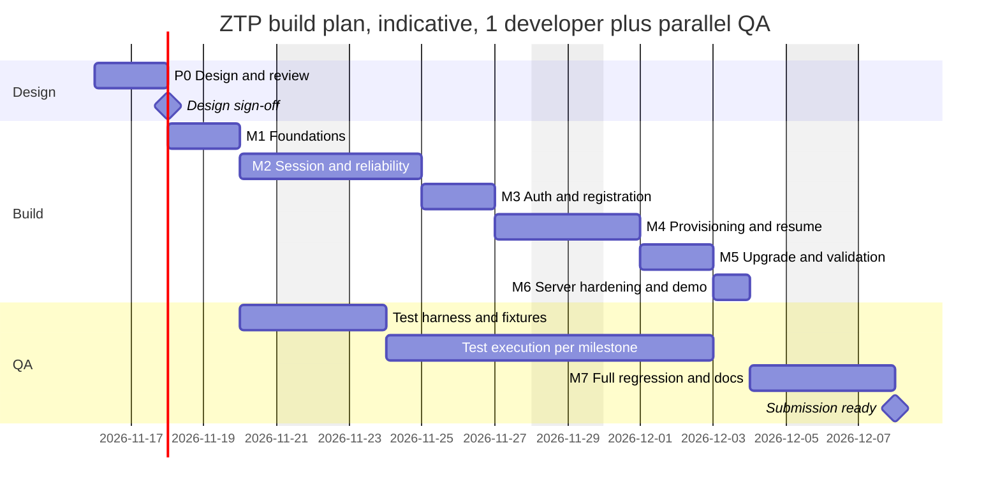

# Product Requirements Document — UDP-Based Zero Touch Provisioning (ZTP)

| Field | Value |
|---|---|
| Document | PRD_ZTP.md (Product Manager persona) |
| Version | 0.1, Draft for review |
| Date | 2026-11-10 |
| Status | Awaiting sign-off from Architecture, QA and PM |
| Owner | Sunil Vallamkonda (Product Manager) |
| Companion documents | [DESIGN.md](DESIGN.md) (Architect: how it is built) · [QA_TEST_PLAN.md](QA_TEST_PLAN.md) (QA: how it is proven) |
| Source of truth for requirements | `UDP‑Based Zero Touch Provisioning (ZTP) Assignment.pdf` (referred to below as "the PDF") |

> **How the three documents fit together.** This PRD says *what* gets built and *why*, and it defines every requirement ID (`ZTP-FR-*`, `ZTP-NFR-*`, `ZTP-BON-*`, `ZTP-DEL-*`). [DESIGN.md §2](DESIGN.md#2-requirements-traceability-matrix) maps each ID to a design section and a source module. [QA_TEST_PLAN.md §10](QA_TEST_PLAN.md#10-requirements-traceability-matrix) maps each ID to test cases (`TC-*`). Constants, glossary and the demo scenario are defined once (DESIGN Appendix B and §19) and only referenced from here.

---

## Table of contents
1. [Document control and approvals](#1-document-control-and-approvals)
2. [Problem statement and background](#2-problem-statement-and-background)
3. [Goals, non-goals and success metrics](#3-goals-non-goals-and-success-metrics)
4. [Personas and stakeholders](#4-personas-and-stakeholders)
5. [User stories and end-to-end scenarios](#5-user-stories-and-end-to-end-scenarios)
6. [Functional requirements](#6-functional-requirements)
7. [Non-functional requirements](#7-non-functional-requirements)
8. [Bonus requirements](#8-bonus-requirements)
9. [Deliverables (Expected Submission)](#9-deliverables-expected-submission)
10. [Scope, assumptions and interpretation decisions](#10-scope-assumptions-and-interpretation-decisions)
11. [Release plan, milestones and timeline](#11-release-plan-milestones-and-timeline)
12. [Dependencies, risks and open questions](#12-dependencies-risks-and-open-questions)
13. [Caveats and limitations (product impact)](#13-caveats-and-limitations-product-impact)
14. [Enhancement roadmap (Now / Next / Later)](#14-enhancement-roadmap-now--next--later)
15. [Definition of Done](#15-definition-of-done)
16. [Glossary](#16-glossary)

---

## 1. Document control and approvals

| Role | Responsibility for this PRD | Sign-off |
|---|---|---|
| Product Manager | Owns scope, priorities, acceptance criteria, timeline | ☐ |
| Architect | Confirms every requirement is feasible and traced in DESIGN.md | ☐ |
| QA Lead | Confirms every requirement is testable and traced in QA_TEST_PLAN.md | ☐ |
| Senior Developer(s) | Confirms the effort estimates in §11 | ☐ |

**Change control.** Any change to a requirement ID or its acceptance criteria means updating all three documents in the same revision and bumping the shared version number. IDs are never re-used. A dropped requirement is marked *Withdrawn* instead of being deleted.

| Version | Date | Change |
|---|---|---|
| 0.1 | 2026-11-10 | First complete draft for architecture, development and QA review |

---

## 2. Problem statement and background

### 2.1 The problem
A network device (an edge gateway, in this exercise) is installed in the field by someone who isn't a network engineer. It powers on with **no configuration, no certificates and no provisioned credentials**, so it must, without human help:

1. find a provisioning server;
2. set up a trustworthy control channel over **UDP** (the PDF requires this);
3. prove who it is and register;
4. receive its configuration and firmware, upgrading itself if necessary;
5. check its own health and enter an **OPERATIONAL** state.

### 2.2 Why it matters (business framing)
- **Cost:** provisioning by hand ("truck rolls", console cables, staff typing CLI) is the main cost of large edge rollouts. ZTP turns that into "plug it in and walk away".
- **Consistency:** central policy means each device gets the correct firmware and config for its model and tenant, with no copy-paste drift.
- **Security:** an unauthenticated provisioning channel lets anyone push a malicious config. Authenticity and replay protection are part of the product, not a later hardening step.
- **Field reality:** devices sit behind NAT and firewalls, on lossy links (cellular, satellite, Wi-Fi), and lose power at awkward moments. The control plane must tolerate **10–20% packet loss**, reordering and duplication, and recover from restarts.

### 2.3 What this exercise is evaluated on
The PDF says reviewers care about *"reasoning and tradeoffs more than feature completeness"* and about networking fundamentals: reliability, security and system behaviour. That shapes the priorities here. Correctness and explained tradeoffs come before breadth of features, and every limitation is written down instead of hidden.

---

## 3. Goals, non-goals and success metrics

### 3.1 Goals
- **G1:** A complete, runnable ZTP flow in C11 over UDP, from boot to OPERATIONAL.
- **G2:** Reliable delivery at the application layer that provably survives 10–20% loss, reordering and duplication.
- **G3:** Authenticated registration with replay protection, and no IP fragmentation.
- **G4:** Firmware upgrade with a process restart and resumption, with **no duplicate registration**.
- **G5:** A server that handles devices concurrently, applies per-device policy and keeps an auditable registration DB with a dump and summary.
- **G6:** Documentation (README, design, logs) that explains each decision and tradeoff well enough to convince senior reviewers.

### 3.2 Non-goals (and why)
| Non-goal | Why it's out of scope | Where production would go |
|---|---|---|
| Confidentiality (encryption) | The PDF asks for authenticity (HMAC), not secrecy. Adding it would roughly double the crypto surface | DTLS 1.3 or an AEAD; see §14 |
| Real PKI and certificates | The scenario says "no certificates" | IDevID and BRSKI (RFC 8995), SZTP (RFC 8572) |
| Real flash writes and a bootloader | Firmware is mock data, as the PDF allows | A/B partitions with a secure boot chain |
| GUI or REST API | The PDF says explicitly that it is "not a REST or API exercise" | An admin API on the server |
| Production packaging | The PDF says it is not required | Packages, systemd units, containers |
| Windows support | POSIX sockets only | A Winsock port |

### 3.3 Success metrics (measurable; verified by QA)
| ID | Metric | Target | Linked requirement | Verified by |
|---|---|---|---|---|
| SM-1 | Valid devices that reach OPERATIONAL under 20% loss, 10% reorder and 5% duplication | **100%** across 10 seeded runs | ZTP-NFR-03 | TC-REL-09, TC-E2E-02 |
| SM-2 | Duplicate registrations after an upgrade restart, a NAT rebind or a session timeout | **0** | ZTP-FR-23 | TC-UPG-03/04, TC-NAT-05 |
| SM-3 | Forged, tampered or replayed registrations accepted | **0** (100% rejected) | ZTP-FR-13/14 | TC-AUTH-03..08 |
| SM-4 | Median time from boot to OPERATIONAL per device at 20% loss (demo timers) | **≤ 60 s** (p95 ≤ 90 s) | ZTP-NFR-04 | TC-PERF-02 |
| SM-5 | Concurrent devices provisioned in one run | **≥ 50**, server RSS ≤ 64 MB | ZTP-NFR-05 | TC-PERF-01 |
| SM-6 | IP fragments on the wire | **0**; every datagram ≤ 1200 B | ZTP-FR-20, NFR-02 | TC-PROV-04/05 |
| SM-7 | Crashes or sanitizer errors under fuzzing (1M malformed datagrams) | **0** | ZTP-NFR-07 | TC-SRV-07 |
| SM-8 | Required README questions answered (5 required + 4 bonus) | **9/9** | ZTP-DEL-06/08 | TC-DEL-05/07 |

---

## 4. Personas and stakeholders

| Persona | Who | Needs from the system | Key requirements |
|---|---|---|---|
| **Field technician** ("Tess") | Installs hardware, not networking-literate | Plug it in, and see a green light without any CLI | FR-01..02, FR-27, BON-01 |
| **Network operations admin** ("Omar") | Runs the provisioning server and owns policy | Correct firmware and config per model and tenant; audit of who registered and when; failure reasons | FR-28..32 |
| **Security officer** ("Sasha") | Signs off on the trust model | No rogue devices, no rogue servers, no replays, documented residual risks | FR-13/14, NFR-06, §13 |
| **Firmware release manager** ("Felix") | Ships firmware versions | Upgrades that verify integrity and survive crashes, with no bricking and no double registration | FR-16..23 |
| **Evaluator / senior reviewer** | Reads the submission | Runnable code, a clear README, logs that prove behaviour, honest tradeoffs | DEL-01..11 |

---

## 5. User stories and end-to-end scenarios

### 5.1 User stories
| ID | As a… | I want… | So that… | Requirements |
|---|---|---|---|---|
| US-01 | field technician | the device to find the server itself | I never type an IP address | FR-02, BON-01 |
| US-02 | ops admin | each model to get its assigned firmware and config | the fleet is consistent | FR-29 |
| US-03 | security officer | registrations with a bad key or a replayed message rejected and recorded | rogue devices can't join and I can audit attempts | FR-13, FR-14, FR-30 |
| US-04 | release manager | outdated devices to upgrade and restart automatically | the fleet converges on the target version | FR-21..23 |
| US-05 | ops admin | provisioning to finish over a bad link | rural and satellite sites work | FR-09, NFR-03 |
| US-06 | ops admin | an interrupted download to continue where it stopped | a 1% loss of power doesn't cost a full re-download | FR-19 |
| US-07 | ops admin | a DB dump and a success/failure summary | I can report rollout status | FR-31, FR-32 |
| US-08 | evaluator | one command that builds and runs a realistic demo | I can verify the claims myself | DEL-02, DEL-05, DEL-11 |

### 5.2 End-to-end scenarios (these become the demo; defined in [DESIGN §19](DESIGN.md#19-build-run-and-demo-plan))
| Scenario | Device | Model / start firmware | Expected outcome | Notes column in DB |
|---|---|---|---|---|
| S1 First boot, upgrade (the Appendix A device) | ZTP-93AF21 | EDGE-GW-100 / v1.0 | Success, v1.1 / cfg v3, OPERATIONAL after restart | — |
| S2 Bad credential | ZTP-84BC19 | EDGE-GW-100, corrupted device key | **Failed**, no firmware or config | Invalid HMAC |
| S3 Power loss mid-download | ZTP-71DD08 | EDGE-GW-100 / v1.0 | `kill -9` during firmware download; resumes the missing chunks only; Success v1.1 / v3 | Transfer resumed |
| S4 Already current | ZTP-55AC90 | EDGE-GW-100 / v1.1 | Success v1.1 / v3, no upgrade or restart | — |
| S5 Legacy model | ZTP-19FE77 | EDGE-GW-050 / v0.9 | Success v1.0 / cfg v2 after upgrade | Legacy device |

All five run **concurrently** with 15% loss, 10% reordering and 5% duplication injected on both sides. The resulting dump mirrors the example table in the PDF.

---

## 6. Functional requirements

Priority key: **M** = Must (required by the PDF), **S** = Should (strongly implied by the PDF or needed for a credible solution).

| ID | Requirement | PDF source | Pri | Acceptance criteria |
|---|---|---|---|---|
| ZTP-FR-01 | The device generates a soft serial on first boot, persists it, and loads it on later boots | §1 | M | Format `ZTP-[0-9A-F]{6}`; the same serial survives restarts; logs `[BOOT] Soft serial generated` the first time, then `loaded` |
| ZTP-FR-02 | The device can find the server through a static IP and port | §1 | M | `--server IP:PORT` works; logs `[DISCOVERY] Using static server IP …` |
| ZTP-FR-03 | All provisioning traffic uses UDP sockets only | §2, Exp. Sub. | M | No TCP sockets anywhere in the code; a pcap shows UDP only |
| ZTP-FR-04 | A session handshake sets up a server-assigned session identifier | §2 | M | HELLO/HELLO_ACK; session_id is non-zero, random, and unique among live sessions |
| ZTP-FR-05 | Every protocol message carries a sequence number | §2, Bonus 1 | M | The `seq` header field is present on every frame type |
| ZTP-FR-06 | Timeouts and retransmission of unacknowledged messages | §2, §3 | M | Retransmits after RTO with exponential backoff; gives up after the retry limit and recovers |
| ZTP-FR-07 | Acknowledgement of received messages | §3 | M | Cumulative ACK and SACK; piggybacked or as a pure ACK |
| ZTP-FR-08 | Duplicate detection | §3 | M | Duplicates are logged, re-ACKed and never re-delivered to the application |
| ZTP-FR-09 | Correct operation under 10–20% simulated packet loss | §3 | M | See SM-1 |
| ZTP-FR-10 | Periodic keepalive messages | §4 | M | Sent when the session is idle for one keepalive interval; acknowledged; logs `[NAT] Keepalive sent/acknowledged` |
| ZTP-FR-11 | Detection of session timeouts, on device and server | §4 | M | Device: declares the session dead after 3 missed intervals and recovers. Server: expires an idle session after 3 intervals, then enforces a grace period |
| ZTP-FR-12 | Registration carries the soft serial, device metadata and a nonce | §5 | M | REGISTER TLVs: serial, model, fw version, hw revision, 64-bit device nonce, echoed server nonce |
| ZTP-FR-13 | The server checks authenticity with HMAC | §5 | M | HMAC-SHA256 over every in-session frame; a bad MAC on REGISTER gives REGISTER_NAK(Invalid HMAC) and a Failed DB row |
| ZTP-FR-14 | Replay protection | §5 | M | Replayed REGISTER in the same session, replayed into a new session, reused nonce, replayed resume: all rejected, none changes state |
| ZTP-FR-15 | The server sends a configuration payload in JSON | §6 | M | The config is valid JSON containing `interfaces`, `mtu`, `keepalive_interval` and `config_version` |
| ZTP-FR-16 | The server sends a (mock) firmware blob | §6 | M | Per-model firmware artifact with a version header |
| ZTP-FR-17 | Data is transferred in chunks | §6 | M | 1024-byte chunks; logs `Receiving config (chunk i/N)` |
| ZTP-FR-18 | Integrity is validated with a hash | §6 | M | SHA-256 of the whole artifact matches the manifest before use; on mismatch, re-download (limited retries) |
| ZTP-FR-19 | Transfers resume after a failure | §6 | M | After a crash or session loss, only the missing chunks are requested again |
| ZTP-FR-20 | No reliance on IP fragmentation | §6 | M | Every datagram ≤ 1200 B UDP payload; DF set where the platform supports it; 0 fragments in the pcap |
| ZTP-FR-21 | Outdated firmware is detected and the upgrade simulated | §7 | M | Version compare; staged, verified install; logs `[UPGRADE] Current: vX -> Target: vY` |
| ZTP-FR-22 | The device process restarts after the upgrade | §7 | M | Process re-exec; logs `[BOOT] Restart detected` |
| ZTP-FR-23 | Provisioning resumes after the restart **without duplicate registration** | §7 | M | Authenticated resume of the same session_id; no REGISTER sent; one DB row per serial |
| ZTP-FR-24 | Validation: configuration is present | §8 | M | The config file exists, its hash matches, required keys are present |
| ZTP-FR-25 | Validation: firmware version | §8 | M | The active slot's version equals the assigned version |
| ZTP-FR-26 | Validation: session health | §8 | M | A fresh keepalive round trip succeeds, the last authenticated RX is recent, SRTT is under the threshold |
| ZTP-FR-27 | Transition to the OPERATIONAL state | §8 | M | Logs `[STATE] Device is OPERATIONAL`; the server records stage OPERATIONAL |
| ZTP-FR-28 | The server handles many devices registering at the same time | §9 | M | 5-device demo with interleaved progress; 50-device scale test |
| ZTP-FR-29 | The server assigns the correct firmware and config per device | §9 | M | Policy: serial override > model > default; legacy model gets v1.0 / cfg v2 |
| ZTP-FR-30 | The server stores registration details: device ID, timestamp, firmware assigned, config version, outcome | §9 | M | All five fields present in every row (plus stage, notes, attempts) |
| ZTP-FR-31 | The server can dump its DB | §9 | M | On SIGUSR1, on SIGINT, and at the end of the demo; table format as in the PDF example |
| ZTP-FR-32 | The server displays a summary: successful devices, failed devices, firmware and config per device | §9 | M | Summary block printed after the dump |
| ZTP-FR-33 | Both sides emit tagged logs that follow the Appendix A flow | §1 example, App. A | S | Tags `[BOOT] [DISCOVERY] [UDP] [NAT] [AUTH] [PROVISION] [UPGRADE] [VALIDATION] [STATE]` |

---

## 7. Non-functional requirements

| ID | Category | Requirement | Acceptance criteria |
|---|---|---|---|
| ZTP-NFR-01 | Portability | C11, POSIX sockets, builds on Linux (gcc) and macOS (clang), **no third-party libraries** | `make` works from a clean checkout on both platforms |
| ZTP-NFR-02 | Network | Maximum UDP payload of 1200 bytes per datagram | Enforced at compile time and at runtime (assert in the encoder) |
| ZTP-NFR-03 | Reliability | 100% success for valid devices at ≤20% loss, with 10% reorder and 5% duplication | SM-1 |
| ZTP-NFR-04 | Performance | Median boot-to-OPERATIONAL ≤ 60 s at 20% loss (demo timers) | SM-4 |
| ZTP-NFR-05 | Scalability | ≥ 50 concurrent devices tested; design limit 1024 sessions; per-source rate limiting | SM-5 |
| ZTP-NFR-06 | Security | CSPRNG nonces and IDs, constant-time MAC comparison, no state change from unauthenticated input, mutual authentication | TC-AUTH-08/11, TC-UNIT-05 |
| ZTP-NFR-07 | Robustness | Malformed input never crashes either process; memory bounded | SM-7 |
| ZTP-NFR-08 | Observability | Tagged logs with millisecond timestamps, one log file per device, protocol counters at exit | TC-LOG-03/04 |
| ZTP-NFR-09 | Determinism | Impairment simulation is reproducible from `--seed` | TC-UNIT-15 |
| ZTP-NFR-10 | Durability | Device state and the server DB survive crashes (atomic writes, append-only log) | TC-UPG-07, TC-SRV-06 |
| ZTP-NFR-11 | Code quality | `-Wall -Wextra -Werror` clean; ASan and UBSan clean during the demo | TC-DEL-01/08 |

---

## 8. Bonus requirements

The PDF's bonus section is optional. **All bonus items are in scope** for this submission.

| ID | Requirement | PDF source | Acceptance criteria |
|---|---|---|---|
| ZTP-BON-01 | Broadcast or multicast discovery | §1 (bonus) | Multicast and broadcast both supported; authenticated OFFER; falls back to static IP |
| ZTP-BON-02 | Every UDP message has a sequence number | Bonus req. 1 | Same as FR-05, checked under impairment |
| ZTP-BON-03 | Acknowledgement and retransmission on timeout | Bonus req. 2 | Logs `[UDP] Retransmitting seq=N (timeout)` |
| ZTP-BON-04 | Out-of-order frames buffered and delivered in order | Bonus assumptions / example | Logs `[UDP] Received packet seq=3 (out of order, expected=2)` and `[UDP] Buffered packet seq=3`; the application sees strictly increasing seq |
| ZTP-BON-05 | Idempotent processing: duplicates cause no duplicate state change | Bonus req. 3 | Duplicate REGISTER, CHUNK or STATUS gives no second DB transition or file write |
| ZTP-BON-06 | Packet loss simulated in code (plus reordering and duplication) | Bonus req. 4 | `--loss/--reorder/--dup/--seed` flags on both binaries; Linux `netem` recipe documented |
| ZTP-BON-07 | Correct behaviour when the ACK is lost but the data arrived | Bonus README Q3 | Duplicate detected, re-ACKed, not re-applied |
| ZTP-BON-08 | Bonus-style log output | Bonus "Sample Log Output" | All four sample log lines appear in the demo logs |

---

## 9. Deliverables (Expected Submission)

Every bullet in the PDF's "Expected Submission" section has an ID. A submission with only code, or only documents, is incomplete, as the PDF says.

| ID | Deliverable | PDF source | Acceptance criteria |
|---|---|---|---|
| ZTP-DEL-01 | Working code that implements the ZTP functionality | Exp. Sub. 1 | The demo reproduces scenarios S1–S5 |
| ZTP-DEL-02 | Runnable or buildable as submitted | Exp. Sub. 1 | `make && make demo` from a clean checkout |
| ZTP-DEL-03 | Device and server logic clearly separated | Exp. Sub. 1 | `device/`, `server/` and `common/` directories; two binaries |
| ZTP-DEL-04 | UDP sockets for all provisioning communication | Exp. Sub. 1 | Same as FR-03 |
| ZTP-DEL-05 | Basic build and run instructions | Exp. Sub. 1 | A "Quick start" section in the README |
| ZTP-DEL-06 | README answers the five required questions (reliability over UDP, replay prevention, avoiding fragmentation, NAT impact, behaviour under loss) | README Requirements | One section per question |
| ZTP-DEL-07 | README covers architecture and control flow, UDP session management, identity/auth/registration, config and firmware provisioning, upgrades and restarts, known limitations and tradeoffs | Exp. Sub. 2 | One section per topic |
| ZTP-DEL-08 | README bonus coverage: loss and out-of-order handling, duplicate detection, simulation method, and the four bonus questions | Exp. Sub. 2, Bonus README Qs | One section per topic and question |
| ZTP-DEL-09 | Server logs | Exp. Sub. 3 | `logs/server.log` from the demo run |
| ZTP-DEL-10 | Client (device) logs | Exp. Sub. 3 | `logs/device_<serial>.log` for every demo device |
| ZTP-DEL-11 | DB dump and summary from the demo run | §9 (supports FR-31/32) | `logs/db_dump.txt` |

---

## 10. Scope, assumptions and interpretation decisions

### 10.1 In scope
Everything in §6–§9: all core requirements, **all bonus items**, and all deliverables.

### 10.2 Out of scope
See §3.2 for the non-goals. Also out of scope: real NAT hardware, real power-loss rigs, IPv6, and multiple server instances.

### 10.3 Assumptions (owner: this section; DESIGN §3 records the technical ones)
| ID | Assumption | Impact if wrong |
|---|---|---|
| A-01 | The implementation is C11 on POSIX (Linux and macOS), tested on loopback or a LAN | A port is needed for other operating systems |
| A-02 | The device has no RTC and no *provisioned* credentials, but has a **per-model manufacturing secret** embedded in its firmware image (DESIGN §3.1) | If reviewers read "no stored credentials" strictly, the alternative is trust-on-first-use, which is weaker. The tradeoff is documented |
| A-03 | Firmware is mock data, and "install" is an atomic file operation (A/B slot files) | None for the evaluation |
| A-04 | A single, trusted provisioning server, reachable by static IP or by broadcast/multicast in the same L2 segment | Multi-site setups would need a relay or DNS-SD (§14) |
| A-05 | The demo uses 5 devices, the scale test 50 or more; impairments are 10–20% loss with reordering and duplication; timers are shortened in the demo | Production timers are documented separately (DESIGN Appendix B) |
| A-06 | Firmware and config are assigned by model, with optional per-serial overrides | — |
| A-07 | Reviewers value reasoning and correctness over breadth of features, as the PDF says | Scope is prioritised accordingly |
| A-08 | Demo serials are set explicitly with `--serial` so that they match the PDF table; normal runs generate them | — |

### 10.4 Interpretation decisions on ambiguities in the PDF (details in [DESIGN §3](DESIGN.md#3-assumptions-and-ambiguity-resolutions))
1. **"No stored credentials" versus HMAC.** A per-model factory secret is used to derive a per-device key. Documented as a limitation.
2. **The seq/ACK diagram in the Appendix is illustrative.** The design uses an independent sequence space per direction, a cumulative ACK and a SACK bitmap.
3. **Session resume keeps the session_id after a reboot.** The server holds a grace period and accepts an authenticated, counter-protected resume.
4. **"Registration outcome"** means the outcome of authentication and registration (Success or Failed). Provisioning progress is tracked in a separate *stage* column.

---

## 11. Release plan, milestones and timeline

### 11.1 Effort and timeline (approximate)
These estimates assume one senior C developer full-time, a QA engineer working in parallel from M2 onward, and a part-time architect for reviews. They include about 20% contingency.

| Phase | Scope | Effort | Indicative dates (start Mon 2026-11-16) | Exit criteria |
|---|---|---|---|---|
| **P0** Design and review | PRD, DESIGN and QA plan reviewed; open questions closed | 1.5–2 d | 16–17 Nov | All three documents signed off (§1) |
| **M1** Foundations | Codec, SHA-256/HMAC with test vectors, logging, netsim, timer heap, Makefile; **GitHub Actions CI (Ubuntu + macOS) with a netem check on the runner**; **spike: multicast and broadcast on macOS** | 2 d | 18–19 Nov | TC-UNIT-01..06, 15, 16 pass |
| **M2** Session and reliability | HELLO handshake, seq/ACK/SACK, RTO and backoff, reorder buffer, dedup, keepalive, timeout, NAT rebinding | 3 d | 20–24 Nov | TC-SESS-*, TC-REL-*, TC-NAT-* pass at 20% loss |
| **M3** Auth and registration | Key hierarchy, REGISTER, NAK path, replay defences, policy, DB rows | 1.5–2 d | 25–26 Nov | TC-AUTH-* pass |
| **M4** Provisioning | Manifest, pulling chunks, hash verify, persisted bitmap, resume | 2 d | 27–30 Nov | TC-PROV-* pass, including the kill -9 resume |
| **M5** Upgrade and validation | A/B slots, execv restart, resume handshake, validation, OPERATIONAL, rollback | 1.5–2 d | 1–2 Dec | TC-UPG-*, TC-VAL-* pass |
| **M6** Server hardening and demo | Rate limits, dump and summary, `run_demo.sh`, scale harness | 1–1.5 d | 3 Dec | TC-SRV-*, TC-E2E-01 pass |
| **M7** QA cycle and documentation | Full regression, impairment matrix, perf/soak, fixes; README and logs finalised | 2–3 d | 4–7 Dec | Exit criteria in QA §11 met; DoD (§15) |
| **Total** | | **≈ 15–16 working days (≈ 3 weeks)** | **Target: Mon 7 Dec 2026** | |

**Team variant:** with two developers (one on `device/`, one on `server/` after M1) plus one QA engineer, the build takes about **8–10 working days (≈ 2 weeks)**. The critical path is still M1 → M2.

**Critical path:** M1 → M2 → M4 → M5. Upgrade and resume depend on both the session layer and the transfer layer. M3 and M6 can partly overlap M4 when two developers are available.

**Adjust for holidays.** The indicative dates ignore public holidays (for example US Thanksgiving, 26 Nov) and must be shifted to fit the team's calendar.

*The Gantt chart rounds durations to whole days.*

### 11.2 Milestone gates
Each milestone ends with a 30-minute review: a demo of the milestone's tests, review of the diff against the DESIGN section concerned, and a defect triage. No milestone may start with Sev-1 defects open from an earlier one (QA §11.3).

---

## 12. Dependencies, risks and open questions

### 12.1 Dependencies (owner: this section)
| ID | Dependency | Type | Notes |
|---|---|---|---|
| D-01 | gcc ≥ 9 or clang ≥ 11 with C11, GNU make, POSIX `sh` | Toolchain | Both platforms |
| D-02 | **No third-party libraries.** SHA-256 and HMAC are written in-house | Design | Depends on the FIPS 180-4 and RFC 4231 test vectors to prove correctness |
| D-03 | `leaks`, ASan/UBSan and tcpdump on the Mac (all built in or part of the CLT); valgrind on CI only | QA tooling | Used for TC-PERF-04, TC-PROV-05 |
| D-04 | Linux `tc netem` (on the CI runners) and macOS dummynet (`dnctl` + `pfctl`, built in) | QA tooling | Optional; the in-code netsim is the default |
| D-09 | **GitHub Actions** with hosted `ubuntu-latest` and `macos-latest` runners: the **only Linux environment**, since there is no local Linux host and disk space on the Mac is limited | CI / platform | Repo: **https://github.com/heysunilvk/ztp-project** (created and empty as of 2026-11-10). Private repos get 2,000 free minutes/month; public repos are free. Each run takes about 5 min. No local disk cost |
| D-05 | Internal ordering: PRD IDs → DESIGN traceability → QA cases; the protocol spec (DESIGN §5) frozen before QA finalises its cases | Process | Changes to the frozen spec go through change control |
| D-06 | Reviewer availability for P0 and the milestone gates | People | A slip in P0 moves the whole plan |
| D-07 | Platform behaviour of broadcast and multicast on loopback | Platform | Spiked in M1 (R-03) |
| D-08 | Xcode Command Line Tools on the development Mac. **Verified installed on 2026-11-10:** Apple clang 16.0.0 (arm64), GNU Make 3.81 | Toolchain | Satisfied. Make 3.81 is old, so the Makefile must avoid GNU Make ≥ 4 features (`.ONESHELL`, `$(file …)`, grouped targets) |

### 12.2 Risk register
| ID | Risk | Likelihood | Impact | Mitigation | Owner |
|---|---|---|---|---|---|
| R-01 | Subtle reliability bugs (window, reorder, wraparound) appear only under certain loss patterns | H | H | Seeded netsim, property-style unit tests over 10k permutations, an impairment matrix with many seeds | Dev / QA |
| R-02 | Bugs in the in-house crypto | M | H | Known-answer tests from FIPS and RFC vectors run in `make test`; keep the code small and auditable | Dev |
| R-03 | Broadcast on loopback doesn't work on macOS (`lo0` has no broadcast) | H | M | Multicast with `IP_MULTICAST_LOOP` as the demo default; broadcast tested locally on the Mac's Wi-Fi/Ethernet interface (its directed broadcast address) and on the CI Linux runner; static fallback; spike in M1 | Dev |
| R-04 | `execv` restart leaks file descriptors or loses log buffers | M | M | `FD_CLOEXEC` on all fds, flush logs before exec, a dedicated test (TC-UPG-02) | Dev |
| R-05 | Timer-based tests are flaky on loaded CI machines | M | M | Deterministic seeds, generous upper bounds, retries counted rather than timed | QA |
| R-06 | Reviewers disagree with how a PDF ambiguity was read | M | M | Every interpretation is explicit, with its rationale (§10.4, DESIGN §3) | PM / Architect |
| R-07 | Scope creep (DTLS, IPv6, a DB engine) threatens the timeline | M | M | Kept on the roadmap (§14); PM rejects in-sprint additions | PM |
| R-08 | Platform differences in the DF bit (`IP_MTU_DISCOVER` on Linux, `IP_DONTFRAG` on macOS) | M | L | Best effort; the size cap (≤ 1200 B) is the actual guarantee | Dev |
| R-09 | The estimate misses the 3-week target | M | M | 20% contingency built in; M6 scale work and the rollback feature can be descoped first | PM |
| R-10 | Toolchain differences: macOS ships GNU Make 3.81 and Apple clang, while Linux has gcc and Make 4.x | L | L | Keep the Makefile Make-3.81-compatible; the CI matrix (D-09) builds on both platforms from M1 | Dev |
| R-11 | No local Linux host, so Linux-only checks (netem, valgrind, the gcc build) run only on CI; feedback is slower, and the `sch_netem` kernel module may be unavailable on hosted runners | M | L | Set up CI in M1 and **verify netem on the runner first**. If it's missing, TC-SIM-03 is waived, because the in-code netsim (BON-06) and macOS dummynet (TC-SIM-04) cover the requirement. Daily work uses macOS substitutes (QA §3.1) | Dev / QA |

### 12.3 Open questions (to close in P0)
| ID | Question | Proposed answer | Decider |
|---|---|---|---|
| Q-01 | Should the config be encrypted, given that it can contain secrets? | No, for this exercise. Documented as a limitation; roadmap item N-01 | PM + Security |
| Q-02 | Should the grace period be configurable per policy (model or tenant)? | Global CLI flag now; per policy later | Architect |
| Q-03 | Should we add a stateless HELLO cookie against DoS now? | Later; rate limiting plus a half-open cap for now | Architect |
| Q-04 | Should the bad-key device keep retrying forever or stop? | Stop after 3 attempts and enter FAILED, so it doesn't hammer the server | PM |
| Q-05 | Is the 3-week timeline acceptable, or should the team variant be used? | Decide at the P0 sign-off | PM |

---

## 13. Caveats and limitations (product impact)
The technical detail is in [DESIGN §22](DESIGN.md#22-tradeoffs-limitations-and-future-work); this section gives the product view.

| Limitation | Impact on users or the business | Acceptable for this release because… |
|---|---|---|
| No confidentiality: config and firmware are sent in clear text, with integrity only | Anyone on the path can read the config contents | The PDF asks for authenticity; the release is a lab prototype |
| Per-model shared factory secret | Extracting it from one device lets an attacker impersonate any device of that model | No PKI exists in the scenario; the roadmap has per-device keys |
| No forward secrecy (no Diffie-Hellman) | A later key compromise exposes past session MACs (not contents, since nothing is encrypted) | Follows from the above |
| Fixed window, no congestion control | Not suitable for very large firmware over constrained links | Mock firmware is 64 KiB; the window is deliberately small |
| Fixed datagram size of 1200 B (no PMTUD) | About 10% overhead compared with a 1472 B payload on Ethernet | Safety comes before efficiency |
| Discovery limited to the local L2 segment or multicast scope | Remote sites need a static IP | The static fallback always works |
| Single-threaded server with a file-backed DB | No HA; limited to roughly 1000 sessions per instance | Far above the needs of the demo |
| Loss is simulated in code, not on real networks | Real-world timing may differ | OS-level impairment also tested (netem on CI, dummynet on the Mac); the design follows RFC guidance |
| No local Linux machine; Linux is tested only on CI | Linux-specific bugs are found later (on push, not on a local run) | CI runs on every push from M1 onward |
| No real power-loss or flash-wear testing | The crash-consistency claims are tested only by simulation | Crash points are injected at every step |

---

## 14. Enhancement roadmap (Now / Next / Later)
Technical detail is in [DESIGN §22.3](DESIGN.md#223-enhancement-suggestions-future-work).

| Horizon | ID | Enhancement | Value |
|---|---|---|---|
| **Now** (in this release) | — | All core and bonus requirements | Meets the PDF |
| **Next** | N-01 | AEAD encryption (ChaCha20-Poly1305) or DTLS 1.3 | Confidentiality of configs |
| Next | N-02 | Ed25519-signed firmware, verified independently of the transport | Supply-chain integrity |
| Next | N-03 | Stateless HELLO cookie | DoS resistance |
| Next | N-04 | SQLite-backed DB and an admin CLI | Operations at scale |
| Next | N-05 | Codec fuzzing in CI (libFuzzer/AFL). *The Linux and macOS CI matrix moved to **Now**: it is required because there is no local Linux host (D-09)* | Quality |
| **Later** | L-01 | Per-device keys in a secure element or TPM; IDevID and BRSKI vouchers | Removes the shared-secret risk |
| Later | L-02 | PLPMTUD (RFC 8899), congestion control (AIMD), adaptive window | Efficiency on large transfers |
| Later | L-03 | IPv6, DHCP option 43 or DNS-SD discovery | Multi-site rollouts |
| Later | L-04 | Delta or compressed firmware, staged and canary rollouts, health-gated A/B commit | Safe fleet upgrades |
| Later | L-05 | SO_REUSEPORT sharding or an HA pair; Prometheus metrics; JSON logs | Scale and observability |
| Later | L-06 | QUIC as the transport | Standardised reliability and security |

---

## 15. Definition of Done
The submission is done when **all** of the following hold:
1. Every `ZTP-FR-*`, `ZTP-BON-*` and `ZTP-DEL-*` requirement has at least one passing test case in QA_TEST_PLAN.md §10.
2. Every `ZTP-NFR-*` target is met or has a waiver signed off (with a documented rationale).
3. `make && make test && make demo` succeeds from a clean checkout on Linux and on macOS, shown by a green run of the CI workflow on both runners and a local macOS run.
4. The README answers the 5 required and 4 bonus questions and covers every section listed in DEL-07 and DEL-08.
5. `logs/` contains `server.log`, one `device_<serial>.log` per demo device, and `db_dump.txt`, and they show scenarios S1–S5.
6. No Sev-1 or Sev-2 defects are open (QA §11.3).
7. All three documents are updated to match the final implementation (version bumped to 1.0).

---

## 16. Glossary
The full glossary is in [DESIGN §0.3](DESIGN.md#03-glossary). The key terms are:
**ZTP:** Zero Touch Provisioning. **Session:** a logical association between a device and the server, identified by `session_id`. **Epoch:** the counter of session re-keys (it increases on each resume). **RTO:** retransmission timeout. **SACK:** selective acknowledgement. **K_mfg / K_dev / K_s:** the manufacturing, device and session keys. **Grace period:** how long the server keeps a session that can still be resumed. **OPERATIONAL:** the final, validated device state.
