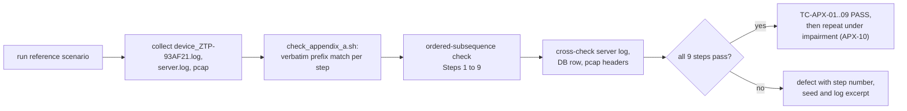

# QA Test Plan: UDP-Based Zero Touch Provisioning (ZTP)

| Field | Value |
|---|---|
| Document | QA_TEST_PLAN.md (QA persona) |
| Version | 0.1, Draft for review |
| Date | 2026-11-10 |
| Owner | Sunil Vallamkonda (QA Lead) |
| Companion documents | [PRD_ZTP.md](PRD_ZTP.md) (requirement IDs and acceptance criteria) · [DESIGN.md](DESIGN.md) (the behaviour under test; constants in Appendix B) |
| Test basis | PRD v0.1 (requirement IDs), DESIGN v0.1 (§5 wire spec, §8 reliability, §10 auth, §19 demo) |

> **Alignment rules.** Every test case (`TC-*`) traces to at least one PRD requirement ID, and every PRD requirement has at least one test case (§10). Constants such as timers, sizes and ports are **not** restated here: tests refer to them by name from DESIGN Appendix B, so a design change can't silently invalidate a test. The demo fixture is the five devices defined in PRD §5.2 and DESIGN §19.3.

---

## Table of contents
1. [Scope and objectives](#1-scope-and-objectives)
2. [Test strategy and levels](#2-test-strategy-and-levels)
3. [Test environment and tooling](#3-test-environment-and-tooling)
4. [Test data and fixtures](#4-test-data-and-fixtures)
5. [Test case catalogue](#5-test-case-catalogue)
6. [Loss and impairment matrix](#6-loss-and-impairment-matrix)
7. [Security test plan](#7-security-test-plan)
8. [Performance, scale and soak](#8-performance-scale-and-soak)
9. [Log and deliverable verification](#9-log-and-deliverable-verification)
10. [Requirements traceability matrix](#10-requirements-traceability-matrix)
11. [Entry and exit criteria, defect management, reporting](#11-entry-and-exit-criteria-defect-management-reporting)
12. [QA timeline, dependencies, assumptions, risks](#12-qa-timeline-dependencies-assumptions-risks)
13. [Caveats: what is not or cannot be tested](#13-caveats-what-is-not-or-cannot-be-tested)
14. [QA enhancement suggestions](#14-qa-enhancement-suggestions)
15. [PDF conformance matrix](#15-pdf-conformance-matrix)

---

## 1. Scope and objectives

### 1.1 Objectives
1. Show that every functional, bonus and deliverable requirement in the PRD (§6, §8, §9) is met.
2. Show that the NFR targets are met: reliability under 20% loss, time to OPERATIONAL, scale, robustness and security (PRD §7, §3.3 success metrics SM-1…SM-10).
3. Find defects early in the highest-risk area, the reliability engine (PRD R-01), using deterministic, seeded tests.
4. Produce the evidence the submission needs: logs, the DB dump and a test report.

### 1.2 In scope
`ztp-device`, `ztp-server`, `libztpcommon`, `mkartifacts`, `run_demo.sh`, and README content.

### 1.3 Out of scope
Real NAT hardware, real flash or power-loss rigs, IPv6, Windows, and production packaging (PRD §3.2). See §13 for how each gap is mitigated.

---

## 2. Test strategy and levels
| Level | What | How | Automated | Owner | When |
|---|---|---|---|---|---|
| **L1 Unit** | Crypto, codec, TLV, reliability engine, util | C test binaries under `tests/`; the reliability engine runs against a **simulated clock and in-memory link**, with no sockets | `make test` | Dev (QA reviews) | Every build, from M1 |
| **L2 Component** | One binary against a scripted peer | A test harness that sends crafted datagrams (`tests/peer_sim`) | Yes | QA | M2+ |
| **L3 Integration** | device ↔ server on loopback | Shell scripts `tests/it_*.sh` with netsim flags; assertions on logs, exit codes and the DB dump | Yes | QA | M2+ per milestone |
| **L4 System / E2E** | The full demo, scenarios S1–S5 | `make demo` plus a results checker | Yes | QA | M6, M7 |
| **Negative / security** | Bad MAC, replay, tampering, floods, fuzzing | §7 | Yes | QA | M3+ |
| **Resilience / chaos** | Crash points, kill -9, SIGSTOP, rebinding, server restart | Test hooks (DESIGN §19.2) and signals | Yes | QA | M4+ |
| **Performance / soak** | 50+ devices, timing, memory | `make scale`, `/usr/bin/time`, `leaks` or valgrind | Semi | QA | M6, M7 |
| **Regression** | Everything above | CI script `tests/run_all.sh` | Yes | QA | M7 and every fix |
| **Documentation review** | README coverage | Checklist (§9) | Manual | QA + PM | M7 |

**Principles**
- **Determinism first:** every impairment test is run with a fixed `--seed` and recorded with it, so a failure reproduces exactly. Statistical tests run over N seeds (§6).
- **Assert on behaviour, not timing**, wherever possible: counts of retransmissions, states and DB rows, not "within 2.3 s". Timing assertions use generous upper bounds (PRD R-05).
- **Tests run from the logs:** every assertion in L3/L4 uses the tagged log lines (DESIGN §17) or the DB dump. That also checks the logs themselves.

---

## 3. Test environment and tooling
| Item | Specification |
|---|---|
| Platforms | **Local:** macOS 14 on the developer's Mac (Apple clang 16, GNU Make 3.81). **CI:** GitHub Actions `ubuntu-latest` (gcc) and `macos-latest` (clang); see DESIGN §19.4. There is **no local Linux host**, so the Ubuntu runner is the Linux platform for the DEL-02 / NFR-01 sign-off |
| Network | Loopback (`127.0.0.1`). The broadcast test TC-DISC-05 runs locally on the Mac's Wi-Fi/Ethernet interface (its directed broadcast address) and in CI on the Ubuntu runner |
| Build variants | `make` (release, `-O2 -Wall -Wextra -Werror`); `make asan` (ASan + UBSan); `make debug` (`-O0 -g`) |
| Impairment | In-code netsim (`--loss/--reorder/--dup/--delay/--seed`), everywhere; macOS dummynet (`scripts/dummynet.sh`), local, TC-SIM-04; Linux `tc netem` (`scripts/netem.sh`), CI Ubuntu runner only, TC-SIM-03 |
| Reduced MTU and real NAT | CI `mtu` job: Linux network namespaces joined by a veth pair at MTU 1280 and 576 (TC-PROV-12/13). Local: `--sim-mtu N:emsgsize` or `N:blackhole` (portable, no sudo). Optional CI `nat-real` job: iptables MASQUERADE with a short conntrack UDP timeout |
| Capture | `tcpdump -i lo0 -w run.pcap udp` (macOS) or `-i lo` (Linux); Wireshark; `scripts/pcapcheck.sh` (maximum datagram size, fragment filter) |
| Memory | Locally: ASan + LeakSanitizer (`make asan`) and `leaks --atExit` (built into macOS). CI: valgrind on the Ubuntu runner |
| Disk footprint (local) | Build outputs, logs, test artifacts and pcaps: < 100 MB in total. `make clean` and `make clean-logs` reclaim it. Large pcaps are limited with `tcpdump -c`. No VMs or containers locally |
| Fuzzing | `tests/fuzz_decode` (a random and mutation-based datagram generator); libFuzzer if available (§14) |
| Prerequisite | Xcode Command Line Tools on the macOS host: **verified on 2026-11-10** (Apple clang 16.0.0, GNU Make 3.81; PRD D-08) |

**QA tools and their options.** These options belong to test tooling, not to the ZTP binaries; the binaries' flags are in DESIGN §19.2.
| Tool | Options used by the tests | Purpose |
|---|---|---|
| `tests/peer_sim` | Modes built in M2: `handshakes N` (TC-SESS-04), `unknown-sid` (TC-SESS-06), `pdf-reorder` (TC-REL-03), `out-of-window` (TC-REL-08), `spoof-source` (TC-NAT-06/12), `rogue-offer` (TC-DISC-07), `replay-offer` (TC-DISC-08), `fake-server` (advertises arbitrary KEEPALIVE_S and DEAD_INTERVALS; TC-CFG-08). Added with their milestones: `rogue-server`, `bad-fleet-key`, `flood N/s`, `replay file.pcap` | A scripted protocol peer for negative, security and component tests (TC-REL-03, TC-AUTH-*, TC-NAT-06/12, TC-CFG-08); driven by `tests/m2_peer.sh` |
| `scripts/pcapcheck.sh` | `--dump-hdr` (decode ZTP headers), maximum-size and fragment filters | Wire-level checks (TC-REL-01, TC-PROV-04/05, TC-APX-03) |
| `tools/mkartifacts` | `--test-set` (the boundary-size firmware and config fixtures in §4.2) | Deterministic artifacts |
| `tests/check_logs.sh`, `check_appendix_a.sh`, `check_invariants.sh` | `--server` (the server matching rule, DESIGN §17.4) | Log, Appendix A and invariant assertions |
| valgrind / `leaks` | `--leak-check=full` / `--atExit` | Leak checks (TC-PERF-04) |

---

## 4. Test data and fixtures

### 4.1 Device fixture (shared with PRD §5.2 and DESIGN §19.3)
| Serial | Model | Start fw | Hooks | Expected final DB row |
|---|---|---|---|---|
| ZTP-93AF21 | EDGE-GW-100 | v1.0 | — | Success, v1.1, v3, OPERATIONAL |
| ZTP-84BC19 | EDGE-GW-100 | v1.0 | `--test-hooks --bad-key` (K_mfg corrupted) | Failed, —, —, FAILED, "Invalid HMAC", failed_attempts 3 |
| ZTP-71DD08 | EDGE-GW-100 | v1.0 | `--test-hooks --crash-after-chunks 40 --replay-test` | Success, v1.1, v3, OPERATIONAL; Notes "—" (verbose dump: "Transfer resumed"); attempts 1, failed_attempts 1 (the spliced replay, TC-AUTH-05) |
| ZTP-55AC90 | EDGE-GW-100 | v1.1 | `--test-hooks --rebind-after 3` | Success, v1.1, v3, OPERATIONAL |
| ZTP-19FE77 | EDGE-GW-050 | v0.9 | static discovery | Success, v1.0, v2, OPERATIONAL, "Legacy device" |

### 4.2 Artifact fixtures (`mkartifacts --test-set`)
| Name | Size | Purpose |
|---|---|---|
| `fw_tiny` | 1 B | One chunk, minimal |
| `fw_1023` / `fw_1024` / `fw_1025` | 1023 / 1024 / 1025 B | Chunk-boundary checks (1 / 1 / 2 chunks) |
| `fw_64k` | 65,536 B | Standard (64 chunks) |
| `fw_1m` | 1 MiB | Stress (1024 chunks; many CHUNK_REQ batches) |
| `fw_corrupt` | 64 KiB with one flipped byte at serve time (`--corrupt-chunk 17` server hook) | Hash mismatch |
| `cfg_v3.json` / `cfg_v2.json` | ≈ 2.3 KB / ≈ 1.8 KB | Standard configs |
| `cfg_missing_key.json` / `cfg_malformed.json` | — | Validation failures. Committed under `tests/conf/` in M1 together with a fixture `cfg_v3.json` (exactly 2310 B, the DESIGN §11.2 example), so TC-UNIT-17 runs before `mkartifacts` exists |

### 4.3 Policy, key and configuration fixtures (all JSON; DESIGN §25)
- `conf/policy.json` (DESIGN §25.6; assignments only, **no `nat` overrides**). `tests/conf/policy_override.json` adds tenant cruise_ops `nat.grace_s = 180` and `serials.ZTP-55AC90.nat.keepalive_interval_s = 10` (TC-CFG-06, TC-SRV-02). `tests/conf/policy_nopolicy.json` adds a key for EDGE-GW-200 with no policy entry (TC-AUTH-12).
- `conf/keys.json` (mode 0600) with the `fleet` key and models EDGE-GW-100 and EDGE-GW-050. The model `EDGE-GW-999` has no key (TC-AUTH-09).
- `conf/server.json`, `conf/device.json` (the production defaults) and the per-side profiles `conf/profiles/server/{demo,strict-nat,cgnat,lan,metered}.json` and `conf/profiles/device/{…}.json` (DESIGN §25.7).
- Negative config fixtures under `tests/conf/`: `bad_range.json` (`nat.keepalive_interval_s: 0`), `bad_type.json` (string where a number is expected), `unknown_key.json` (`nat.keepalive_intervl_s`), `dup_key.json`, `trailing_comma.json`, `too_deep.json` (17 levels), `too_big.json` (> 64 KiB), `dgram_over_cap.json` (`net.max_datagram: 1400`), `chunk_too_big.json` (`xfer.chunk_size: 2048`), `keys_world_readable.json` (mode 0644).
- Two fixtures can't be committed as-is. `too_big.json` (> 64 KiB) is generated by `tests/cli_config.sh` at test time. File modes aren't kept by git, so the key tests copy `tests/conf/keys_test.json` (test-only key material) and set mode 0600 to load it and 0644 for the `keys_world_readable` case.

---

## 5. Test case catalogue
**Priority:** P1 = must pass for release, P2 = should pass (a waiver needs sign-off), P3 = informational.
Each case gives its preconditions and steps in short form, followed by the expected result, which includes the expected **log line** where relevant. All L3/L4 cases run with the release build and the ASan build.

### 5.1 Unit (L1)
| TC ID | Title | Req | Pri | Steps / setup | Expected result |
|---|---|---|---|---|---|
| TC-UNIT-01 | SHA-256 known-answer tests | NFR-01, FR-18 | P1 | FIPS 180-4 vectors: "", "abc", the 448-bit message, 1,000,000 × "a"; streaming across chunk boundaries | All digests match |
| TC-UNIT-02 | HMAC-SHA256 known-answer tests | FR-13 | P1 | RFC 4231 test cases 1–7, including case 5 (truncation) and long keys | All match |
| TC-UNIT-03 | Header and TLV encode/decode round trip | FR-05, BON-02 | P1 | Every message type × flag combination with random field values; every TLV tag in DESIGN §5.4.1 (including PATH_PROBE 0x1F, RESUMED 0x20, SRV_STAGE 0x21, DEAD_INTERVALS 0x22, MAX_DGRAM 0x23) and every enumeration in §5.4.3 | Fields identical after the round trip; `seq` present on every type; header length 44; the resume HELLO_ACK (RESUMED + SRV_STAGE) parses without a duplicate-tag error |
| TC-UNIT-04 | TLV parser bounds | NFR-07 | P1 | Truncated TLV, length beyond the payload, duplicate tag, unknown tag, zero-length string, oversize string | Unknown tag skipped; duplicate or overrun → reject; never reads out of bounds (ASan) |
| TC-UNIT-05 | Constant-time compare | NFR-06 | P2 | `ct_memeq` on equal and unequal buffers; check there is no early exit | Correct results; no data-dependent branches |
| TC-UNIT-06 | Serial-number arithmetic and wraparound | FR-05 | P1 | `seq_lt` across 2³² − 1 → 0; the forced re-key threshold | Correct ordering; re-key triggered when `next_seq > 2^30` |
| TC-UNIT-07 | RTO estimator, Karn, backoff | FR-06 | P1 | Feed RTT samples; mark one frame retransmitted; trigger repeated timeouts | Matches the RFC 6298 formulas; no sample taken from a retransmitted frame; RTO doubles to the cap; clamped to [min, max] |
| TC-UNIT-08 | Reorder buffer: in-order delivery | BON-04 | P1 | Simulated link: 10,000 seeded random permutations, losses and duplicates of 1..200 frames | The application receives exactly 1..N in order, once each |
| TC-UNIT-09 | Duplicate classification | FR-08, BON-05 | P1 | Inject seq ≤ rcv_ack, and a seq that's already buffered | Both dropped, counted as dup, and an immediate ACK is scheduled |
| TC-UNIT-10 | Generating and parsing SACK | FR-07 | P1 | Buffer patterns that produce known bitmaps; sender marks frames sacked | Bit i ⇔ seq ack+2+i; fast retransmit fires after 3 later frames are SACKed |
| TC-UNIT-11 | Policy parser and precedence | FR-29 | P1 | Model rules, a serial override, default reject, a malformed file | Serial > model > default; a malformed file is a fatal error at startup |
| TC-UNIT-12 | Version comparison | FR-21 | P1 | v0.9 < v1.0 < v1.1 < v1.10; v1.1 == v1.1; malformed values | Correct ordering; malformed → error |
| TC-UNIT-13 | Atomic file write | NFR-10 | P1 | Inject a failure after `write`, after `fsync`, before `rename` | The file is always the old or the new version, never torn; `.bak` fallback works |
| TC-UNIT-14 | Persisting and loading the chunk bitmap | FR-19 | P1 | Save a map with arbitrary bits; reload it; mismatched sha | Bits identical; sha mismatch → map discarded |
| TC-UNIT-15 | Netsim determinism and rates | NFR-09, BON-06 | P1 | Same seed twice; 100k packets at loss 0.15 | Identical decision sequences; observed rate 15% ± 1% |
| TC-UNIT-16 | Key-derivation known-answer test | FR-13 | P1 | Fixed K_fleet, K_mfg, serial, Nd, Ns, sid, epoch | K_boot = HMAC(K_fleet, "ZTP-BOOT-v1"), K_dev = HMAC(K_mfg, "ZTP-DEV-v1" ‖ serial) and K_s equal reference values computed independently (e.g. with `openssl dgst -sha256 -mac HMAC`); inputs encoded as in DESIGN §10.1 (ASCII labels and serial with no terminator, `be64` nonces, `be32` session id, `be16` epoch) |
| TC-UNIT-17 | Config key validation | FR-24 | P1 | `cfg_v3`, `cfg_missing_key`, `cfg_malformed` | Pass / fail (missing key named) / fail |
| TC-UNIT-18 | Strict JSON parser | FR-34, NFR-07 | P1 | The JSONTestSuite-style accept/reject corpus (valid, invalid, edge cases), the `tests/conf/` negatives, plus 1M random and mutated inputs (ASan) | Valid files accepted; duplicate keys, trailing commas, comments, depth > 16 and size > 64 KiB rejected with path and line; no crashes or out-of-bounds reads |
| TC-UNIT-19 | Bitmap conversion on chunk-size change | FR-19, FR-20 | P1 | Maps with random bits at chunk size 1024 converted to 256 | Chunk i set at 1024 ⇔ chunks 4i..4i+3 set at 256; the byte ranges are identical; a non-power-of-two ratio is rejected |
| TC-UNIT-20 | Precedence and policy validation | FR-34, FR-35 | P1 | Synthetic defaults, file, profile, CLI and policy layers; a policy entry with `nat.keepalive_interval_s = 900` | Merge order defaults < file < profile < CLI, then policy tenant < model < serial; the 900 s policy entry is rejected at startup (exit 78) |

### 5.2 Discovery (DISC)
| TC ID | Title | Req | Pri | Steps / setup | Expected result |
|---|---|---|---|---|---|
| TC-DISC-01 | Soft serial generated on first boot | FR-01 | P1 | Empty state dir, no `--serial` | `[BOOT] Soft serial generated`, then `[BOOT] Soft serial: ZTP-XXXXXX` matching `^ZTP-[0-9A-F]{6}$`; persisted in `device.state` |
| TC-DISC-02 | Soft serial loaded on later boots, and assigned by configuration | FR-01 | P1 | (a) Rerun with the same state dir. (b) A fresh state dir with `--serial ZTP-93AF21`. (c) The state dir from (a) with a different `--serial` | (a) `[BOOT] Soft serial loaded`, then `[BOOT] Soft serial: <same value>`; the file is unchanged. (b) `[BOOT] Soft serial assigned (configuration)`. (c) Exit 78 (identity change refused) |
| TC-DISC-03 | Static IP discovery | FR-02 | P1 | `--discover static --server 127.0.0.1:5555` | `[DISCOVERY] Using static server IP 127.0.0.1:5555`; session established |
| TC-DISC-04 | Multicast discovery | BON-01 | P1 | `--discover mcast` with no `--server`; `--mcast-iface 127.0.0.1` on both sides (Linux CI: `ip link set lo multicast on`) | `[DISCOVERY] Provisioning server found 127.0.0.1:5555 (OFFER verified)` |
| TC-DISC-05 | Broadcast discovery | BON-01 | P2 | (a) Locally on the Mac, connected to Wi-Fi/Ethernet: `--discover bcast --bcast-addr $(ifconfig en0 \| awk '/broadcast/{print $NF}')`. (b) CI `broadcast` job on the Ubuntu runner | Server found via broadcast on both |
| TC-DISC-06 | Fallback to static | BON-01 | P1 | Server started with `--test-hooks --no-discovery`; device `--discover mcast --server 127.0.0.1:5555` | `discovery.attempts` (3) DISCOVER attempts, then `[DISCOVERY] Using static server IP 127.0.0.1:5555`; session established |
| TC-DISC-07 | Forged OFFER ignored | BON-01, NFR-06 | P1 | A rogue responder (`tests/peer_sim rogue-offer`) answers every DISCOVER with a bad-MAC OFFER pointing elsewhere. The server runs with `--test-hooks --no-discovery`, so the rogue is the only responder and the outcome doesn't depend on which reply arrives first | Device logs `[DISCOVERY] OFFER MAC invalid, ignoring` for each, never uses the rogue address, falls back to the static address, and completes with the genuine server |
| TC-DISC-08 | Replayed OFFER ignored | BON-01 | P2 | `peer_sim replay-offer` captures a genuine OFFER from the server (its own DISCOVER, unicast to the server's discovery port), then replays it to the device's DISCOVERs on a second discovery port | Ignored: `[DISCOVERY] OFFER nonce mismatch, ignoring`; the device falls back to static |

### 5.3 Session (SESS)
| TC ID | Title | Req | Pri | Steps / setup | Expected result |
|---|---|---|---|---|---|
| TC-SESS-01 | Handshake happy path | FR-04 | P1 | One device, no impairment | `[UDP] HELLO sent (seq=1)`, `[UDP] Session established (session_id=N)`, N ≠ 0; the server log has the same sid |
| TC-SESS-02 | HELLO lost: idempotent retransmission | FR-06, BON-05 | P1 | Device `--test-hooks --drop-seq tx:1` (drops the first HELLO transmission) | The retransmission carries the same bytes and Nd; exactly **one** half-open session on the server; the HELLO_ACK cache is hit on any further duplicate |
| TC-SESS-03 | HELLO_ACK lost | FR-06, BON-05 | P1 | Server `--test-hooks --drop-seq tx:1` (drops its first HELLO_ACK), with `--set rel.rto_initial_ms=2000` so the device's retransmission arrives before the server's own (otherwise either one may recover the handshake, and the cache path isn't exercised) | The device retransmits HELLO; the server answers from its cache (no server-side retransmission of seq 1); one session |
| TC-SESS-04 | Session IDs are random and unique | FR-04 | P2 | 1,000 handshakes | No duplicates among live sessions; values aren't sequential (a simple runs test) |
| TC-SESS-05 | Server down: retry exhaustion and recovery | FR-06, FR-11 | P1 | Start the device with no server; start the server after 20 s | Retries with backoff and jitter, logged; the device recovers and completes once the server is up |
| TC-SESS-06 | Unknown session_id dropped | NFR-06 | P1 | `peer_sim` sends (a) a non-HELLO frame with a random sid and (b) a RESUME HELLO with a random sid | (a) Dropped; `rx_unknown` increased; no reply; no state change. (b) Terminal ERROR `SESSION_UNKNOWN` under K_boot; no state change |
| TC-SESS-07 | Stale epoch dropped | FR-23 | P1 | After a resume (epoch 1), replay an epoch 0 frame | Dropped before the MAC check; `rx_stale` increased |
| TC-SESS-08 | UDP only | FR-03, DEL-04 | P1 | `lsof -i -a -p <pid>` on both processes during the demo; a pcap filter `not udp` on the test ports; `grep -r SOCK_STREAM src` | Only UDP sockets; no non-UDP packets; no `SOCK_STREAM` in the code |
| TC-SESS-09 | A HELLO can't tear down a live session | FR-14, NFR-06 | P1 | While ZTP-93AF21 is PROVISIONING, `peer_sim` (holding K_fleet) sends fresh HELLOs for serial ZTP-93AF21, and replays the device's original HELLO | Each gets at most a half-open session or the cached HELLO_ACK; the live session is untouched (same sid, provisioning continues); no `superseded` log line |

### 5.4 Reliability (REL)
| TC ID | Title | Req | Pri | Steps / setup | Expected result |
|---|---|---|---|---|---|
| TC-REL-01 | Every frame carries a seq | FR-05, BON-02 | P1 | Decode the pcap of a full run (`pcapcheck.sh --dump-hdr`) | Every datagram has a valid header with seq; reliable seqs increase per direction and epoch |
| TC-REL-02 | Retransmission on timeout | FR-06, FR-07, BON-03 | P1 | Drop one data frame (scripted) | `[UDP] Retransmitting seq=N (timeout)` once; delivered once; the ACK advances |
| TC-REL-03 | The PDF scenario, reproduced verbatim: seq 2 lost, seq 3 buffered, duplicate of seq 2 | BON-04, BON-08 | P1 | **Component test (L2)** against the real server: `peer_sim` (holding the fleet test key) completes a fresh HELLO (device seq 1), then sends path-probe KEEPALIVE frames under K_boot in HALF_OPEN in the order seq 3, seq 2 (with the RETX flag), seq 2 again. This needs only the M2 handshake. (No end-to-end flow reaches this order naturally, because the path probe must be ACKed before REGISTER is sent (DESIGN §8.8.1).) | Server log, in order, **verbatim**: `[UDP] Received packet seq=3 (out of order, expected=2)`, `[UDP] Buffered packet seq=3`, `[UDP] Duplicate packet seq=2 ignored`. The sender-side line `[UDP] Retransmitting seq=2 (timeout)` is checked on the engine in the mirrored unit test (TC-UNIT-08 harness, a simulated clock and a dropped seq 2). Delivery order is 1, 2, 3, each delivered once |
| TC-REL-04 | Lost ACK: data received | BON-07, BON-05 | P1 | Drop the ACK of REGISTER on the server's TX (scripted) | The device retransmits REGISTER (device seq=3, after HELLO=1 and the path-probe KEEPALIVE=2); server logs `Duplicate packet seq=3 ignored`; **one** REGISTER processed (DB attempts = 1) |
| TC-REL-05 | Heavy duplication | FR-08, BON-05 | P1 | `--dup 1.0` (every datagram duplicated) on both sides | Completes; dup counters ≈ the number of frames; DB rows, stage transitions and chunk writes each happen once |
| TC-REL-06 | Window limit respected | FR-06 | P1 | Debug log of in-flight counts during a 1 MiB transfer | Never more than `ZTP_TX_WINDOW` unacknowledged |
| TC-REL-07 | Fast retransmit | FR-06 | P2 | Drop one frame in the middle of the window (scripted) | `Retransmitting seq=N (fast, sack)` before the RTO expires |
| TC-REL-08 | Out-of-window frames dropped | NFR-07 | P2 | `peer_sim` sends seq = rcv_ack + 100 with a valid MAC | Dropped, counted as `out_of_window`, not buffered |
| TC-REL-09 | Completes at 10/15/20% loss | FR-09, NFR-03 | P1 | Impairment matrix rows M2–M4 (§6), 10 seeds each | 100% of the valid devices reach OPERATIONAL |
| TC-REL-10 | Heavy reordering | BON-04 | P1 | `--reorder 0.25 --reorder-delay 50` | Completes; out-of-order and buffered logs present; no out-of-order delivery to the application (debug assert) |
| TC-REL-11 | No ACK loops | FR-07 | P2 | Idle session for 60 s with debug logging | ACK and KEEPALIVE_ACK frames are never acknowledged; no ping-pong |

### 5.5 NAT and keepalive (NAT)
| TC ID | Title | Req | Pri | Steps / setup | Expected result |
|---|---|---|---|---|---|
| TC-NAT-01 | Keepalives when idle | FR-10 | P1 | An OPERATIONAL device with demo timers, observed for 20 s | `[NAT] Keepalive sent` about every interval; `[NAT] Keepalive acknowledged` for each |
| TC-NAT-02 | No keepalives during a transfer | FR-10 | P2 | During the `fw_1m` transfer | No KEEPALIVE frames while data is flowing |
| TC-NAT-03 | Device detects a dead server | FR-11 | P1 | `kill -STOP` the server once the device is OPERATIONAL | After about 3 intervals: `[NAT] Session timeout detected`; resume attempts with backoff; `kill -CONT` → `Session resumed` |
| TC-NAT-04 | Server detects an idle device | FR-11 | P1 | `kill -STOP` a device | Server: `[NAT] [sid=… …] Session idle, entering grace` after `server_idle_intervals` × keepalive; deleted after `grace_s`; **DB row kept**; a later resume gets `SESSION_EXPIRED` (tombstone) |
| TC-NAT-05 | NAT rebinding | FR-11, FR-23 | P1 | `--test-hooks --rebind-after 3` | Server: `[NAT] [sid=… …] Peer address changed A -> B (rebinding)` on the first **new** frame from B; the session continues; no REGISTER; DB attempts unchanged |
| TC-NAT-06 | Spoofed source can't hijack | NFR-06 | P1 | `peer_sim` sends a frame for a live sid from a new port with a bad MAC | The peer address is unchanged; frame dropped; `mac_fail` increased |
| TC-NAT-07 | No false timeouts under loss (production timers) | FR-11, NFR-03 | P2 | OPERATIONAL device, **default profile** (keepalive 20 s, dead 3 intervals), 20% loss per direction, 30 min | 0 session timeouts declared (expected per DESIGN §9.3: P ≈ 6×10⁻⁷ per cycle, about 90 cycles) |
| TC-NAT-13 | False timeouts with demo timers recover cleanly | FR-11, FR-23 | P2 | OPERATIONAL device, `demo` profile (2 s / 6 s), 20% loss, 10 min | Any `Session timeout detected` is followed by `Session resumed` within `reconnect_max_s` + one RTT; zero re-registrations; the rate is consistent with DESIGN §9.3 (about 6×10⁻³ per cycle) |
| TC-NAT-08 | NAT idle timeout shorter than the keepalive | FR-36, FR-35, FR-11 | P1 | Demo profile (keepalive 2 s); device `--nat-sim idle_timeout_s=1.5`; OPERATIONAL for 30 s; then repeat with a policy override `keepalive_interval_s = 1` | Run 1: the session survives (rebinding after each gap), with no re-registration; the server logs `NAT idle timeout is probably below keepalive_interval … consider lowering it`. Run 2, after the override: no more rebindings and no advice lines |
| TC-NAT-09 | NAT reboot: all mappings flushed | FR-36, FR-23 | P1 | Device `--nat-sim reboot_at_s=T`, once in the middle of the firmware download and once while OPERATIONAL | The server logs `Peer address changed … (rebinding)`; the transfer continues and completes; the DB has 1 row and attempts = 1 |
| TC-NAT-10 | Public IP change | FR-36 | P2 | Device `--nat-sim change_ip_at_s=T` (Linux CI: 127.0.0.1 → 127.0.0.2; macOS: lo0 alias); run with `nat.allow_ip_change` true, then false | true: server `[NAT] [sid=… …] Peer IP changed A -> B (allowed)`, and the session continues. false: server `[NAT] [sid=… …] Peer IP changed A -> B: RESUME_REQUIRED sent`; device `[UDP] Resume required by server (IP change)`, then `[UDP] Session resumed (session_id=<same>) epoch=<n>`. Still no re-registration |
| TC-NAT-11 | Outbound UDP blocked by a customer firewall | FR-36, A-09 | P1 | Device `--nat-sim block_server_port` (and, locally, a real pf block rule on lo0 for port 5555, with sudo); unblock after 60 s | Device log: `[NAT] No response from 127.0.0.1:5555 after 9 HELLO transmissions: check that outbound UDP to port 5555 is allowed (firewall or NAT policy)`; retries stay at ≤ `net.reconnect_max_s` intervals; after unblocking, provisioning completes normally |
| TC-NAT-12 | A replayed valid frame from a new address can't move the peer | NFR-06, FR-14, FR-11 | P1 | `peer_sim` captures a valid KEEPALIVE (and a CHUNK_REQ) of a live session and re-sends it from a different port | Classified as a duplicate; **the peer address is unchanged**; the re-ACK goes only to the replayer's address; no `Peer address changed` line; the real device's traffic continues normally |

### 5.6 Authentication and registration (AUTH)
| TC ID | Title | Req | Pri | Steps / setup | Expected result |
|---|---|---|---|---|---|
| TC-AUTH-01 | REGISTER contents | FR-12 | P1 | `-v` debug decode of REGISTER, or pcap TLV decode | SERIAL, MODEL, FW_VER, HW_REV, NONCE_REG (64-bit) and NONCE_SRV present |
| TC-AUTH-02 | Valid registration | FR-13 | P1 | ZTP-93AF21 | `[AUTH] Registration successful`, `[AUTH] Assigned tenant: cruise_ops`; DB Success |
| TC-AUTH-03 | Invalid HMAC (wrong model key) | FR-13, FR-30 | P1 | ZTP-84BC19 `--test-hooks --bad-key` (K_mfg corrupted, K_fleet correct) | HELLO and the path probe succeed; 3 × REGISTER_NAK(BAD_MAC), each echoing NONCE_REG; device logs `[AUTH] Registration failed: Invalid HMAC (1/3)` … `(3/3), giving up` and `[STATE] Device is FAILED (reason: Invalid HMAC)`; DB: Failed, notes "Invalid HMAC", failed_attempts 3; **no** config or firmware sent |
| TC-AUTH-04 | Replay in the same session | FR-14 | P1 | `--replay-test` phase A | The server logs a duplicate or anti-replay drop; no second DB transition |
| TC-AUTH-05 | Replay spliced into a new session | FR-14 | P1 | `--test-hooks --replay-test` phase B: the captured REGISTER is re-sent into a second, never-registered half-open session, with its header session_id rewritten (attacker splicing) | The MAC fails, because the header and K_s differ. The server logs an auth failure and NAKs that half-open session. ZTP-71DD08's Success row is **not overwritten**: `failed_attempts` = 1, `attempts` = 1. The device's real session is unaffected |
| TC-AUTH-06 | Reused nonce | FR-14 | P1 | `--reuse-nonce` (the second registration reuses NONCE_REG with a valid MAC) | REGISTER_NAK(REPLAY) |
| TC-AUTH-07 | Replayed resume HELLO | FR-14, FR-23 | P1 | `peer_sim` replays the captured resume HELLO (resume_ctr = 2) after the device has resumed with 3 | `RESUME_REJECTED`; the live session is unaffected |
| TC-AUTH-08 | Tampering with any byte | NFR-06 | P1 | For each byte offset of a captured REGISTER and CHUNK_DATA, flip one bit and send | Every variant is dropped; no state change |
| TC-AUTH-09 | Unknown model | FR-29, FR-13 | P1 | `--model EDGE-GW-999` (no K_mfg in keys.json; the fleet key is valid) | Terminal ERROR `UNKNOWN_MODEL` (K_boot) in reply to HELLO; no session created; device logs `[AUTH] Registration failed: UNKNOWN_MODEL` and exits FAILED; DB Failed, notes "Unknown model" (capped table, §10.3) |
| TC-AUTH-10 | HELLO flood is rate-limited | NFR-05 | P2 | `peer_sim --flood 5000/s` from one IP while 5 devices provision | Rate-limited log lines; all 5 legitimate devices still reach OPERATIONAL |
| TC-AUTH-11 | Rogue server rejected | NFR-06 | P1 | `peer_sim --rogue-server` answers HELLO with a bad MAC | The device ignores it and keeps retrying with the genuine server |
| TC-AUTH-12 | Known model, no policy | FR-29, FR-13 | P1 | `keys.json` has a key for EDGE-GW-200, `policy.json` has no entry for it (`default.action = reject`) | REGISTER verified, then REGISTER_NAK `NO_POLICY`; device logs `[AUTH] Registration failed: NO_POLICY` and exits FAILED at once (no retries); DB Failed, notes "No policy" |
| TC-AUTH-13 | Wrong fleet key (not a fleet device) | NFR-06, FR-36 | P2 | Device with a corrupted K_fleet (`peer_sim --bad-fleet-key`) | Every HELLO silently dropped (`mac_fail` increases on the server); no DB row; the device logs the blocked-path hint after 9 HELLO transmissions and keeps retrying with backoff |
| TC-AUTH-14 | Forged or replayed NAK is ignored | FR-14, NFR-06 | P1 | During a normal registration, `peer_sim` injects (a) a REGISTER_NAK with a bad MAC and (b) a captured, valid NAK from an earlier attempt (old NONCE_REG) | The device ignores both (MAC check, then nonce check); registration succeeds; the attempt counter is unchanged |
| TC-AUTH-15 | Replayed terminal ERROR is ignored | FR-14, NFR-06 | P1 | A passive capture of valid K_boot ERRORs (UNKNOWN_MODEL, SERVER_BUSY from one device; SESSION_UNKNOWN and RESUME_REJECTED from a resume) replayed by `peer_sim` to a different device during its HELLO or resume | Each is ignored, because the echoed Nd or Nd′ doesn't match the outstanding request. The target device does **not** enter FAILED, does not re-register, and provisions normally |

### 5.7 Provisioning (PROV)
| TC ID | Title | Req | Pri | Steps / setup | Expected result |
|---|---|---|---|---|---|
| TC-PROV-01 | Config in chunks with hash | FR-15, FR-17, FR-18 | P1 | ZTP-93AF21 | `Receiving config (chunk 1/3)` … `(3/3)`, `Config checksum verified` |
| TC-PROV-02 | Config is valid JSON | FR-15 | P1 | Parse the saved `config.json` with an external tool (`python3 -m json.tool` or `jq`) | Valid JSON; contains `config_version` and the PDF example's keys (the exact values are checked in TC-PDF-03) |
| TC-PROV-03 | Firmware in chunks with hash | FR-16, FR-17, FR-18 | P1 | ZTP-93AF21 | 64 chunks; `Firmware checksum verified`; the slot file's SHA equals the server artifact's |
| TC-PROV-04 | Datagram size cap | FR-20, NFR-02 | P1 | pcap of the full demo → maximum UDP payload; also the encoder unit check (`rel_send` returns `-E2BIG` above the current limit) | ≤ 1200 bytes (expected maximum 1076); after a forced fallback (TC-PROV-13) ≤ 508 |
| TC-PROV-05 | DF set, no IP fragments | FR-20 | P1 | Linux and macOS: check the socket option (`getsockopt IP_MTU_DISCOVER` = `IP_PMTUDISC_DO` / `IP_DONTFRAG` = 1); pcap filter `ip[6:2] & 0x3fff != 0` on the reduced-MTU CI link (TC-PROV-12/13) | DF set on both platforms; 0 fragments, including on a 1280 and a 576 MTU link (on loopback, MTU 16 KB, a zero-fragment result alone proves nothing, so the reduced-MTU links are the evidence) |
| TC-PROV-06 | Chunk boundaries | FR-17 | P1 | `fw_tiny`, `fw_1023`, `fw_1024`, `fw_1025`, `fw_1m` | Chunk counts 1, 1, 1, 2, 1024; all hashes verified |
| TC-PROV-07 | Hash mismatch handling | FR-18 | P1 | Server `--corrupt-chunk 17` (persistent) | `Checksum mismatch, discarding (attempt 1/2)`, again for 2/2, then STATUS_REPORT FAILED HASH_MISMATCH; DB stage FAILED |
| TC-PROV-08 | Resume after kill -9 | FR-19 | P1 | ZTP-71DD08 `--crash-after-chunks 40`, plus a separate run with an external `kill -9` at a random time | After the restart: `Resuming firmware: 32/64 chunks present, requesting 32`; the total number of chunks served is < 64 + 32; the hash verifies |
| TC-PROV-09 | Resume after a server restart | FR-19, FR-23 | P1 | Restart the server (SIGTERM, then start) in the middle of the firmware download | The server restores the session from the journal into IDLE_GRACE; the device **resumes** (no second `[AUTH] REGISTER:` line; server `Registration successful` count stays 1); the partial download is reused (manifest sha matches) |
| TC-PROV-10 | Artifact changed between attempts | FR-18, FR-19 | P2 | Replace the firmware artifact (new sha) while the device is down | The partial is discarded; full download; verified |
| TC-PROV-11 | Duplicate chunks are harmless | BON-05 | P1 | `--dup 0.5` on the server's TX during the firmware download | No rewrites (write counter = chunk count); hash verifies |
| TC-PROV-12 | 1280-byte MTU path: no fallback needed | FR-20, NFR-02 | P1 | CI `mtu` job: veth MTU 1280, single-device demo | Provisioning completes at 1200 B datagrams; no step-down log; 0 fragments |
| TC-PROV-13 | Small-MTU path: step-down to 508 B | FR-20, FR-19 | P1 | (a) CI `mtu` job at veth MTU 576 (kernel EMSGSIZE on the server). (b) Locally, **server** `--sim-mtu 1000:emsgsize`. (c) Locally, **server** `--sim-mtu 1000:blackhole` (large server frames silently dropped). Each is applied in the middle of the firmware download | (a, b) Server: `[UDP] [sid=… …] Path MTU too small for 1200 B (EMSGSIZE): datagram limit now 508`; the stuck chunk seqs are resent as 52 B fill frames with `MTU_REDUCED`. (c) Device: `[UDP] Suspected PMTU black hole: datagram limit now 508` after `net.pmtu_blackhole_s`, then MANIFEST_REQ with MAX_DGRAM 508; the server fills its stuck seqs. In every case: CHUNK_SIZE 256 in the new MANIFEST, the chunks already received are **kept** (bitmap converted), no seq gap or stall, the hash verifies, and the max datagram is ≤ 508 from then on, including after a resume |

### 5.8 Upgrade and restart (UPG)
| TC ID | Title | Req | Pri | Steps / setup | Expected result |
|---|---|---|---|---|---|
| TC-UPG-01 | Outdated firmware upgraded | FR-21 | P1 | ZTP-93AF21 (v1.0) | `[UPGRADE] Current: v1.0 -> Target: v1.1`; `Upgrade complete, restarting device` |
| TC-UPG-02 | Process restart | FR-22 | P1 | Both `--restart-mode exec` and `--restart-mode exit` (supervised); binary started via a `PATH` lookup (not an absolute path) | `[BOOT] Device starting (boot #2)` then `[BOOT] Restart detected (pending upgrade to v1.1)`; boot_count increased; the exec path is resolved correctly (macOS `_NSGetExecutablePath`); no leaked fds (`lsof` before and after shows the same count) |
| TC-UPG-03 | Resume without re-registration | FR-23 | P1 | After TC-UPG-01 | `[UDP] Session resumed (session_id=<same>) epoch=1`; the device log has exactly **1** `[AUTH] REGISTER:` line; the server log has exactly 1 `Registration successful` for the serial (server matching rule, DESIGN §17.4); the server logs a peer address change (new socket, so a new NAT mapping) |
| TC-UPG-04 | One DB row per serial | FR-23, FR-30 | P1 | After the full demo | The dump has exactly one row per serial; attempts = 1 for every device except the bad-key one |
| TC-UPG-05 | Already current: no upgrade | FR-21 | P1 | ZTP-55AC90 (v1.1) | `Firmware v1.1 is current, no upgrade required`; no restart; no firmware chunks transferred |
| TC-UPG-06 | Legacy device path | FR-29, FR-21 | P1 | ZTP-19FE77 (EDGE-GW-050, v0.9) | Upgrades to v1.0; cfg v2; note "Legacy device" |
| TC-UPG-07 | Crash at each upgrade step | NFR-10 | P1 | `--test-hooks --crash-at {download,downloaded,verified,committed,post-exec}`: all 5 points in DESIGN §12.4, run one at a time | Each case recovers to OPERATIONAL with the correct firmware; no re-download after `verified`; no duplicate registration |
| TC-UPG-08 | Grace period expired before the resume | FR-23 | P1 | `--test-hooks --restart-mode exit --restart-delay <grace_s + 5>` | Resume → terminal ERROR `SESSION_EXPIRED`; fresh registration; **same** DB row; provisioning note (verbose dump) "Re-registered after session expiry"; the default dump's Notes are unchanged |
| TC-UPG-09 | Rollback on failed validation | FR-25 | P2 | `--fail-validate` | `Validation failed on v1.1, rolled back to v1.0`; STATUS FAILED VALIDATION_FAILED; DB registration Success, stage FAILED |
| TC-UPG-10 | Fast restart while the server session is still live | FR-23, FR-19 | P1 | ZTP-71DD08 `--test-hooks --crash-after-chunks 40` relaunched within 1 s (before any idle timeout) | The server is still in PROVISIONING when the resume HELLO arrives; resume accepted (epoch + 1), old TX state discarded; the device re-requests the missing chunks; DB attempts = 1 |
| TC-UPG-11 | Crash during resume, then resume again (no deadlock) | FR-23, NFR-10 | P1 | (a) Device `--test-hooks --crash-at resume-sent` (abort right after the resume HELLO is sent; the server may or may not have accepted it). (b) Server SIGKILL right after it sends HELLO_ACK(RESUMED), restarted at once | (a) After the relaunch, the device proposes `proposed_epoch = max(epoch, proposed_epoch) + 1` with a higher ctr; the server accepts **on the first try**, whether or not it had accepted the earlier proposal; the device logs `Session resumed (session_id=<same>) epoch=<n>`. (b) The device retransmits its resume HELLO (the same ctr and Nd′); the restarted server, which journaled the accept with Nd′ and Ns2 before replying, rebuilds and resends the identical HELLO_ACK (rule 1). No re-registration in either case; DB attempts = 1 |

### 5.9 Validation (VAL)
| TC ID | Title | Req | Pri | Steps / setup | Expected result |
|---|---|---|---|---|---|
| TC-VAL-01 | Happy-path validation | FR-24..27 | P1 | ZTP-93AF21 | `Configuration present`, `Firmware v1.1 verified`, `Session healthy`, `[STATE] Device is OPERATIONAL` |
| TC-VAL-02 | Config missing at validation | FR-24 | P1 | `--test-hooks --hook-delete-config` (then again with `--no-refetch`) | One re-fetch of the config, then pass; with `--no-refetch` → STATUS_REPORT FAILED and `[STATE] Device is FAILED (reason: …)` |
| TC-VAL-03 | Firmware version mismatch | FR-25 | P1 | (a) After an upgrade: `--test-hooks --hook-bad-fw-version v9.9`. (b) A device whose firmware is already current, same hook | (a) Rollback to slot A, `[UPGRADE] Validation failed on v1.1, rolled back to v1.0`, FAILED. (b) FAILED with no rollback (nothing to roll back) |
| TC-VAL-04 | Unhealthy session | FR-26 | P1 | `kill -STOP` the server at the start of VALIDATE | Not OPERATIONAL until the session recovers; `kill -CONT` within the deadline → OPERATIONAL; past it → FAILED |
| TC-VAL-05 | Server records OPERATIONAL | FR-27, FR-30 | P1 | After TC-VAL-01 | Server `[STATE] … OPERATIONAL`; DB stage OPERATIONAL |

### 5.10 Server (SRV)
| TC ID | Title | Req | Pri | Steps / setup | Expected result |
|---|---|---|---|---|---|
| TC-SRV-01 | 5-device concurrent demo | FR-28 | P1 | `make demo` | Every final DB row matches §4.1 |
| TC-SRV-02 | Per-device assignment | FR-29 | P1 | Demo + `policy_override.json` | Each device gets the firmware and config of its model, or of its serial override |
| TC-SRV-03 | DB record fields | FR-30 | P1 | Inspect the dump and `db.jsonl` | Device ID, timestamp, firmware assigned, config version and outcome present for every row |
| TC-SRV-04 | Dump on demand | FR-31, DEL-11 | P1 | `kill -USR1 <server>` during the demo; SIGINT at the end | The dump is printed both times, in the default PDF format (exact format checks in TC-PDF-02); `--dump-verbose` adds the extra columns **after** Notes only |
| TC-SRV-05 | Summary | FR-32 | P1 | At the end of the demo | Lists 4 successes, 1 failure with reason, and firmware/config per device |
| TC-SRV-06 | DB persists across a server restart | NFR-10 | P1 | Restart the server after the demo; dump | The same rows are rebuilt from the journal |
| TC-SRV-07 | Fuzzing malformed datagrams | NFR-07 | P1 | 1M random and mutated datagrams at the control and discovery ports, ASan build | No crash, hang or sanitizer report; counters increase |
| TC-SRV-08 | Session limits and half-open expiry | NFR-05, NFR-07 | P2 | 300 half-open HELLOs from `peer_sim` spread over 30 source addresses (127.0.0.10–39 on Linux; or `--set limits.hello_rate_per_ip=1000`) so the rate limit doesn't mask the cap | Capped at `max_half_open` (256); further HELLOs get terminal `SERVER_BUSY`; they expire after `half_open_ttl_s`; memory returns to baseline |
| TC-SRV-09 | Interleaved progress | FR-28 | P1 | Server log of the demo | Lines from ≥ 3 different sids interleave during provisioning (not one device after another) |
| TC-SRV-10 | Resume across a server restart mid-upgrade | FR-23, NFR-10 | P1 | ZTP-93AF21 with `--test-hooks --restart-mode exit --restart-delay 5` (a window while the server is in AWAIT_RESUME); during that window, SIGKILL the server and restart it | Server log: session 7421 restored into IDLE_GRACE from the journal; the device resumes with `[UDP] Session resumed (session_id=7421) epoch=1`; no second REGISTER; DB row unchanged |
| TC-SRV-11 | Failed-record cap | NFR-07, NFR-05 | P2 | `peer_sim` (holding K_fleet) performs 20 000 failing registrations with random serials; `--set limits.max_failed_records=10000` | The DB never holds more than 10 000 Failed rows without a prior Success (oldest evicted); Success rows are never evicted or overwritten |

### 5.11 Simulation (SIM)
| TC ID | Title | Req | Pri | Steps / setup | Expected result |
|---|---|---|---|---|---|
| TC-SIM-01 | Observed loss rate, per direction and end to end | BON-06 | P1 | 10k datagrams each way, `--loss 0.15` on both processes | Each sender's `[SIM]` drop rate is 15% ± 2%, and the end-to-end loss per direction computed from both processes' counters (sent by A, received by B) is 15% ± 2%, not about 28% (TX-only rule, DESIGN §16.1) |
| TC-SIM-02 | Reordering and duplication are observable | BON-06 | P1 | `--reorder 0.1 --dup 0.05` (the M2 run uses 0.5 / 0.5, because a handshake has few frames) | `[SIM]` counters non-zero; matching dup events in `[UDP]`. OOO events need two reliable frames in flight in one direction, which a handshake never has (HELLO and the path probe are sequential), so the OOO half is checked from M4 on, during transfers |
| TC-SIM-03 | The netem alternative | BON-06 | P2 | CI `impair-netem` job (Ubuntu runner): `scripts/netem.sh on`, netsim off, run the demo | Same PASS result as with netsim. *If `sch_netem` can't be loaded on the hosted runner, this is waived (PRD R-11)* |
| TC-SIM-04 | The macOS dummynet alternative | BON-06 | P2 | Locally: `sudo scripts/dummynet.sh on 0.15 5` (loss and delay only, **both directions**), netsim off, run the demo; then `scripts/dummynet.sh off` and check that the pf rules were restored | Same PASS result; retransmission counters show OS-level loss in **both** directions (device and server `retx_timeout` > 0); reordering and duplication aren't exercised (a dummynet limitation) |

### 5.12 Performance (PERF)
| TC ID | Title | Req | Pri | Steps / setup | Expected result |
|---|---|---|---|---|---|
| TC-PERF-01 | 50 concurrent devices | NFR-05, FR-28 | P1 | `make scale N=50`, 15% loss | All valid devices OPERATIONAL; all done ≤ 120 s; server peak RSS ≤ 64 MB |
| TC-PERF-02 | Time to OPERATIONAL | NFR-04 | P1 | 20 runs × the 5-device demo at 20% loss | Median ≤ 60 s, p95 ≤ 90 s |
| TC-PERF-03 | Retransmission overhead against the model | FR-09 | P3 | Counters at 10/20/30% loss | Ratio of transmissions to frames ≤ DESIGN §21.1 Q5 bounds (+10%) |
| TC-PERF-04 | Soak with no leaks | NFR-07 | P2 | 5 OPERATIONAL devices for 1 h; `leaks` or valgrind | No leaks; RSS stable (± 5%) |

### 5.13 Logs (LOG)
| TC ID | Title | Req | Pri | Steps / setup | Expected result |
|---|---|---|---|---|---|
| TC-LOG-01 | Required tags present | FR-33 | P1 | grep the demo logs | Each of `[BOOT] [DISCOVERY] [UDP] [NAT] [AUTH] [PROVISION] [UPGRADE] [VALIDATION] [STATE]` appears in at least one device log, and the relevant ones in the server log |
| TC-LOG-02 | Bonus log lines present in the demo | BON-08 | P1 | grep the demo logs with the **generic** pattern (real sequence numbers vary by seed): `Received packet seq=[0-9]+ \(out of order, expected=[0-9]+\)`, `Buffered packet seq=[0-9]+`, `Retransmitting seq=[0-9]+ \(timeout\)`, `Duplicate packet seq=[0-9]+ ignored` | All four lines appear; the literal PDF numbers (seq 2 and 3) are proven by TC-REL-03 |
| TC-LOG-03 | Format and files | NFR-08 | P2 | Inspect | ISO-8601 timestamps with ms, monotonic within each file; one file per device; the device log continues across the restart |
| TC-LOG-04 | Counters at exit | NFR-08 | P2 | End of the demo | Counter summary present on both sides |

### 5.14 Deliverables (DEL)
| TC ID | Title | Req | Pri | Steps / setup | Expected result |
|---|---|---|---|---|---|
| TC-DEL-01 | Clean build on both platforms | DEL-02, NFR-01, NFR-11 | P1 | Fresh clone → `make` on macOS and Linux | Builds with no warnings (`-Werror`); links only libc |
| TC-DEL-02 | The demo produces its artifacts | DEL-01, DEL-09, DEL-10, DEL-11 | P1 | `make demo` | Exit 0, PASS; `logs/server.log`, five `logs/device_*.log`, `logs/db_dump.txt` |
| TC-DEL-03 | Device/server separation | DEL-03 | P1 | Directory layout check; `nm` symbol check; include check | No server symbols in the device binary and vice versa; no cross-includes |
| TC-DEL-04 | The README quick start works | DEL-05 | P1 | A reviewer who has never seen the project follows the README only | Builds and runs the demo successfully |
| TC-DEL-05 | README: 5 required answers | DEL-06 | P1 | §9 checklist | All 5 present and accurate against the implementation |
| TC-DEL-06 | README: design sections | DEL-07 | P1 | §9 checklist | All 6 topics present |
| TC-DEL-07 | README: bonus coverage | DEL-08 | P1 | §9 checklist | 3 bonus topics + 4 bonus answers present |
| TC-DEL-08 | Sanitizer-clean demo | NFR-11 | P1 | `make asan demo` | No ASan or UBSan reports |
| TC-DEL-09 | Logs committed | DEL-09, DEL-10 | P1 | `git ls-files logs/` (in the submission) | The server and every client log are present |
| TC-DEL-10 | README: why keepalives matter | DEL-12 | P1 | §9 checklist, item 18 | A dedicated README section explains NAT/firewall idle expiry, why the server can't initiate, failure detection, resource hygiene and rebinding (DESIGN §9.6), and agrees with the implemented timers |

### 5.15 End-to-end (E2E)
| TC ID | Title | Req | Pri | Steps / setup | Expected result |
|---|---|---|---|---|---|
| TC-E2E-01 | Appendix A flow, single device | FR-33, FR-01..27 | P1 | ZTP-93AF21 alone, no impairment, 127.0.0.1 (runs everywhere, including CI) | All of TC-APX-01..09 pass, and the PDF lines appear in Appendix A order (an ordered-subsequence check; §5.17) |
| TC-E2E-02 | Full demo under impairment | FR-28..32, NFR-03 | P1 | `make demo` (15% loss, 10% reorder, 5% dup) × 10 seeds | PASS for all seeds; the dump matches §4.1 |

### 5.17 Conformance with PDF Appendix A (APX), one test per step
**Setup (the reference run)**, the same as DESIGN Appendix A: `sudo ifconfig lo0 alias 10.10.10.5/32`; server `--bind 10.10.10.5 --profile demo --test-hooks --first-session-id 7421`; device `--serial ZTP-93AF21 --model EDGE-GW-100 --fw v1.0 --discover static --server 10.10.10.5:5555 --profile demo --test-hooks --nonce 984312`; no impairment (TC-APX-01..09) and 15% loss, 10% reorder, 5% dup (TC-APX-10). On CI (no sudo needed for an alias, but a fixed IP isn't guaranteed) the same tests run against `127.0.0.1`, and only the address is substituted.

**Matching rule**, from DESIGN §17.4: each PDF line must appear **verbatim as the prefix** of a log message (`grep -F`). Order is checked as an ordered subsequence across the whole device log. Server-side evidence is checked in `server.log` for the same sid. **Server lines** carry the session tag after the log tag (`[AUTH] [sid=7421 ZTP-93AF21] Registration successful`), so `check_appendix_a.sh` matches them with the server rule from DESIGN §17.4: remove the `[sid=… …] ` part, then prefix-match.

| TC ID | PDF Appendix A step | Req | Pri | Check | Expected result: the PDF's text, verbatim |
|---|---|---|---|---|---|
| TC-APX-01 | Step 1: Device boot (device information: ZTP-93AF21, EDGE-GW-100, v1.0) | FR-01, FR-33 | P1 | Device log | `[BOOT] Device starting` → `[BOOT] Soft serial: ZTP-93AF21` → `[BOOT] Firmware version: v1.0` |
| TC-APX-02 | Step 2: Server discovery (static IP 10.10.10.5, UDP port 5555) | FR-02, FR-33 | P1 | Device log; pcap (`tcpdump -i lo0 udp and host 10.10.10.5`) | `[DISCOVERY] Using static server IP 10.10.10.5:5555`; the pcap shows the device's datagrams addressed to 10.10.10.5:5555 |
| TC-APX-03 | Step 3: UDP session (HELLO seq=1 with soft_serial; HELLO_ACK seq=1 with session_id=7421) | FR-03, FR-04, FR-05, FR-33 | P1 | Device log + pcap header decode (`pcapcheck.sh --dump-hdr`) | `[UDP] HELLO sent (seq=1)` → `[UDP] Session established (session_id=7421)`. The pcap shows HELLO with seq=1 and the SERIAL TLV `ZTP-93AF21`, and HELLO_ACK with seq=1 and session_id=7421 |
| TC-APX-04 | Step 4: NAT keepalive | FR-10, FR-33 | P1 | Device log order | `[NAT] Keepalive sent` → `[NAT] Keepalive acknowledged`, appearing **after** Step 3 and **before** Step 5 (the path probe); periodic keepalives continue after OPERATIONAL |
| TC-APX-05 | Step 5: Secure registration (session_id=7421, soft_serial, model, firmware v1.0, nonce=984312) | FR-12, FR-13, FR-29, FR-33 | P1 | Device log, server log, DB | `[AUTH] REGISTER: session_id=7421 soft_serial=ZTP-93AF21 model=EDGE-GW-100 firmware=v1.0 nonce=984312`, then `[AUTH] Registration successful` → `[AUTH] Assigned tenant: cruise_ops`. The server logs the same; the DB row is Success |
| TC-APX-06 | Step 6: Config provisioning (the example config, 3 chunks) | FR-15, FR-17, FR-18, FR-33 | P1 | Device log; saved config (with TC-PDF-03) | `[PROVISION] Receiving config (chunk 1/3)` → `(chunk 2/3)` → `(chunk 3/3)` → `[PROVISION] Config checksum verified` |
| TC-APX-07 | Step 7: Firmware upgrade (v1.0 → v1.1) | FR-16, FR-21, FR-22, FR-33 | P1 | Device log; slot B header | `[UPGRADE] Current: v1.0 -> Target: v1.1` → `[UPGRADE] Upgrade complete, restarting device`; slot B header = v1.1 |
| TC-APX-08 | Step 8: Resume after restart, without duplicate registration | FR-22, FR-23, FR-33 | P1 | Device log; server log; DB | `[BOOT] Restart detected` → `[UDP] Session resumed (session_id=7421)`. **No** `[AUTH] REGISTER:` line after the restart; the server has exactly 1 `Registration successful` for ZTP-93AF21; the DB has one row with attempts = 1 |
| TC-APX-09 | Step 9: Validation and operational mode | FR-24..27, FR-33 | P1 | Device log; server log; DB | `[VALIDATION] Configuration present` → `[VALIDATION] Firmware v1.1 verified` → `[STATE] Device is OPERATIONAL`; the server's DB stage is OPERATIONAL |
| TC-APX-10 | Steps 1–9 under impairment | FR-09, NFR-03, FR-33 | P1 | Same checks, with 15% loss, 10% reorder and 5% dup × 10 seeds; **a fresh server and state directory per seed** (so the fixed `--nonce 984312` never hits the nonce cache) | All step checks of APX-01..09 still pass in order; extra retransmission, out-of-order or duplicate lines may appear in between |

### 5.18 Conformance with the PDF's other examples and its scope (PDF)
| TC ID | PDF item | Req | Pri | Steps / setup | Expected result |
|---|---|---|---|---|---|
| TC-PDF-01 | §1 "Example output" | FR-01, FR-02, FR-33 | P1 | First boot (empty state dir, no `--serial`), once in static and once in multicast mode | Both runs contain `[BOOT] Soft serial generated` and `[DISCOVERY] Provisioning server found`, in that order |
| TC-PDF-02 | §9 "Example of a Dump from Server DB" | FR-31, FR-30, FR-32, DEL-11 | P1 | Full demo, then `logs/db_dump.txt` | Title `Device Registration Details`; header columns exactly `Device ID, Registration Status, Firmware Assigned, Config Version, Registration Time, Notes` in that order; times match `^\d{4}-\d{2}-\d{2} \d{2}:\d{2}:\d{2}$`; `—` in empty cells. The rows match the PDF's 5 example rows: ZTP-93AF21 Success v1.1 v3 —; ZTP-84BC19 Failed — — Invalid HMAC; ZTP-71DD08 Success v1.1 v3; ZTP-55AC90 Success v1.1 v3; ZTP-19FE77 Success v1.0 v2 Legacy device: **an exact match apart from the timestamps**. Rows are sorted by Registration Time, then Device ID (DESIGN §14.5), so the test compares the set of rows **and** checks that sort order; rows exist only for verdicts (DESIGN §14.4), so no half-finished registrations appear. Provisioning notes such as "Transfer resumed" appear only in `--dump-verbose` |
| TC-PDF-03 | Appendix A "Example Configuration" | FR-15 | P1 | Parse the received `config.json` with `jq` (or `python3 -m json.tool`) | `.interfaces.wan == "eth0"`, `.interfaces.lan == "eth1"`, `.mtu == 1500`, `.keepalive_interval == 20`; extra keys allowed |
| TC-PDF-04 | Appendix A addressing (10.10.10.5:5555) | FR-02 | P3 | Local Mac with the lo0 alias (requires sudo); the alias is removed afterwards | The reference run works on the exact PDF address; logs show `10.10.10.5:5555` |
| TC-PDF-05 | Overview / Scope & Expectations: UDP only, "not a REST or API exercise", C or Python, no UI | FR-03, NFR-01, DEL-04 | P1 | `git ls-files` (only `.c`, `.h`, `.sh`, Makefile, docs); `grep -rniE 'http\|SOCK_STREAM\|listen\(\|accept\('` over the code; `nm` of both binaries | C sources only; no HTTP, REST or TCP code; no listening TCP sockets at runtime (`lsof -iTCP` empty for both processes); interaction is CLI and logs only |

### 5.19 Configuration (CFG)
| TC ID | Title | Req | Pri | Steps / setup | Expected result |
|---|---|---|---|---|---|
| TC-CFG-01 | Built-in defaults | FR-34 | P1 | Start both binaries with no config file, then run `--print-config` | Values equal DESIGN Appendix B.2 defaults; every value's source is `default` |
| TC-CFG-02 | A config file overrides the defaults | FR-34 | P1 | `server.json` setting `nat.keepalive_interval_s = 15`, `rel.tx_window = 4`; `device.json` setting `rel.tx_window = 4` | `--print-config` on both shows the values with source = the file; in a session, the server advertises KEEPALIVE_S = 15 and the device sends keepalives every 15 s; at most 4 frames are in flight (debug log) |
| TC-CFG-03 | Precedence: defaults < file < profile < CLI | FR-34 | P1 | `server.json` setting keepalive 5, plus `--profile demo`, plus `--set nat.keepalive_interval_s=3`; check `--print-config` after each removal | Effective keepalive = 3 (source `cli`); removing `--set` gives 2 (`profile:demo`, which overlays the file); removing `--profile` gives 5 (file); removing the file gives 20 (`default`) |
| TC-CFG-04 | Range and type validation (fail fast) | FR-34, NFR-07 | P1 | Each `tests/conf/bad_*.json`, `dgram_over_cap.json`, `chunk_too_big.json` | Exit code 78 with a message naming the key, value, file and allowed range; nothing is bound on the network |
| TC-CFG-05 | Unknown keys rejected (typo protection) | FR-34 | P1 | `unknown_key.json`, then the same with `--config-lenient` | Strict: exit 78, `unknown key nat.keepalive_intervl_s`. Lenient: a warning, and the default is used |
| TC-CFG-06 | Per-tenant, model and serial NAT override delivered to the device | FR-35, FR-29 | P1 | Server with `--policy tests/conf/policy_override.json` (tenant cruise_ops `grace_s` 180; ZTP-55AC90 `keepalive_interval_s` 10); default profile; the 5-device demo | Server log `Policy: … keepalive 10 s … (source: policy:serial ZTP-55AC90)`; HELLO_ACK to ZTP-55AC90 carries KEEPALIVE_S = 10 and to the others 20; every HELLO_ACK carries GRACE_S = 180 (tenant); ZTP-55AC90 sends keepalives every 10 s, the others every 20 s; the verbose dump shows the effective values |
| TC-CFG-07 | Profiles | FR-34 | P2 | Each of `demo`, `strict-nat`, `cgnat`, `lan`, `metered`: `--profile <name> --print-config` on the server (loads `conf/profiles/server/<name>.json`) and on the device (`conf/profiles/device/<name>.json`) | Each side's file passes strict validation (exit 0, no unknown keys); values match DESIGN §25.7; `--demo-timers` is the same as `--profile demo` |
| TC-CFG-08 | Device clamp on advertised values | FR-35, NFR-06 | P1 | `peer_sim fake-server` (the real server would reject these values, §25.8) advertises KEEPALIVE_S = 1 to a device with `keepalive_min_s = 5`, then KEEPALIVE_S = 900 against `keepalive_max_s = 300`, then DEAD_INTERVALS = 50. The device bounds are set in a config file, not with `--set`: a device-side `--set nat.keepalive_interval_s` overrides any advertised value by design (DESIGN §25.3) | The device uses 5 s, then 300 s, then 10 intervals, and logs `[NAT] Advertised keepalive 1 s clamped to 5 s` (and so on); no flooding and no silence |
| TC-CFG-09 | Key-file permissions, and policy/artifact checks | FR-34, NFR-06 | P1 | `keys.json` mode 0644; a policy referencing a missing `firmware_file`; a model without a key | Each refuses to start (exit 78) with a specific message |
| TC-CFG-10 | Settings from the resolved decisions take effect (DESIGN §23) | FR-34, FR-35 | P2 | One run per setting: (a) `run.exit_when_operational` false, then true; (b) `rel.rto_initial_ms=1000 rel.rto_min_ms=1000 rel.rto_max_ms=60000` (the RFC 6298 values); (c) `discovery.mode` static, then bcast; (d) `log.dump_verbose` true; (e) `auth.register_attempts=1` with `--bad-key`; (f) `nat.allow_ip_change=false`; (g) `net.mtu_fallback=false` with `--sim-mtu 1000:emsgsize` | (a) false: the device stays OPERATIONAL and keeps sending keepalives; true: it logs `[STATE] Exiting after operational hold (run.exit_when_operational, <h> s)` and exits 0 after `run.operational_hold_s`. (b) Accepted by validation; `--print-config` shows it; the first retransmission waits ≥ 1 s. (c) The chosen discovery path is logged. (d) `db_dump_verbose.txt` written, default dump unchanged. (e) FAILED after one NAK. (f) Behaves as TC-NAT-10 false. (g) No step-down: the transfer fails visibly with `-E2BIG`/EMSGSIZE logged, so the switch really disables the fallback. Each is also visible in `--print-config` |

**Total: 165 catalogued test cases** (P1: 139, P2: 24, P3: 2), plus the exploratory TC-PERF-01b (§8).

### 5.20 Where each test runs
| Environment | What runs there |
|---|---|
| **Local Mac** (developer, daily) | All of L1, all of L3/L4 with netsim, the TC-APX reference run on 10.10.10.5 (lo0 alias) and TC-PDF-04, TC-DISC-05 (a) (Wi-Fi broadcast), TC-SIM-04 (dummynet), the pcap cases, the performance cases (TC-PERF-01/02: timing is measured locally, not on shared runners), `leaks`/ASan soak |
| **CI `macos-latest`** | Clean build, `make test`, demo, ASan, impairment rows M1–M4 (a second, clean macOS environment), TC-APX-01..10 and TC-PDF-01/02/03/05 on 127.0.0.1 |
| **CI `ubuntu-latest`** (the only Linux) | gcc build, `make test`, demo, ASan, rows M1–M4, TC-SIM-03 (netem), TC-DISC-05 (b) (broadcast), valgrind (TC-PERF-04, Linux half), row M7, TC-APX-01..10 and TC-PDF-01/02/03/05 on 127.0.0.1 |

---

## 6. Loss and impairment matrix
Loss, reorder and duplication are configured **per direction**: they are applied at each sender only (DESIGN §16.1), so "15%" means 15% of the datagrams in each direction are lost, not a compounded 28%. The 5-device demo is run against each row, with **10 seeds per row** (seeds 1–10), on the local Mac and both CI runners for rows M1–M4, on the local Mac for M5–M6 and M8–M9, and on the CI Ubuntu runner only for M7 (netem). CI runs 3 seeds per push and all 10 nightly or on demand.

| Row | Loss (each direction) | Reorder | Dup | Delay | Pass criterion | Metrics recorded |
|---|---|---|---|---|---|---|
| M1 | 0% | 0 | 0 | 0 | 100% of valid devices OPERATIONAL | Baseline time, frame counts |
| M2 | 10% | 0.05 | 0.02 | 1 ms | 100% OPERATIONAL | Retx ratio, time |
| M3 | 15% | 0.10 | 0.05 | 2±1 ms | 100% OPERATIONAL (**the demo configuration**) | Retx ratio, time, OOO and dup counts |
| M4 | 20% | 0.10 | 0.05 | 5±2 ms | 100% OPERATIONAL; median time ≤ 60 s (SM-1, SM-4) | All of the above |
| M5 | 30% | 0.20 | 0.10 | 5±2 ms | ≥ 95% OPERATIONAL (stress, P2) | Session failures/resumes |
| M6 | 50% | 0.20 | 0.10 | 5 ms | No crash and no corrupted state; completion not required (P3) | Behaviour notes |
| M7 | 15% correlated 25% (netem) | 10% | 5% | 5 ms | 100% OPERATIONAL | Comparison with M3 |
| M8 | Asymmetric: 20% device→server only | 0 | 0 | 0 | 100% OPERATIONAL | Retx per direction |
| M9 | Asymmetric: 20% server→device only | 0 | 0 | 0 | 100% OPERATIONAL | Retx per direction |

For every run: **zero** duplicate DB rows, **zero** duplicate REGISTERs after a restart, and every artifact hash verified (invariants checked by `tests/check_invariants.sh`).

---

## 7. Security test plan
| Area | Cases | Technique |
|---|---|---|
| Authenticity | TC-AUTH-02/03/08/09/11/12/13, TC-DISC-07 | A wrong model key (Invalid HMAC), an unknown model, no policy, a wrong fleet key, bit flips at every offset, a rogue server and a rogue OFFER |
| Replay | TC-AUTH-04..07, TC-AUTH-14, TC-DISC-08, TC-SESS-07, TC-SESS-09, TC-NAT-12 | The built-in `--replay-test`; `peer_sim` replaying captured datagrams (`tcpdump` → `peer_sim --replay file.pcap`) |
| DB integrity | TC-AUTH-05 (Success not overwritten), TC-UPG-04 | Hostile attempts against existing serials |
| Input handling | TC-UNIT-04, TC-SRV-07, TC-REL-08 | Fuzzing and boundary datagrams (0, 43, 44, 1200, 1201, 65507 bytes) |
| DoS resistance | TC-AUTH-10, TC-SRV-08, TC-SRV-11, TC-NAT-12, TC-SESS-09 | Floods, half-open exhaustion, the failed-record cap, peer-hijack attempts by replay, session teardown by HELLO |
| Crypto correctness | TC-UNIT-01/02/05/16 | Known-answer tests, constant-time review |
| Secrets hygiene | Manual review | No session keys on disk (`grep` the state dir for the K_s hex from debug runs); keys zeroised on free |

**Known residual risks that are accepted and not tested as defects:** no confidentiality, the shared model key, no forward secrecy (DESIGN §18.3). QA confirms that these are documented in the README (TC-DEL-06).

---

## 8. Performance, scale and soak
| Test | Load | Duration | Targets | Tooling |
|---|---|---|---|---|
| TC-PERF-01 | 50 devices (spawned by `run_scale.sh`), 15% loss | Until complete | All OPERATIONAL in ≤ 120 s; server RSS ≤ 64 MB; CPU < 1 core | `/usr/bin/time -l` (macOS) / `-v` (Linux) |
| TC-PERF-01b (P3, exploratory) | 200 devices | Until complete | Record only | Same |
| TC-PERF-02 | The 5-device demo, 20% loss, 20 runs | — | Median ≤ 60 s, p95 ≤ 90 s | Timestamps from the logs |
| TC-PERF-04 | 5 OPERATIONAL devices | 1 h | No leaks, stable RSS | `leaks`, valgrind |

---

## 9. Log and deliverable verification
README checklist (TC-DEL-05..07). Each item must be present **and** must agree with the implemented behaviour:

| # | README item | PRD ID | ✓ |
|---|---|---|---|
| 1 | Q1 How reliability is implemented over UDP | DEL-06 | ☐ |
| 2 | Q2 How replay attacks are prevented | DEL-06 | ☐ |
| 3 | Q3 Why IP fragmentation is avoided | DEL-06 | ☐ |
| 4 | Q4 How NAT affects the protocol design | DEL-06 | ☐ |
| 5 | Q5 What happens under packet loss | DEL-06 | ☐ |
| 6 | Overall architecture and control flow | DEL-07 | ☐ |
| 7 | UDP session management | DEL-07 | ☐ |
| 8 | Identity, authentication, registration | DEL-07 | ☐ |
| 9 | Config and firmware provisioning | DEL-07 | ☐ |
| 10 | Version upgrades and restarts | DEL-07 | ☐ |
| 11 | Known limitations and tradeoffs | DEL-07 | ☐ |
| 12 | Bonus: packet loss and out-of-order handling | DEL-08 | ☐ |
| 13 | Bonus: duplicate detection | DEL-08 | ☐ |
| 14 | Bonus: simulation method | DEL-08 | ☐ |
| 15 | Bonus Q1–Q4 | DEL-08 | ☐ |
| 16 | Build and run instructions | DEL-05 | ☐ |
| 17 | Where the server and client logs are | DEL-09/10 | ☐ |
| 18 | Why "keepalives matter in real deployments" (PDF §4) | DEL-12 | ☐ |
| 19 | Walkthrough of the Appendix A example with real logs | FR-33 | ☐ |
| 20 | The DB dump, shown in the PDF example format | FR-31 | ☐ |
| 21 | Deployment prerequisite (outbound UDP 5555/5556 allowed) and NAT ownership; Q4 answer covers every row of DESIGN §21.1 Q4 | FR-36 | ☐ |
| 22 | Configuration files and keys (server.json, device.json, policy.json, profiles), with an example | FR-34 | ☐ |

Log checks (TC-LOG-01..04, TC-DEL-09) are automated in `tests/check_logs.sh`.

---

## 10. Requirements traceability matrix
Status values: ☐ Not run · ✅ Pass · ❌ Fail · ⚠ Waived. Every row is ☐ at v0.1.

### 10.1 Functional
| PRD ID | DESIGN § | Test cases | Status |
|---|---|---|---|
| ZTP-FR-01 | §6.1 | TC-APX-01, TC-DISC-01/02, TC-E2E-01, TC-PDF-01 | ☐ |
| ZTP-FR-02 | §6.3 | TC-APX-02, TC-DISC-03, TC-E2E-01, TC-PDF-01/04 | ☐ |
| ZTP-FR-03 | §4.3, §1.3 | TC-APX-03, TC-E2E-01, TC-PDF-05, TC-SESS-08 | ☐ |
| ZTP-FR-04 | §7 | TC-APX-03, TC-E2E-01, TC-SESS-01/04 | ☐ |
| ZTP-FR-05 | §5.2, §8.1 | TC-APX-03, TC-E2E-01, TC-REL-01, TC-UNIT-03/06 | ☐ |
| ZTP-FR-06 | §8.3 | TC-E2E-01, TC-REL-02/06/07, TC-SESS-02/03/05, TC-UNIT-07 | ☐ |
| ZTP-FR-07 | §8.4 | TC-E2E-01, TC-REL-02/11, TC-UNIT-10 | ☐ |
| ZTP-FR-08 | §8.5 | TC-E2E-01, TC-REL-05, TC-UNIT-09 | ☐ |
| ZTP-FR-09 | §8, §16 | TC-APX-10, TC-E2E-01, TC-PERF-03, TC-REL-09 | ☐ |
| ZTP-FR-10 | §9.2, §9.5 | TC-APX-04, TC-E2E-01, TC-NAT-01/02 | ☐ |
| ZTP-FR-11 | §9.3 | TC-E2E-01, TC-NAT-03/04/05/07/08/12/13, TC-SESS-05 | ☐ |
| ZTP-FR-12 | §10.2 | TC-APX-05, TC-AUTH-01, TC-E2E-01 | ☐ |
| ZTP-FR-13 | §10.1–10.3 | TC-APX-05, TC-AUTH-02/03/09/12, TC-E2E-01, TC-UNIT-02/16 | ☐ |
| ZTP-FR-14 | §10.4 | TC-AUTH-04/05/06/07/14/15, TC-E2E-01, TC-NAT-12, TC-SESS-09 | ☐ |
| ZTP-FR-15 | §11.1 | TC-APX-06, TC-E2E-01, TC-PDF-03, TC-PROV-01/02 | ☐ |
| ZTP-FR-16 | §11.1 | TC-APX-07, TC-E2E-01, TC-PROV-03 | ☐ |
| ZTP-FR-17 | §11.2 | TC-APX-06, TC-E2E-01, TC-PROV-01/03/06 | ☐ |
| ZTP-FR-18 | §11.3 | TC-APX-06, TC-E2E-01, TC-PROV-01/03/07/10, TC-UNIT-01 | ☐ |
| ZTP-FR-19 | §11.4 | TC-E2E-01, TC-PROV-08/09/10/13, TC-UNIT-14/19, TC-UPG-10 | ☐ |
| ZTP-FR-20 | §5.5 | TC-E2E-01, TC-PROV-04/05/12/13, TC-UNIT-19 | ☐ |
| ZTP-FR-21 | §12.1, §12.6 | TC-APX-07, TC-E2E-01, TC-UNIT-12, TC-UPG-01/05/06 | ☐ |
| ZTP-FR-22 | §12.2 | TC-APX-07/08, TC-E2E-01, TC-UPG-02 | ☐ |
| ZTP-FR-23 | §12.3 | TC-APX-08, TC-AUTH-07, TC-E2E-01, TC-NAT-05/09/13, TC-PROV-09, TC-SESS-07, TC-SRV-10, TC-UPG-03/04/08/10/11 | ☐ |
| ZTP-FR-24 | §13 | TC-APX-09, TC-E2E-01, TC-UNIT-17, TC-VAL-01/02 | ☐ |
| ZTP-FR-25 | §13, §12.5 | TC-APX-09, TC-E2E-01, TC-UPG-09, TC-VAL-01/03 | ☐ |
| ZTP-FR-26 | §13 | TC-APX-09, TC-E2E-01, TC-VAL-01/04 | ☐ |
| ZTP-FR-27 | §13, §13.1 | TC-APX-09, TC-E2E-01, TC-VAL-01/05 | ☐ |
| ZTP-FR-28 | §14.1 | TC-E2E-02, TC-PERF-01, TC-SRV-01/09 | ☐ |
| ZTP-FR-29 | §14.3 | TC-APX-05, TC-AUTH-09/12, TC-CFG-06, TC-E2E-02, TC-SRV-02, TC-UNIT-11, TC-UPG-06 | ☐ |
| ZTP-FR-30 | §14.4 | TC-AUTH-03, TC-E2E-02, TC-PDF-02, TC-SRV-03, TC-UPG-04, TC-VAL-05 | ☐ |
| ZTP-FR-31 | §14.5 | TC-E2E-02, TC-PDF-02, TC-SRV-04 | ☐ |
| ZTP-FR-32 | §14.5 | TC-E2E-02, TC-PDF-02, TC-SRV-05 | ☐ |
| ZTP-FR-33 | §17, §17.4, §4.5 | TC-APX-01/02/03/04/05/06/07/08/09/10, TC-E2E-01, TC-LOG-01, TC-PDF-01 | ☐ |
| ZTP-FR-34 | §25 | TC-CFG-01/02/03/04/05/07/09/10, TC-UNIT-18/20 | ☐ |
| ZTP-FR-35 | §9.7, §25.3, §25.6 | TC-CFG-06/08/10, TC-NAT-08, TC-UNIT-20 | ☐ |
| ZTP-FR-36 | §9.7, §9.8 | TC-AUTH-13, TC-NAT-08/09/10/11 | ☐ |

### 10.2 Bonus
| PRD ID | DESIGN § | Test cases | Status |
|---|---|---|---|
| ZTP-BON-01 | §6.2 | TC-DISC-04/05/06/07/08 | ☐ |
| ZTP-BON-02 | §5.2, §8.1 | TC-REL-01, TC-UNIT-03 | ☐ |
| ZTP-BON-03 | §8.3 | TC-REL-02 | ☐ |
| ZTP-BON-04 | §8.4 | TC-REL-03/10, TC-UNIT-08 | ☐ |
| ZTP-BON-05 | §8.6 | TC-PROV-11, TC-REL-04/05, TC-SESS-02/03, TC-UNIT-09 | ☐ |
| ZTP-BON-06 | §16 | TC-SIM-01/02/03/04, TC-UNIT-15 | ☐ |
| ZTP-BON-07 | §8.7 | TC-REL-04 | ☐ |
| ZTP-BON-08 | §17.2 | TC-LOG-02, TC-REL-03 | ☐ |

### 10.3 Non-functional
| PRD ID | DESIGN § | Test cases | Status |
|---|---|---|---|
| ZTP-NFR-01 | §4.2, §19 | TC-DEL-01, TC-PDF-05, TC-UNIT-01 | ☐ |
| ZTP-NFR-02 | §5.5 | TC-PROV-04/12 | ☐ |
| ZTP-NFR-03 | §8 | TC-APX-10, TC-E2E-02, TC-NAT-07, TC-REL-09 | ☐ |
| ZTP-NFR-04 | §16.3 | TC-PERF-02 | ☐ |
| ZTP-NFR-05 | §14 | TC-AUTH-10, TC-PERF-01, TC-SRV-08/11 | ☐ |
| ZTP-NFR-06 | §10, §18 | TC-AUTH-08/11/13/14/15, TC-CFG-08/09, TC-DISC-07, TC-NAT-06/12, TC-SESS-06/09, TC-UNIT-05 | ☐ |
| ZTP-NFR-07 | §5.6, §14.6 | TC-CFG-04, TC-PERF-04, TC-REL-08, TC-SRV-07/08/11, TC-UNIT-04/18 | ☐ |
| ZTP-NFR-08 | §17 | TC-LOG-03/04 | ☐ |
| ZTP-NFR-09 | §16.1 | TC-UNIT-15 | ☐ |
| ZTP-NFR-10 | §15.3, §14.4 | TC-SRV-06/10, TC-UNIT-13, TC-UPG-07/11 | ☐ |
| ZTP-NFR-11 | §19.1 | TC-DEL-01/08 | ☐ |

### 10.4 Deliverables
| PRD ID | DESIGN § | Test cases | Status |
|---|---|---|---|
| ZTP-DEL-01 | §19 | TC-DEL-02 | ☐ |
| ZTP-DEL-02 | §19.1 | TC-DEL-01 | ☐ |
| ZTP-DEL-03 | §4.2 | TC-DEL-03 | ☐ |
| ZTP-DEL-04 | §4.3 | TC-PDF-05, TC-SESS-08 | ☐ |
| ZTP-DEL-05 | §19, §21.3 | TC-DEL-04 | ☐ |
| ZTP-DEL-06 | §21.1 | TC-DEL-05 | ☐ |
| ZTP-DEL-07 | §21.3 | TC-DEL-06 | ☐ |
| ZTP-DEL-08 | §21.2, §21.3 | TC-DEL-07 | ☐ |
| ZTP-DEL-09 | §17.3 | TC-DEL-02/09 | ☐ |
| ZTP-DEL-10 | §17.3 | TC-DEL-02/09 | ☐ |
| ZTP-DEL-11 | §14.5 | TC-DEL-02, TC-PDF-02, TC-SRV-04 | ☐ |
| ZTP-DEL-12 | §9.6, §21.3 | TC-DEL-10 | ☐ |

**Coverage:** 67 of 67 PRD requirements have at least one test case. No test case is orphaned: each one in §5 references at least one PRD ID.

---

## 11. Entry and exit criteria, defect management, reporting

### 11.1 Entry criteria (per milestone)
- The milestone's code builds with `-Werror` on both platforms, and `make test` (L1) passes.
- The DESIGN sections concerned are frozen; the wire spec (§5) is frozen from M2 onward.
- The test hooks the milestone needs are available (DESIGN §19.2).

### 11.2 Exit criteria (release, M7)
1. **100% of P1 cases pass** on macOS and on Linux, in the release build and the ASan build.
2. ≥ 90% of P2 cases pass; every P2 failure has a signed waiver.
3. Impairment rows M1–M4 and M7–M9 pass for all seeds; M5 ≥ 95%.
4. Success metrics SM-1…SM-10 (PRD §3.3) met.
5. No open Sev-1 or Sev-2 defects.
6. The traceability matrix (§10) shows every requirement as ✅ or ⚠ (waived with sign-off).
7. The README checklist (§9) is complete.

### 11.3 Defect severity
| Sev | Definition | Examples | Rule |
|---|---|---|---|
| 1 Critical | Crash, data corruption, security bypass, or a required flow broken | Accepting a bad MAC; a duplicate REGISTER after a restart; ASan error | Blocks the milestone gate |
| 2 Major | A requirement fails under some conditions | Fails at 20% loss for one seed; resume re-downloads everything | Must be fixed before release |
| 3 Minor | A deviation that doesn't affect the outcome | Wrong log wording; misaligned dump columns | Fix or waive |
| 4 Trivial | Cosmetic or documentation | Typo | Backlog |

Every defect report includes: TC ID, platform, build variant, **seed and netsim flags**, the log excerpts, and the pcap if relevant.

### 11.4 Reporting
- Per milestone: a one-page test summary (passed, failed, blocked; new defects; risks).
- At release: `TEST_REPORT.md` with the traceability matrix filled in, the impairment matrix results (time and retx ratio per row), and the perf numbers.

---

## 12. QA timeline, dependencies, assumptions, risks
*The overall plan is owned by [PRD §11](PRD_ZTP.md#11-release-plan-milestones-and-timeline). This is the QA view of it.*

### 12.1 QA timeline (in parallel with development; start Mon 2026-11-16, the same calendar as PRD §11)
| Window | QA activity | Effort |
|---|---|---|
| P0 (16–17 Nov) | Review PRD and DESIGN for testability; freeze this plan | 1 d |
| M1 (18–20 Nov) | The config, policy, key and provisioned-config fixtures (§4.3); review the L1 tests; run the M1 gate set | 1.5 d |
| M2 (23–26 Nov) | Build `peer_sim` (`--rogue-offer`, `--rogue-server`, `--fake-server`, `--bad-fleet-key`, `--flood`, `--replay`), the log checkers (`check_logs.sh` with the server matching rule, `check_invariants.sh`, `check_appendix_a.sh`) and `pcapcheck.sh`. They are built here because their first users are the M2 gate cases (TC-DISC-07, TC-SESS-06, TC-REL-08, TC-NAT-06, TC-CFG-08), and in M1 there was no session traffic to drive or check. Then run the M2 gate set (below), and seeded impairment rows M1–M4 on the session and reliability cases | 4.5 d |
| M3 (27–30 Nov) | Run the M3 gate set: registration outcomes, replay and security cases, policy and DB | 1.5 d |
| M4 (1–2 Dec) | Run the M4 gate set: transfers, many frames in flight, PROVISIONING-session cases | 1 d |
| M5 (3–4 Dec) | Run the M5 gate set: everything that needs resume or the full flow (UPG with all crash points, VAL, kill -9 and server-restart resume, MTU fallback on CI, OPERATIONAL-state NAT cases, APX) | 1.5 d |
| M6 (7 Dec) | Run the M6 gate set: SRV (including TC-SRV-10), PERF, E2E, PDF-02/05, LOG | 1 d |
| M7 (8–9 Dec) | Full regression on both platforms, the whole matrix, soak, README checklist, test report | 2 d |
| **Total QA effort** | | **≈ 14 days**, overlapping development; about 2 days on the critical path after code freeze |

**Milestone gate sets.** Each test runs at the earliest milestone that delivers everything it depends on. A milestone's exit criterion (PRD §11.1) is "its gate set passes, and every earlier gate set still passes". This table is the single source for those criteria.
| Gate | Test cases (prerequisites in brackets) |
|---|---|
| **M1** | TC-UNIT-01..06, TC-UNIT-11..20, TC-CFG-01..05, TC-CFG-07 (codec, crypto, netsim, config and policy loaders, transfer bitmap and provisioned-config check; no reliability engine, which is built in M2) |
| **M2** | TC-UNIT-07..10 (reliability engine, simulated clock), TC-DISC-01..08, TC-SESS-01..04/06/08, TC-REL-01/02/03/08, TC-NAT-06/11, TC-SIM-01/02 (OOO half from M4), TC-CFG-08 (discovery, handshake, reliability, path probe; driven by HELLO, keepalive or `peer_sim` traffic) |
| **M3** | TC-AUTH-01..06/08/09/11..14, TC-REL-04, TC-REL-11 (needs a session that lives 60 s; M2 sessions are half-open and expire after `nat.half_open_ttl_s`), TC-CFG-09, TC-SRV-03/08/11 (registration, keys, policy, DB) |
| **M4** | TC-PROV-01..07/10/11, TC-REL-06/07, TC-SESS-09, TC-NAT-05/12 (transfer into the inactive slot, a PROVISIONING session, many frames in flight) |
| **M5** | TC-UPG-01..11, TC-VAL-01..05, TC-SESS-05/07, TC-AUTH-07/10/15, TC-REL-05/09/10, TC-PROV-08/09/12/13, TC-NAT-01..04/07..10/13, TC-CFG-06/10, TC-APX-01..10, TC-PDF-01/03/04 (anything that completes the full flow or needs the resume handshake) |
| **M6** | TC-SRV-01/02/04..07/09/10, TC-PERF-01..04, TC-E2E-01/02, TC-PDF-02/05, TC-LOG-01..04 (server hardening, dump, demo, scale) |
| **M7** | TC-DEL-01..10, TC-SIM-03/04, the full impairment matrix (§6), and a full regression of every gate |

### 12.2 QA dependencies
- QA-D1: the test hooks in DESIGN §19.2 (all gated by `--test-hooks`): `--first-session-id`, `--corrupt-chunk`, `--drop-seq`, `--dup-seq`, `--no-discovery`, `--bad-key`, `--replay-test`, `--reuse-nonce`, `--nonce`, `--crash-after-chunks`, `--crash-at`, `--restart-mode`, `--restart-delay`, `--rebind-after`, `--fail-validate`, `--hook-delete-config`, `--no-refetch`, `--hook-bad-fw-version`, plus the simulation flags `--sim-mtu` and `--nat-sim`. These must land with each milestone.
- QA-D2: **GitHub Actions** on https://github.com/heysunilvk/ztp-project (PRD D-09) as the Linux environment for netem (TC-SIM-03), broadcast (TC-DISC-05 (b)), valgrind and the gcc build. There's no local Linux host or VM, because of limited disk space on the Mac. CI is set up in M1.
- QA-D3: the Xcode CLT on the macOS host. Satisfied: verified on 2026-11-10 (PRD D-08).
- QA-D4: `tcpdump` permission on the test host (sudo), for the pcap-based cases.

### 12.3 QA assumptions
- Loopback timing is representative enough of LAN behaviour; WAN conditions are approximated with `--delay`.
- The test hooks don't change production code paths beyond the injection point (verified by code review).
- Seeds 1–10 give sufficient coverage of the impairment matrix; a failing seed is added to the regression set permanently.
- **NAT:** there is no NAT hardware. The in-code NAT emulator (DESIGN §9.8: idle-timeout expiry with a new source port, reboot flush, source-IP change, port blocking) is assumed to represent what matters to the protocol, which is that mappings expire and external addresses change. It does **not** model NAT *types* (symmetric vs endpoint-independent filtering), ALG payload rewriting, or real conntrack timing. These are covered by design argument (DESIGN T-09, PRD A-12) and, where possible, by the optional CI job with Linux network namespaces and `iptables MASQUERADE` (§14 item 2). Real customer NATs remain untested (§13).
- **NAT mapping lifecycle (DESIGN T-12, PRD A-14):** each assumed aspect has a test. Creation by the first outbound datagram and refresh by outbound traffic only: TC-NAT-01/08 (the emulator refreshes only on device TX). A changing external port: TC-NAT-05/09. A changing external IP: TC-NAT-10. A new mapping after a restart: TC-UPG-03 (the device re-binds its socket after `execv`, and the server logs the new peer address with no re-registration). Deletion without notice: TC-NAT-09. Not testable here: real NAT mapping types and real conntrack lifetimes (§13).
- **NAT timing in tests:** the emulator's timeouts are scaled to the `demo` profile (for example a 1.5 s idle timeout against a 2 s keepalive). The ratios, not the absolute values, are assumed to carry over to production (a 15 s timeout against a 20 s keepalive).
- **Deployment prerequisite (PRD A-09):** test environments allow outbound UDP on 5555/5556, except in TC-NAT-11, which blocks it on purpose.

### 12.4 Risks to testing
| Risk | Mitigation |
|---|---|
| Timing-dependent flaky tests | Assert on counts and states; generous bounds; re-run with the same seed to separate a flake from a bug |
| A test hook masks real behaviour | Hooks are reviewed; at least one kill -9 is a *real* external kill (TC-PROV-08) |
| Platform-specific socket behaviour (broadcast, DF) | Run both platforms; known platform differences documented (DESIGN §6.2) |
| Limited test time at M7 | Most cases are automated and run from M2 onward, so M7 is mainly regression |

---

## 13. Caveats: what is not or cannot be tested
| Gap | Why | Mitigation / substitute |
|---|---|---|
| Real NAT devices (port-restricted, symmetric, CGNAT) | No NAT hardware in the lab | Rebinding simulation (TC-NAT-05), the NAT emulator (TC-NAT-08..10), idle-timeout logic (TC-NAT-03/04), and the optional CI `nat-real` job (a Linux conntrack MASQUERADE NAT). Optional: a Linux `iptables MASQUERADE` namespace test (§14) |
| Real power loss and flash behaviour | No hardware | Crash injection at every commit point (TC-UPG-07); atomic-write unit tests |
| Real wireless or satellite loss patterns | No RF test bed | Correlated loss with netem on CI (M7); a range of seeds |
| Interactive Linux debugging | No local Linux host | Reproduce with the same seed on the Mac (netsim is deterministic); CI uploads logs and pcaps as artifacts; a temporary `tmate` debug step in CI can be enabled if needed |
| Long-term fleet scale (10k+ devices) | Out of scope | 50-device test plus a 200-device exploratory run; design analysis (DESIGN §14.1) |
| Cryptographic strength | Not a QA activity | Standard primitives with known-answer tests; design review |
| Confidentiality | Not implemented by design | Documented limitation (DESIGN §18.3) |

---

## 14. QA enhancement suggestions
1. **Coverage-guided fuzzing** (libFuzzer or AFL++) of `ztp_decode()` and the TLV parser, run in CI for every change.
2. **Network-namespace NAT lab** on Linux (`ip netns` + `iptables MASQUERADE` with short UDP conntrack timeouts) for realistic NAT tests.
3. **Property-based tests** of the reliability engine: arbitrary interleavings of loss, reorder, duplication and delay, with the invariants "exactly once, in order, eventually complete when loss < 100%".
4. **Extend the CI matrix.** The base matrix (Ubuntu and macOS × release and ASan × rows M1–M4) is already in scope (DESIGN §19.4). Next steps: nightly runs of all 10 seeds on every row, and badges in the README.
5. **Code coverage** (`gcov`/`llvm-cov`) with a target of ≥ 85% lines in `common/` and ≥ 75% overall.
6. **A Wireshark Lua dissector** for the ZTP header, which makes pcap review and defect reports much faster.
7. **Chaos mode in the demo**: random kill -9 of devices and the server during runs, checked against the invariants.

---

## 15. PDF conformance matrix
This is the clause-by-clause check that the test plan covers **every point in the assignment PDF**. Each row gives the PRD requirement ([PRD Appendix: PDF coverage map](PRD_ZTP.md#appendix-pdf-coverage-map)), the DESIGN section, and the test cases that must pass.

| # | PDF section and clause | PRD ID | DESIGN § | Test cases |
|---|---|---|---|---|
| 1 | Overview: ZTP over UDP transport | FR-03 | §1.3, §5 | TC-SESS-08, TC-PDF-05 |
| 2 | Overview: not a REST or API exercise | FR-03, NFR-01 | §1.3 | TC-PDF-05 |
| 3 | Scope: language C or Python | NFR-01 | §1.3 | TC-DEL-01, TC-PDF-05 |
| 4 | Scope: working code and a README | DEL-01..08, DEL-12 | §19, §21 | TC-DEL-02, TC-DEL-04..07, TC-DEL-10 |
| 5 | Scope: correctness and fundamentals over UI or packaging | — (scope) | §1.3 | TC-PDF-05 (no UI or HTTP code) |
| 6 | Problem statement: unconfigured device to OPERATIONAL | FR-01..27 | §4.5 | TC-E2E-01, TC-APX-01..10 |
| 7 | §1 Generate or load a soft serial | FR-01 | §6.1 | TC-DISC-01/02, TC-APX-01 |
| 8 | §1 Static IP discovery | FR-02 | §6.3 | TC-DISC-03, TC-APX-02, TC-PDF-04 |
| 9 | §1 Broadcast or multicast discovery (bonus) | BON-01 | §6.2 | TC-DISC-04..08 |
| 10 | §1 Example output (`Soft serial generated`, `Provisioning server found`) | FR-33 | §6.1, §6.3, §17.4 | TC-PDF-01 |
| 11 | §2 All communication over UDP | FR-03 | §5.1 | TC-SESS-08 |
| 12 | §2 Session handshake | FR-04 | §7 | TC-SESS-01/02/03, TC-APX-03 |
| 13 | §2 Sequence numbers | FR-05 | §5.2, §8.1 | TC-UNIT-03/06, TC-REL-01 |
| 14 | §2 Timeouts | FR-06 | §8.3 | TC-UNIT-07, TC-REL-02, TC-SESS-05 |
| 15 | §2 Retransmission logic | FR-06 | §8.3, §8.10 | TC-REL-02/07, TC-SESS-02 |
| 16 | §2 Session identifier | FR-04 | §7.2 | TC-SESS-01/04, TC-APX-03 |
| 17 | §3 Acknowledgements | FR-07 | §8.4 | TC-UNIT-10, TC-REL-02/11 |
| 18 | §3 Duplicate detection | FR-08 | §8.5 | TC-UNIT-09, TC-REL-05 |
| 19 | §3 Retransmissions on timeout | FR-06 | §8.3 | TC-REL-02 |
| 20 | §3 Simulated packet loss of 10–20% | FR-09, NFR-03 | §8, §16 | TC-REL-09, matrix rows M2–M4, TC-APX-10, TC-E2E-02 |
| 21 | §4 Device may be behind NAT or a firewall (owned by the customer or ISP, may change; NAT parameters configurable) | FR-11, FR-34..36 | §4.6, §9.1, §9.4, §9.7, §9.8, §25 | TC-NAT-05/06/08/09/10/11/12/13, TC-CFG-06/08 |
| 22 | §4 Periodic keepalive messages | FR-10 | §9.2 | TC-NAT-01/02, TC-APX-04 |
| 23 | §4 Session timeout detection | FR-11 | §9.3, §9.5 | TC-NAT-03/04/07 |
| 24 | §4 README: why this matters for real deployments | DEL-12 | §9.6 | TC-DEL-10 |
| 25 | §5 REGISTER carries soft serial, metadata, nonce | FR-12 | §10.2 | TC-AUTH-01, TC-APX-05 |
| 26 | §5 HMAC verification | FR-13 | §10.1, §10.3 | TC-UNIT-02/16, TC-AUTH-02/03/08/09/12/13 |
| 27 | §5 Replay protection | FR-14 | §10.4 | TC-AUTH-04/05/06/07/14/15, TC-NAT-12, TC-SESS-09 |
| 28 | §6 Configuration payload (JSON or YAML) | FR-15 | §11.1 | TC-PROV-01/02, TC-PDF-03 |
| 29 | §6 Firmware blob (mock) | FR-16 | §11.1 | TC-PROV-03 |
| 30 | §6 Transfer in chunks | FR-17 | §11.2 | TC-PROV-01/03/06, TC-APX-06 |
| 31 | §6 Integrity hash | FR-18 | §11.3 | TC-PROV-07/10 |
| 32 | §6 Resume transfers after failure | FR-19 | §11.4, §11.5 | TC-PROV-08/09/13, TC-UPG-10, TC-UNIT-19 |
| 33 | §6 No reliance on IP fragmentation | FR-20 | §5.5, §5.8 | TC-PROV-04/05/12/13 |
| 34 | §7 Outdated firmware: simulate upgrade | FR-21 | §12.1, §12.6 | TC-UPG-01/05/06, TC-APX-07 |
| 35 | §7 Restart the device process | FR-22 | §12.2 | TC-UPG-02, TC-APX-07/08 |
| 36 | §7 Resume without duplicate registration | FR-23 | §12.3, §14.4 | TC-UPG-03/04/08/10/11, TC-SRV-10, TC-PROV-09, TC-APX-08 |
| 37 | §8 Validate configuration availability | FR-24 | §13, §13.1 | TC-VAL-01/02, TC-APX-09 |
| 38 | §8 Validate firmware version | FR-25 | §13 | TC-VAL-03, TC-UPG-09, TC-APX-09 |
| 39 | §8 Validate session health | FR-26 | §13 | TC-VAL-04 |
| 40 | §8 Transition to OPERATIONAL | FR-27 | §13.1, §15.1 | TC-VAL-01/05, TC-APX-09 |
| 41 | §9 Multiple devices concurrently | FR-28 | §14.1, §14.8 | TC-SRV-01/09, TC-PERF-01 |
| 42 | §9 Accept and process registrations at the same time | FR-28 | §14.8, §14.9 | TC-SRV-09, TC-AUTH-10 |
| 43 | §9 Determine and assign firmware and config per device | FR-29 | §14.3 | TC-SRV-02, TC-UPG-06, TC-AUTH-09 |
| 44 | §9 Track: device ID, timestamp, firmware, config version, outcome | FR-30 | §14.4 | TC-SRV-03 |
| 45 | §9 In-memory or file-backed store | FR-30, NFR-10 | §14.4 | TC-SRV-06 |
| 46 | §9 Dump the database | FR-31 | §14.5 | TC-SRV-04 |
| 47 | §9 Summary: successes, failures, versions per device | FR-32 | §14.5 | TC-SRV-05 |
| 48 | §9 "Example of a Dump from Server DB" (format and rows) | FR-31 | §14.5 | TC-PDF-02 |
| 49 | README Q1 reliability over UDP | DEL-06 | §21.1 | TC-DEL-05 |
| 50 | README Q2 replay prevention | DEL-06 | §21.1 | TC-DEL-05 |
| 51 | README Q3 why IP fragmentation is avoided | DEL-06 | §21.1 | TC-DEL-05 |
| 52 | README Q4 how NAT affects the design | DEL-06 | §21.1 (with §9.7) | TC-DEL-05 |
| 53 | README Q5 behaviour under packet loss | DEL-06 | §21.1 | TC-DEL-05, TC-PERF-03 |
| 54 | Notes: reasoning and tradeoffs | DEL-07 | §3, §22 | TC-DEL-06 |
| 55 | Appendix A scenario: no configuration, certificates or credentials | (A-02) | §3.1 | TC-DISC-01 (empty state), TC-PDF-01 |
| 56 | Appendix A device information (ZTP-93AF21, EDGE-GW-100, v1.0) | FR-01 | App. A | TC-APX-01 |
| 57 | Appendix A Step 1 Device boot | FR-01, FR-33 | §6.1 | TC-APX-01 |
| 58 | Appendix A Step 2 Server discovery (10.10.10.5:5555) | FR-02 | §6.3 | TC-APX-02, TC-PDF-04 |
| 59 | Appendix A Step 3 UDP session (HELLO, HELLO_ACK, session_id) | FR-04, FR-05 | §7.1 | TC-APX-03 |
| 60 | Appendix A Step 4 NAT keepalive | FR-10 | §9.2 | TC-APX-04 |
| 61 | Appendix A Step 5 Secure registration (fields, nonce, tenant) | FR-12, FR-13 | §10.2 | TC-APX-05 |
| 62 | Appendix A Step 6 Configuration provisioning (example config, 3 chunks) | FR-15, FR-17, FR-18 | §11 | TC-APX-06, TC-PDF-03 |
| 63 | Appendix A Step 7 Firmware upgrade (v1.0 → v1.1) | FR-21, FR-22 | §12.1 | TC-APX-07 |
| 64 | Appendix A Step 8 Resume after restart | FR-23 | §12.3 | TC-APX-08 |
| 65 | Appendix A Step 9 Validation and OPERATIONAL | FR-24..27 | §13 | TC-APX-09 |
| 66 | Bonus assumptions: 10–20% loss, reordering, duplicates | NFR-03, BON-04/05 | §8 | TC-REL-05/09/10, TC-APX-10 |
| 67 | Bonus req. 1: sequence numbers on every message | BON-02 | §5.3 | TC-REL-01 |
| 68 | Bonus req. 2: ACKs and retransmission | BON-03 | §8.3 | TC-REL-02 |
| 69 | Bonus req. 3: idempotent processing | BON-05 | §8.6 | TC-REL-04/05, TC-PROV-11, TC-SESS-02 |
| 70 | Bonus req. 4: packet loss simulation in code | BON-06 | §16 | TC-SIM-01..04, TC-UNIT-15 |
| 71 | Bonus sample packet flow diagram | BON-04 | §8.8.1 | TC-REL-03 |
| 72 | Bonus out-of-order example (expected 2, received 3, buffer) | BON-04 | §8.4 | TC-REL-03, TC-UNIT-08 |
| 73 | Bonus sample log output (4 lines) | BON-08 | §17.2 | TC-LOG-02, TC-REL-03/04 |
| 74 | Bonus README Q1–Q4 | DEL-08, BON-07 | §21.2 | TC-DEL-07 |
| 75 | Expected Submission 1: implements ZTP | DEL-01 | §19 | TC-DEL-02, TC-E2E-02 |
| 76 | Expected Submission 1: runnable or buildable as submitted | DEL-02 | §19.1 | TC-DEL-01 |
| 77 | Expected Submission 1: device and server logic separated | DEL-03 | §4.2 | TC-DEL-03 |
| 78 | Expected Submission 1: UDP sockets for all provisioning traffic | DEL-04 | §4.3 | TC-SESS-08 |
| 79 | Expected Submission 1: build and run instructions | DEL-05 | §19 | TC-DEL-04 |
| 80 | Expected Submission 2: README minimum topics (6) | DEL-07 | §21.3 | TC-DEL-06 |
| 81 | Expected Submission 2: README bonus topics (3) | DEL-08 | §21.3 | TC-DEL-07 |
| 82 | Expected Submission 3: server logs | DEL-09 | §17.3 | TC-DEL-02/09 |
| 83 | Expected Submission 3: client logs | DEL-10 | §17.3 | TC-DEL-02/09 |

**Result:** all 83 PDF clauses map to a design section and at least one test case. 81 of them map to a PRD requirement ID. The other two map to a documented scope or assumption decision instead: row 5 ("correctness over UI or packaging") to PRD §10.1, and row 55 (Appendix A "no stored credentials") to assumption A-02 and DESIGN §3.1.
